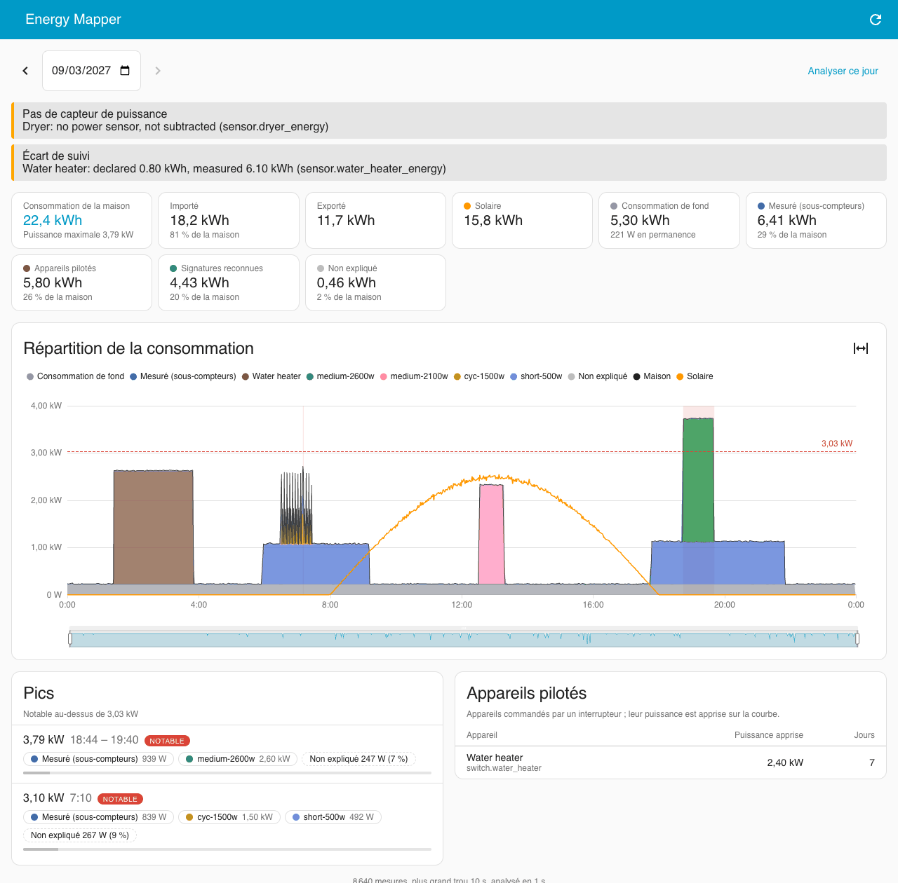

# Energy Mapper

**Find the appliances of your home in the curve of the whole-house power meter, without a
smart plug on each of them.** Energy Mapper is a Home Assistant add-on and integration for
non-intrusive load monitoring (NILM): every night it analyses the previous day, splits the
house consumption into base load, measured devices, switch-driven appliances and recurring
"signatures", and explains the peaks. Everything runs locally.

*[Version française plus bas](#français).*

> **Status: experimental.** The nightly report is complete; appliances get their own devices,
> sensors and hourly energy for the Energy dashboard, and can be renamed, re-linked, merged,
> deleted or added by hand; the signatures to review are listed in the panel, with the
> entity each one probably is (see the [roadmap](#roadmap)). Feedback from installations other than the developer's is very welcome.

<picture>
  <source media="(prefers-color-scheme: dark)" srcset="https://raw.githubusercontent.com/sylvaing/ha-energy-mapper/main/docs/images/panel-dark.png">
  
</picture>

*The sidebar panel on a made-up household (synthetic data from the developer harness).*

## Contents

- [What it does, and what it does not](#what-it-does-and-what-it-does-not)
- [Requirements](#requirements)
- [Installation](#installation)
- [Configuration](#configuration)
- [Reading the panel](#reading-the-panel)
- [Appliances in Home Assistant](#appliances-in-home-assistant)
- [Privacy](#privacy)
- [Limits](#limits)
- [Roadmap](#roadmap)
- [Contributing](#contributing)
- [Licence and credits](#licence-and-credits)
- [Français](#français)

Technical details: [design document](docs/design.md) and the
[add-on documentation](energy_mapper/DOCS.md) (also shown in the add-on's *Documentation* tab).

## What it does, and what it does not

**It does:**

- read, once a night, yesterday's history of the grid meter (and of the solar production,
  battery, sub-meters and switches) from the Home Assistant recorder;
- configure itself from the **Energy dashboard**: grid, solar, battery and individual devices
  are found there, with the power sensor (W) that goes with each energy sensor (kWh);
- rebuild the house load (grid + solar + battery), remove what is already measured
  (sub-meters), and look in the rest for **steps**: sudden changes of at least 300 W (by
  default) when an appliance switches on or off;
- measure the real power of appliances driven by a **switch** (a water heater on a relay, a
  pilot-wire radiator), including those that run when their switch is *off*;
- group the remaining steps into **activations** (one use of one appliance) and the
  activations into **signatures** (for example "about 2 kW for 3 minutes, mornings and
  evenings"), learned across days with a progressive forgetting;
- show a daily report in a sidebar panel: an energy summary, a timeline of each appliance's
  runs (or a stacked per-minute chart), the day's peaks with what was running, the switched
  loads and the signature registry, plus what is worth checking in your Energy dashboard
  setup.

**It does not:**

- **meter** anything. Every figure for a signature or a switched load is an **estimate** from
  one meter; only sub-meters are measured. Do not use it for billing;
- name appliances. A signature is `short-2000w`, not "kettle": naming signatures (which then
  become appliances like the switched ones) is the next step of v1;
- change your configuration or the Energy dashboard on its own: the add-on never calls a
  service, and the integration only adds its own devices, sensors and statistics; the one
  change it makes to the Energy dashboard, *Take over tracking* (below), waits for your
  confirmation and can be undone;
- work in real time for its figures: the analysis runs at night on the previous day. The
  *Live* tab shows the steps as they happen, to label appliances, but the appliances' power
  and on/off entities are not live yet (planned for v2).

**What it recognises well today:** appliances that draw a steady power of a few hundred watts
or more and switch cleanly: kettle, oven, toaster, water heater, electric radiators, the
heating phases of a dishwasher or washing machine; and **cycling** loads that switch on and
off every minute or so at the same power (an induction hob at medium power, an oven
thermostat), which are grouped into one session with their duty cycle.

**What it recognises badly today:**

- loads below the step threshold (300 W by default; with solar panels, the *smallest
  appliance at night* lowers it while they produce nothing): lighting, electronics, fridges
  (they end up in the base load or in "unexplained");
- loads whose power varies continuously: EV chargers that modulate, inverter heat pumps and
  air conditioners, induction hobs at high power (a measured EV charger or heat pump is best
  declared as a sub-meter; variable loads will be handled in [#16](https://github.com/sylvaing/ha-energy-mapper/issues/16));
- multi-phase appliances (dishwasher, washing machine, dryer): a first version groups their
  heating and low-power phases into **cycles** and proposes each recurring programme as one
  *multi-phase cycle* signature ("Cycle with 2 kW heating, ~1 h 30", with its phases); once
  you name it, its cycles are counted as one use, low-power phases included. Two appliances
  running at once, or a low load next to a cycle (a TV), still blur it, and one appliance can
  give several such signatures (one per programme)
  ([#26](https://github.com/sylvaing/ha-energy-mapper/issues/26));
- events shorter than two meter readings, and several appliances of similar size switching
  at the same moment (some pairings are then wrong).

## Requirements

- **Home Assistant OS or Supervised** (the add-on needs the Supervisor), on **amd64** or
  **aarch64** (Raspberry Pi 4/5 included: a day is analysed in a few seconds at most).
  Home Assistant Container and Core are not supported yet: a standalone image is planned in
  [#19](https://github.com/sylvaing/ha-energy-mapper/issues/19).
- **Home Assistant 2025.10 or later** for the integration, add-on **0.14.0 or later** to
  learn from a connected appliance, 0.11.0 to
  learn an appliance from a smart plug and for the nightly self-test, 0.9.0 for the day raster of the review (0.8.0 for the attribute suggestions and merges, 0.7.0 for the entity suggestions, 0.6.0 for the review of the signatures, 0.5.0 for the appliance
  management, 0.4.0 for the appliance statistics; developed and tested on 2026.10 and
  2026.11; the panel uses Home Assistant's own date picker when available, and a plain date
  field otherwise).
- [HACS](https://hacs.xyz) to install the integration (or a manual copy).
- A **power sensor of the grid meter** (W or kW), recorded by the recorder (do not exclude it).
  The faster it reports, the better: every 1 to 10 s is ideal (P1 port, Shelly EM/Pro EM,
  Linky TIC…); every 60 s works, but short uses are missed.
- Recommended: the **Energy dashboard** configured (grid, and solar, battery and individual
  devices if you have them). Without it, choose the grid sensor in the settings.

## Installation

### 1. The add-on

[](https://my.home-assistant.io/redirect/supervisor_add_addon_repository/?repository_url=https%3A%2F%2Fgithub.com%2Fsylvaing%2Fha-energy-mapper)

1. **Settings → Add-ons** (called *Apps* in recent versions) **→ Add-on store → ⋮ →
   Repositories**, add `https://github.com/sylvaing/ha-energy-mapper` (or use the button above).
2. Install **Energy Mapper** (the image is built on your machine, which takes a few minutes),
   then **Start** it. Nothing has to be configured if the Energy dashboard is set up.
3. On its first start, the add-on analyses the past days still held by the recorder (up to
   30, newest first; the recorder keeps 10 days by default). Its log shows each day analysed.

### 2. The integration

1. In **HACS → ⋮ → Custom repositories**, add `https://github.com/sylvaing/ha-energy-mapper`
   with the type **Integration**.
2. Download **Energy Mapper** from HACS, then **restart Home Assistant**.

Without HACS: copy `custom_components/energy_mapper` into the `custom_components` folder of
your configuration and restart.

### 3. Connect them

Once the add-on runs, Home Assistant **discovers** it: **Settings → Devices & services**
shows *Energy Mapper* under *Discovered*; select **Add** and confirm. The **Energy Mapper**
panel then appears in the sidebar.

If it is not discovered, add the integration by hand (**Add integration → Energy Mapper**).
When the add-on is installed on this Home Assistant, its address is proposed: keep it. It is
`http://<hostname>:8099`, where `<hostname>` is shown on the add-on's *Info* page (for example
`xxxxxxxx-energy-mapper`; `local-energy-mapper` for a local copy of the add-on). The port is
only reachable from Home Assistant, not from your network. For a standalone container, enter
`http://<address of the machine>:8099`.

## Configuration

### Automatic, from the Energy dashboard

With the Energy dashboard set up, there is nothing to configure. The add-on reads it live
before each analysis:

| In the Energy dashboard | Used as |
|---|---|
| Grid consumption (and return) | The grid power sensor; several grid meters (one per phase) are summed; separate import and export sensors are combined. A grid meter that never counted is ignored. |
| Solar production | The solar power sensor; several inverters are summed. |
| Home battery | The battery power sensor (check its sign: positive must mean discharging). |
| Individual device with its own power sensor | A **sub-meter**: its power is subtracted before the analysis. A device "included in" another one is never subtracted twice. |
| Individual device estimated from a `switch` or `input_boolean` (for example a [powercalc](https://github.com/bramstroker/homeassistant-powercalc) sensor with a `source_entity`) | A **switched load**: its real power is measured on the house curve each time the switch changes. powercalc is optional, only used as a hint. |
| Device without power sensor, or unavailable | Not used, and reported in *Things to check*. |

### The options of the integration

**Settings → Devices & services → Energy Mapper → Configure.** The form is pre-filled with
what the add-on uses (Energy dashboard first, then the add-on options, then the defaults).
Change only what is wrong: a field left as found keeps following the Energy dashboard, and
only the values that differ are saved. The settings are kept in Home Assistant (and in its
backups), pushed to the add-on on save and each time Home Assistant starts, and take
precedence over the add-on options. The top of the form lists the sub-meters and switched
appliances that come from the Energy dashboard, and your changes (excluded, added or changed).

| Section | Setting | Default | Notes |
|---|---|---|---|
| Sensors | Grid power, *positive when exporting* | Energy dashboard | The whole-house meter, positive when importing; tick the box if yours is the other way round. |
| | Grid export power | Energy dashboard | Only for meters that report import and export as two positive sensors. |
| | Solar power | Energy dashboard | |
| | Battery power, *positive when charging* | Energy dashboard | Positive when discharging. |
| | Sub-meters to subtract | Automatic | *Automatic*: those of the Energy dashboard; remove one from the list to ignore it (new ones of the Energy dashboard still come). *Only the sensors of the list*: your own list (adding a sensor the Energy dashboard does not list makes the list yours). *None*: subtract nothing. |
| | Sub-meters | Energy dashboard | Power sensors of measured appliances, subtracted before the analysis. |
| Switched appliances | Entity, name, on-states | Energy dashboard | Those of the Energy dashboard, plus yours: an entry here adds one or changes the one with the same entity; removing one of the Energy dashboard from the list excludes it. *On-states*: the states in which the appliance runs (`on` by default). The **polarity is detected automatically**: a pilot-wire radiator whose relay cuts the heating when `on` is found and shown as *Inverted*. Appliances (below) are the simpler way to add one. |
| | Excluded switches | empty | Switches never measured nor proposed as appliances. Removing a switched appliance of the Energy dashboard from the list above, or deleting an appliance driven by a switch, adds its switch here; remove it to measure it again. An estimate of the Energy dashboard driven by an excluded switch is subtracted like any other estimate. |
| Thresholds | Smallest appliance (step threshold) | 300 W | Smaller detects more appliances, and more noise. |
| | Smallest appliance at night | empty | Only with a solar production sensor. Smaller steps, down to this value (50 W to the step threshold, 150 W is a good start), are also kept while the solar panels produce nothing: below 20 W in the minute before and after the step. It catches small evening appliances (TV, lighting) without the false midday steps that come from the solar and grid meters drifting apart. Without a solar sensor it has no effect: lower the step threshold instead. |
| | Fixed peak threshold | empty | Empty: a peak is *notable* above 80 % of the highest power of the recent days. Set a value (for example your subscribed power) to use it instead. |
| Analysis and storage | Time of the nightly analysis | 04:30 | Applies after the next analysis. |
| | Past days analysed on start | 30 | Limited by what the recorder still holds. |
| | Signature half-life | 30 days | Age at which a past use counts half in the signature registry. Shorter forgets replaced appliances faster; longer keeps rare ones known longer. |
| | Keep full reports | 90 days | Full reports keep the per-minute curve; older days keep a summary (totals, peaks, activations). |
| | Peak reference window | 30 days | Notable peaks are relative to the highest power of these days, to follow the seasons. |
| | Self-test: measured devices per night | 1 | After the nightly analysis, this many sub-meters are hidden in a copy of the analysis to check that the curve finds them again (see *Self-test* below). 0 disables it. |
| Review of the signatures | Notify in Repairs | on | One notice in **Settings → Repairs** while signatures wait in the *To review* tab of the panel. |
| | Uses / different days before a signature is proposed | 5 / 3 | A signature is proposed once it was seen that many times on that many different days. |
| | *Wait*: propose again after | 14 days | A signature put on hold comes back after these days, or once its uses reached… |
| | *Wait*: or after this many times more uses | 2 | …twice the number it had (6 uses: back at 12). |
| | Entity suggestions: minimum match | 80 % | An entity is suggested for a signature when its state changes at this share of the signature's starts and stops (at least 5 of them, on 3 different days). |

The same settings exist as **add-on options** (*Configuration* tab of the add-on), useful
without the integration. See the [add-on documentation](energy_mapper/DOCS.md#configuration).

## Reading the panel

The panel follows your Home Assistant theme (light and dark), language (English and French)
and number and time formats, and adapts to narrow screens (mobile app). Four tabs split it:
**Today** (the selected day, for the whole household), **Appliances** (one card per
appliance, and every signature), for administrators **To review** with the number of signatures waiting
for a name (*Today* shows a banner while some wait), and **Live** (what the house does right
now, below). The tab and the day are kept in the address, so a view can be bookmarked.

- **Day picker**: Home Assistant's date picker, with presets *Yesterday*, *Day before
  yesterday*, *Highest use (30 days)* and *Last notable peak*. Administrators can **analyse a
  day** again (after changing the settings, for example).
- **To review** (administrators): the recurring signatures seen often enough to be an
  appliance (5 uses on 3 different days by default), **one at a time**. A progress card at the
  top counts the named, to review, waiting and ignored signatures and shows how much of their
  energy is already explained; chips filter the queue: *Most energy first*, *With a
  suggestion*, *Waiting*, *Ignored*. On the left, the queue (name, uses per week, energy):
  tick several to **Wait**, **Ignore** or **Restore** them at once. On the right, the current
  signature: power, usual duration, runs per week, energy, first seen, a **day raster** of its
  uses over the last 60 days (one row per day, the most recent on top, 0 to 24 h; each use a
  block as wide as it lasted, darker when more powerful; weekends tinted; a thin strip of the
  usual hours above): it shows whether it runs at the same time every day, on weekdays only, or
  at a drifting time. Select a use (or press Enter on it) to open its day zoomed on it. Then up
  to three recent **examples drawn on the house curve**, which open their day the same way. Below, the form: a name and *How to track it*, then **Validate and
  next**, **Wait** or **Ignore**; keyboard shortcuts **V**, **W** (wait), **I** and the arrows.
  On a phone the queue becomes a "1 of 34" stepper. What the choices do:
  - **Curve only**: a **new appliance** (give it a name: Energy Mapper creates
    the appliance, its sensors and hourly energy statistics from the signature); an appliance
    **driven by a switch** without power measurement (relay-driven water heater, pilot-wire
    radiator: its state becomes the ground truth and Energy Mapper measures its power); or an
    appliance **with a power sensor** (a smart plug: it becomes a sub-meter, subtracted before
    the analysis, so its steps no longer appear). The switch or sensor is picked with Home
    Assistant's entity picker;
  - **Probably: Attic fan (92 %)**: the entity whose state changes when the signature starts
    and stops, found by Energy Mapper (see below). **Use** fills the form with it (linked as
    the switch, named after it); the other suggested entities are one click away, and any other
    entity can still be chosen. A thermostat found by its *heating* periods is shown as
    **Living room (heating)**: it names a new appliance, it is not linked as a switch;
  - **Probably part of Radiator: …** and **Merge**: the entity found already
    belongs to an appliance (it is one of its switches or sensors, or in the same device), so
    the signature is probably a part of it, such as a radiator cycling on its own thermostat
    while its pilot-wire relay allows heating. Merging adds the signature to the appliance:
    its energy is added to the appliance's, past days included. *How to track it* also
    offers **Merge into an appliance** for any appliance;
  - **Wait**: hide it until there is clearly more data (twice as many uses, or 14 days later);
  - **Ignore**: never propose it again. The *Ignored* filter brings one back (*Restore*).
    A signature whose appliance you deleted is listed there too.

  Decisions are kept by the add-on (in Home Assistant backups). A single notice in
  **Settings → Repairs** says how many signatures wait for a review and links to this
  section; it disappears when nothing is left, and can be turned off in the options.

  **Entity suggestions.** Every night, for each signature to review, the add-on compares its
  starts and stops of the last 30 days with the state changes of your entities that may tell
  when an appliance runs: lights, switches, input booleans, fans, climate, humidifier and water
  heater entities (their mode), media players, binary sensors, and sensors reporting an
  operation state (`enum` device class, such as a washing machine's programme state), plus
  what thermostats and humidifiers are doing (their `hvac_action` and `action` attributes:
  *heating*, *idle*…). An entity is
  suggested when its state changes within a minute or two (twice the meter's reporting
  interval) of at least 80 % of the starts and stops, at least 5 times on 3 different days,
  and when at least 30 % of its own changes happen at those times (an entity that changes all
  the time is never suggested). The states it is in while the appliance runs are learned too:
  a pilot-wire relay that is *off* while its radiator heats, or a washing machine reporting
  *running*, is linked with the right states. An entity that stays in a state for long
  periods while the appliance runs inside them (a thermostat *heating* for an hour while its
  radiator switches on and off) is suggested when at least 80 % of the signature's running
  time falls in that state, on enough separate uses that chance cannot explain it, and when
  the appliance runs in at least 30 % of those periods (an entity that is on most of the time
  is never suggested). Entities already linked to an appliance are compared too: they lead to
  a merge. The first suggestions appear after the first nightly
  analysis following the update (the past days are then read once from the recorder).
  Entities the recorder does not keep cannot be compared: the section says which kinds of
  entities are not recorded at all. Lights and small devices below the step threshold
  (300 W) never match: suggestions mostly help with large loads (heaters, fans, connected
  appliances, audio and video equipment).
- **Summary**: house consumption in large type, the day's highest power and its time, grid
  import and solar (with what was exported), then a **split bar** of the house consumption,
  with the energy and share of each part: **base load** (the always-on power, a low
  percentile of the day), **measured by plugs and sensors**, **estimated** (devices whose
  power is only an estimate, e.g. lights estimated by an estimation integration), **named
  appliances** (switched loads and named signatures), **still to name** (signatures without
  a name yet) and **unexplained**. Select a part to highlight it in the timeline.
- **The day, appliance by appliance**: a timeline with one row per appliance of the day
  (switched loads, plugs and sensors, signatures), its running periods as blocks on a
  0–24 h axis and its kWh, under a thin strip of the house power. Appliances still to name
  are dashed, with their provisional name in italics; cycling appliances are striped. The
  notable peaks are shaded on the strip and listed as chips: select one to zoom on it,
  *Whole day* to come back. Select a row to highlight that appliance. *Stacked curve*
  switches to the same split per minute, stacked, with the house and solar lines, the
  notable threshold (dashed) and the peaks shaded; zoom with the slider or the mouse wheel.
  Each appliance keeps its colour from one day to the next.
- **What used energy**: one row per appliance of the day, by energy, with its colour, a
  short detail (runs and time span, *in cycles*, time on for switched loads) and kWh; base
  load, plugs and sensors, estimated and unexplained are rows too. Appliances still to name
  are in italics with a dashed dot. Select a row to highlight that appliance in the timeline;
  administrators can open an unnamed one in *To review*.
- **Peaks**: the day's top episodes (up to 5) with what was running at the maximum and the
  unexplained power. A peak is **notable** when it reaches the notable threshold (80 % of the
  highest power of the last 30 days, or your fixed threshold). Select a peak to zoom on it.
- **N things to check** (collapsed): what the analysis found in your setup, such as a device
  without a power sensor, an unavailable sensor, a battery whose sign should be checked, or a
  **tracking gap** (a switch-driven device whose declared energy is far from what was
  measured, typically an estimate configured at a few watts for a 2 kW water heater).
- **Appliances** (tab): one card per appliance with how it is tracked (*Recognised in the
  curve*, *Switch*, *Power sensor*, or *Merged* sources; estimated or measured), its energy
  and runs on the selected day (the same figures as *Today*), the last day it ran and its
  daily energy over the last 7 days as small bars, from the appliance's energy statistics.
  *7 days* and *30 days* sum those statistics instead. Select a card to see that appliance
  highlighted on *Today*; administrators have a *Settings* link to the integration page, where
  an appliance is renamed, linked or merged. Below, collapsed under **All signatures**, the
  signature registry and the switched loads (the power learned from the curve, the number of
  days seen, and *Inverted* when the appliance runs while its switch is off).
- **Signatures** (under *All signatures*): the appliances recognised across days, most frequent first: steady or
  cycling (with on-time and period), typical power and duration, uses per week, last seen, the
  usual hours of the day, and *Seen this day*. A signature you have not named yet shows a
  provisional name built from what it is, such as *2.6 kW appliance, ~50 min, in the
  evening* or *900 W appliance in cycles, at night*, everywhere in the panel. Its id
  (`short-2000w`, `medium-…`, `long-…`, `cyc-1500w`), shown below it, gives the duration band
  (under 10 min, 10 to 60 min, over 1 h, cycling) and the power when it was first seen; it
  stays the same from one night to the next.

- **Live** (tab, [#17](https://github.com/sylvaing/ha-energy-mapper/issues/17)): what the
  house does right now, to name appliances by switching them on. It runs **only while the tab
  is open** (a pulsing dot on the tab while it streams). From top to bottom:
  - **the curve of the last 15 minutes**: the house power, the part not identified in grey, and
    a marker on each switch-on: **?** to label, **✓** known. Select a marker to label it;
  - **Now**: the current power in large type, the appliances probably running (recognised
    ones, *Looks like…* for an unnamed signature, *Unknown, +850 W*), the plugs and sensors
    drawing power, the switches that are on, the rest (*Background and not identified*) and a
    split bar;
  - **What just happened**: one line per switch-on, newest first; its stop completes the line
    (*ran for 2 min 10 s*); alternating steps of the same size are one line (*switches on and
    off, 8 times in 6 min*). A line says *new*, *seen before* (an unnamed signature),
    *known* or *labelled by you*, is greyed while provisional (a spike disappears), and says
    when the solar output moved at the same time (never suggested automatically). *To label*
    filters the lines still to name. For administrators: **It's…** opens the labelling under
    the line (a zoom of the step, the 3 best candidates with why, such as *Seen 23 times,
    without a name · same power · usually at this time*, and a score; a name, with frequent
    names for that power; how to track it: curve, switch or power sensor; and a sentence
    saying what saving will do). Naming a step that matches an unnamed signature is the
    review's *Validate*; a known appliance gets an example. **Ignore** only hides the line;
    the **⋯** menu's *Never propose this again* is the review's *Ignore*;
  - **I'm switching an appliance on** (administrators): type its name, click *I'm switching
    it on*, switch it on within 2 minutes; Energy Mapper shows the step it saw (*Detected:
    +850 W at 14:32:05, is it?*), waits for you to switch it off (or *Finish without the
    stop*) and saves it. Two steps at once are both offered; a change too small for the curve
    says so and suggests a measuring plug instead (*Learn from a plug*);
  - **Good to know**: the limits below.

  Limits of the live view: a step is provisional after about 3 meter readings (5–10 s) and
  confirmed after 20–40 s; appliances under the step threshold (300 W) make no step; two
  appliances switched on in the same second make one step; a washing machine or dishwasher
  shows by its first phase only (label it: the night rebuilds the whole cycle).

  

Days older than the report retention keep their totals, peaks and signatures, without the
curve.


## Appliances in Home Assistant

Each **appliance** is an entry of its own on the integration page (**Settings → Devices &
services → Energy Mapper**, under *Appliances*), with a device under the *Energy Mapper*
service device. Appliances are created automatically for the **switched loads** (once their
power has been learned) and, from the *To review* tab of the panel, for the **signatures
you validate**. From the integration page you can:

- **add** one by hand (*Add appliance*): driven by a switch (a relay, a pilot wire), or not
  seen yet, described by its power and a typical use ("Kettle, 2000 W, short"): its first use
  is recognised by that power;
- **rename** it (its menu → *Reconfigure* → *Rename*): the device, its entities and its energy
  statistic take the new name; entity ids and statistic ids do not change;
- **change its link**: to another switch (and on-states), or to a **power sensor** that
  measures it (a smart plug): it then becomes a sub-meter, subtracted before the analysis,
  and its sensors here stop (use the plug's own energy in the Energy dashboard); a signature
  linked to a switch becomes a switched load. The energy recorded so far is kept;
- **merge** another appliance into it, when two of them are the same appliance (two
  signatures of one machine, or a signature that is in fact a switched load): their energy is
  added from then on, the other one's past hours are added to this one's statistic, and the
  other one is deleted;
- **delete** it: its device, entities and statistic are removed. A signature loses its name
  and is no longer proposed; a switch is excluded (see the options) so it does not come back.

The appliances are kept in Home Assistant (and its backups) and sent to the add-on after each
change; a reinstalled integration takes back those the add-on holds.

**Learn from a plug** ([#14](https://github.com/sylvaing/ha-energy-mapper/issues/14)): a
smart plug (or any power sensor) put on an appliance for a few days can teach it its
signature, so that it keeps being tracked from the whole-house curve once the plug goes
elsewhere. On the appliance's card of the panel's *Appliances* tab (administrators), *Learn
from a plug*, pick the sensor that measures only this appliance and confirm. While it learns,
Energy Mapper does not subtract that sensor (the appliance stays in the curve, as it will
without the plug) and keeps, for each analysed day, when the plug says the appliance really
ran. The card shows the days and uses seen, the signature learned (steady, in cycles, or the
phases of a dishwasher-like cycle), and how well the curve finds it: the uses found (recall)
and the share of right detections (precision). *Finish* (after a confirmation) links the
learned signature to the appliance and removes the plug from its sources: unplug it, the
appliance is now tracked from the curve. *Stop learning* drops what was learned. An appliance
below the step threshold (300 W by default) cannot be learned this way.

**Learn from a connected appliance** ([#79](https://github.com/sylvaing/ha-energy-mapper/issues/79)):
many washing machines, dryers and dishwashers report in Home Assistant an **operation state**
(`run` / `stop` / `pause`), often their **phase** (drying, cooling, rinsing…), a cumulative
**energy counter** (often coarse: 0.1 kWh every 15 minutes) and the running **programme**, but
no useful power sensor (some stay at 0 W while the appliance runs). *Learn from a connected
appliance* (top of the *Appliances* tab, administrators; *Learn from its state* on the card of an
appliance already tracked by such a state) lists the devices that have an operation state,
proposes its entities (operation state and the states in which it runs, phase state, energy
counter, programme), says which ones the recorder does not keep, and starts learning once you
confirm (a new appliance can also be tracked by its state at once). Each run is then
measured on the whole-house curve (what the house draws above its usual level around the run,
so a slow start or a cycle of very different phases is measured as it is), its phases named
with their power, and its energy checked against the counter once it has counted at least 1 kWh.
The card shows the energy of a use, the phases, the programmes seen and how well the curve
finds the appliance; *Finish* adds the learned signature (one per programme when the programme
is recorded) and keeps the state as a source. Without a counter or a programme, the state
alone is enough.

**Appliances tracked by an operation state** (a `sensor` such as `run` / `stop`): since add-on
0.14.0 each run is measured over the whole run instead of from a power step at the start and
the end, so an appliance that starts slowly (a heat-pump dryer) or whose power changes during
the cycle (a dishwasher) gets its energy. Relays (`switch`, `input_boolean`…) are measured from
their steps as before. A power sensor that stays flat while its device's energy counter
increases is no longer subtracted: a *Power sensor stuck* finding suggests learning the
appliance from its state.

**Labelled examples** ([#17](https://github.com/sylvaing/ha-energy-mapper/issues/17), from the
*Live* tab): when you say which appliance a step was ("this is the toaster"), the use
(start, stop, power) is kept as a **labelled example** of that appliance, at most 20 per
appliance, in its settings in Home Assistant (so in every backup). Naming a step that matches an
unnamed signature is the review's *Validate*; a new appliance whose start and stop are known is
recognised from its first night (its signature is created at once), one labelled before its stop
when the stop comes or at night. Each night the add-on finds the examples again in the analysed
day, links the appliance to the signature they were found as when it has none yet, and the card
shows how many of your labelled uses the curve finds.

**Self-test** ([#15](https://github.com/sylvaing/ha-energy-mapper/issues/15)): how well does
the curve find an appliance it cannot see? Each night, after the analysis, the add-on takes one
of your sub-meters (a device measured by its own power sensor), analyses the day once more
**with that device hidden** in the curve, as if it had no sensor, and checks against its sensor
whether its uses were found. The devices take turns, one per night by default (the setting
*Self-test: measured devices per night*; 0 switches it off); the real report, the signatures
and the statistics never change. The *Appliances* tab shows a *Self-test* card to every user:
for each device, "found again 83 % of the time" over the last 60 days, the number of tests,
the uses found, the precision (share of right detections), the energy found, and the trend
(improving, stable, getting worse). A device with fewer than 5 uses tested shows "not enough
data yet", and one below the step threshold "too low for the whole-house curve".

| Sensor | Value |
|---|---|
| *Appliance* Energy yesterday | kWh of the last analysed day (attribute `day`) |
| *Appliance* Uses yesterday | Number of uses that day (on-periods of a switched load) |
| *Appliance* Last seen | When it last used energy |
| *Appliance* Typical power | The learned power (diagnostic) |
| Energy Mapper Unexplained energy yesterday | What no appliance explains, kWh |
| Energy Mapper Base load | The always-on power of the last analysed day |
| Energy Mapper Last analysis | When the add-on last analysed a day |

**Energy dashboard:** the analysis runs at night, so an energy sensor would put the whole day
into the hour of the analysis. Instead, the hourly energy of each appliance is written into
Home Assistant's long-term statistics with the right hours (like the delayed data of utility
integrations), as `energy_mapper:load_switch_water_heater_energy` for example. In **Settings →
Dashboards → Energy → Individual devices → Add device**, pick the statistic named after the
appliance. A day's hours appear the morning after, once the night's analysis is done. When an appliance appears, all the stored days (up to `report_retention_days`) are
imported at once; a day analysed again replaces its hours without double counting.

Do not add an appliance that is already tracked in the Energy dashboard by another sensor
(for example a powercalc estimate of the same switch): it would be counted twice. Use
**Take over tracking** instead ([#13](https://github.com/sylvaing/ha-energy-mapper/issues/13)):
on the appliance's card of the panel's *Appliances* tab (administrators), the line *Energy
dashboard* names the individual device that is probably this appliance (an estimate driven
by its switch, or a sensor of the switch's own device), or lets you pick one. After you
confirm, that device is replaced by the appliance's statistic, at the same place, in one
change: never both. The Energy dashboard then shows Energy Mapper's figures for the past
days the statistic covers too. *Undo* puts the former device back. If you delete the
appliance later, a Repairs issue offers to put the former device back. Live power and
on/off states come with real-time detection
([#17](https://github.com/sylvaing/ha-energy-mapper/issues/17)).

## Privacy

- **Everything stays local.** No cloud service, no account, no telemetry: the add-on only
  talks to Home Assistant through the Supervisor, and the integration only to the add-on.
- The add-on only **reads** Home Assistant (states, entity registry, Energy dashboard settings
  and recorder history); it never calls a service. The integration writes only its own
  devices, sensors and statistics.
- The live view (the *Live* tab, #17) follows the state changes of the meters and
  switched loads the analysis already reads, **only while the tab is open**, keeps 15 minutes
  in memory and stores nothing; it stops 2 minutes after the tab is closed. The add-on option
  `live_view: false` turns it off entirely. The uses you label there are kept with the
  appliance in Home Assistant (20 at most per appliance).
- Its data (daily reports, day summaries, the signature registry, the settings) lives in the
  add-on's `/data` folder, is **included in Home Assistant backups**, and stays bounded (a few
  MB) whatever the age of the installation.
- The panel and its websocket commands need a logged-in Home Assistant user; analysing a day
  and reviewing signatures require an administrator.

## Limits

- An **estimation**, not a measurement: errors of a few percent to tens of percent on a
  signature are normal, more during heavy simultaneous use (cooking).
- The **step threshold** sets the smallest visible appliance (300 W by default). With solar
  panels, the *smallest appliance at night* lowers it only while they produce nothing.
- The **meter rate** sets the shortest visible use: an appliance must last at least two meter
  readings.
- The analysis needs the **full day of history** of the grid power sensor in the recorder: do
  not exclude it, and keep at least a couple of days (`purge_keep_days`). A day whose history
  starts after midnight is not analysed.
- A use that starts or ends while another appliance of a similar power switches can be
  paired wrongly; uses longer than 6 hours are not paired.
- Signature ids are names, not appliances: one appliance can produce several signatures (each
  phase of a programme) and two appliances of the same power can share one.
- Three-phase installations are analysed on the sum of the phases (per-phase analysis:
  [#18](https://github.com/sylvaing/ha-energy-mapper/issues/18)).
- The texts of *Things to check* are in English with an add-on older than 0.11.0.
- Entity suggestions compare the **state** of the entities and two attributes only
  (`hvac_action` of thermostats, `action` of humidifiers). A suggestion found by its long
  periods (containment) or by an attribute names an appliance or leads to a merge; it is not
  used as a switch that measures the appliance. An entity that follows the same daily schedule
  as an appliance without driving it (a daytime sensor and a pool pump) may be suggested:
  ignore it.

## Roadmap

See the [milestones](https://github.com/sylvaing/ha-energy-mapper/milestones):

- [**v0 – Nightly report**](https://github.com/sylvaing/ha-energy-mapper/milestone/1): done.
  Read-only nightly analysis, sidebar panel.
- [**v1 – Validate & track**](https://github.com/sylvaing/ha-energy-mapper/milestone/2): review
  signatures in the panel (name one, or link it to an existing switch or power sensor), with
  the entity each one probably is, one entry per appliance and per-appliance entities and
  hourly energy statistics, "take
  over tracking" in the Energy dashboard, learning from measured devices, a nightly self-test with a success rate (done), variable loads, and
  a benchmark on public NILM datasets ([#28](https://github.com/sylvaing/ha-energy-mapper/issues/28)).
- [**v2 – Live**](https://github.com/sylvaing/ha-energy-mapper/milestone/3): a *Live* tab to
  see steps as they happen and label appliances by hand
  ([#17](https://github.com/sylvaing/ha-energy-mapper/issues/17), done; live entities for
  automations come next), per-phase analysis, recognition of multi-phase appliance cycles.
- [**v3 – Publish**](https://github.com/sylvaing/ha-energy-mapper/milestone/4): release
  process, default HACS and add-on store listing, standalone Docker image for Container/Core.

## Contributing

Issues and pull requests are welcome. Please open an issue first for anything large. The
repository contains **no real consumption data**: tests and the panel's development harness
use synthetic households only; real recorder extracts stay outside the repository (see
`tools/replay_csv.py`).

Layout: `energy_mapper/` is the add-on (with the engine library `app/nilm_core/`, standard
library only), `custom_components/energy_mapper/` the integration, `frontend/` the panel
(TypeScript, Lit, ECharts), `tests/` the engine and add-on tests, `tests_integration/` the
integration tests.

```sh
# engine and add-on: standard library only (Python 3.12+)
python3 -m unittest discover -s tests
ruff check . && ruff format --check .

# integration: Home Assistant test environment (Python 3.14)
pip install -r requirements_test.txt && python -m pytest

# panel (Node 24)
cd frontend && npm ci
npm run typecheck && npm test && npm run build   # or: npm run dev (rebuild on change)
python3 dev/make_sample.py                         # regenerate the synthetic sample data
cd .. && python3 -m http.server 8765               # then open http://localhost:8765/frontend/dev/index.html
```

The panel bundle `custom_components/energy_mapper/frontend/energy-mapper-panel.js` is
committed; CI checks that it matches the sources. The dev page mounts the panel with a fake
`hass` (theme, language, number and time formats, add-on states) answering from
`frontend/dev/sample/`; Home Assistant's own elements are not available there, so the panel
shows its fallbacks (a native date field instead of HA's date picker).

The add-on service also runs outside Home Assistant, against any instance, for development:

```sh
cd energy_mapper/app
HA_URL=http://homeassistant.local:8123 HA_TOKEN=<long-lived token> \
  DATA_DIR=/tmp/energy_mapper PORT=8099 python3 main.py
```

Workflow: one branch and one pull request per issue (`Closes #N` in the description). CI runs
ruff, the engine tests (Python 3.12 and 3.13), the integration tests, hassfest and HACS
validation, the add-on linter and test builds (amd64, aarch64), and the panel type check, tests
and build; it must be green before merging. Code, comments and commits are in English.

## Licence and credits

[MIT](LICENSE).

- The step pairing by closest size and the idea of cycling sessions were informed by
  [Home NILM](https://github.com/amstrad83/ha-home-nilm) (MIT).
- [NILMTK](https://github.com/nilmtk/nilmtk) is the reference toolkit for evaluating NILM
  algorithms on public datasets; Energy Mapper's benchmark will use its metrics
  ([#28](https://github.com/sylvaing/ha-energy-mapper/issues/28)).
- The panel uses [Lit](https://lit.dev) and [Apache ECharts](https://echarts.apache.org), the
  libraries of the Home Assistant frontend.

---

## Français

**Retrouvez les appareils de la maison dans la courbe du compteur général, sans prise
connectée sur chacun d'eux.** Energy Mapper est un add-on et une intégration Home Assistant
de désagrégation de la consommation (NILM, *non-intrusive load monitoring*) : chaque nuit, il
analyse la veille, répartit la consommation de la maison entre consommation de fond,
appareils mesurés, appareils pilotés par un interrupteur et « signatures » récurrentes, et
explique les pics. Tout reste en local.

> **État : expérimental.** Le rapport de nuit est complet ; les appareils ont leurs appareils
> Home Assistant, capteurs et énergie heure par heure pour le tableau Énergie, et peuvent être
> renommés, reliés autrement, fusionnés, supprimés ou ajoutés à la main ; les signatures à
> examiner sont listées dans le panneau, avec l'entité qu'elles sont probablement (voir la
> [feuille de route](#feuille-de-route)). Les retours d'autres installations que celle du
> développeur sont très bienvenus.



*Le panneau sur un foyer imaginaire (données synthétiques du banc de développement).*

Détails techniques (en anglais) : [document de conception](docs/design.md) et
[documentation de l'add-on](energy_mapper/DOCS.md) (aussi dans l'onglet *Documentation* de
l'add-on).

### Ce qu'il fait, et ce qu'il ne fait pas

**Il :**

- lit, une fois par nuit, l'historique de la veille du compteur réseau (et de la production
  solaire, de la batterie, des sous-compteurs et des interrupteurs) dans l'enregistreur
  (*recorder*) de Home Assistant ;
- se configure à partir du **tableau Énergie** : réseau, solaire, batterie et appareils
  individuels y sont trouvés, avec le capteur de puissance (W) qui va avec chaque capteur
  d'énergie (kWh) ;
- reconstitue la consommation de la maison (réseau + solaire + batterie), retire ce qui est
  déjà mesuré (sous-compteurs) et cherche dans le reste des **marches** : des variations
  brusques d'au moins 300 W (par défaut) quand un appareil s'allume ou s'éteint ;
- mesure la puissance réelle des appareils **pilotés par un interrupteur** (chauffe-eau sur
  relais, radiateur sur fil pilote), y compris ceux qui chauffent quand l'interrupteur est
  sur *off* ;
- regroupe les marches restantes en **utilisations** (une marche d'un appareil), et les
  utilisations en **signatures** (par exemple « environ 2 kW pendant 3 minutes, matin et
  soir »), apprises au fil des jours avec un oubli progressif ;
- affiche un rapport quotidien dans un panneau de la barre latérale : bilan énergétique,
  frise des marches de chaque appareil (ou courbe empilée minute par minute), pics de la journée avec ce qui tournait, appareils
  pilotés et registre des signatures, plus ce qui mérite d'être vérifié dans votre
  configuration Énergie.

**Il ne :**

- **mesure** rien : chaque chiffre d'une signature ou d'un appareil piloté est une
  **estimation** à partir d'un seul compteur ; seuls les sous-compteurs sont mesurés. Ne
  l'utilisez pas pour facturer ;
- nomme pas les appareils : une signature s'appelle `short-2000w`, pas « bouilloire ».
  Nommer les signatures (qui deviennent alors des appareils comme les appareils pilotés),
  c'est la prochaine étape de la v1 ;
- modifie pas de lui-même votre configuration ni le tableau Énergie : l'add-on n'appelle
  jamais de service, et l'intégration n'ajoute que ses propres appareils, capteurs et
  statistiques ; le seul changement qu'elle fait au tableau Énergie, *Prendre en charge le
  suivi* (plus bas), attend votre confirmation et peut être annulé ;
- fonctionne pas en temps réel pour ses chiffres : l'analyse tourne la nuit sur la veille.
  L'onglet *En direct* montre les marches au moment où elles arrivent, pour étiqueter les
  appareils, mais les entités de puissance et de marche des appareils ne sont pas encore en
  direct (prévu en v2).

**Ce qu'il reconnaît bien aujourd'hui :** les appareils qui consomment une puissance stable
de quelques centaines de watts ou plus et s'allument franchement : bouilloire, four,
grille-pain, chauffe-eau, radiateurs électriques, les phases de chauffe du lave-vaisselle ou
du lave-linge ; et les appareils **cycliques** qui s'allument et s'éteignent toutes les minutes
environ à la même puissance (plaque à induction à puissance moyenne, thermostat du four),
regroupés en une seule session avec leur rapport cyclique.

**Ce qu'il reconnaît mal aujourd'hui :**

- les appareils sous le seuil de marche (300 W par défaut ; avec des panneaux solaires, le
  *plus petit appareil la nuit* l'abaisse quand ils ne produisent rien) : éclairage,
  électronique, réfrigérateurs (ils finissent dans la consommation de fond ou dans « non
  expliqué ») ;
- les appareils dont la puissance varie en continu : borne de recharge qui module, pompe à
  chaleur et climatisation *inverter*, plaque à induction à pleine puissance (une borne ou
  une pompe à chaleur mesurée se déclare de préférence en sous-compteur ; les charges
  variables seront traitées dans [#16](https://github.com/sylvaing/ha-energy-mapper/issues/16)) ;
- les appareils à plusieurs phases (lave-vaisselle, lave-linge, sèche-linge) : une première
  version regroupe leurs phases de chauffe et de faible puissance en **cycles** et propose
  chaque programme récurrent comme une seule signature *cycle à plusieurs phases* (« Cycle
  avec chauffe de 2 kW, ~1 h 30 », avec ses phases) ; une fois nommée, ses cycles comptent
  pour une seule utilisation, phases de faible puissance comprises. Deux appareils en même
  temps, ou une petite charge à côté d'un cycle (une télévision), le brouillent encore, et un
  appareil peut donner plusieurs signatures de ce type (une par programme)
  ([#26](https://github.com/sylvaing/ha-energy-mapper/issues/26)) ;
- les événements plus courts que deux mesures du compteur, et plusieurs appareils de
  puissance voisine qui basculent au même moment (certaines associations sont alors fausses).

### Prérequis

- **Home Assistant OS ou Supervised** (l'add-on a besoin du Supervisor), sur **amd64** ou
  **aarch64** (Raspberry Pi 4/5 compris : une journée s'analyse en quelques secondes au plus).
  Home Assistant Container et Core ne sont pas encore pris en charge : une image autonome est
  prévue dans [#19](https://github.com/sylvaing/ha-energy-mapper/issues/19).
- **Home Assistant 2025.10 ou plus récent** pour l'intégration, add-on **0.14.0 ou plus
  récent** pour apprendre d'un appareil connecté, 0.11.0 pour apprendre un appareil d'une
  prise connectée et pour l'auto-test de nuit, 0.9.0 pour la grille jour par
  jour de l'examen (0.8.0 pour les suggestions d'attribut et
  les fusions, 0.7.0 pour les suggestions
  d'entité, 0.6.0 pour l'examen des signatures, 0.5.0 pour la
  gestion des appareils, 0.4.0 pour leurs statistiques ; développée et testée sur
  2026.10 et 2026.11 ; le panneau utilise le sélecteur de date de Home Assistant quand il est
  disponible, un simple champ de date sinon).
- [HACS](https://hacs.xyz) pour installer l'intégration (ou une copie manuelle).
- Un **capteur de puissance du compteur réseau** (W ou kW), enregistré par le *recorder* (ne
  l'excluez pas). Plus il est rapide, mieux c'est : toutes les 1 à 10 s c'est l'idéal (port
  P1, Shelly EM/Pro EM, TIC du Linky…) ; toutes les 60 s ça marche, mais les utilisations
  courtes sont manquées.
- Recommandé : le **tableau Énergie** configuré (réseau, et solaire, batterie et appareils
  individuels si vous en avez). Sans lui, choisissez le capteur réseau dans les réglages.

### Installation

#### 1. L'add-on

[](https://my.home-assistant.io/redirect/supervisor_add_addon_repository/?repository_url=https%3A%2F%2Fgithub.com%2Fsylvaing%2Fha-energy-mapper)

1. **Paramètres → Modules complémentaires** (*Applications* dans les versions récentes)
   **→ Boutique → ⋮ → Dépôts**, ajoutez `https://github.com/sylvaing/ha-energy-mapper` (ou
   utilisez le bouton ci-dessus).
2. Installez **Energy Mapper** (l'image est construite sur votre machine, ce qui prend quelques
   minutes), puis **démarrez-le**. Rien à configurer si le tableau Énergie est en place.
3. À son premier démarrage, l'add-on analyse les jours passés encore présents dans le
   *recorder* (jusqu'à 30, du plus récent au plus ancien ; le *recorder* garde 10 jours par
   défaut). Son journal affiche chaque jour analysé.

#### 2. L'intégration

1. Dans **HACS → ⋮ → Dépôts personnalisés**, ajoutez
   `https://github.com/sylvaing/ha-energy-mapper` avec le type **Intégration**.
2. Téléchargez **Energy Mapper** depuis HACS, puis **redémarrez Home Assistant**.

Sans HACS : copiez `custom_components/energy_mapper` dans le dossier `custom_components` de
votre configuration, puis redémarrez.

#### 3. Les relier

Une fois l'add-on démarré, Home Assistant le **découvre** : **Paramètres → Appareils et
services** affiche *Energy Mapper* dans *Découverts* ; choisissez **Ajouter** et confirmez.
Le panneau **Energy Mapper** apparaît alors dans la barre latérale.

S'il n'est pas découvert, ajoutez l'intégration à la main (**Ajouter une intégration →
Energy Mapper**). Quand l'add-on est installé sur ce Home Assistant, son adresse est proposée :
gardez-la. C'est `http://<nom d'hôte>:8099`, où le nom d'hôte figure sur la page *Infos* de
l'add-on (par exemple `xxxxxxxx-energy-mapper` ; `local-energy-mapper` pour une copie locale de
l'add-on). Le port n'est accessible que depuis Home Assistant, pas depuis votre réseau. Pour un
conteneur autonome, saisissez `http://<adresse de la machine>:8099`.

### Configuration

#### Automatique, depuis le tableau Énergie

Avec le tableau Énergie en place, il n'y a rien à configurer. L'add-on le relit avant chaque
analyse :

| Dans le tableau Énergie | Utilisé comme |
|---|---|
| Consommation du réseau (et retour) | Le capteur de puissance réseau ; plusieurs compteurs (un par phase) sont additionnés ; des capteurs séparés d'achat et de revente sont combinés. Un compteur qui n'a jamais compté est ignoré. |
| Production solaire | Le capteur de puissance solaire ; plusieurs onduleurs sont additionnés. |
| Batterie domestique | Le capteur de puissance de la batterie (vérifiez son signe : positif doit vouloir dire décharge). |
| Appareil individuel avec son propre capteur de puissance | Un **sous-compteur** : sa puissance est retirée avant l'analyse. Un appareil « inclus dans » un autre n'est jamais retiré deux fois. |
| Appareil individuel estimé à partir d'un `switch` ou d'un `input_boolean` (par exemple un capteur [powercalc](https://github.com/bramstroker/homeassistant-powercalc) avec une `source_entity`) | Un **appareil piloté** : sa puissance réelle est mesurée sur la courbe de la maison à chaque changement de l'interrupteur. powercalc est facultatif, utilisé seulement comme indice. |
| Appareil sans capteur de puissance, ou indisponible | Non utilisé, et signalé dans *À vérifier*. |

#### Les options de l'intégration

**Paramètres → Appareils et services → Energy Mapper → Configurer.** Le formulaire est
pré-rempli avec ce que l'add-on utilise (le tableau Énergie d'abord, puis les options de
l'add-on, puis les valeurs par défaut). Ne changez que ce qui est faux : un champ laissé tel
quel continue de suivre le tableau Énergie, et seules les valeurs différentes sont
enregistrées. Les réglages sont gardés dans Home Assistant (et dans ses sauvegardes), envoyés
à l'add-on à l'enregistrement et à chaque démarrage de Home Assistant, et passent avant les
options de l'add-on. Le haut du formulaire liste les sous-compteurs et appareils pilotés qui
viennent du tableau Énergie, et vos changements (exclus, ajoutés ou modifiés).

| Section | Réglage | Par défaut | Remarques |
|---|---|---|---|
| Capteurs | Puissance réseau, *positif en revente* | Tableau Énergie | Le compteur général, positif à l'achat ; cochez la case si le vôtre est inversé. |
| | Puissance de revente | Tableau Énergie | Seulement pour les compteurs qui donnent achat et revente en deux capteurs positifs. |
| | Puissance solaire | Tableau Énergie | |
| | Puissance batterie, *positif en charge* | Tableau Énergie | Positif en décharge. |
| | Sous-compteurs à retirer | Automatique | *Automatique* : ceux du tableau Énergie ; retirez-en un de la liste pour l'ignorer (les nouveaux du tableau Énergie arrivent quand même). *Seulement les capteurs de la liste* : votre propre liste (ajouter un capteur que le tableau Énergie ne liste pas fait de la liste la vôtre). *Aucun* : ne rien retirer. |
| | Sous-compteurs | Tableau Énergie | Capteurs de puissance d'appareils mesurés, retirés avant l'analyse. |
| Appareils pilotés | Entité, nom, états de marche | Tableau Énergie | Ceux du tableau Énergie, plus les vôtres : une ligne ici en ajoute un ou modifie celui de même entité ; retirer de la liste un appareil du tableau Énergie l'exclut. *États de marche* : les états dans lesquels l'appareil fonctionne (`on` par défaut). Le **sens est détecté automatiquement** : un radiateur sur fil pilote dont le relais coupe la chauffe quand il est sur `on` est reconnu et affiché *Inversé*. Les appareils (plus bas) sont le moyen le plus simple d'en ajouter un. |
| | Interrupteurs exclus | vide | Interrupteurs jamais mesurés ni proposés comme appareils. Retirer de la liste ci-dessus un appareil piloté du tableau Énergie, ou supprimer un appareil piloté, ajoute son interrupteur ici ; retirez-le pour le mesurer à nouveau. Une estimation du tableau Énergie pilotée par un interrupteur exclu est retirée comme toute autre estimation. |
| Seuils | Plus petit appareil (seuil de marche) | 300 W | Plus bas détecte plus d'appareils, et plus de bruit. |
| | Plus petit appareil la nuit | vide | Seulement avec un capteur de production solaire. Des marches plus petites, jusqu'à cette valeur (de 50 W au seuil de marche, 150 W pour commencer), sont aussi retenues quand les panneaux solaires ne produisent rien : moins de 20 W la minute avant et après la marche. On voit ainsi les petits appareils du soir (télé, éclairage) sans les fausses marches de midi, dues aux compteurs solaire et réseau qui dérivent un peu l'un de l'autre. Sans capteur solaire, aucun effet : baissez plutôt le seuil de marche. |
| | Seuil fixe des pics | vide | Vide : un pic est *notable* au-dessus de 80 % de la puissance la plus haute des derniers jours. Une valeur (par exemple la puissance souscrite) la remplace. |
| Analyse et stockage | Heure de l'analyse de nuit | 04:30 | S'applique après la prochaine analyse. |
| | Jours passés analysés au démarrage | 30 | Limité par ce que le *recorder* contient encore. |
| | Demi-vie des signatures | 30 jours | Âge auquel une utilisation passée compte pour moitié dans le registre des signatures. Plus court oublie plus vite un appareil remplacé ; plus long garde plus longtemps les appareils rares. |
| | Conservation des rapports complets | 90 jours | Les rapports complets gardent la courbe minute par minute ; les jours plus anciens gardent un résumé (totaux, pics, utilisations). |
| | Fenêtre de référence des pics | 30 jours | Les pics notables sont relatifs à la puissance la plus haute de ces jours, pour suivre les saisons. |
| | Auto-test : appareils mesurés par nuit | 1 | Après l'analyse de la nuit, ce nombre de sous-compteurs est caché dans une copie de l'analyse pour vérifier que la courbe les retrouve (voir *Auto-test* plus bas). 0 le désactive. |
| Examen des signatures | Signaler dans Réparations | oui | Un seul avis dans **Paramètres → Réparations** tant que des signatures attendent dans l'onglet *À examiner* du panneau. |
| | Utilisations / jours différents avant de proposer une signature | 5 / 3 | Une signature est proposée dès qu'elle a été vue ce nombre de fois sur ce nombre de jours différents. |
| | *Attendre* : proposer de nouveau après | 14 jours | Une signature mise en attente revient après ces jours, ou quand ses utilisations ont atteint… |
| | *Attendre* : ou après ce multiple d'utilisations | 2 | …le double de son nombre (6 utilisations : retour à 12). |
| | Suggestions d'entité : concordance minimale | 80 % | Une entité est suggérée pour une signature quand son état change à cette part des démarrages et arrêts de la signature (au moins 5, sur 3 jours différents). |

Les mêmes réglages existent comme **options de l'add-on** (onglet *Configuration* de
l'add-on), utiles sans l'intégration. Voir la
[documentation de l'add-on](energy_mapper/DOCS.md#configuration).

### Lire le panneau

Le panneau suit le thème de Home Assistant (clair et sombre), sa langue (anglais et
français) et ses formats de nombres et d'heures, et s'adapte aux écrans étroits (application mobile).
Quatre onglets le partagent : **Ma journée** (le jour choisi, pour tout le foyer), **Appareils**
(une carte par appareil, et toutes les signatures), pour les administrateurs **À examiner** avec le
nombre de signatures qui attendent un nom (*Ma journée* affiche un bandeau tant qu'il y en a),
et **En direct** (ce que fait la maison en ce moment, plus bas). L'onglet et le jour sont gardés
dans l'adresse : une vue peut être mise en favori.

- **Choix du jour** : le sélecteur de date de Home Assistant, avec les raccourcis *Hier*,
  *Avant-hier*, *Conso. max. (30 j)* et *Dernier pic notable*. Les administrateurs peuvent
  **analyser un jour** à nouveau (après un changement de réglages, par exemple).
- **À examiner** (administrateurs) : les signatures récurrentes vues assez souvent pour être
  un appareil (5 utilisations sur 3 jours différents par défaut), **une à la fois**. Une carte
  de progression en haut compte les signatures nommées, à examiner, en attente et ignorées et
  montre quelle part de leur énergie est déjà expliquée ; des puces filtrent la file : *Plus
  énergivores d'abord*, *Avec suggestion*, *En attente*, *Ignorées*. À gauche, la file (nom,
  utilisations par semaine, énergie) : cochez-en plusieurs pour les **Attendre**, **Ignorer**
  ou **Rétablir** d'un coup. À droite, la signature en cours : puissance, durée habituelle,
  fréquence, énergie, première apparition, une **grille jour par jour** de ses utilisations sur
  les 60 derniers jours (une ligne par jour, la plus récente en haut, de 0 à 24 h ; chaque
  utilisation est un bloc aussi large que sa durée, plus foncé quand elle est plus puissante ;
  week-ends teintés ; une fine bande des heures habituelles au-dessus) : on voit s'il tourne à
  heure fixe, en semaine seulement ou à une heure qui dérive. Sélectionnez une utilisation (ou
  Entrée dessus) pour ouvrir son jour zoomé dessus. Puis jusqu'à trois **exemples dessinés sur
  la courbe de la maison**, qui ouvrent leur jour de la même façon. En dessous, le formulaire : un nom et *Comment le suivre*, puis
  **Valider et passer au suivant**, **Attendre** ou **Ignorer** ; raccourcis clavier **V**,
  **A** (attendre), **I** et les flèches. Sur téléphone, la file devient un sélecteur « 1 sur
  34 ». Ce que font les choix :
  - **Sur la courbe seulement** : un **nouvel appareil** (donnez-lui un nom : Energy
    Mapper crée l'appareil, ses capteurs et ses statistiques d'énergie horaires à partir de la
    signature) ; un appareil **commandé par un interrupteur** sans mesure de puissance
    (chauffe-eau sur relais, radiateur sur fil pilote : son état devient la référence et
    Energy Mapper mesure sa puissance) ; ou un appareil **avec un capteur de puissance** (une
    prise connectée : il devient un sous-compteur, soustrait avant l'analyse, ses marches
    n'apparaissent plus). L'interrupteur ou le capteur se choisit avec le sélecteur d'entités
    de Home Assistant ;
  - **Probablement : Ventilateur des combles (92 %)** : l'entité dont l'état change quand la
    signature démarre et s'arrête, trouvée par Energy Mapper (voir plus bas). **Utiliser**
    remplit le formulaire avec elle (reliée comme interrupteur, nom pré-rempli) ; les autres entités
    suggérées sont à un clic, et toute autre entité reste possible. Un thermostat trouvé par
    ses périodes de chauffe s'affiche **Salon (heating)** : il nomme un nouvel appareil, il
    n'est pas relié comme interrupteur ;
  - **Probablement une partie de Radiateur : …** et **Fusionner** : l'entité
    trouvée appartient déjà à un appareil (c'est l'un de ses interrupteurs ou capteurs, ou elle
    est dans le même appareil Home Assistant), donc la signature en fait probablement partie,
    comme un radiateur qui cycle sur son propre thermostat pendant que son relais de fil pilote
    autorise la chauffe. La fusion ajoute la signature à l'appareil : son énergie s'ajoute à
    celle de l'appareil, jours passés compris. *Comment le suivre* propose aussi **Fusionner
    avec un appareil** pour n'importe quel appareil ;
  - **Attendre** : la masquer jusqu'à avoir nettement plus de données (deux fois plus
    d'utilisations, ou 14 jours plus tard) ;
  - **Ignorer** : ne plus jamais la proposer. Le filtre *Ignorées* permet de revenir en
    arrière (*Rétablir*). Une signature dont vous avez supprimé l'appareil y figure aussi.

  Les décisions sont gardées par l'add-on (dans les sauvegardes de Home Assistant). Un seul
  avis dans **Paramètres → Réparations** indique combien de signatures attendent et renvoie à
  cette section ; il disparaît quand il n'y a plus rien, et peut être désactivé dans les
  options.

  **Suggestions d'entité.** Chaque nuit, pour chaque signature à examiner, l'add-on compare
  ses démarrages et arrêts des 30 derniers jours avec les changements d'état de vos entités
  qui peuvent dire quand un appareil fonctionne : lumières, interrupteurs, booléens
  (`input_boolean`), ventilateurs, thermostats, humidificateurs et chauffe-eau (leur mode),
  lecteurs multimédia, capteurs binaires, et capteurs d'état de fonctionnement (classe `enum`,
  comme l'état du programme d'un lave-linge), ainsi que ce que font les thermostats et les
  humidificateurs (leurs attributs `hvac_action` et `action` : *heating*, *idle*…). Une entité est suggérée quand son état change à une
  minute ou deux près (deux fois l'intervalle du compteur) d'au moins 80 % des démarrages et
  arrêts, au moins 5 fois sur 3 jours différents, et quand au moins 30 % de ses propres
  changements tombent à ces moments (une entité qui change sans cesse n'est jamais
  suggérée). Les états dans lesquels l'appareil fonctionne sont appris aussi : un relais de
  fil pilote *éteint* pendant que son radiateur chauffe, ou un lave-linge qui indique
  *en marche*, est relié avec les bons états. Une entité qui reste longtemps dans un état
  pendant que l'appareil fonctionne à l'intérieur (un thermostat qui chauffe une heure pendant
  que son radiateur s'allume et s'éteint) est suggérée quand au moins 80 % du temps de marche
  de la signature tombe dans cet état, sur assez d'utilisations distinctes pour que le hasard
  ne l'explique pas, et quand l'appareil fonctionne dans au moins 30 % de ces périodes (une
  entité allumée presque tout le temps n'est jamais suggérée). Les entités déjà reliées à un
  appareil sont comparées aussi : elles mènent à une fusion. Les premières suggestions arrivent
  après la première analyse de nuit qui suit la mise à jour (les jours passés sont alors lus
  une fois dans le *recorder*). Les entités que le *recorder* ne garde pas ne peuvent pas
  être comparées : la section indique quels types d'entités ne sont pas enregistrés du tout.
  Les lumières et petits appareils sous le seuil de marche (300 W) ne correspondent jamais :
  les suggestions servent surtout pour les gros appareils (chauffages, ventilateurs,
  appareils connectés, audio et vidéo).
- **Bilan** : la consommation de la maison en grand, la puissance la plus haute du jour et son
  heure, le réseau et le solaire (avec ce qui a été revendu), puis une **barre de
  répartition** de la consommation de la maison, avec l'énergie et la part de chaque partie :
  **consommation de fond** (la puissance permanente, un bas centile de la journée),
  **mesuré par prises et capteurs**, **estimé** (appareils dont la puissance n'est qu'une
  estimation, comme des lumières estimées par une intégration d'estimation), **appareils
  nommés** (appareils pilotés et signatures nommées), **à nommer** (signatures encore sans
  nom) et **non expliqué**. Sélectionnez une partie pour la mettre en évidence dans la
  frise.
- **La journée, appareil par appareil** : une frise avec une ligne par appareil de la
  journée (appareils pilotés, prises et capteurs, signatures), ses périodes de marche en
  blocs sur un axe de 0 à 24 h et ses kWh, sous une fine bande de la puissance de la maison.
  Les appareils à nommer sont en pointillés, avec leur nom provisoire en italique ; les
  appareils en cycles sont hachurés. Les pics notables sont surlignés sur la bande et listés
  en pastilles : sélectionnez-en un pour zoomer dessus, *Toute la journée* pour revenir.
  Sélectionnez une ligne pour mettre l'appareil en évidence. *Courbe empilée* affiche la même
  répartition minute par minute, empilée, avec les courbes de la maison et du solaire, le
  seuil notable (en pointillés) et les pics surlignés ; zoomez avec le curseur ou la molette.
  Chaque appareil garde sa couleur d'un jour à l'autre.
- **Ce qui a consommé** : une ligne par appareil de la journée, par énergie, avec sa
  couleur, un court détail (nombre de fois et plage horaire, *en cycles*, durée allumée pour
  les appareils pilotés) et les kWh ; la consommation de fond, les prises et capteurs,
  l'estimé et le non expliqué sont aussi des lignes. Les appareils à nommer sont en italique
  avec un point en pointillés. Sélectionnez une ligne pour mettre l'appareil en évidence dans
  la frise ; les administrateurs peuvent ouvrir l'examen d'un appareil sans nom.
- **Pics** : les épisodes les plus hauts de la journée (jusqu'à 5) avec ce qui tournait au
  maximum et la puissance non expliquée. Un pic est **notable** quand il atteint le seuil notable
  (80 % de la puissance la plus haute des 30 derniers jours, ou votre seuil fixe).
  Sélectionnez un pic pour zoomer dessus.
- **N points à vérifier** (repliés) : ce que l'analyse a trouvé dans votre configuration,
  comme un appareil sans capteur de puissance, un capteur indisponible, une batterie dont le
  signe est à vérifier, ou un **écart de suivi** (un appareil piloté dont l'énergie déclarée
  est loin de ce qui a été mesuré, typiquement une estimation réglée à quelques watts pour un
  chauffe-eau de 2 kW).
- **Appareils** (onglet) : une carte par appareil avec sa façon d'être suivi (*Reconnu dans
  la courbe*, *Interrupteur*, *Capteur de puissance*, ou sources *Fusionné* ; estimé ou
  mesuré), son énergie et ses utilisations le jour choisi (les mêmes chiffres que *Ma
  journée*), le dernier jour où il a tourné et son énergie par jour sur les 7 derniers jours
  en petites barres, d'après les statistiques d'énergie de l'appareil. *7 jours* et *30 jours*
  font la somme de ces statistiques. Choisissez une carte pour voir l'appareil mis en évidence
  dans *Ma journée* ; les administrateurs ont un lien *Réglages* vers la page de
  l'intégration, où l'on renomme, relie ou fusionne un appareil. Dessous, repliés sous
  **Toutes les signatures**, le registre des signatures et les appareils pilotés (la puissance
  apprise sur la courbe, le nombre de jours vus, et *Inversé* quand l'appareil fonctionne
  interrupteur éteint).
- **Signatures** (sous *Toutes les signatures*) : les appareils reconnus au fil des jours, les plus fréquents d'abord :
  continu ou cyclique (avec durée de marche et période), puissance et durée typiques,
  utilisations par semaine, dernière fois vue, heures habituelles, et *Vue ce jour*. Une
  signature pas encore nommée porte partout dans le panneau un nom provisoire tiré de ce
  qu'elle est, comme *Appareil de 2,6 kW, ~50 min, le soir* ou *Appareil de 900 W en
  cycles, la nuit*. Son identifiant (`short-2000w`, `medium-…`, `long-…`, `cyc-1500w`),
  affiché dessous, donne la tranche de durée (moins de 10 min, 10 à 60 min, plus d'1 h,
  cyclique) et la puissance lors de sa création ; il reste le même d'une nuit à l'autre.

- **En direct** (onglet, [#17](https://github.com/sylvaing/ha-energy-mapper/issues/17)) : ce
  que fait la maison en ce moment, pour nommer les appareils en les allumant. Il ne tourne
  **que quand l'onglet est ouvert** (un point qui pulse sur l'onglet pendant le direct). De haut
  en bas :
  - **la courbe des 15 dernières minutes** : la puissance de la maison, la part non identifiée
    en gris, et un repère sur chaque démarrage : **?** à étiqueter, **✓** connu. Cliquez un
    repère pour l'étiqueter ;
  - **Maintenant** : la puissance actuelle en gros, les appareils probablement en marche
    (reconnus, *Ressemble à…* pour une signature sans nom, *Inconnu, +850 W*), les prises et
    capteurs qui consomment, les interrupteurs allumés, le reste (*Fond et non identifié*) et
    une barre de répartition ;
  - **Ce qui vient de se passer** : une ligne par démarrage, la plus récente en haut ; l'arrêt
    complète la ligne (*a fonctionné 2 min 10 s*) ; des marches alternées de même taille font
    une seule ligne (*s'allume et s'éteint, 8 fois en 6 min*). Une ligne dit *nouveau*, *déjà
    signalé* (une signature sans nom), *connu* ou *étiqueté par vous*, est grisée tant qu'elle
    est provisoire (un pic disparaît), et signale quand le solaire a bougé en même temps
    (jamais suggéré automatiquement). *À étiqueter* filtre les lignes encore à nommer. Pour les
    administrateurs : **C'est…** ouvre l'étiquetage sous la ligne (un zoom de la marche, les 3
    meilleurs candidats avec la raison, par exemple *Déjà signalé 23 fois, sans nom · même
    puissance · d'habitude à cette heure*, et un score ; un nom, avec les noms fréquents à
    cette puissance ; comment le suivre : courbe, interrupteur ou capteur de puissance ; et une
    phrase qui dit ce que fera l'enregistrement). Nommer une marche qui correspond à une
    signature sans nom revient à la *valider* dans la revue ; un appareil connu reçoit un
    exemple. **Ignorer** masque seulement la ligne ; *Ne plus me proposer*, dans le menu
    **⋯**, est la décision *Ignorer* de la revue ;
  - **J'allume un appareil** (administrateurs) : tapez son nom, cliquez *Je vais l'allumer*,
    allumez-le dans les 2 minutes ; Energy Mapper montre la marche vue (*Détecté : +850 W à
    14:32:05, c'est bien lui ?*), attend que vous l'éteigniez (ou *Terminer sans l'arrêt*) et
    l'enregistre. Deux marches à la fois sont proposées toutes les deux ; une variation trop
    faible pour la courbe est signalée, avec le conseil d'une prise de mesure (*Apprendre d'une
    prise*) ;
  - **À savoir** : les limites ci-dessous.

  Limites du direct : une marche est provisoire après environ 3 relevés du compteur (5 à
  10 s) et confirmée après 20 à 40 s ; un appareil sous le seuil de marche (300 W) ne fait pas
  de marche ; deux appareils allumés à la même seconde ne font qu'une marche ; un lave-linge ou
  un lave-vaisselle n'apparaît que par sa première phase (étiquetez-la : la nuit reconstitue le
  cycle entier).

  

Les jours plus anciens que la conservation des rapports gardent leurs totaux, pics et
signatures, sans la courbe.

### Les appareils dans Home Assistant

Chaque **appareil** est une entrée à part sur la page de l'intégration (**Paramètres →
Appareils et services → Energy Mapper**, sous *Appareils*), avec son appareil Home Assistant
rattaché à l'appareil de service *Energy Mapper*. Les appareils sont créés automatiquement
pour les **appareils pilotés** (dès que leur puissance a été apprise) et, depuis l'onglet
*À examiner* du panneau, pour les **signatures que vous validez**. Depuis la page de l'intégration, vous pouvez :

- en **ajouter** un à la main (*Ajouter un appareil*) : piloté par un interrupteur (relais, fil
  pilote), ou pas encore vu, décrit par sa puissance et une utilisation typique
  (« Bouilloire, 2000 W, courte ») : sa première utilisation est reconnue à cette puissance ;
- le **renommer** (son menu → *Reconfigurer* → *Renommer*) : l'appareil, ses entités et sa
  statistique d'énergie prennent le nouveau nom ; les identifiants d'entités et de
  statistique ne changent pas ;
- **changer son lien** : vers un autre interrupteur (et ses états de marche), ou vers un
  **capteur de puissance** qui le mesure (une prise connectée) : il devient alors un
  sous-compteur, retiré avant l'analyse, et ses capteurs ici s'arrêtent (utilisez l'énergie de
  la prise dans le tableau Énergie) ; une signature reliée à un interrupteur devient un
  appareil piloté. L'énergie déjà enregistrée est conservée ;
- **fusionner** un autre appareil dans celui-ci, quand les deux sont le même appareil (deux
  signatures d'une même machine, ou une signature qui est en fait un appareil piloté) : leurs
  énergies s'additionnent ensuite, les heures passées de l'autre sont ajoutées à la
  statistique de celui-ci, et l'autre est supprimé ;
- le **supprimer** : son appareil, ses entités et sa statistique disparaissent. Une signature
  perd son nom et n'est plus proposée ; un interrupteur est exclu (voir les options) pour ne
  pas revenir.

Les appareils sont gardés dans Home Assistant (et ses sauvegardes) et envoyés à l'add-on
après chaque changement ; une intégration réinstallée reprend ceux que l'add-on connaît.

**Apprendre d'une prise** ([#14](https://github.com/sylvaing/ha-energy-mapper/issues/14)) :
une prise connectée (ou tout capteur de puissance) posée sur un appareil pendant quelques
jours peut lui apprendre sa signature, pour qu'il reste suivi dans la courbe de la maison une
fois la prise partie ailleurs. Sur la carte de l'appareil, dans l'onglet *Appareils* du
panneau (administrateurs), *Apprendre d'une prise*, choisissez le capteur qui ne mesure que cet
appareil et confirmez. Pendant l'apprentissage, Energy Mapper ne soustrait pas ce capteur
(l'appareil reste dans la courbe, comme il le sera sans la prise) et garde, pour chaque jour
analysé, les moments où la prise dit que l'appareil a vraiment fonctionné. La carte montre les
jours et les utilisations vus, la signature apprise (stable, en cycles, ou les phases d'un
cycle de lave-vaisselle) et la façon dont la courbe la retrouve : les utilisations retrouvées
(rappel) et la part de détections justes (précision). *Terminer* (après confirmation) relie la
signature apprise à l'appareil et retire la prise de ses sources : débranchez-la, l'appareil
est désormais suivi dans la courbe. *Arrêter l'apprentissage* oublie ce qui a été appris. Un
appareil sous le seuil de marche (300 W par défaut) ne peut pas être appris ainsi.

**Apprendre d'un appareil connecté** ([#79](https://github.com/sylvaing/ha-energy-mapper/issues/79)) :
beaucoup de lave-linge, sèche-linge et lave-vaisselle indiquent dans Home Assistant un **état de
fonctionnement** (`run` / `stop` / `pause`), souvent leur **phase** (séchage, refroidissement,
rinçage…), un **compteur d'énergie** cumulé (souvent grossier : 0,1 kWh tous les quarts d'heure)
et le **programme** en cours, mais pas de capteur de puissance utile (certains restent à 0 W
pendant que l'appareil fonctionne). *Apprendre d'un appareil connecté* (en haut de l'onglet
*Appareils*, administrateurs ; *Apprendre de son état* sur la carte d'un appareil déjà suivi
par un tel état) liste les appareils qui ont un état de fonctionnement, propose ses entités
(état de fonctionnement et états pendant lesquels il fonctionne, état de la phase, compteur
d'énergie, programme), signale celles que l'enregistreur ne conserve pas, et lance
l'apprentissage une fois confirmé (un nouvel appareil peut aussi être suivi par son état tout
de suite). Chaque cycle est alors mesuré sur la courbe de la maison (ce que la maison consomme
au-dessus de son niveau habituel autour du cycle : un démarrage progressif ou un cycle aux
phases très différentes est mesuré tel quel), ses phases nommées avec leur puissance, et son
énergie vérifiée avec le compteur dès qu'il a compté au moins 1 kWh. La carte montre l'énergie
d'une utilisation, les phases, les programmes vus et la façon dont la courbe retrouve
l'appareil ; *Terminer* ajoute la signature apprise (une par programme quand le programme est
enregistré) et garde l'état comme source. Sans compteur ni programme, l'état seul suffit.

**Appareils suivis par un état de fonctionnement** (un `sensor` comme `run` / `stop`) : depuis
l'add-on 0.14.0, chaque cycle est mesuré sur toute sa durée au lieu d'une marche de puissance
au début et à la fin, si bien qu'un appareil qui démarre lentement (un sèche-linge à pompe à
chaleur) ou dont la puissance change pendant le cycle (un lave-vaisselle) a son énergie. Les
relais (`switch`, `input_boolean`…) sont mesurés par leurs marches comme avant. Un capteur de
puissance qui reste fixe pendant que le compteur d'énergie de son appareil augmente n'est plus
soustrait : une remarque *Capteur de puissance bloqué* propose d'apprendre l'appareil de son
état.

**Exemples étiquetés** ([#17](https://github.com/sylvaing/ha-energy-mapper/issues/17), depuis
l'onglet *En direct*) : quand vous dites quel appareil a fait une marche (« c'est le
grille-pain »), l'utilisation (début, fin, puissance) est gardée comme **exemple étiqueté** de
cet appareil, 20 au plus par appareil, dans ses réglages de Home Assistant (donc dans toute
sauvegarde). Nommer une marche qui correspond à une signature sans nom revient à la *valider*
dans la revue ; un nouvel appareil dont le début et la fin sont connus est reconnu dès sa
première nuit (sa signature est créée tout de suite), un appareil étiqueté avant son arrêt quand
l'arrêt arrive ou la nuit. Chaque nuit, l'add-on retrouve les exemples dans la journée analysée,
relie l'appareil à la signature sous laquelle ils ont été retrouvés s'il n'en a pas encore, et
la carte indique combien de vos utilisations étiquetées la courbe retrouve.

**Auto-test** ([#15](https://github.com/sylvaing/ha-energy-mapper/issues/15)) : la courbe
retrouve-t-elle un appareil qu'elle ne voit pas ? Chaque nuit, après l'analyse, l'add-on prend
un de vos sous-compteurs (un appareil mesuré par son propre capteur de puissance), analyse la
journée une seconde fois **en cachant cet appareil** dans la courbe, comme s'il n'avait pas de
capteur, et vérifie avec son capteur si ses utilisations ont été retrouvées. Les appareils
passent à tour de rôle, un par nuit par défaut (le réglage *Auto-test : appareils mesurés par
nuit* ; 0 le désactive) ; le vrai rapport, les signatures et les statistiques ne changent
jamais. L'onglet *Appareils* montre une carte *Auto-test* à tous les utilisateurs : pour chaque
appareil, « retrouvé 83 % du temps » sur les 60 derniers jours, le nombre de tests, les
utilisations retrouvées, la précision (part des détections justes), l'énergie retrouvée et la
tendance (en progrès, stable, en baisse). Un appareil avec moins de 5 utilisations testées
affiche « pas encore assez de données », et un appareil sous le seuil de marche « trop faible
pour la courbe de la maison ».

| Capteur | Valeur |
|---|---|
| *Appareil* Énergie hier | kWh du dernier jour analysé (attribut `day`) |
| *Appareil* Utilisations hier | Nombre d'utilisations ce jour-là (périodes de marche d'un appareil piloté) |
| *Appareil* Dernière utilisation | Quand il a consommé pour la dernière fois |
| *Appareil* Puissance habituelle | La puissance apprise (diagnostic) |
| Energy Mapper Énergie inexpliquée hier | Ce qu'aucun appareil n'explique, en kWh |
| Energy Mapper Consommation de fond | La puissance permanente du dernier jour analysé |
| Energy Mapper Dernière analyse | La dernière analyse d'un jour par l'add-on |

**Tableau Énergie :** l'analyse tourne la nuit, un capteur d'énergie mettrait donc toute la
journée dans l'heure de l'analyse. À la place, l'énergie heure par heure de chaque appareil
est écrite dans les statistiques long terme de Home Assistant avec les bonnes heures (comme
les données différées des intégrations de fournisseurs d'énergie), par exemple
`energy_mapper:load_switch_water_heater_energy`. Dans **Paramètres → Tableaux de bord →
Énergie → Appareils individuels → Ajouter un appareil**, choisissez la statistique qui porte
le nom de l'appareil. Ses heures apparaissent le lendemain matin. Quand un appareil apparaît,
tous les jours conservés (jusqu'à `report_retention_days`) sont importés d'un coup ; un jour
analysé à nouveau remplace ses heures sans double comptage.

N'ajoutez pas un appareil déjà suivi dans le tableau Énergie par un autre capteur (par
exemple une estimation powercalc du même interrupteur) : il serait compté deux fois.
Utilisez plutôt **Prendre en charge le suivi**
([#13](https://github.com/sylvaing/ha-energy-mapper/issues/13)) : sur la carte de l'appareil,
dans l'onglet *Appareils* du panneau (administrateurs), la ligne *Tableau de bord Énergie*
nomme l'appareil individuel qui est probablement cet appareil (une estimation pilotée par son
interrupteur, ou un capteur de l'appareil de l'interrupteur), ou vous laisse en choisir un.
Après confirmation, il est remplacé par la statistique de l'appareil, à la même place, en un
seul changement : jamais les deux. Le tableau Énergie montre alors les chiffres d'Energy
Mapper aussi pour les jours passés que couvre la statistique. *Rétablir* remet l'ancien. Si
vous supprimez l'appareil ensuite, un problème dans Réparations propose de remettre l'ancien.
La puissance et l'état de marche en direct viendront avec la détection en temps réel
([#17](https://github.com/sylvaing/ha-energy-mapper/issues/17)).

### Vie privée

- **Tout reste en local.** Aucun service en ligne, aucun compte, aucune télémétrie : l'add-on
  ne parle qu'à Home Assistant, par le Supervisor, et l'intégration qu'à l'add-on.
- L'add-on ne fait que **lire** Home Assistant (états, registre des entités, réglages du
  tableau Énergie et historique du *recorder*) ; il n'appelle jamais de service.
  L'intégration n'écrit que ses propres appareils, capteurs et statistiques.
- La vue en direct (l'onglet *En direct*, #17) suit les changements d'état des
  compteurs et interrupteurs que l'analyse lit déjà, **seulement quand l'onglet est ouvert**,
  garde 15 minutes en mémoire et n'enregistre rien ; elle s'arrête 2 minutes après la
  fermeture de l'onglet. L'option `live_view: false` de l'add-on la coupe complètement. Les
  utilisations que vous y étiquetez sont gardées avec l'appareil dans Home Assistant (20 au
  plus par appareil).
- Ses données (rapports quotidiens, résumés, registre des signatures, réglages) sont dans le
  dossier `/data` de l'add-on, **incluses dans les sauvegardes de Home Assistant**, et restent
  bornées (quelques Mo) quel que soit l'âge de l'installation.
- Le panneau et ses commandes websocket demandent un utilisateur Home Assistant connecté ;
  analyser un jour et examiner les signatures demandent un administrateur.

### Limites

- Une **estimation**, pas une mesure : quelques pour cent à quelques dizaines de pour cent
  d'erreur sur une signature sont normaux, davantage quand beaucoup d'appareils tournent en
  même temps (cuisine).
- Le **seuil de marche** fixe le plus petit appareil visible (300 W par défaut). Avec des
  panneaux solaires, le *plus petit appareil la nuit* l'abaisse seulement quand ils ne
  produisent rien.
- Le **rythme du compteur** fixe l'utilisation la plus courte visible : un appareil doit
  durer au moins deux mesures.
- L'analyse a besoin de **toute la journée d'historique** du capteur de puissance réseau dans
  le *recorder* : ne l'excluez pas, et gardez au moins quelques jours (`purge_keep_days`). Un
  jour dont l'historique commence après minuit n'est pas analysé.
- Une utilisation qui commence ou finit au moment où un autre appareil de puissance voisine
  bascule peut être mal associée ; les utilisations de plus de 6 heures ne sont pas
  associées.
- Une signature est un nom, pas un appareil : un appareil peut produire plusieurs signatures
  (chaque phase d'un programme) et deux appareils de même puissance peuvent en partager une.
- Les installations triphasées sont analysées sur la somme des phases (analyse par phase :
  [#18](https://github.com/sylvaing/ha-energy-mapper/issues/18)).
- Les textes de *À vérifier* sont en anglais avec un add-on antérieur à 0.11.0.
- Les suggestions d'entité ne comparent que l'**état** des entités et deux attributs
  (`hvac_action` des thermostats, `action` des humidificateurs). Une suggestion trouvée par ses
  longues périodes (inclusion) ou par un attribut nomme un appareil ou mène à une fusion ; elle
  n'est pas utilisée comme interrupteur qui mesure l'appareil. Une entité qui suit le même
  horaire quotidien qu'un appareil sans le commander (un capteur de jour et une pompe de
  piscine) peut être suggérée : ignorez-la.

### Feuille de route

Voir les [jalons](https://github.com/sylvaing/ha-energy-mapper/milestones) :

- [**v0 – Rapport de nuit**](https://github.com/sylvaing/ha-energy-mapper/milestone/1) :
  terminé. Analyse de nuit en lecture seule, panneau.
- [**v1 – Valider et suivre**](https://github.com/sylvaing/ha-energy-mapper/milestone/2) :
  revue des signatures dans le panneau (en nommer une, ou la relier à un interrupteur ou un
  capteur de puissance existant), avec l'entité qu'elle est probablement, une entrée par
  appareil, entités par appareil, statistiques d'énergie heure par heure et « prendre en
  charge le suivi » dans le tableau Énergie, apprentissage à partir des appareils mesurés,
  auto-test de nuit avec un taux de réussite (faits), charges variables, et évaluation
  sur des jeux de données NILM publics ([#28](https://github.com/sylvaing/ha-energy-mapper/issues/28)).
- [**v2 – En direct**](https://github.com/sylvaing/ha-energy-mapper/milestone/3) : un onglet
  *En direct* pour voir les marches au moment où elles arrivent et étiqueter les appareils à la
  main ([#17](https://github.com/sylvaing/ha-energy-mapper/issues/17), fait ; les entités en
  direct pour les automatisations suivent), analyse par phase, reconnaissance des cycles des
  appareils à plusieurs phases.
- [**v3 – Publication**](https://github.com/sylvaing/ha-energy-mapper/milestone/4) : processus
  de version, référencement par défaut dans HACS et la boutique d'add-ons, image Docker
  autonome pour Container/Core.

### Contribuer

Tickets et *pull requests* bienvenus ; ouvrez d'abord un ticket pour tout changement
important. Le dépôt ne contient **aucune donnée de consommation réelle** : les tests et le
banc de développement du panneau n'utilisent que des foyers synthétiques. Les commandes de
test (unittest pour le moteur, pytest pour l'intégration, npm pour le panneau, ruff) et le
fonctionnement des *pull requests* sont décrits dans la section
[Contributing](#contributing). Code, commentaires et commits en anglais.

### Licence et remerciements

[MIT](LICENSE).

- L'association des marches par taille la plus proche et l'idée des sessions cycliques
  viennent en partie de [Home NILM](https://github.com/amstrad83/ha-home-nilm) (MIT).
- [NILMTK](https://github.com/nilmtk/nilmtk) est la boîte à outils de référence pour évaluer
  les algorithmes NILM sur des jeux de données publics ; l'évaluation d'Energy Mapper
  utilisera ses métriques ([#28](https://github.com/sylvaing/ha-energy-mapper/issues/28)).
- Le panneau utilise [Lit](https://lit.dev) et [Apache ECharts](https://echarts.apache.org), les
  bibliothèques du frontend de Home Assistant.
