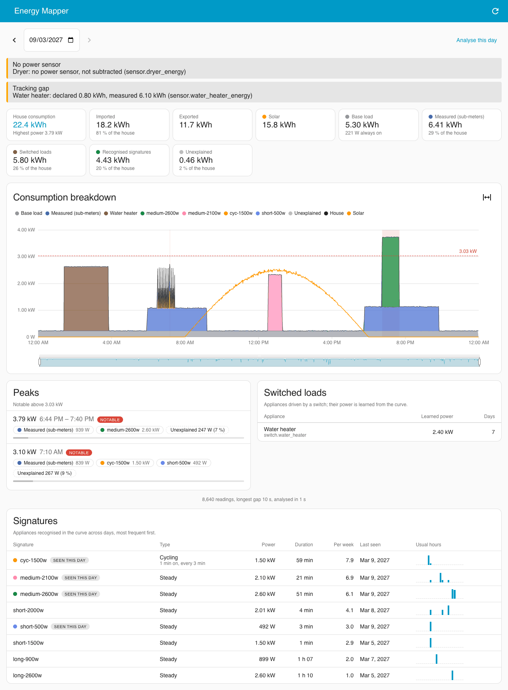
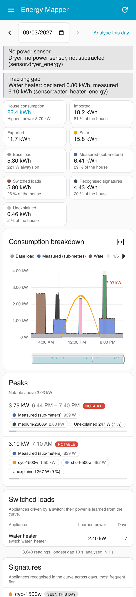

# Energy Mapper

**Find the appliances of your home in the curve of the whole-house power meter, without a
smart plug on each of them.** Energy Mapper is a Home Assistant add-on and integration for
non-intrusive load monitoring (NILM): every night it analyses the previous day, splits the
house consumption into base load, measured devices, switch-driven appliances and recurring
"signatures", and explains the peaks. Everything runs locally.

*[Version française plus bas](#français).*

> **Status: experimental.** The nightly report is complete; appliances get their own devices,
> sensors and hourly energy for the Energy dashboard, and can be renamed, re-linked, merged,
> deleted or added by hand; the signatures to review are listed in the panel, with the
> entity each one probably is (see the [roadmap](#roadmap)). Feedback from installations other than the developer's is very welcome.

<picture>
  <source media="(prefers-color-scheme: dark)" srcset="https://raw.githubusercontent.com/sylvaing/ha-energy-mapper/main/docs/images/panel-dark.png">
  
</picture>

*The sidebar panel on a made-up household (synthetic data from the developer harness).*

## Contents

- [What it does, and what it does not](#what-it-does-and-what-it-does-not)
- [Requirements](#requirements)
- [Installation](#installation)
- [Configuration](#configuration)
- [Reading the panel](#reading-the-panel)
- [Appliances in Home Assistant](#appliances-in-home-assistant)
- [Privacy](#privacy)
- [Limits](#limits)
- [Roadmap](#roadmap)
- [Contributing](#contributing)
- [Licence and credits](#licence-and-credits)
- [Français](#français)

Technical details: [design document](docs/design.md) and the
[add-on documentation](energy_mapper/DOCS.md) (also shown in the add-on's *Documentation* tab).

## What it does, and what it does not

**It does:**

- read, once a night, yesterday's history of the grid meter (and of the solar production,
  battery, sub-meters and switches) from the Home Assistant recorder;
- configure itself from the **Energy dashboard**: grid, solar, battery and individual devices
  are found there, with the power sensor (W) that goes with each energy sensor (kWh);
- rebuild the house load (grid + solar + battery), remove what is already measured
  (sub-meters), and look in the rest for **steps**: sudden changes of at least 300 W (by
  default) when an appliance switches on or off;
- measure the real power of appliances driven by a **switch** (a water heater on a relay, a
  pilot-wire radiator), including those that run when their switch is *off*;
- group the remaining steps into **activations** (one use of one appliance) and the
  activations into **signatures** (for example "about 2 kW for 3 minutes, mornings and
  evenings"), learned across days with a progressive forgetting;
- show a daily report in a sidebar panel: an energy summary, a stacked per-minute chart, the
  day's peaks with what was running, the switched loads and the signature registry, plus what
  is worth checking in your Energy dashboard setup.

**It does not:**

- **meter** anything. Every figure for a signature or a switched load is an **estimate** from
  one meter; only sub-meters are measured. Do not use it for billing;
- name appliances. A signature is `short-2000w`, not "kettle": naming signatures (which then
  become appliances like the switched ones) is the next step of v1;
- change your configuration or the Energy dashboard: the add-on never calls a service, and the
  integration only adds its own devices, sensors and statistics (you choose to add them to the
  Energy dashboard);
- work in real time: the analysis runs at night on the previous day (live detection is
  planned for v2).

**What it recognises well today:** appliances that draw a steady power of a few hundred watts
or more and switch cleanly: kettle, oven, toaster, water heater, electric radiators, the
heating phases of a dishwasher or washing machine; and **cycling** loads that switch on and
off every minute or so at the same power (an induction hob at medium power, an oven
thermostat), which are grouped into one session with their duty cycle.

**What it recognises badly today:**

- loads below the step threshold (300 W by default): lighting, electronics, fridges
  (they end up in the base load or in "unexplained");
- loads whose power varies continuously: EV chargers that modulate, inverter heat pumps and
  air conditioners, induction hobs at high power (a measured EV charger or heat pump is best
  declared as a sub-meter; variable loads will be handled in [#16](https://github.com/sylvaing/ha-energy-mapper/issues/16));
- multi-phase appliances (dishwasher, washing machine, dryer) appear as several unrelated
  signatures, one per heating phase ([#26](https://github.com/sylvaing/ha-energy-mapper/issues/26));
- events shorter than two meter readings, and several appliances of similar size switching
  at the same moment (some pairings are then wrong).

## Requirements

- **Home Assistant OS or Supervised** (the add-on needs the Supervisor), on **amd64** or
  **aarch64** (Raspberry Pi 4/5 included: a day is analysed in a few seconds at most).
  Home Assistant Container and Core are not supported yet: a standalone image is planned in
  [#19](https://github.com/sylvaing/ha-energy-mapper/issues/19).
- **Home Assistant 2025.10 or later** for the integration, add-on **0.7.0 or later** for the
  entity suggestions (0.6.0 for the review of the signatures, 0.5.0 for the appliance
  management, 0.4.0 for the appliance statistics; developed and tested on 2026.10 and
  2026.11; the panel uses Home Assistant's own date picker when available, and a plain date
  field otherwise).
- [HACS](https://hacs.xyz) to install the integration (or a manual copy).
- A **power sensor of the grid meter** (W or kW), recorded by the recorder (do not exclude it).
  The faster it reports, the better: every 1 to 10 s is ideal (P1 port, Shelly EM/Pro EM,
  Linky TIC…); every 60 s works, but short uses are missed.
- Recommended: the **Energy dashboard** configured (grid, and solar, battery and individual
  devices if you have them). Without it, choose the grid sensor in the settings.

## Installation

### 1. The add-on

[](https://my.home-assistant.io/redirect/supervisor_add_addon_repository/?repository_url=https%3A%2F%2Fgithub.com%2Fsylvaing%2Fha-energy-mapper)

1. **Settings → Add-ons** (called *Apps* in recent versions) **→ Add-on store → ⋮ →
   Repositories**, add `https://github.com/sylvaing/ha-energy-mapper` (or use the button above).
2. Install **Energy Mapper** (the image is built on your machine, which takes a few minutes),
   then **Start** it. Nothing has to be configured if the Energy dashboard is set up.
3. On its first start, the add-on analyses the past days still held by the recorder (up to
   30, newest first; the recorder keeps 10 days by default). Its log shows each day analysed.

### 2. The integration

1. In **HACS → ⋮ → Custom repositories**, add `https://github.com/sylvaing/ha-energy-mapper`
   with the type **Integration**.
2. Download **Energy Mapper** from HACS, then **restart Home Assistant**.

Without HACS: copy `custom_components/energy_mapper` into the `custom_components` folder of
your configuration and restart.

### 3. Connect them

Once the add-on runs, Home Assistant **discovers** it: **Settings → Devices & services**
shows *Energy Mapper* under *Discovered*; select **Add** and confirm. The **Energy Mapper**
panel then appears in the sidebar.

If it is not discovered, add the integration by hand (**Add integration → Energy Mapper**)
and enter the address of the add-on API: `http://<hostname>:8099`, where `<hostname>` is
shown on the add-on's *Info* page (for example `xxxxxxxx-energy-mapper`; `local-energy-mapper`
for a local copy of the add-on). The port is only reachable from Home Assistant, not from your
network.

## Configuration

### Automatic, from the Energy dashboard

With the Energy dashboard set up, there is nothing to configure. The add-on reads it live
before each analysis:

| In the Energy dashboard | Used as |
|---|---|
| Grid consumption (and return) | The grid power sensor; several grid meters (one per phase) are summed; separate import and export sensors are combined. A grid meter that never counted is ignored. |
| Solar production | The solar power sensor; several inverters are summed. |
| Home battery | The battery power sensor (check its sign: positive must mean discharging). |
| Individual device with its own power sensor | A **sub-meter**: its power is subtracted before the analysis. A device "included in" another one is never subtracted twice. |
| Individual device estimated from a `switch` or `input_boolean` (for example a [powercalc](https://github.com/bramstroker/homeassistant-powercalc) sensor with a `source_entity`) | A **switched load**: its real power is measured on the house curve each time the switch changes. powercalc is optional, only used as a hint. |
| Device without power sensor, or unavailable | Not used, and reported in *Things to check*. |

### The options of the integration

**Settings → Devices & services → Energy Mapper → Configure.** The form is pre-filled with
what the add-on uses (Energy dashboard first, then the add-on options, then the defaults).
Change only what is wrong: a field left as found keeps following the Energy dashboard, and
only the values that differ are saved. The settings are kept in Home Assistant (and in its
backups), pushed to the add-on on save and each time Home Assistant starts, and take
precedence over the add-on options.

| Section | Setting | Default | Notes |
|---|---|---|---|
| Sensors | Grid power, *positive when exporting* | Energy dashboard | The whole-house meter, positive when importing; tick the box if yours is the other way round. |
| | Grid export power | Energy dashboard | Only for meters that report import and export as two positive sensors. |
| | Solar power | Energy dashboard | |
| | Battery power, *positive when charging* | Energy dashboard | Positive when discharging. |
| | Sub-meters | Energy dashboard | Power sensors of measured appliances; a list here replaces the Energy dashboard's. |
| Switched appliances | Entity, name, on-states | Energy dashboard | Added to those of the Energy dashboard, or replacing one with the same entity. *On-states*: the states in which the appliance runs (`on` by default). The **polarity is detected automatically**: a pilot-wire radiator whose relay cuts the heating when `on` is found and shown as *Inverted*. Appliances (below) are the simpler way to add one. |
| | Excluded switches | empty | Switches never measured nor proposed as appliances. Deleting an appliance driven by a switch adds its switch here; remove it to measure it again. An estimate of the Energy dashboard driven by an excluded switch is subtracted like any other estimate. |
| Thresholds | Smallest appliance (step threshold) | 300 W | Smaller detects more appliances, and more noise. |
| | Fixed peak threshold | empty | Empty: a peak is *notable* above 80 % of the highest power of the recent days. Set a value (for example your subscribed power) to use it instead. |
| Analysis and storage | Time of the nightly analysis | 04:30 | Applies after the next analysis. |
| | Past days analysed on start | 30 | Limited by what the recorder still holds. |
| | Signature half-life | 30 days | Age at which a past use counts half in the signature registry. Shorter forgets replaced appliances faster; longer keeps rare ones known longer. |
| | Keep full reports | 90 days | Full reports keep the per-minute curve; older days keep a summary (totals, peaks, activations). |
| | Peak reference window | 30 days | Notable peaks are relative to the highest power of these days, to follow the seasons. |
| Review of the signatures | Notify in Repairs | on | One notice in **Settings → Repairs** while signatures wait in the *To review* section of the panel. |
| | Uses / different days before a signature is proposed | 5 / 3 | A signature is proposed once it was seen that many times on that many different days. |
| | *Wait*: propose again after | 14 days | A signature put on hold comes back after these days, or once its uses reached… |
| | *Wait*: or after this many times more uses | 2 | …twice the number it had (6 uses: back at 12). |
| | Entity suggestions: minimum match | 80 % | An entity is suggested for a signature when its state changes at this share of the signature's starts and stops (at least 5 of them, on 3 different days). |

The same settings exist as **add-on options** (*Configuration* tab of the add-on), useful
without the integration. See the [add-on documentation](energy_mapper/DOCS.md#configuration).

## Reading the panel

The panel follows your Home Assistant theme (light and dark), language (English and French)
and number and time formats, and adapts to narrow screens (mobile app).

- **Day picker**: Home Assistant's date picker, with presets *Yesterday*, *Day before
  yesterday*, *Highest use (30 days)* and *Last notable peak*. Administrators can **analyse a
  day** again (after changing the settings, for example).
- **To review** (administrators): the recurring signatures seen often enough to be an
  appliance (5 uses on 3 different days by default), most energy first, with their power,
  duration or on/off rhythm, number of uses, energy, usual hours and up to three recent
  **examples**: select one to open its day zoomed on it. For each one:
  - **Validate…**: say what it is: a **new appliance** (give it a name: Energy Mapper creates
    the appliance, its sensors and hourly energy statistics from the signature); an appliance
    **driven by a switch** without power measurement (relay-driven water heater, pilot-wire
    radiator: its state becomes the ground truth and Energy Mapper measures its power); or an
    appliance **with a power sensor** (a smart plug: it becomes a sub-meter, subtracted before
    the analysis, so its steps no longer appear). The switch or sensor is picked with Home
    Assistant's entity picker;
  - **Probably: Attic fan (92 %)**: the entity whose state changes when the signature starts
    and stops, found by Energy Mapper (see below). *Validate…* then opens with it already
    picked and named after it; the other suggested entities are one click away, and any other
    entity can still be chosen;
  - **Wait**: hide it until there is clearly more data (twice as many uses, or 14 days later);
  - **Ignore**: never propose it again. The *Ignored* list below brings one back (*Restore*).
    A signature whose appliance you deleted is listed there too.

  Decisions are kept by the add-on (in Home Assistant backups). A single notice in
  **Settings → Repairs** says how many signatures wait for a review and links to this
  section; it disappears when nothing is left, and can be turned off in the options.

  **Entity suggestions.** Every night, for each signature to review, the add-on compares its
  starts and stops of the last 30 days with the state changes of your entities that may tell
  when an appliance runs: lights, switches, input booleans, fans, climate and water heater
  entities (their mode), media players, binary sensors, and sensors reporting an operation
  state (`enum` device class, such as a washing machine's programme state). An entity is
  suggested when its state changes within a minute or two (twice the meter's reporting
  interval) of at least 80 % of the starts and stops, at least 5 times on 3 different days,
  and when at least 30 % of its own changes happen at those times (an entity that changes all
  the time is never suggested). The states it is in while the appliance runs are learned too:
  a pilot-wire relay that is *off* while its radiator heats, or a washing machine reporting
  *running*, is linked with the right states. Entities already linked to an appliance or used
  as a switched load are not compared. The first suggestions appear after the first nightly
  analysis following the update (the past days are then read once from the recorder).
  Entities the recorder does not keep cannot be compared: the section says which kinds of
  entities are not recorded at all. Lights and small devices below the step threshold
  (300 W) never match: suggestions mostly help with large loads (heaters, fans, connected
  appliances, audio and video equipment).
- **Things to check**: what the analysis found in your setup, such as a device without a power
  sensor, an unavailable sensor, a battery whose sign should be checked, or a **tracking gap**
  (a switch-driven device whose declared energy is far from what was measured, typically an
  estimate configured at a few watts for a 2 kW water heater).
- **Summary cards**: house consumption (and the day's highest power), grid import and export,
  solar, then how the house consumption splits: **base load** (the always-on power, a low
  percentile of the day), **measured** (sub-meters), **switched loads**, **recognised
  signatures** and **unexplained**.
- **Consumption breakdown**: the same split per minute, stacked, with the house and solar
  lines, the notable threshold (dashed) and the peaks shaded. Zoom with the slider or the
  mouse wheel; each appliance keeps its colour from one day to the next.
- **Peaks**: the day's top episodes (up to 5) with what was running at the maximum and the
  unexplained share. A peak is **notable** when it reaches the notable threshold (80 % of the
  highest power of the last 30 days, or your fixed threshold). Select a peak to zoom on it.
- **Switched loads**: the power learned from the curve, the number of days seen, and
  *Inverted* when the appliance runs while its switch is off.
- **Signatures**: the appliances recognised across days, most frequent first: steady or
  cycling (with on-time and period), typical power and duration, uses per week, last seen, the
  usual hours of the day, and *Seen this day*. The id (`short-2000w`, `medium-…`, `long-…`,
  `cyc-1500w`) gives the duration band (under 10 min, 10 to 60 min, over 1 h, cycling) and the
  power when it was first seen; it stays the same from one night to the next.

Days older than the report retention keep their totals, peaks and signatures, without the
curve.



## Appliances in Home Assistant

Each **appliance** is an entry of its own on the integration page (**Settings → Devices &
services → Energy Mapper**, under *Appliances*), with a device under the *Energy Mapper*
service device. Appliances are created automatically for the **switched loads** (once their
power has been learned) and, from the *To review* section of the panel, for the **signatures
you validate**. From the integration page you can:

- **add** one by hand (*Add appliance*): driven by a switch (a relay, a pilot wire), or not
  seen yet, described by its power and a typical use ("Kettle, 2000 W, short"): its first use
  is recognised by that power;
- **rename** it (its menu → *Reconfigure* → *Rename*): the device, its entities and its energy
  statistic take the new name; entity ids and statistic ids do not change;
- **change its link**: to another switch (and on-states), or to a **power sensor** that
  measures it (a smart plug): it then becomes a sub-meter, subtracted before the analysis,
  and its sensors here stop (use the plug's own energy in the Energy dashboard); a signature
  linked to a switch becomes a switched load. The energy recorded so far is kept;
- **merge** another appliance into it, when two of them are the same appliance (two
  signatures of one machine, or a signature that is in fact a switched load): their energy is
  added from then on, the other one's past hours are added to this one's statistic, and the
  other one is deleted;
- **delete** it: its device, entities and statistic are removed. A signature loses its name
  and is no longer proposed; a switch is excluded (see the options) so it does not come back.

The appliances are kept in Home Assistant (and its backups) and sent to the add-on after each
change; a reinstalled integration takes back those the add-on holds.

| Sensor | Value |
|---|---|
| *Appliance* Energy yesterday | kWh of the last analysed day (attribute `day`) |
| *Appliance* Uses yesterday | Number of uses that day (on-periods of a switched load) |
| *Appliance* Last seen | When it last used energy |
| *Appliance* Typical power | The learned power (diagnostic) |
| Energy Mapper Unexplained energy yesterday | What no appliance explains, kWh |
| Energy Mapper Base load | The always-on power of the last analysed day |
| Energy Mapper Last analysis | When the add-on last analysed a day |

**Energy dashboard:** the analysis runs at night, so an energy sensor would put the whole day
into the hour of the analysis. Instead, the hourly energy of each appliance is written into
Home Assistant's long-term statistics with the right hours (like the delayed data of utility
integrations), as `energy_mapper:load_switch_water_heater_energy` for example. In **Settings →
Dashboards → Energy → Individual devices → Add device**, pick the statistic named after the
appliance. A day's hours appear the morning after, once the night's analysis is done. When an appliance appears, all the stored days (up to `report_retention_days`) are
imported at once; a day analysed again replaces its hours without double counting.

Do not add an appliance that is already tracked in the Energy dashboard by another sensor
(for example a powercalc estimate of the same switch): it would be counted twice. Replacing
it is planned ([#13](https://github.com/sylvaing/ha-energy-mapper/issues/13)). Live power and
on/off states come with real-time detection
([#17](https://github.com/sylvaing/ha-energy-mapper/issues/17)).

## Privacy

- **Everything stays local.** No cloud service, no account, no telemetry: the add-on only
  talks to Home Assistant through the Supervisor, and the integration only to the add-on.
- The add-on only **reads** Home Assistant (states, entity registry, Energy dashboard settings
  and recorder history); it never calls a service. The integration writes only its own
  devices, sensors and statistics.
- Its data (daily reports, day summaries, the signature registry, the settings) lives in the
  add-on's `/data` folder, is **included in Home Assistant backups**, and stays bounded (a few
  MB) whatever the age of the installation.
- The panel and its websocket commands need a logged-in Home Assistant user; analysing a day
  and reviewing signatures require an administrator.

## Limits

- An **estimation**, not a measurement: errors of a few percent to tens of percent on a
  signature are normal, more during heavy simultaneous use (cooking).
- The **step threshold** sets the smallest visible appliance (300 W by default).
- The **meter rate** sets the shortest visible use: an appliance must last at least two meter
  readings.
- The analysis needs the **full day of history** of the grid power sensor in the recorder: do
  not exclude it, and keep at least a couple of days (`purge_keep_days`). A day whose history
  starts after midnight is not analysed.
- A use that starts or ends while another appliance of a similar power switches can be
  paired wrongly; uses longer than 6 hours are not paired.
- Signature ids are names, not appliances: one appliance can produce several signatures (each
  phase of a programme) and two appliances of the same power can share one.
- Three-phase installations are analysed on the sum of the phases (per-phase analysis:
  [#18](https://github.com/sylvaing/ha-energy-mapper/issues/18)).
- The texts of *Things to check* come from the add-on in English.
- Entity suggestions compare the **state** of the entities only: a climate entity is compared
  by its mode, not by its `hvac_action` attribute (attributes are not read).

## Roadmap

See the [milestones](https://github.com/sylvaing/ha-energy-mapper/milestones):

- [**v0 – Nightly report**](https://github.com/sylvaing/ha-energy-mapper/milestone/1): done.
  Read-only nightly analysis, sidebar panel.
- [**v1 – Validate & track**](https://github.com/sylvaing/ha-energy-mapper/milestone/2): review
  signatures in the panel (name one, or link it to an existing switch or power sensor), with
  the entity each one probably is, one entry per appliance and per-appliance entities and
  hourly energy statistics (done), "take
  over tracking" in the Energy dashboard,
  learning from measured devices, a nightly self-test with a success rate, variable loads, and
  a benchmark on public NILM datasets ([#28](https://github.com/sylvaing/ha-energy-mapper/issues/28)).
- [**v2 – Live**](https://github.com/sylvaing/ha-energy-mapper/milestone/3): real-time
  detection, per-phase analysis, recognition of multi-phase appliance cycles.
- [**v3 – Publish**](https://github.com/sylvaing/ha-energy-mapper/milestone/4): release
  process, default HACS and add-on store listing, standalone Docker image for Container/Core.

## Contributing

Issues and pull requests are welcome. Please open an issue first for anything large. The
repository contains **no real consumption data**: tests and the panel's development harness
use synthetic households only; real recorder extracts stay outside the repository (see
`tools/replay_csv.py`).

Layout: `energy_mapper/` is the add-on (with the engine library `app/nilm_core/`, standard
library only), `custom_components/energy_mapper/` the integration, `frontend/` the panel
(TypeScript, Lit, ECharts), `tests/` the engine and add-on tests, `tests_integration/` the
integration tests.

```sh
# engine and add-on: standard library only (Python 3.12+)
python3 -m unittest discover -s tests
ruff check . && ruff format --check .

# integration: Home Assistant test environment (Python 3.14)
pip install -r requirements_test.txt && python -m pytest

# panel (Node 24)
cd frontend && npm ci
npm run typecheck && npm test && npm run build   # or: npm run dev (rebuild on change)
python3 dev/make_sample.py                         # regenerate the synthetic sample data
cd .. && python3 -m http.server 8765               # then open http://localhost:8765/frontend/dev/index.html
```

The panel bundle `custom_components/energy_mapper/frontend/energy-mapper-panel.js` is
committed; CI checks that it matches the sources. The dev page mounts the panel with a fake
`hass` (theme, language, number and time formats, add-on states) answering from
`frontend/dev/sample/`; Home Assistant's own elements are not available there, so the panel
shows its fallbacks (a native date field instead of HA's date picker).

The add-on service also runs outside Home Assistant, against any instance, for development:

```sh
cd energy_mapper/app
HA_URL=http://homeassistant.local:8123 HA_TOKEN=<long-lived token> \
  DATA_DIR=/tmp/energy_mapper PORT=8099 python3 main.py
```

Workflow: one branch and one pull request per issue (`Closes #N` in the description). CI runs
ruff, the engine tests (Python 3.12 and 3.13), the integration tests, hassfest and HACS
validation, the add-on linter and test builds (amd64, aarch64), and the panel type check, tests
and build; it must be green before merging. Code, comments and commits are in English.

## Licence and credits

[MIT](LICENSE).

- The step pairing by closest size and the idea of cycling sessions were informed by
  [Home NILM](https://github.com/amstrad83/ha-home-nilm) (MIT).
- [NILMTK](https://github.com/nilmtk/nilmtk) is the reference toolkit for evaluating NILM
  algorithms on public datasets; Energy Mapper's benchmark will use its metrics
  ([#28](https://github.com/sylvaing/ha-energy-mapper/issues/28)).
- The panel uses [Lit](https://lit.dev) and [Apache ECharts](https://echarts.apache.org), the
  libraries of the Home Assistant frontend.

---

## Français

**Retrouvez les appareils de la maison dans la courbe du compteur général, sans prise
connectée sur chacun d'eux.** Energy Mapper est un add-on et une intégration Home Assistant
de désagrégation de la consommation (NILM, *non-intrusive load monitoring*) : chaque nuit, il
analyse la veille, répartit la consommation de la maison entre consommation de fond,
appareils mesurés, appareils pilotés par un interrupteur et « signatures » récurrentes, et
explique les pics. Tout reste en local.

> **État : expérimental.** Le rapport de nuit est complet ; les appareils ont leurs appareils
> Home Assistant, capteurs et énergie heure par heure pour le tableau Énergie, et peuvent être
> renommés, reliés autrement, fusionnés, supprimés ou ajoutés à la main ; les signatures à
> examiner sont listées dans le panneau, avec l'entité qu'elles sont probablement (voir la
> [feuille de route](#feuille-de-route)). Les retours d'autres installations que celle du
> développeur sont très bienvenus.


*Le panneau sur un foyer imaginaire (données synthétiques du banc de développement).*

Détails techniques (en anglais) : [document de conception](docs/design.md) et
[documentation de l'add-on](energy_mapper/DOCS.md) (aussi dans l'onglet *Documentation* de
l'add-on).

### Ce qu'il fait, et ce qu'il ne fait pas

**Il :**

- lit, une fois par nuit, l'historique de la veille du compteur réseau (et de la production
  solaire, de la batterie, des sous-compteurs et des interrupteurs) dans l'enregistreur
  (*recorder*) de Home Assistant ;
- se configure à partir du **tableau Énergie** : réseau, solaire, batterie et appareils
  individuels y sont trouvés, avec le capteur de puissance (W) qui va avec chaque capteur
  d'énergie (kWh) ;
- reconstitue la consommation de la maison (réseau + solaire + batterie), retire ce qui est
  déjà mesuré (sous-compteurs) et cherche dans le reste des **marches** : des variations
  brusques d'au moins 300 W (par défaut) quand un appareil s'allume ou s'éteint ;
- mesure la puissance réelle des appareils **pilotés par un interrupteur** (chauffe-eau sur
  relais, radiateur sur fil pilote), y compris ceux qui chauffent quand l'interrupteur est
  sur *off* ;
- regroupe les marches restantes en **utilisations** (une marche d'un appareil), et les
  utilisations en **signatures** (par exemple « environ 2 kW pendant 3 minutes, matin et
  soir »), apprises au fil des jours avec un oubli progressif ;
- affiche un rapport quotidien dans un panneau de la barre latérale : bilan énergétique,
  courbe empilée minute par minute, pics de la journée avec ce qui tournait, appareils
  pilotés et registre des signatures, plus ce qui mérite d'être vérifié dans votre
  configuration Énergie.

**Il ne :**

- **mesure** rien : chaque chiffre d'une signature ou d'un appareil piloté est une
  **estimation** à partir d'un seul compteur ; seuls les sous-compteurs sont mesurés. Ne
  l'utilisez pas pour facturer ;
- nomme pas les appareils : une signature s'appelle `short-2000w`, pas « bouilloire ».
  Nommer les signatures (qui deviennent alors des appareils comme les appareils pilotés),
  c'est la prochaine étape de la v1 ;
- modifie pas votre configuration ni le tableau Énergie : l'add-on n'appelle jamais de
  service, et l'intégration n'ajoute que ses propres appareils, capteurs et statistiques
  (c'est vous qui les ajoutez au tableau Énergie) ;
- fonctionne pas en temps réel : l'analyse tourne la nuit sur la veille (la détection en
  direct est prévue en v2).

**Ce qu'il reconnaît bien aujourd'hui :** les appareils qui consomment une puissance stable
de quelques centaines de watts ou plus et s'allument franchement : bouilloire, four,
grille-pain, chauffe-eau, radiateurs électriques, les phases de chauffe du lave-vaisselle ou
du lave-linge ; et les appareils **cycliques** qui s'allument et s'éteignent toutes les minutes
environ à la même puissance (plaque à induction à puissance moyenne, thermostat du four),
regroupés en une seule session avec leur rapport cyclique.

**Ce qu'il reconnaît mal aujourd'hui :**

- les appareils sous le seuil de marche (300 W par défaut) : éclairage, électronique,
  réfrigérateurs (ils finissent dans la consommation de fond ou dans « non expliqué ») ;
- les appareils dont la puissance varie en continu : borne de recharge qui module, pompe à
  chaleur et climatisation *inverter*, plaque à induction à pleine puissance (une borne ou
  une pompe à chaleur mesurée se déclare de préférence en sous-compteur ; les charges
  variables seront traitées dans [#16](https://github.com/sylvaing/ha-energy-mapper/issues/16)) ;
- les appareils à plusieurs phases (lave-vaisselle, lave-linge, sèche-linge) apparaissent
  comme plusieurs signatures sans lien, une par phase de chauffe
  ([#26](https://github.com/sylvaing/ha-energy-mapper/issues/26)) ;
- les événements plus courts que deux mesures du compteur, et plusieurs appareils de
  puissance voisine qui basculent au même moment (certaines associations sont alors fausses).

### Prérequis

- **Home Assistant OS ou Supervised** (l'add-on a besoin du Supervisor), sur **amd64** ou
  **aarch64** (Raspberry Pi 4/5 compris : une journée s'analyse en quelques secondes au plus).
  Home Assistant Container et Core ne sont pas encore pris en charge : une image autonome est
  prévue dans [#19](https://github.com/sylvaing/ha-energy-mapper/issues/19).
- **Home Assistant 2025.10 ou plus récent** pour l'intégration, add-on **0.7.0 ou plus
  récent** pour les suggestions d'entité (0.6.0 pour l'examen des signatures, 0.5.0 pour la
  gestion des appareils, 0.4.0 pour leurs statistiques ; développée et testée sur
  2026.10 et 2026.11 ; le panneau utilise le sélecteur de date de Home Assistant quand il est
  disponible, un simple champ de date sinon).
- [HACS](https://hacs.xyz) pour installer l'intégration (ou une copie manuelle).
- Un **capteur de puissance du compteur réseau** (W ou kW), enregistré par le *recorder* (ne
  l'excluez pas). Plus il est rapide, mieux c'est : toutes les 1 à 10 s c'est l'idéal (port
  P1, Shelly EM/Pro EM, TIC du Linky…) ; toutes les 60 s ça marche, mais les utilisations
  courtes sont manquées.
- Recommandé : le **tableau Énergie** configuré (réseau, et solaire, batterie et appareils
  individuels si vous en avez). Sans lui, choisissez le capteur réseau dans les réglages.

### Installation

#### 1. L'add-on

[](https://my.home-assistant.io/redirect/supervisor_add_addon_repository/?repository_url=https%3A%2F%2Fgithub.com%2Fsylvaing%2Fha-energy-mapper)

1. **Paramètres → Modules complémentaires** (*Applications* dans les versions récentes)
   **→ Boutique → ⋮ → Dépôts**, ajoutez `https://github.com/sylvaing/ha-energy-mapper` (ou
   utilisez le bouton ci-dessus).
2. Installez **Energy Mapper** (l'image est construite sur votre machine, ce qui prend quelques
   minutes), puis **démarrez-le**. Rien à configurer si le tableau Énergie est en place.
3. À son premier démarrage, l'add-on analyse les jours passés encore présents dans le
   *recorder* (jusqu'à 30, du plus récent au plus ancien ; le *recorder* garde 10 jours par
   défaut). Son journal affiche chaque jour analysé.

#### 2. L'intégration

1. Dans **HACS → ⋮ → Dépôts personnalisés**, ajoutez
   `https://github.com/sylvaing/ha-energy-mapper` avec le type **Intégration**.
2. Téléchargez **Energy Mapper** depuis HACS, puis **redémarrez Home Assistant**.

Sans HACS : copiez `custom_components/energy_mapper` dans le dossier `custom_components` de
votre configuration, puis redémarrez.

#### 3. Les relier

Une fois l'add-on démarré, Home Assistant le **découvre** : **Paramètres → Appareils et
services** affiche *Energy Mapper* dans *Découverts* ; choisissez **Ajouter** et confirmez.
Le panneau **Energy Mapper** apparaît alors dans la barre latérale.

S'il n'est pas découvert, ajoutez l'intégration à la main (**Ajouter une intégration →
Energy Mapper**) avec l'adresse de l'API de l'add-on : `http://<nom d'hôte>:8099`, où le nom
d'hôte figure sur la page *Infos* de l'add-on (par exemple `xxxxxxxx-energy-mapper` ;
`local-energy-mapper` pour une copie locale de l'add-on). Le port n'est accessible que depuis
Home Assistant, pas depuis votre réseau.

### Configuration

#### Automatique, depuis le tableau Énergie

Avec le tableau Énergie en place, il n'y a rien à configurer. L'add-on le relit avant chaque
analyse :

| Dans le tableau Énergie | Utilisé comme |
|---|---|
| Consommation du réseau (et retour) | Le capteur de puissance réseau ; plusieurs compteurs (un par phase) sont additionnés ; des capteurs séparés d'achat et de revente sont combinés. Un compteur qui n'a jamais compté est ignoré. |
| Production solaire | Le capteur de puissance solaire ; plusieurs onduleurs sont additionnés. |
| Batterie domestique | Le capteur de puissance de la batterie (vérifiez son signe : positif doit vouloir dire décharge). |
| Appareil individuel avec son propre capteur de puissance | Un **sous-compteur** : sa puissance est retirée avant l'analyse. Un appareil « inclus dans » un autre n'est jamais retiré deux fois. |
| Appareil individuel estimé à partir d'un `switch` ou d'un `input_boolean` (par exemple un capteur [powercalc](https://github.com/bramstroker/homeassistant-powercalc) avec une `source_entity`) | Un **appareil piloté** : sa puissance réelle est mesurée sur la courbe de la maison à chaque changement de l'interrupteur. powercalc est facultatif, utilisé seulement comme indice. |
| Appareil sans capteur de puissance, ou indisponible | Non utilisé, et signalé dans *À vérifier*. |

#### Les options de l'intégration

**Paramètres → Appareils et services → Energy Mapper → Configurer.** Le formulaire est
pré-rempli avec ce que l'add-on utilise (le tableau Énergie d'abord, puis les options de
l'add-on, puis les valeurs par défaut). Ne changez que ce qui est faux : un champ laissé tel
quel continue de suivre le tableau Énergie, et seules les valeurs différentes sont
enregistrées. Les réglages sont gardés dans Home Assistant (et dans ses sauvegardes), envoyés
à l'add-on à l'enregistrement et à chaque démarrage de Home Assistant, et passent avant les
options de l'add-on.

| Section | Réglage | Par défaut | Remarques |
|---|---|---|---|
| Capteurs | Puissance réseau, *positif en revente* | Tableau Énergie | Le compteur général, positif à l'achat ; cochez la case si le vôtre est inversé. |
| | Puissance de revente | Tableau Énergie | Seulement pour les compteurs qui donnent achat et revente en deux capteurs positifs. |
| | Puissance solaire | Tableau Énergie | |
| | Puissance batterie, *positif en charge* | Tableau Énergie | Positif en décharge. |
| | Sous-compteurs | Tableau Énergie | Capteurs de puissance d'appareils mesurés ; une liste ici remplace celle du tableau Énergie. |
| Appareils pilotés | Entité, nom, états de marche | Tableau Énergie | Ajoutés à ceux du tableau Énergie, ou remplaçant celui de même entité. *États de marche* : les états dans lesquels l'appareil fonctionne (`on` par défaut). Le **sens est détecté automatiquement** : un radiateur sur fil pilote dont le relais coupe la chauffe quand il est sur `on` est reconnu et affiché *Inversé*. Les appareils (plus bas) sont le moyen le plus simple d'en ajouter un. |
| | Interrupteurs exclus | vide | Interrupteurs jamais mesurés ni proposés comme appareils. Supprimer un appareil piloté ajoute son interrupteur ici ; retirez-le pour le mesurer à nouveau. Une estimation du tableau Énergie pilotée par un interrupteur exclu est retirée comme toute autre estimation. |
| Seuils | Plus petit appareil (seuil de marche) | 300 W | Plus bas détecte plus d'appareils, et plus de bruit. |
| | Seuil fixe des pics | vide | Vide : un pic est *notable* au-dessus de 80 % de la puissance la plus haute des derniers jours. Une valeur (par exemple la puissance souscrite) la remplace. |
| Analyse et stockage | Heure de l'analyse de nuit | 04:30 | S'applique après la prochaine analyse. |
| | Jours passés analysés au démarrage | 30 | Limité par ce que le *recorder* contient encore. |
| | Demi-vie des signatures | 30 jours | Âge auquel une utilisation passée compte pour moitié dans le registre des signatures. Plus court oublie plus vite un appareil remplacé ; plus long garde plus longtemps les appareils rares. |
| | Conservation des rapports complets | 90 jours | Les rapports complets gardent la courbe minute par minute ; les jours plus anciens gardent un résumé (totaux, pics, utilisations). |
| | Fenêtre de référence des pics | 30 jours | Les pics notables sont relatifs à la puissance la plus haute de ces jours, pour suivre les saisons. |
| Examen des signatures | Signaler dans Réparations | oui | Un seul avis dans **Paramètres → Réparations** tant que des signatures attendent dans la section *À examiner* du panneau. |
| | Utilisations / jours différents avant de proposer une signature | 5 / 3 | Une signature est proposée dès qu'elle a été vue ce nombre de fois sur ce nombre de jours différents. |
| | *Attendre* : proposer de nouveau après | 14 jours | Une signature mise en attente revient après ces jours, ou quand ses utilisations ont atteint… |
| | *Attendre* : ou après ce multiple d'utilisations | 2 | …le double de son nombre (6 utilisations : retour à 12). |
| | Suggestions d'entité : concordance minimale | 80 % | Une entité est suggérée pour une signature quand son état change à cette part des démarrages et arrêts de la signature (au moins 5, sur 3 jours différents). |

Les mêmes réglages existent comme **options de l'add-on** (onglet *Configuration* de
l'add-on), utiles sans l'intégration. Voir la
[documentation de l'add-on](energy_mapper/DOCS.md#configuration).

### Lire le panneau

Le panneau suit le thème de Home Assistant (clair et sombre), sa langue (anglais et
français) et ses formats de nombres et d'heures, et s'adapte aux écrans étroits (application mobile).

- **Choix du jour** : le sélecteur de date de Home Assistant, avec les raccourcis *Hier*,
  *Avant-hier*, *Conso. max. (30 j)* et *Dernier pic notable*. Les administrateurs peuvent
  **analyser un jour** à nouveau (après un changement de réglages, par exemple).
- **À examiner** (administrateurs) : les signatures récurrentes vues assez souvent pour être
  un appareil (5 utilisations sur 3 jours différents par défaut), les plus gourmandes d'abord,
  avec leur puissance, leur durée ou leur rythme marche/arrêt, leur nombre d'utilisations,
  leur énergie, leurs heures habituelles et jusqu'à trois **exemples** récents : sélectionnez-en
  un pour ouvrir son jour zoomé dessus. Pour chacune :
  - **Valider…** : dites ce que c'est : un **nouvel appareil** (donnez-lui un nom : Energy
    Mapper crée l'appareil, ses capteurs et ses statistiques d'énergie horaires à partir de la
    signature) ; un appareil **commandé par un interrupteur** sans mesure de puissance
    (chauffe-eau sur relais, radiateur sur fil pilote : son état devient la référence et
    Energy Mapper mesure sa puissance) ; ou un appareil **avec un capteur de puissance** (une
    prise connectée : il devient un sous-compteur, soustrait avant l'analyse, ses marches
    n'apparaissent plus). L'interrupteur ou le capteur se choisit avec le sélecteur d'entités
    de Home Assistant ;
  - **Probablement : Ventilateur des combles (92 %)** : l'entité dont l'état change quand la
    signature démarre et s'arrête, trouvée par Energy Mapper (voir plus bas). *Valider…*
    s'ouvre alors avec cette entité déjà choisie et le nom pré-rempli ; les autres entités
    suggérées sont à un clic, et toute autre entité reste possible ;
  - **Attendre** : la masquer jusqu'à avoir nettement plus de données (deux fois plus
    d'utilisations, ou 14 jours plus tard) ;
  - **Ignorer** : ne plus jamais la proposer. La liste *Ignorées* en dessous permet de revenir
    en arrière (*Rétablir*). Une signature dont vous avez supprimé l'appareil y figure aussi.

  Les décisions sont gardées par l'add-on (dans les sauvegardes de Home Assistant). Un seul
  avis dans **Paramètres → Réparations** indique combien de signatures attendent et renvoie à
  cette section ; il disparaît quand il n'y a plus rien, et peut être désactivé dans les
  options.

  **Suggestions d'entité.** Chaque nuit, pour chaque signature à examiner, l'add-on compare
  ses démarrages et arrêts des 30 derniers jours avec les changements d'état de vos entités
  qui peuvent dire quand un appareil fonctionne : lumières, interrupteurs, booléens
  (`input_boolean`), ventilateurs, thermostats et chauffe-eau (leur mode), lecteurs
  multimédia, capteurs binaires, et capteurs d'état de fonctionnement (classe `enum`, comme
  l'état du programme d'un lave-linge). Une entité est suggérée quand son état change à une
  minute ou deux près (deux fois l'intervalle du compteur) d'au moins 80 % des démarrages et
  arrêts, au moins 5 fois sur 3 jours différents, et quand au moins 30 % de ses propres
  changements tombent à ces moments (une entité qui change sans cesse n'est jamais
  suggérée). Les états dans lesquels l'appareil fonctionne sont appris aussi : un relais de
  fil pilote *éteint* pendant que son radiateur chauffe, ou un lave-linge qui indique
  *en marche*, est relié avec les bons états. Les entités déjà reliées à un appareil ou
  utilisées comme appareil piloté ne sont pas comparées. Les premières suggestions arrivent
  après la première analyse de nuit qui suit la mise à jour (les jours passés sont alors lus
  une fois dans le *recorder*). Les entités que le *recorder* ne garde pas ne peuvent pas
  être comparées : la section indique quels types d'entités ne sont pas enregistrés du tout.
  Les lumières et petits appareils sous le seuil de marche (300 W) ne correspondent jamais :
  les suggestions servent surtout pour les gros appareils (chauffages, ventilateurs,
  appareils connectés, audio et vidéo).
- **À vérifier** : ce que l'analyse a trouvé dans votre configuration, comme un appareil sans
  capteur de puissance, un capteur indisponible, une batterie dont le signe est à vérifier,
  ou un **écart de suivi** (un appareil piloté dont l'énergie déclarée est loin de ce qui a
  été mesuré, typiquement une estimation réglée à quelques watts pour un chauffe-eau de
  2 kW).
- **Cartes du bilan** : consommation de la maison (et puissance maximale du jour), achat et
  revente, solaire, puis la répartition de la consommation : **consommation de fond** (la
  puissance permanente, un bas centile de la journée), **mesuré** (sous-compteurs),
  **appareils pilotés**, **signatures reconnues** et **non expliqué**.
- **Répartition de la consommation** : la même répartition minute par minute, empilée, avec
  les courbes de la maison et du solaire, le seuil notable (en pointillés) et les pics
  surlignés. Zoomez avec le curseur ou la molette ; chaque appareil garde sa couleur d'un
  jour à l'autre.
- **Pics** : les épisodes les plus hauts de la journée (jusqu'à 5) avec ce qui tournait au
  maximum et la part non expliquée. Un pic est **notable** quand il atteint le seuil notable
  (80 % de la puissance la plus haute des 30 derniers jours, ou votre seuil fixe).
  Sélectionnez un pic pour zoomer dessus.
- **Appareils pilotés** : la puissance apprise sur la courbe, le nombre de jours vus, et
  *Inversé* quand l'appareil fonctionne interrupteur éteint.
- **Signatures** : les appareils reconnus au fil des jours, les plus fréquents d'abord :
  continu ou cyclique (avec durée de marche et période), puissance et durée typiques,
  utilisations par semaine, dernière fois vue, heures habituelles, et *Vue ce jour*.
  L'identifiant (`short-2000w`, `medium-…`, `long-…`, `cyc-1500w`) donne la tranche de durée
  (moins de 10 min, 10 à 60 min, plus d'1 h, cyclique) et la puissance lors de sa création ;
  il reste le même d'une nuit à l'autre.

Les jours plus anciens que la conservation des rapports gardent leurs totaux, pics et
signatures, sans la courbe.

### Les appareils dans Home Assistant

Chaque **appareil** est une entrée à part sur la page de l'intégration (**Paramètres →
Appareils et services → Energy Mapper**, sous *Appareils*), avec son appareil Home Assistant
rattaché à l'appareil de service *Energy Mapper*. Les appareils sont créés automatiquement
pour les **appareils pilotés** (dès que leur puissance a été apprise) et, depuis la section
*À examiner* du panneau, pour les **signatures que vous validez**. Depuis la page de l'intégration, vous pouvez :

- en **ajouter** un à la main (*Ajouter un appareil*) : piloté par un interrupteur (relais, fil
  pilote), ou pas encore vu, décrit par sa puissance et une utilisation typique
  (« Bouilloire, 2000 W, courte ») : sa première utilisation est reconnue à cette puissance ;
- le **renommer** (son menu → *Reconfigurer* → *Renommer*) : l'appareil, ses entités et sa
  statistique d'énergie prennent le nouveau nom ; les identifiants d'entités et de
  statistique ne changent pas ;
- **changer son lien** : vers un autre interrupteur (et ses états de marche), ou vers un
  **capteur de puissance** qui le mesure (une prise connectée) : il devient alors un
  sous-compteur, retiré avant l'analyse, et ses capteurs ici s'arrêtent (utilisez l'énergie de
  la prise dans le tableau Énergie) ; une signature reliée à un interrupteur devient un
  appareil piloté. L'énergie déjà enregistrée est conservée ;
- **fusionner** un autre appareil dans celui-ci, quand les deux sont le même appareil (deux
  signatures d'une même machine, ou une signature qui est en fait un appareil piloté) : leurs
  énergies s'additionnent ensuite, les heures passées de l'autre sont ajoutées à la
  statistique de celui-ci, et l'autre est supprimé ;
- le **supprimer** : son appareil, ses entités et sa statistique disparaissent. Une signature
  perd son nom et n'est plus proposée ; un interrupteur est exclu (voir les options) pour ne
  pas revenir.

Les appareils sont gardés dans Home Assistant (et ses sauvegardes) et envoyés à l'add-on
après chaque changement ; une intégration réinstallée reprend ceux que l'add-on connaît.

| Capteur | Valeur |
|---|---|
| *Appareil* Énergie hier | kWh du dernier jour analysé (attribut `day`) |
| *Appareil* Utilisations hier | Nombre d'utilisations ce jour-là (périodes de marche d'un appareil piloté) |
| *Appareil* Dernière utilisation | Quand il a consommé pour la dernière fois |
| *Appareil* Puissance habituelle | La puissance apprise (diagnostic) |
| Energy Mapper Énergie inexpliquée hier | Ce qu'aucun appareil n'explique, en kWh |
| Energy Mapper Consommation de fond | La puissance permanente du dernier jour analysé |
| Energy Mapper Dernière analyse | La dernière analyse d'un jour par l'add-on |

**Tableau Énergie :** l'analyse tourne la nuit, un capteur d'énergie mettrait donc toute la
journée dans l'heure de l'analyse. À la place, l'énergie heure par heure de chaque appareil
est écrite dans les statistiques long terme de Home Assistant avec les bonnes heures (comme
les données différées des intégrations de fournisseurs d'énergie), par exemple
`energy_mapper:load_switch_water_heater_energy`. Dans **Paramètres → Tableaux de bord →
Énergie → Appareils individuels → Ajouter un appareil**, choisissez la statistique qui porte
le nom de l'appareil. Ses heures apparaissent le lendemain matin. Quand un appareil apparaît,
tous les jours conservés (jusqu'à `report_retention_days`) sont importés d'un coup ; un jour
analysé à nouveau remplace ses heures sans double comptage.

N'ajoutez pas un appareil déjà suivi dans le tableau Énergie par un autre capteur (par
exemple une estimation powercalc du même interrupteur) : il serait compté deux fois. Le
remplacement est prévu ([#13](https://github.com/sylvaing/ha-energy-mapper/issues/13)). La
puissance et l'état de marche en direct viendront avec la détection en temps réel
([#17](https://github.com/sylvaing/ha-energy-mapper/issues/17)).

### Vie privée

- **Tout reste en local.** Aucun service en ligne, aucun compte, aucune télémétrie : l'add-on
  ne parle qu'à Home Assistant, par le Supervisor, et l'intégration qu'à l'add-on.
- L'add-on ne fait que **lire** Home Assistant (états, registre des entités, réglages du
  tableau Énergie et historique du *recorder*) ; il n'appelle jamais de service.
  L'intégration n'écrit que ses propres appareils, capteurs et statistiques.
- Ses données (rapports quotidiens, résumés, registre des signatures, réglages) sont dans le
  dossier `/data` de l'add-on, **incluses dans les sauvegardes de Home Assistant**, et restent
  bornées (quelques Mo) quel que soit l'âge de l'installation.
- Le panneau et ses commandes websocket demandent un utilisateur Home Assistant connecté ;
  analyser un jour et examiner les signatures demandent un administrateur.

### Limites

- Une **estimation**, pas une mesure : quelques pour cent à quelques dizaines de pour cent
  d'erreur sur une signature sont normaux, davantage quand beaucoup d'appareils tournent en
  même temps (cuisine).
- Le **seuil de marche** fixe le plus petit appareil visible (300 W par défaut).
- Le **rythme du compteur** fixe l'utilisation la plus courte visible : un appareil doit
  durer au moins deux mesures.
- L'analyse a besoin de **toute la journée d'historique** du capteur de puissance réseau dans
  le *recorder* : ne l'excluez pas, et gardez au moins quelques jours (`purge_keep_days`). Un
  jour dont l'historique commence après minuit n'est pas analysé.
- Une utilisation qui commence ou finit au moment où un autre appareil de puissance voisine
  bascule peut être mal associée ; les utilisations de plus de 6 heures ne sont pas
  associées.
- Une signature est un nom, pas un appareil : un appareil peut produire plusieurs signatures
  (chaque phase d'un programme) et deux appareils de même puissance peuvent en partager une.
- Les installations triphasées sont analysées sur la somme des phases (analyse par phase :
  [#18](https://github.com/sylvaing/ha-energy-mapper/issues/18)).
- Les textes de *À vérifier* viennent de l'add-on, en anglais.
- Les suggestions d'entité ne comparent que l'**état** des entités : un thermostat est
  comparé par son mode, pas par son attribut `hvac_action` (les attributs ne sont pas lus).

### Feuille de route

Voir les [jalons](https://github.com/sylvaing/ha-energy-mapper/milestones) :

- [**v0 – Rapport de nuit**](https://github.com/sylvaing/ha-energy-mapper/milestone/1) :
  terminé. Analyse de nuit en lecture seule, panneau.
- [**v1 – Valider et suivre**](https://github.com/sylvaing/ha-energy-mapper/milestone/2) :
  revue des signatures dans le panneau (en nommer une, ou la relier à un interrupteur ou un
  capteur de puissance existant), avec l'entité qu'elle est probablement, une entrée par
  appareil, entités par appareil et statistiques d'énergie heure par heure (faits),
  « reprendre le suivi » dans le tableau Énergie, apprentissage à partir des appareils
  mesurés, auto-contrôle de nuit avec un taux de réussite, charges variables, et évaluation
  sur des jeux de données NILM publics ([#28](https://github.com/sylvaing/ha-energy-mapper/issues/28)).
- [**v2 – En direct**](https://github.com/sylvaing/ha-energy-mapper/milestone/3) : détection en
  temps réel, analyse par phase, reconnaissance des cycles des appareils à plusieurs phases.
- [**v3 – Publication**](https://github.com/sylvaing/ha-energy-mapper/milestone/4) : processus
  de version, référencement par défaut dans HACS et la boutique d'add-ons, image Docker
  autonome pour Container/Core.

### Contribuer

Tickets et *pull requests* bienvenus ; ouvrez d'abord un ticket pour tout changement
important. Le dépôt ne contient **aucune donnée de consommation réelle** : les tests et le
banc de développement du panneau n'utilisent que des foyers synthétiques. Les commandes de
test (unittest pour le moteur, pytest pour l'intégration, npm pour le panneau, ruff) et le
fonctionnement des *pull requests* sont décrits dans la section
[Contributing](#contributing). Code, commentaires et commits en anglais.

### Licence et remerciements

[MIT](LICENSE).

- L'association des marches par taille la plus proche et l'idée des sessions cycliques
  viennent en partie de [Home NILM](https://github.com/amstrad83/ha-home-nilm) (MIT).
- [NILMTK](https://github.com/nilmtk/nilmtk) est la boîte à outils de référence pour évaluer
  les algorithmes NILM sur des jeux de données publics ; l'évaluation d'Energy Mapper
  utilisera ses métriques ([#28](https://github.com/sylvaing/ha-energy-mapper/issues/28)).
- Le panneau utilise [Lit](https://lit.dev) et [Apache ECharts](https://echarts.apache.org), les
  bibliothèques du frontend de Home Assistant.
