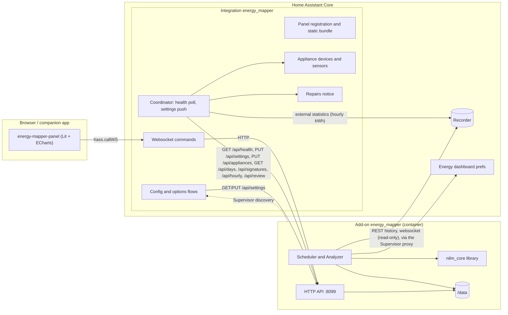
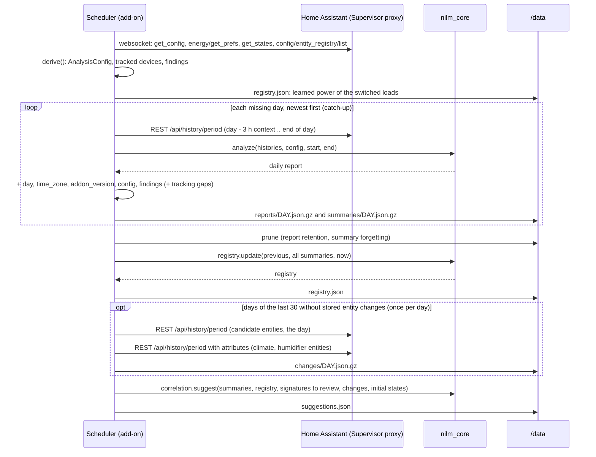
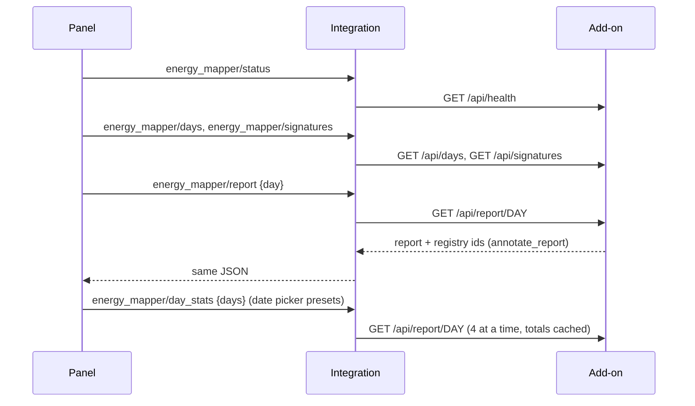
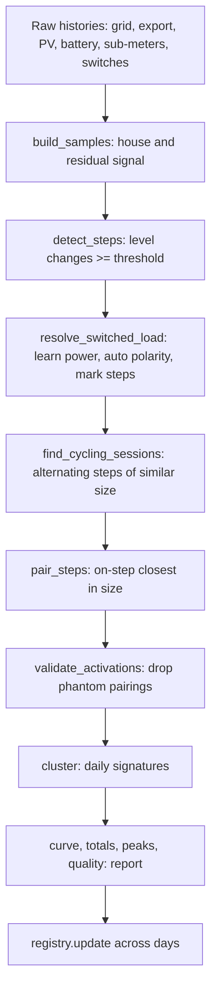
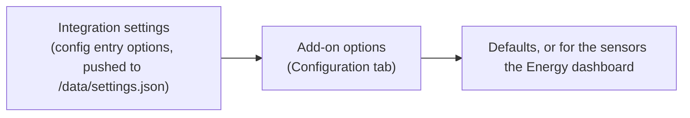

# Energy Mapper: design

This document describes how Energy Mapper works as of add-on 0.6.0 and integration 0.4.0:
the architecture, the analysis engine, how the Energy dashboard is used, storage, the APIs
and the reasons behind the main choices. User documentation: the [README](../README.md) and
the [add-on documentation](../energy_mapper/DOCS.md).

## Contents

1. [Goals and constraints](#1-goals-and-constraints)
2. [Architecture](#2-architecture)
3. [Data flow](#3-data-flow)
4. [The engine](#4-the-engine)
5. [Using the Energy dashboard](#5-using-the-energy-dashboard)
6. [Storage and retention](#6-storage-and-retention)
7. [Add-on HTTP API](#7-add-on-http-api)
8. [Integration: websocket API, appliances and statistics](#8-integration-websocket-api-appliances-and-statistics)
9. [Settings and precedence](#9-settings-and-precedence)
10. [Design choices](#10-design-choices)
11. [Known limits](#11-known-limits)
12. [Roadmap pointers](#12-roadmap-pointers)

## 1. Goals and constraints

Recognise the appliances of a home from the curve of its whole-house meter (and its solar
production), then, step by step, bring their consumption into the Home Assistant Energy
dashboard as the user names them (non-intrusive load monitoring, NILM).

- **Never put Home Assistant at risk**: no heavy computation in the Home Assistant process.
- **Read-only by default**: observe and propose. v0 never writes to Home Assistant; later
  versions change the configuration only after the user confirms, one appliance at a time.
- **Work for everyone**: no PV or PV, signed or import/export grid meters, W or kW, one or
  several phases, a battery, meters reporting every second or every minute, with or without
  an Energy dashboard. No hard-coded threshold that only fits one home.
- **Everything local**: consumption data reveals the habits of a household. No cloud, no
  telemetry.
- **Small hardware**: one day analysed in a few seconds at most on a Raspberry Pi 4.
- **No real consumption data in the repository**: tests and the panel's dev harness use
  synthetic households; real extracts stay outside (`tools/replay_csv.py`).

## 2. Architecture

The design follows the Frigate model: an add-on does all the computation, an integration
provides the Home Assistant side, and a panel shows the results inside the Home Assistant
frontend.

| Part | Where | Role |
|---|---|---|
| `nilm_core` | `energy_mapper/app/nilm_core/` | The engine: pure functions on lists of `(timestamp, value)`, standard library only, no Home Assistant import, no I/O, no clock. Testable and replayable offline. |
| Add-on service | `energy_mapper/app/` | Reads Home Assistant through the Supervisor (`homeassistant_api: true`, no token to create), derives the configuration from the Energy dashboard, runs the nightly analysis, maintains the signature registry and the storage, serves the internal HTTP API, announces itself through Supervisor discovery. |
| Integration | `custom_components/energy_mapper/` | Finds the add-on (discovery or manual address), keeps the user's settings in its config entry and pushes them to the add-on, relays the add-on API to the frontend as websocket commands, registers the sidebar panel, publishes the appliances as devices with sensors and imports their hourly energy into the long-term statistics (§ 8.1). No analysis. |
| Panel | `frontend/` → `custom_components/energy_mapper/frontend/energy-mapper-panel.js` | Sidebar panel running inside the Home Assistant frontend, built with the same libraries (Lit 3, ECharts 6) and styled only with Home Assistant theme variables. |

The integration and the panel never talk to Home Assistant's recorder for the analysis (the
integration only writes the appliances' statistics to it), and the add-on never talks to the
browser: the user only ever sees Home Assistant.

## 3. Data flow

### Nightly run

- **When**: on start, then every day at `analysis_time` (04:30 by default) in Home
  Assistant's time zone. Each pass catches up: yesterday and up to `backfill_days` days back
  that have no report yet, newest first. It stops at a *partial day* (the recorder history
  starts more than an hour after midnight: purged) or after three consecutive days without
  data. A failed day never stops the loop; Home Assistant outages are retried after 1, 5, 15
  and 60 minutes.
- **What a day is**: `[00:00, 24:00)` local time (23 or 25 hours on DST days). Histories are
  read from 3 hours before midnight so that loads already on at midnight are seen.
- **History request**: REST history with `minimal_response`, `no_attributes` and
  `significant_changes_only=0`, for the grid, solar, battery, sub-meter and switch entities
  and the energy sensors of the switched devices (for the tracking gaps). The entity
  suggestions read their candidates the same way, plus one request *with* attributes (not
  minimal) for the few entities whose attributes are compared (§ 8.4).
- **After a pass that analysed something** (or once a day otherwise), the storage is pruned
  and the signature registry updated, then the entity suggestions are computed (§ 8.4).
  `POST /api/analyze` does the same for one day. A pass with nothing to analyse never calls
  Home Assistant: it recomputes the suggestions from the stored changes only.

### Viewing a report

## 4. The engine

`nilm_core.analyze()` turns raw histories into a daily report. Across days,
`nilm_core/registry.py` keeps the signature registry (§ 4.8) and
`nilm_core/correlation.py` scores entities against the signatures to review (§ 8.4).

### 4.1 The signal (`signal.py`)

- **House load** = grid + PV + battery, where the grid is signed (+ import, − export, or
  `import − export` with two meters), PV is positive and the battery is + when discharging.
  **Residual** = house − sub-meters: what the analysis looks at.
- Several meters of the same kind (one per phase, several inverters) are summed on the union
  of their timestamps; the sum is unknown while one of them is.
- Unit factors per entity (kW → W) come from `unit_of_measurement`; `grid_invert` and
  `battery_invert` flip a sign.
- The grid meter drives the timeline: one sample per grid reading. Other series are
  piecewise constant (Home Assistant records a state when it changes).
- **Unavailable sources**: PV keeps its last value for 5 minutes, then counts 0 if it was
  already near zero (night, ≤ 50 W) and *unknown* otherwise (an inverter timeout in daylight
  must not create a multi-kW fake step); samples with unknown PV have no house value. Sub-meters
  and the battery keep their last value for 5 minutes, then count 0.

### 4.2 Steps (`steps.py`)

An appliance switching is a **step** in the residual load. For each reading that jumps by at
least 60 % of the threshold, the median of the readings in a window before and after is
compared; a difference of at least `step_threshold_w` (300 W) is a step. Windows are 20 s or
3.1 × the meter's median reporting interval, whichever is larger (at least three readings per
side), which makes the detector robust to single-sample spikes (motor inrush, meter noise)
and adapts it to meters reporting every 1 s to 60 s. Neighbouring candidates of the same sign
are merged, keeping the largest.

### 4.3 Switched loads (`known.py`)

An appliance driven by a Home Assistant entity without its own power sensor (a water heater
on a relay, a radiator on a pilot-wire relay). The entity tells *when* it may run; the steps
tell *whether* it drew power (a hot tank's thermostat may be open) and *how much*.

1. On-periods are the intervals in one of `on_states` (unavailable states do not end a period).
2. Near each transition (± 30 s), the largest free step of the right sign is a candidate; the
   **power** is the median candidate size (falling back to the power learned on previous days
   when there is no transition that day).
3. Candidates within 20 % (or half the threshold) of that power are kept and marked as
   explained; an on-period counts only if it started or ended with such a step.
4. **Automatic polarity**: the opposite states are tried too, and the polarity confirmed by more
   steps wins; the report then says `inverted: true`. A pilot-wire radiator heats while its
   relay is *off*.

Switched loads are resolved first, so their steps are never reused as anonymous activations.

### 4.4 Cycling sessions (`activations.py`)

Some loads switch on and off every few tens of seconds at the same power (an induction hob at
medium power, an oven thermostat). Pairing these steps one by one would produce dozens of tiny
"appliances", so they are grouped first: alternating up/down steps of at least 600 W, within
20 % of the running median size, at most 120 s apart, at least 6 steps. A session has a power,
a duty cycle, a cycle count, a median on-time and period. When another appliance switches at
the same instant as a cycle, the meter sees one combined step (e.g. +1.4 kW hob + 2.8 kW oven);
that step is split, the cycle's share joins the session and the remainder becomes a new step
that can be paired with the other appliance.

### 4.5 Pairing and validation (`activations.py`)

- Each off-step closes the open on-step **closest in size** (within 25 % or 60 W), not the most
  recent one: with several loads on, the off-step of a kettle must not close the water heater
  that started before it. Ties go to the most recent. Open on-steps older than 6 hours are
  dropped.
- **Validation** drops phantom pairings: steps from clouds (grid and PV are not sampled
  together) or from two unrelated appliances can be paired into a load lasting hours, during
  which the load falls back to the base. A low percentile (10 %) of the load during the
  activation must stay above `base + 0.6 × power`.

The result is a list of **activations** (one use of one appliance): start, end, power, and
for sessions duty, on-time and period.

### 4.6 Daily signatures (`signatures.py`)

Activations are grouped by kind (`steady` or `cycling`) and duration band (`short` < 10 min,
`medium` 10–60 min, `long` > 1 h, `session` for cycling), then clustered greedily on power
(12 % tolerance). The id names the group and the power rounded to 50 W under 1 kW, 100 W above:
`short-2000w`, `medium-2100w`, `long-900w`, `cyc-1500w`. Daily ids depend on that day only;
the long-lived identity is the registry id (below).

### 4.7 The report (`report.py`)

- **Base load**: the 5th percentile of the per-minute mean of the residual load (always-on
  consumption: fridges, network, standby).
- **Curve**: per minute, the house, grid, PV and sub-metered power, then the room left
  (house − sub-metered) split into base load, switched loads, signatures and *other*
  (unexplained). Measured parts are kept as measured; estimated parts are scaled down when they
  would explain more than what is left, switched loads first.
- **Totals** (`energy_kwh`) are integrated from the curve.
- **Peaks**: episodes where the house load is above 80 % of the day's maximum (samples less
  than 2 minutes apart merge into one episode), the top 5 by maximum. For each, what was running
  at the maximum (sub-meters, switched loads, activations) and the unexplained rest. A peak is
  **notable** when its maximum reaches the notable threshold (§ 4.8).
- **Quality**: number of samples, steps, seconds with unknown PV, longest gap, compute time.

### 4.8 The signature registry (`registry.py`)

An appliance used once a day is an isolated case in each daily report; it only becomes
recognisable across days. After each nightly pass the add-on rebuilds a **registry** from all
the stored day summaries.

- **Progressive forgetting, no fixed window**: every activation is weighted by its age,
  `0.5 ** (age_days / half_life_days)` (30 days by default). Recent habits dominate, a replaced
  appliance fades out within weeks, and a rare one (weekly, or a few times a year) stays known
  as "seen rarely" while its weight is meaningful. Below a weight of 1 % something is
  forgotten (about 200 days with a 30-day half-life).
- **Clustering from scratch every night** per (kind, band): seeds at the densest powers,
  nearest-centre assignment within 12 %, re-centring on the weighted median, merging of
  centres closer than 0.75 × the tolerance, until stable. The result depends only on the stored
  activations, so re-running a night gives the same clusters.
- **Stable identity**: each cluster takes the id of the previous signature it matches (same
  kind and band, power within 12 %, closest first, labelled signatures first). Unmatched
  clusters get a new id named like the daily ones. A previous signature without a cluster is
  carried forward with its weight decayed when nothing is left near its power (a rare
  appliance whose days were pruned), dropped when a neighbouring cluster took its activations,
  and dropped when its weight falls below 1 %, unless it has a user label (v1).
- **Per signature**: weighted and raw counts, days seen, uses per week, first and last seen,
  weighted hours histogram, weighted-median power and duration (and on-time, period and duty
  for sessions), raw and weighted energy, the three most recent examples.
- **Registry ids in daily reports**: `annotate_report()` adds `registry_id` to the activations
  (nearest signature, same rule), to the daily signatures (majority of their activations) and
  to the signature parts of the peaks. The API applies it when serving a report, so the ids are
  always the current ones.
- **Switched loads memory**: power (weighted median, weight × confirmed transitions) and
  polarity (weighted vote) from the days with confirmed transitions; a day without transitions
  keeps the last values, and the add-on uses the learned power as the fallback of such a day.
- **Notable peak threshold**: 80 % of the highest of the day's maximum and the highest daily
  maximum of the `peak_window_days` (30) days before, to follow the seasons; or the fixed
  `peak_threshold_w` when set. Daily reports still list the day's own top episodes, so a normal
  day is never empty; only the flag `notable` depends on this threshold. The days of the first
  backfill (analysed newest first) only know the days stored before them.

## 5. Using the Energy dashboard

`energy_config.derive()` turns `energy/get_prefs`, `get_states` and
`config/entity_registry/list` into the engine's `AnalysisConfig`. It is read live before each
analysis, so a change in the Energy dashboard applies to the next night.

**Energy → power sensor.** The dashboard lists energy sensors (kWh); the engine needs power
sensors (W). For each energy sensor, in order: a power sensor with the same `source_entity`
(estimation integrations such as powercalc); a power sensor of the same device with the most
shared name tokens (multi-channel meters have one power sensor per channel; power factor and
similar sensors are ignored); `sensor.<name>_power`.

**Sources.** Grid: the import sensors, several summed (one per phase), with the export sensor
when there is one grid meter; a grid source whose energy is 0 is ignored (and reported).
Solar: several inverters summed. Battery: the first battery source (with a "check the sign"
finding). Both the flat (`stat_energy_from`) and the older `flow_from`/`flow_to` formats are
read.

**Roles of the tracked devices** (`device_consumption`):

| Role | When | Use |
|---|---|---|
| `submeter` | Measured device with a power sensor | Subtracted before the analysis |
| `estimated` | Estimated device (has a `source_entity`) not driven by a switch, with a power sensor (lights…) | Subtracted like a sub-meter |
| `switched` | Estimated from a `switch` or `input_boolean` | A switched load: measured from the steps at its transitions |
| `estimated` (excluded) | Estimated from a switch listed in `excluded_switched_loads` | Subtracted like any estimate (§ 8.2) |
| `nested` | `included_in_stat` points to another tracked device | Not subtracted (never twice) |
| `energy_only` | No power sensor found | Not used; finding `no_power_sensor` |
| `unavailable` | Energy sensor unavailable | Not used; finding `unavailable` |
| `energy_mapper` | One of Energy Mapper's own statistics (`energy_mapper:…`, § 8.1), e.g. an estimate replaced by the appliance's statistic | Never subtracted, never `unavailable`. A switched load's statistic keeps its relay measured as a switched load, with its learned polarity; a labelled signature's needs nothing. An id the add-on cannot map: finding `unknown_statistic`, not used |

**Energy Mapper's own statistics** (`statistic_ids.py`): once an appliance is published, users
may replace its estimate in the Energy dashboard by its statistic; the relay then disappears
from the dashboard (no more `source_entity`). The add-on maps the statistic back with
`statistic_ids.json`: `statistic id → {kind, source_id, name, on_states}`, rebuilt before
each analysis from the registry with the integration's rule (every learned switched load,
every labelled signature) and never forgetting an entry, so a relay idle for months keeps its
learned polarity. A load id missing from it is matched against the current entities
(`statistic_id(load, entity_id)`; default polarity, which the engine's automatic polarity
corrects). Both sides build ids with the same function (`energy_mapper:<load|signature>_<slug>_energy`,
Home Assistant's `slugify`), checked by the integration tests. A device whose
`included_in_stat` is such a statistic is `nested`; a statistic nested in another device too.
The appliances declared by the integration (§ 8.2) are applied last and win: their statistic
keeps its id across renames, re-links and merges, so its entry names the appliance and its
current relay or signature, and is never `unknown_statistic`. A relay listed in
`excluded_switched_loads` is not measured, even from its statistic.
When the same relay is behind both an estimate and a statistic, it is measured once, with the
learned polarity.

**Findings** (shown as *Things to check*): `grid_ignored`, `no_power_sensor`, `unavailable`,
`battery_sign`, `no_grid`, `unknown_statistic`, and `tracking_gap`: after the analysis, `tracking_gaps()` compares,
for each switch-driven device, the energy declared by its sensor over the day with the energy
measured for its switched load; a ratio of 2 or more (with at least 0.5 kWh on one side) is
reported, typically an estimate configured at a few watts for a 2 kW water heater.

**Manual settings always win**: grid sensor (then no extra grid meters are summed), export,
PV, battery, signs, sub-meters (replace the derived list), switched loads (added, or
replacing the one with the same entity), thresholds. Then the **user's appliances** (§ 8.2)
apply: their switched-load sources are switched loads named after the appliance, their
sub-meter sources are added to the sub-meters. Without an Energy dashboard and without a
grid setting, the analysis fails with `no_grid`.

## 6. Storage and retention

Everything is under the add-on's `/data` (included in Home Assistant backups):

| Path | Content | Retention | Order of size |
|---|---|---|---|
| `reports/YYYY-MM-DD.json.gz` | Full daily report, with the per-minute curve | `report_retention_days` (90) | ~2 MB in all |
| `summaries/YYYY-MM-DD.json.gz` | The report without its curve | Until its activations' weight is below 1 % (~200 days with a 30-day half-life); never while the full report is kept | ~1–2 MB in all |
| `registry.json` | Signature registry, with the review decisions (§ 8.3) | While a signature's weight is above 1 %; forever once labelled; the 100 most recently ignored after they fade out | tens of KB |
| `settings.json` | Settings pushed by the integration | Until replaced (`PUT {}` deletes it) | < 64 KB |
| `statistic_ids.json` | Energy Mapper statistic id → appliance (§ 5) | Forever (one line per appliance ever published) | KB |
| `appliances.json` | The user's appliances pushed by the integration (§ 8.2) | Until replaced | KB |
| `changes/YYYY-MM-DD.json.gz` | State changes of the candidate entities and attributes on one day, with their state at midnight (version 2, § 8.4) | 31 days, and never without the day's summary | ~10–100 KB per day |
| `suggestions.json` | Entity suggestions of the signatures to review (§ 8.4), and the candidate list | Replaced each night | a few KB to tens of KB |
| `state.json` | `last_run`, `last_maintenance` | – | bytes |
| `options.json` | Add-on options (written by the Supervisor) | – | bytes |

Writes are atomic (temporary file + rename). Pruning runs after each analysis pass, then the
registry is updated; if it is missing or unreadable it is rebuilt from the summaries (a full
rebuild of 200 days × 80 activations takes about 0.2 s). Plain JSON reports of 0.1 are
compressed on start. When a full report has been pruned, `GET /api/report/DAY` serves the
summary with `curve: []` and `curve_pruned: true`.

### Report fields

| Field | Content |
|---|---|
| `version` | Report format (1) |
| `day`, `start`, `end`, `time_zone` | The analysed local day (unix times) |
| `generated_at`, `addon_version` | When and by which add-on version |
| `energy_kwh` | `house`, `grid_import`, `grid_export`, `pv`, `submetered`, `estimated` (the part of `submetered` from estimated devices, add-on 0.8.1+), `base`, `other`, `known` (`{name: kWh}`), `signatures` (`{daily id: kWh}`), and `base_w` (base load power, W) |
| `max_house_w`, `peak_threshold_w` | Highest house power of the day and the notable threshold |
| `curve` | Per-minute rows `{t, house, grid, pv, submetered, estimated, base, known: {name: W}, signatures: {daily id: W}, other}` |
| `peaks` | `{start, end, max_ts, house_w, grid_w, pv_w, parts: [{kind: submetered\|estimated\|known\|signature, name, power_w, since?, registry_id?}], unexplained_w, notable}` |
| `known_loads` | Switched loads: `{name, entity_id, power_w, transitions, matched, on_states, inverted, on_s}` |
| `activations` | `{start, end, power_w, cycling, duty, on_s, period_s, signature, registry_id}` |
| `signatures` | Daily signatures: `{id, kind, band, power_w, count, duration_s, energy_kwh, hours, on_s, period_s, duty, examples, registry_id}` |
| `quality` | `{samples, steps, pv_unknown_s, max_gap_s, compute_s}` |
| `config` | Sensors used: `grid_entity`, `extra_grid_entities`, `grid_export_entity`, `pv_entity`, `extra_pv_entities`, `battery_entity`, `tracked` (`{name, energy_entity, power_entity, role, source_entity}`), `findings` |
| `findings` | `{kind, entity_id, detail}` (derive findings and tracking gaps) |

## 7. Add-on HTTP API

Port 8099 on the internal Supervisor network (not exposed on the host). No authentication:
only Home Assistant and other add-ons can reach it. Standard library `ThreadingHTTPServer`,
JSON in and out; request bodies are limited to 64 KB (413 above).

| Request | Answer |
|---|---|
| `GET /api/health` | `200 {"status": "ok", "version": "0.8.1", "last_run": <unix time \| null>, "days": <full reports>, "signatures": <registry size>, "storage_bytes": <int>}` |
| `GET /api/days` | `200 {"days": [...], "summary_days": [...], "generated": {day: <unix time>}}`: days with a full report, and older days with only a summary, ascending; `generated`: when each full report was made (`generated_at`) |
| `GET /api/report/YYYY-MM-DD` | `200` the report with registry ids; `400 {"error": "invalid_day"}`; `404 {"error": "not_found"}` |
| `GET /api/hourly/YYYY-MM-DD` | `200` the hourly breakdown of the day (`nilm_core/hourly.py`, § 8.1); `400 invalid_day`; `404 not_found` when the day has no per-minute curve |
| `GET /api/signatures` | `200` the registry: `{version, updated_at, half_life_days, power_tol, days, first_day, last_day, signatures: [...], switched_loads: [...], peak: {window_days, relative, reference_w, threshold_w, days} \| null}` |
| `POST /api/analyze?day=YYYY-MM-DD` | `200 {"day", "ok": true}`, else `{"day", "ok": false, "error", "message"}` with `invalid_day` 400 (not a date, or not over), `no_grid` / `no_data` / `partial_day` 422, `ha_error` 502, `internal` 500 |
| `GET /api/settings` | `200 {"settings", "options", "defaults", "automatic"}` (§ 9) |
| `PUT /api/settings` | Replaces the settings: `200 {"settings": <as stored>}`; `400 {"error": "invalid_settings" \| "invalid_json", "message"}` |
| `GET /api/appliances` | `200 {"appliances": [...]}`: the user's appliances (§ 8.2) |
| `PUT /api/appliances` | Replaces them: `200 {"appliances": <as stored>}`; `400 {"error": "invalid_appliances" \| "invalid_json", "message"}` |
| `GET /api/review` | `200 {"criteria": {min_uses, min_days, wait_days, wait_factor}, "now", "counts": {proposed, waiting, ignored, validated}, "signatures": [...], "suggest": {computed_at, days, candidates, attribute_candidates, min_score, unrecorded_domains, unrecorded_entities}}`: the registry signatures `proposed` (most weighted energy first), `waiting` and `ignored`, each with its `review_state` (§ 8.3) and, when some entity matches, its `suggestions` (§ 8.4) |
| `POST /api/review` | `{"id", "action": "validate" \| "wait" \| "ignore" \| "restore", "appliance"?}`: `200 {"signature"}` with its `review_state`; `404 not_found`; `400 invalid_review` (`validate` needs `appliance`) |
| `POST /api/signatures` | `{"kind", "band", "power_w", "label"}`: the signature of an appliance not seen yet: `200 {"signature", "created"}` (an existing unnamed signature at that power is returned, `created: false`); `409 {"error": "conflict", "message", "id"}` when that signature belongs to another appliance; `400 invalid_signature` |

Other paths answer `404 {"error": "not_found"}`, other methods on known paths
`405 {"error": "method_not_allowed"}`. The registry signature fields are documented in the
[add-on documentation](../energy_mapper/DOCS.md#signature-registry).

**Discovery**: under the Supervisor the add-on posts
`{"service": "energy_mapper", "config": {"host": <container hostname>, "port": 8099}}` to
`http://supervisor/discovery` (retried after 10 s, 30 s, 1 min, 5 min); the integration's
`async_step_hassio` receives it.

## 8. Integration: websocket API, appliances and statistics

Registered once in `async_setup`. Every command needs an authenticated user; `analyze` needs an
administrator. Except `status` and `day_stats`, each command relays one add-on request and
returns its JSON unchanged.

| Command | Parameters | Result |
|---|---|---|
| `energy_mapper/status` | – | `{"configured": bool, "state": <config entry state> \| null, "url": str \| null, "available": bool, "health": <GET /api/health> \| null, "error": str \| null, "settings": <entry settings> \| null}`. Never an error; `health` is fetched live when the entry is loaded. |
| `energy_mapper/days` | – | `GET /api/days` |
| `energy_mapper/report` | `day`: `YYYY-MM-DD` | `GET /api/report/<day>` |
| `energy_mapper/analyze` | `day` | `POST /api/analyze?day=<day>` (timeout 600 s; admin only) |
| `energy_mapper/day_stats` | `days`: list of at most 62 days | `{"days": {"YYYY-MM-DD": {"house_kwh", "max_house_w", "notable_peaks", "last_notable"}}}`; days without a report are left out. The integration reads the reports (4 at a time) and caches the totals (up to 400 days; an analysis invalidates its day). |
| `energy_mapper/signatures` | – | `GET /api/signatures` |
| `energy_mapper/settings` | – | `GET /api/settings` (settings are changed in the options flow) |
| `energy_mapper/review` | – | `GET /api/review`, `"repair"` (the notice is on) and `"appliances"` (`[{key, name}]` of the subentries, sorted by name: what a signature can be merged into); admin only |
| `energy_mapper/validate` | `signature_id`, `name`, `entity_id`?, `on_states`? (at most 20) | Creates the appliance (§ 8.3, § 8.4): `{"appliance": {"key", "name", "sources"}}`; admin only |
| `energy_mapper/merge_signature` | `signature_id`, `appliance` (its key) | Adds the signature as a source of that appliance (§ 8.4): `{"appliance": {"key", "name", "sources"}}`; admin only |
| `energy_mapper/wait`, `energy_mapper/ignore`, `energy_mapper/restore` | `signature_id` | `POST /api/review`: `{"signature"}`; admin only |

The review commands take `signature_id` (`id` is the websocket message's own id).
Errors (`{"code", "message"}`): `invalid_format` (bad parameters), `unauthorized`,
`not_loaded` (no entry, or not set up), `addon_unavailable` (unreachable or timeout, 30 s by
default), or the add-on's own code and message (`invalid_day`, `not_found`, `no_grid`,
`no_data`, `partial_day`, `ha_error`, `internal`), else `http_<status>` / `invalid_response`;
`validate` and `merge_signature` also answer `already_linked` (the signature or the entity is
already a source of an appliance) and `not_found` (no such signature or appliance).

Other parts of the integration:

- **Config flow**: `async_step_hassio` (discovery, then a confirmation) or `async_step_user`
  (manual URL, default `http://local-energy-mapper:8099`), both validated by
  `GET /api/health`. Single instance (unique id `energy_mapper`). On rediscovery an entry
  created by discovery follows the new URL; a manual URL is kept.
- **Coordinator**: polls `/api/health` every 5 minutes; setup raises `ConfigEntryNotReady`
  while the add-on does not answer.
- **Panel**: `panel_custom` registration (`/energy-mapper`, element `energy-mapper-panel`,
  icon `mdi:home-lightning-bolt-outline`, not admin-only), bundle served from
  `/energy_mapper_frontend/` with a content hash in the URL.
- **Diagnostics**: entry data and options, last health, availability, sync state, appliances
  and imported days, signatures to review.

### 8.1 Appliances, sensors and hourly statistics

The analysis is nightly, so a day's values are only known the next morning. A
`total_increasing` sensor updated once a day would put the whole day into the hour of the
analysis in the Energy dashboard. The hourly energy of each appliance is therefore imported
into the recorder's **long-term statistics** as **external statistics**, with the timestamp of
each hour, the way utility integrations publish delayed meter data; the sensors only show the
last analysed day.

**Appliances** are the config subentries of the entry (§ 8.2). Each has one or more
sources; its hourly energy is the sum of its switched-load and signature sources (a sub-meter
source is measured by its own sensor and gets nothing here). Identity, given at creation from
the first source and never changed afterwards (renames, link changes and merges keep it):

| Created from | Key: device identifier, subentry unique id, unique id base | Statistic id |
|---|---|---|
| Switched load | `load:<entity_id>` | `energy_mapper:load_<slug of entity_id>_energy` |
| Signature | `signature:<registry id>` | `energy_mapper:signature_<slug of registry id>_energy` |

A key already taken (an appliance re-linked away from that source) gets a suffix (`-2`). The
statistic id is stored in the subentry: after a link change it no longer follows the rule.

**Where the hourly series are computed: in the add-on** (`GET /api/hourly/DAY`,
`nilm_core/hourly.py`), because it owns the report format and the registry matcher, and the
answer is a few KB instead of the 200 KB per-minute curve (a 90-day backfill would otherwise
move about 20 MB to Home Assistant). For each curve row (one minute), switched-load watts are
keyed by entity id (the curve keys them by name, mapped with `known_loads`), and the watts of
each *daily* signature are shared among its activations running in that minute in proportion
of their energy, each share going to the **registry id** of its activation
(`registry.Matcher`, the rule of `annotate_report`); unmatched activations go to `?`. Rows are
summed per **UTC hour** (`floor(t / 3600)`), so a DST day has 23 or 25 hours and needs no
special case; in a time zone with a half-hour offset the first and last hours are shared with
the neighbouring days, and the integration adds both days' parts. The registry ids are those
of the registry at the time of the import: past days are not re-attributed when the registry
moves on.

**Synchronisation** (`coordinator.py`), in a background task after each successful health
poll (every 5 minutes) and after `energy_mapper/analyze`:

1. `GET /api/days` and `GET /api/signatures`. A day is *changed* when it was never imported or
   its `generated` time differs from the one imported (new day, or `POST /api/analyze`).
2. `GET /api/hourly/DAY` for the changed days (4 at a time), and the last day for the sensors.
3. The appliances are updated (§ 8.2: adoption, discovery); the recorder metadata of source
   `energy_mapper` tells which already have statistics. An appliance without statistics is
   new: it is **backfilled** with every stored day that has a curve (up to
   `report_retention_days`), oldest first, in one import.
4. Each appliance imports the hours of its days (zeros included, so a re-import overwrites an
   hour that became empty).
5. Statistics of source `energy_mapper` that no appliance owns are cleared
   (`async_clear_statistics`), and devices of no appliance removed. The registry never removes
   an appliance: only the user does (§ 8.2).
6. The appliances are pushed to the add-on when they changed (`PUT /api/appliances`).
7. The imported days, the learned powers, the last day's values and each appliance's last use
   are kept in `.storage/energy_mapper.<entry id>`, so the sensors have their values after a
   restart and nothing is imported twice.

**Monotonic sums** (`statistics.py`): importing hours `H` of a statistic reads the stored
rows from one week before `min(H)` (further back only if that week is empty) and takes the
sum of the last row before `min(H)`. The rows at or after `min(H)` keep their hourly value
(`state` holds the hour's kWh) unless they are in `H`, and the cumulative sums are recomputed
from there; only the hours of `H` and the later rows whose sum moved are written. So a
re-analysed day replaces its hours instead of adding to them, the days after it shift by the
difference, and the sums never decrease (hourly values are never negative).

Metadata: `has_sum`, `mean_type` none, `unit_class` `energy` (on the Home Assistant versions that have it; required from 2026.11),
kWh, `source` `energy_mapper`, `name` the appliance name.

**Devices and sensors** (`sensor.py`): a service device *Energy Mapper* (the entry) and one
device per appliance linked to it (`via_device`), in the appliance's subentry; an appliance
measured only by a sub-meter keeps its device without sensors. All sensors use `has_entity_name` with
translated names (English, French), so their entity ids follow the appliance name; they are
unavailable while the add-on is unreachable and keep their values otherwise.

| Sensor | Device | Value |
|---|---|---|
| `sensor.<appliance>_energy_yesterday` | appliance | kWh of the last analysed day (attribute `day`) |
| `sensor.<appliance>_uses_yesterday` | appliance | Activations (signature) or on-periods (switched load) that day |
| `sensor.<appliance>_last_seen` | appliance | Timestamp: end of the last minute with energy, over the imported days |
| `sensor.<appliance>_typical_power` | appliance | Learned power, W (diagnostic) |
| `sensor.energy_mapper_unexplained_energy_yesterday` | service | The day's `other`, kWh |
| `sensor.energy_mapper_base_load` | service | The day's base load, W |
| `sensor.energy_mapper_last_analysis` | service | Timestamp of the add-on's last analysis |

The sensors have no `state_class`: they create no statistics of their own, the hourly
statistics are the energy history. The house total is already in Home Assistant (the grid
meter) and is not duplicated. Live power and on/off entities come with real-time detection
(#17).

### 8.2 Appliances: one config subentry each

**Source of truth: Home Assistant.** Each appliance is a config subentry (type `appliance`)
of the Energy Mapper entry: `title` = name, `unique_id` = key, `data` =
`{key, statistic_id, sources}`. Its device and entities belong to the subentry
(`config_subentry_id`), so the integration page lists the appliances, and Home Assistant
removes the device and entities with the subentry. The add-on owns what is *learned*
(signatures, powers, polarities); the user's *decisions* (names, links, merges, deletions,
exclusions) live in Home Assistant, in its backups, and are pushed to the add-on, which only
applies them. Sources:

| Source | Data | Hourly energy | In the add-on |
|---|---|---|---|
| `switched_load` | `entity_id`, `on_states` only when forced | `known[entity_id]` | A switched load named after the appliance |
| `signature` | registry `id`, its `kind`, `band`, `power_w` | `signatures[id]` | `label` = name, `appliance` = key; recreated from group and power if missing |
| `submeter` | `entity_id` (a power sensor) | none: the sensor has it | Added to the sub-meters |

**Sync, add-on → Home Assistant** (`coordinator.py`, each synchronisation):

1. *Adoption*, once per entry (until the first successful push): the appliances the add-on
   holds (`GET /api/appliances`) that no subentry covers become subentries, so a reinstalled
   integration keeps the user's appliances.
2. *Discovery*: every learned switched load not excluded and every labelled signature without
   `appliance` (a label set before #11 or by another client) that no subentry covers gets a
   subentry, named after the switched load or the label. A label with `appliance` belongs to
   one of our appliances: when none has that key, it was deleted and the next push clears it.
   The review in the panel (§ 8.3) creates its appliances through the same helper
   (`EnergyMapperCoordinator.async_add_appliance`).

**Sync, Home Assistant → add-on**: the list of appliances, sorted, is pushed with
`PUT /api/appliances` after each synchronisation when it differs from the last push (so after
every change of a subentry, which schedules one). The add-on stores it in
`appliances.json`, applies the labels to the registry at once and after each nightly update
(the update matches labelled signatures first), and uses the switched loads and sub-meters
from the next analysis. An add-on older than 0.5.0 answers 404/405: nothing is pushed, the
appliances still work in Home Assistant.

**Changes**, from the integration page (subentry flows, `config_flow.py`) and handled by the
entry's update listener (`async_subentries_changed`):

| Action | Flow | Effect |
|---|---|---|
| Add | *Add appliance*: a switch (`add_relay`), or not seen yet (`add_expected`: name, power, typical use) | New subentry. Not seen yet: `POST /api/signatures` creates an *expected* signature (weight 0, named, never forgotten) that the first cluster of its group within 12 % takes; an unnamed signature already at that power is used instead; one of another appliance is refused. A source already used by another appliance is refused (merge instead) |
| Rename | *Reconfigure → Rename* | Title; device name, statistic metadata name (empty import), add-on label or switched-load name follow. Entity ids (registry), unique ids, key and statistic id do not change |
| Change the link | *Reconfigure → Link to a switch / a power sensor* | Sources replaced. Same statistic: the past hours stay, new hours come from the new source (a re-analysed past day uses the new source). A relay no appliance uses any more is excluded; a signature loses its label at the push. A sub-meter-only appliance keeps its device and statistic history; its sensors are removed and no hours are imported |
| Merge | *Reconfigure → Merge another appliance into this one* | Under the synchronisation lock: every hour of the other appliance's statistic is added to this one's (read from the recorder, so the whole history, not only the retained days; sums recomputed), its sources join this one's, then its subentry is removed (device, entities, statistic). Merging is a union of sources, not a merge of registry clusters: two clusters at different powers would split again at the next nightly re-clustering |
| Delete | Home Assistant's own *Delete* on the subentry | Home Assistant removes the device and entities; the listener clears the statistic, excludes the relays no appliance uses any more (`excluded_switched_loads`, removed from the manual `switched_loads`), the push clears the labels. No comeback: discovery skips excluded relays and labels with `appliance` |

**Exclusions** (`excluded_switched_loads`, a setting, #33 minimal): the add-on does not
measure an Energy dashboard estimate driven by an excluded switch as a switched load (it is
subtracted like any estimate); a manual or appliance switched load is still measured. The
options flow shows the list; removing a switch from it lets it be found again. Adding an
appliance on an excluded switch removes the exclusion.

**Migration** (entry 1.1 → 1.2, `async_migrate_entry`): each device of the entry with an
appliance key (and each appliance of the 0.2 store without a device) becomes a subentry with
that key, name and the statistic id of the rule; the device moves into it
(`new_config_subentry_id`), its entities too (`config_subentry_id`). Entity ids, unique ids and
statistic ids do not change, nothing is re-imported. The add-on gets the appliances at the
first push; until then it keeps working from its settings.

### 8.3 Review of the signatures in the panel

The user decides which recurring signatures become appliances in the panel, where the curve
is visible, not in Repairs: a Repair per signature would be a red badge for every new
signature, and a Repair only offers "fix" or "ignore", with no "wait" and no curve.

**Who decides what.** The add-on owns the review state of each signature, computed when it is
asked (`review.py`), from the registry and the keys of the appliances the integration pushed:

| `review_state` | Rule |
|---|---|
| `validated` | The signature has a `label`/`appliance` (signature source of an appliance), or its decision is `validated` for an appliance key the add-on currently holds |
| `ignored` | Decision `ignored`, or `validated` for an appliance that no longer exists (deleting an appliance means "not interested"; restoring brings it back) |
| `waiting` | Decision `waiting` and neither `count ≥ until_count` (`ceil(count × wait_factor)`, at least one more) nor `now ≥ until` (`wait_days` later) |
| `proposed` | Mature: `count ≥ min_uses` and `days_seen ≥ min_days` (raw counts over the stored summaries) |
| `immature` | Otherwise |

The thresholds are settings (`review_min_uses` 5, `review_min_days` 3, `review_wait_days` 14,
`review_wait_factor` 2, § 9); a wait stores its own `until_count` and `until`, so changing the
settings does not move the waits already decided.

**Storage: in the registry signature** (`review`: `{"state", "at", …}`), because the
decision is about a registry identity and must follow it: `registry.update` copies it to the
cluster that takes the id each night, like the label. Ignored signatures are exempt from the
1 % forgetting (a carried one is kept when nothing absorbed its activations), so that the same
appliance seen again months later takes the ignored id and stays ignored; at most
`MAX_FADED_IGNORED` (100) faded ignored signatures are kept, the most recently ignored first,
which bounds the registry. Waiting decisions go with their signature. Decisions are written
under the registry lock; the nightly update, which reads the registry before re-clustering
(about 0.2 s), copies the decisions stored meanwhile before saving, so none is lost. The
registry is in `/data`, so decisions survive restarts and are in the backups; a registry
rebuilt from scratch (corrupt file) loses them (the appliances themselves are in Home
Assistant).

**Validation** (`energy_mapper/validate`, `EnergyMapperCoordinator.async_validate`): the
integration reads the registry signature, builds the source and creates the subentry with the
same helper as discovery, so the device, sensors, statistics and backfill follow at the next
synchronisation exactly as for any appliance:

| Choice in the panel | Source of the new appliance | Key |
|---|---|---|
| New appliance (a name) | `signature` (id, group, power) | `signature:<id>` |
| Linked to a switch or an entity whose state tells when it runs (`switch`, `input_boolean`, `light`, `fan`, `binary_sensor`, `climate`, `humidifier`, `water_heater`, `media_player`, or a `sensor` of the `enum` device class) | `switched_load`: the entity is the ground truth, the engine measures its power; the signature fades out as its steps are explained. `on_states`: those learned by the suggestion (§ 8.4) when the entity was suggested and they are not just `on`, else none (the add-on's automatic polarity) | `load:<entity_id>` |
| Linked to a power sensor (any other `sensor`) | `submeter`: subtracted before the analysis, its steps disappear | `submeter:<entity_id>` |
| A part of an existing appliance (`energy_mapper/merge_signature`, #43) | `signature` added to that appliance's sources (§ 8.4, *Merge*) | the appliance's, unchanged |

A signature or an entity already used by an appliance is refused (`already_linked`; merging is
done from the appliance's own flow). The integration then pushes the appliances at once
(`PUT /api/appliances`) and records `validate` with the new key (`POST /api/review`), so the
add-on knows the appliance before the decision names it.

**Repairs: one notice only.** After each synchronisation (every 5 minutes) and after each
decision, the integration reads `GET /api/review` and keeps a single non-fixable issue
`signatures_to_review` (warning, "to review: N") whose description and *Learn more* link open
the panel at `/energy-mapper?review=1`; the panel scrolls to its *To review* section. It is
deleted when nothing is proposed, when the option *Notify in Repairs* is off, or when the entry
is removed. An add-on before 0.6.0 answers 404: no notice, no section.

**Panel** (`frontend/src/review.ts`, unit tested): administrators only. Proposed signatures
with power, duration or cycle (on-time and period), uses and days, uses per week, energy, the
usual hours (the hours at or above half of the busiest one, as ranges, across midnight) and
the three most recent examples of the registry; an example opens its day and zooms the chart
on it. *Validate…* opens an inline form (new appliance / switch / power sensor, Home
Assistant's `ha-entity-picker` when loaded, a native input with a list of the matching
entities otherwise); *Wait* and *Ignore* act at once. Below: the waiting signatures (when they
come back) and a collapsible *Ignored* list, each with *Restore*.

Not in this version: the other proposals of the same section, "take over tracking" (#13) and
"probable sub-meter" (a power sensor whose steps coincide with the whole-house steps).

### 8.4 Entity suggestions (#41, #43)

The review asks the user what a signature is; often Home Assistant already knows: a fan, a
heater on a smart relay, a washing machine reporting its programme state turn on and off
exactly when the signature starts and stops. The add-on compares them every night and the
panel shows the best match: "Probably: Attic fan (92 %)". When that entity already belongs to
an appliance, the signature is probably a part of it: "Probably part of Radiator: Living room
(heating)", with a *Merge into Radiator* button.

**Candidates** (`suggest.py`): entities of the domains `light`, `switch`, `input_boolean`,
`fan`, `climate`, `humidifier`, `water_heater`, `media_player`, `binary_sensor`, and `sensor`
with the `enum` device class (an operation state); not the diagnostic or configuration entities
(`entity_category`), not Energy Mapper's own entities, not the meters and sub-meters the
analysis uses, nor the excluded switched loads (`excluded_switched_loads`). Since 0.8.0 the
switched loads and the entities linked to an appliance **are** candidates: a signature matching
one of them is a part of that appliance (a radiator cycling on its own thermostat while its
pilot-wire relay allows heating), which the panel proposes to merge. At most 500, sorted.
Nothing is specific to a vendor or a name.

**Attribute candidates** (#43): a `climate` entity's state is its HVAC *mode* (`heat` all
winter); whether it is actually heating is the attribute `hvac_action`. A small fixed list of
"what is it doing" attributes is read as if they were states, for the entities of their domain
only (`ATTRIBUTE_CANDIDATES`, at most 50 entities):

| Domain | Attribute | Why |
|---|---|---|
| `climate` | `hvac_action` (`heating`, `cooling`, `idle`, `off`…) | The mode stays the same for months; the action follows the regulation |
| `humidifier` | `action` (`humidifying`, `drying`, `idle`, `off`) | Same, for a humidifier or dehumidifier |

Left out: a fan's `percentage` (a speed setting; the fan's on/off state already tells when it
runs) and the water heater's `operation_mode` (it is the state already; no standard attribute
says when a water heater heats). The series key is `<entity_id>::<attribute>`; a suggestion
gives `entity_id` and `attribute`, and the panel shows it as "<friendly name> (heating)", the
on states of the match in parentheses. Attributes need the full history rows (with
attributes, not minimal: an attribute change keeps `last_changed`, `last_updated` is its
time), so they are read in a separate request limited to those entities.

**Changes** (one history request per day, split so that the entity list of a request stays
under 3,000 characters, plus one with attributes): for each candidate, the changes of state
within the day (the first known state is not a change; `unavailable`/`unknown` are skipped),
and the state at midnight (`initial`, needed by containment). An entity changing more than 100
times that day (300 for an attribute: a thermostat's `hvac_action` may follow a short
regulation cycle) is only counted (`chatty`: that day is not compared for it); an entity
without any recorded state is `missing`. The changes of a day are read right after the day is
analysed, and kept in `changes/DAY.json.gz` (`version` 2) for 31 days; days of the window
without that file, or with a file written before 0.8.0 (no version: no attributes, no initial
states), are read (again) once at the next nightly run. If the recorder purged such a day
meanwhile, the old file is kept; it is still compared, the time before each entity's first
change being unknown. A day whose history is empty for every candidate (purged by the
recorder) is kept but not compared.

**Edge scoring** (`nilm_core/correlation.py`, pure): the signatures in the `proposed` and
`waiting` states (at most 50) and their activations of the stored summaries of the last 30
days (registry ids by the clustering's rule). Each activation gives an *on* step (its start)
and an *off* step (its end); steps closer to midnight than the window are left out. The
**window** is twice the day's mean sampling interval (`(end − start) / quality.samples`),
between 60 and 300 s. For one entity and one signature:

1. For each step, the nearest change of the entity within ± window, and the state it entered.
2. **On states**: the states entered at more on steps than off steps (`on` for a light,
   `off` for a pilot-wire relay, `running` for an operation state…). None: no candidate.
3. A step is **matched** when the state entered is an on state for an on step, or any other
   state for an off step.
4. `score` = matched / steps compared (days without stored changes, or chatty, are not
   compared); `on_share` and `off_share` the same per kind of step; `explained` (reverse
   share) = the entity's changes within the window of some step / all its changes on the
   compared days, steps or not.

An entity is suggested on edges when `score ≥ review_suggest_score` (80 % by default), at
least 5 steps are matched on at least 3 different days, and `explained ≥ 0.3`: an entity that
changes all the time matches every step by chance but explains few of its own changes. A
random entity changing *r* times a day hits a step with a probability of about *r × 2 ×
window / 1 day* (7 % for 50 changes a day and a 60 s window), far from 80 %.

**Containment scoring** (#43). Edge coincidence is the wrong test for an entity that stays in
a state for long periods while the load cycles inside them: a thermostat stays `heating` for an
hour while its radiator switches on and off on its own; most of the radiator's steps are far
from any change of the thermostat, and most of the thermostat's changes are far from a step.
What matters is that the signature **only runs while** the entity is in that state. From the
entity's known periods of each compared day (`segments`: from midnight with the initial state,
or from its first change) and the signature's activations (`signature_uses`):

1. **On states**: the states holding a larger share of the signature's on-time than of the
   entity's time (a lift above 1). None, or covering all the time: no candidate.
2. `contained` (shown as the score): the share of the signature's on-time spent in an on state.
3. `time_share`: the share of the entity's time in an on state.
4. **Sessions**: the activations of a day grouped when less than 30 minutes apart (uses close
   together are not independent evidence); a session is *inside* when at least half of its
   on-time is in an on state. `matches` = sessions inside, `sessions` = all of them.
5. `chance` = P(X ≥ matches) for X ~ Binomial(sessions, time_share): the probability that so
   many sessions fall inside by chance if they ignored the entity.
6. `used`: the share of the entity's on periods (consecutive on segments) during which the
   signature runs at least once (the entity's on-time actually used).

An entity is suggested on containment when `contained ≥ review_suggest_score` (the same
setting), at least 5 sessions are inside on at least 3 different days, `used ≥ 0.3` and
`chance ≤ 10⁻⁴`. The chance test rejects an entity that is "on" most of the time (it contains
most uses whatever they are); `used` rejects an entity that is often on without the load. The
threshold allows for the multiple comparisons (up to 550 series per signature): a random
entity reaches it about once in 10,000 comparisons.

Synthetic results (`tests/test_containment.py`, 20 days, a ~900 W cycling load inside four
"heating" periods of 60–110 minutes a day, a fifth period a day without it, the load starting
and stopping 3–10 minutes away from the thermostat's changes):

| Entity | Edge score | `contained` | `time_share` | `used` | inside / sessions | `chance` | Result |
|---|---|---|---|---|---|---|---|
| Thermostat `hvac_action` | none (no on state stands out) | 1.0 | 0.29 | 0.8 | 80 / 80 | 2.5 × 10⁻⁴³ | suggested (containment) |
| Same, 40 % of the uses moved outside heating | – | 0.61 | 0.29 | 0.54 | 41 / 68 | 10⁻⁷ | rejected (`contained` < 0.8) |
| 30 random entities, 4 changes a day | – | at most `time_share` + 0.05 | 0.1–0.9 | – | – | best 0.019 | rejected (`chance`) |
| An entity on except two short breaks a day | – | 0.96 | 0.95 | 0.83 | 78 / 80 | 0.18 | rejected (`chance`) |

An entity accepted on both tests is an edge match. The best 3 are kept: edge matches first,
then by score, then `explained` (edge) or `used` (containment), then matches. Cost:
entities × signatures × days of lookups, binary searches and overlaps; containment is computed
only when the edge test fails and stops at `contained` when it is too low: a few seconds at
the bounds (550 series, 50 signatures, 30 days), once a night.

**Storage and API.** `suggestions.json` (`version` 2): `{version, day, computed_at, days,
candidates, attribute_candidates, min_score, unrecorded: {entities, domains}, entities: [the
candidates and attribute keys], devices: {entity_id: device_id}, signatures: {id: [candidate]}}`
where an edge candidate is `{entity_id, attribute?, match: "edge", score, on_share, off_share,
explained, matches, steps, days, days_compared, on_states, inverted}` and a containment
candidate `{entity_id, attribute?, match: "containment", score, contained, time_share, used,
matches, sessions, days, days_compared, chance, on_states, inverted}`. It is replaced each
night; separate from the registry so that the nightly re-clustering never has to carry it.
`GET /api/review` adds `suggestions` to each listed signature that has some and `suggest` to
the listing. A suggested entity that belongs to an appliance gets `appliance: {key, name,
via}`: `via: "entity"` when it is a source of the appliance (switched load, sub-meter), `via:
"device"` when it shares a Home Assistant device with one (`devices`, from the entity registry
of the nightly run: a thermostat and its relay in one device). `unrecorded.domains`: the
candidate domains none of whose entities has any recorded state on the days that have some
history (recorder exclusions); the panel names them under the section's hint, without
blocking anything. The integration relays the listing, and adds `appliances`.

**Linking.** What a suggestion can become depends on how it matched:

| Suggestion | The *Validate…* form opens on | Why |
|---|---|---|
| Belongs to an appliance (`appliance`) | *A part of an existing appliance*, that appliance selected; the card also has *Merge into <appliance>* | The signature is probably a part of it |
| Edge match of an entity state | *An appliance driven by a switch*, the entity picked and named after it | Its changes are the appliance's steps: a ground truth |
| Containment match, or an attribute | *A new appliance*, named after the entity | A hint for the name only (below) |

The suggested entities are chips; another entity or mode can still be chosen.
`energy_mapper/validate` accepts `on_states`, sent when the entity is one of the edge state
suggestions and its on states are not just `on`. Any linked entity becomes a **switched load**
(§ 4.3): the engine handles any state values once the on states are known (and still tries the
opposite polarity), so every candidate domain is usable as a ground truth, an operation-state
sensor included. The derivation from the Energy dashboard (§ 5) keeps `switch` and
`input_boolean` only, for estimates driven by a switch: a light with an estimate stays an
estimate (subtracted), since a light below the step threshold could never be measured as a
switched load.

**Attributes and containment are not ground truths** (decision #43): a switched load measures
the power step at the entity's transitions (§ 4.3). A containment match says the opposite: the
load switches *inside* the entity's periods, not at its transitions, so a switched load keyed on
it would measure nothing useful. An attribute edge match (a humidifier's `action`) could be
one, but it would need a new kind of source (entity + attribute) in the subentries, the
settings, the analysis's history read and the hourly keys, for little gain: such entities
usually have an on/off state that is already a candidate. So an attribute or containment
suggestion only names the new appliance (a `signature` source) or points to the appliance to
merge into.

**Merge** (`energy_mapper/merge_signature`, `EnergyMapperCoordinator.async_merge_signature`):
under the synchronisation lock, the signature (with its group and power) is added to the
sources of the appliance with that key, like a merge of #38 (§ 8.2): the appliance keeps its
name, key and statistic; its energy is the sum of its sources from now on. The appliance is
marked for a **re-import**: at the next synchronisation (scheduled by the subentry change)
every stored day is imported again into its hourly statistic, so the stored days include the
signature's energy too (hours older than the report retention keep their values). The mark is
kept in the integration's storage until that synchronisation succeeds. The integration then
pushes the appliances and records `validate` with the appliance's key (`POST /api/review`), so
the signature is `validated` and labelled with the appliance's name. A signature already used
by an appliance is refused (`already_linked`).

## 9. Settings and precedence

The settings have three possible sources, resolved **key by key**:

1. **Integration settings** win. The options flow stores only the values that differ from
   what the add-on would use without them (the `automatic` and `defaults` answers of
   `GET /api/settings`), so untouched fields keep following the Energy dashboard. They are
   pushed with `PUT /api/settings` on save and on the first successful poll after Home
   Assistant starts (retried while the push fails). An entry that never saved settings adopts
   those the add-on holds (a reinstalled integration keeps the user's settings). If the add-on
   is down or refuses them, nothing is saved.
2. **Add-on options** (`/data/options.json`), the same keys plus `log_level`.
3. **Defaults** (`analysis_time` 04:30, `backfill_days` 30, `half_life_days` 30,
   `report_retention_days` 90, `peak_window_days` 30, `step_threshold_w` 300, signs not
   inverted, relative peak threshold) and, for the sensors, the Energy dashboard.

Accepted keys and ranges: `grid_entity`, `grid_export_entity`, `pv_entity`, `battery_entity`
(`sensor.*`), `grid_invert`, `battery_invert` (bool), `submeters` (`sensor.*` list),
`switched_loads` (`{entity_id, name?, on_states?}` list), `excluded_switched_loads` (entity id
list, § 8.2), `step_threshold_w` 50–10000,
`peak_threshold_w` 100–100000, `analysis_time` `HH:MM`, `backfill_days` 0–365,
`half_life_days` and `peak_window_days` 1–365, `report_retention_days` 7–3650,
`review_min_uses` 2–1000, `review_min_days` and `review_wait_days` 1–365, `review_wait_factor`
1.2–10, `review_suggest_score` 50–100 (%, § 8.4). `null`, `""`
and `[]` mean absent; unknown keys refuse the whole request. A new `analysis_time` applies
after the next pass; everything else applies to the next analysis.

`GET /api/settings` answers `settings` (as stored), `options` (add-on options among these
keys), `defaults` (value of each scalar key without settings) and `automatic` (sensors and
switched loads the analysis uses without settings, read live; `null` when Home Assistant
cannot be read).

## 10. Design choices

- **Add-on + integration** rather than everything in the integration: the analysis reads a
  day of history at full resolution and runs CPU-bound code; in a separate container it can
  never slow down or crash Home Assistant, and it can later run as a standalone image for
  Container/Core users (#19). The integration stays thin and keeps the Home Assistant-specific
  parts (flows, translations, panel, later entities and repairs).
- **Configuration from the Energy dashboard**: most users already described their meters
  there. Deriving instead of asking means zero configuration for them, and the same model
  will let v1 write back to the Energy dashboard after confirmation.
- **Standard library only** (engine and add-on): small image, no native wheels to build for
  aarch64, nothing to audit or update, fast enough (a real day in about one second on amd64).
  The add-on includes a minimal RFC 6455 websocket client for the same reason.
- **No machine learning for now**: the events that matter in a home (resistive loads switching)
  are well described by steps, sizes, durations and hours; explicit rules are explainable in
  the panel ("2.6 kW for 51 min, evenings"), need no training data that the repository may not
  contain, and run on a Raspberry Pi. Learned models may come with labelled signatures and the
  public-dataset benchmark (#28) to measure whether they help.
- **No LLM**: nothing in the analysis needs one, and sending consumption data to a remote
  service would break the privacy constraint.
- **Progressive forgetting instead of a fixed window**: rare appliances stay known, replaced
  ones fade out, and storage stays bounded without a hard cut-off.
- **Stable signature ids**: clustering from scratch every night keeps the results
  reproducible; matching clusters to the previous ids keeps the identity that user labels will
  attach to (v1).
- **Home Assistant design system** for the panel: same libraries (Lit, ECharts), only theme
  variables, Home Assistant's own elements (date picker, buttons, alerts) when defined, with
  plain fallbacks; nothing of Home Assistant is bundled.
- **Read-only v0**: building trust in the results before anything is written to the user's
  configuration.
- **Review in the panel, decisions in the registry** (§ 8.3): the curve is needed to judge a
  signature, and only the panel shows it; Repairs only notifies. Appliances are Home
  Assistant's (subentries), but "wait" and "ignore" are about a registry identity that changes
  every night, so they live next to it and follow it.

## 11. Known limits

- Estimation from one meter: during heavy simultaneous use (several kitchen appliances), some
  pairings remain wrong and peak breakdowns are approximate.
- Peaks are explained at the instant of their maximum; a load starting on that very sample is
  not counted yet.
- Loads below `step_threshold_w`, continuously variable loads and uses shorter than two meter
  readings are not recognised; multi-phase appliances produce one signature per phase.
- Activations longer than 6 hours are not paired.
- Three-phase installations are analysed on the sum of the phases.
- The analysis depends on the recorder history; the backfill is limited by `purge_keep_days`.
- The first backfill analyses newest first, so its days do not benefit from the peak window.
- Finding details are produced in English by the add-on.
- Appliance statistics are attributed with the registry of the night they are imported;
  a past day is re-attributed only when it is analysed again (with the appliance's current
  sources, after a link change).
- An appliance linked to a power sensor gets no statistics or sensors from Energy Mapper: its
  energy is the sensor's own.
- Review decisions live in the registry: a registry rebuilt from scratch (unreadable file)
  proposes the ignored and waiting signatures again (appliances are not affected).
- The review does not propose "take over tracking" (#13) or "probable sub-meter" yet.
- Entity suggestions compare the state of the candidates and two attributes only
  (`climate.hvac_action`, `humidifier.action`), start after the first nightly run following
  the update, and cannot see entities the recorder excludes. Two entities that always change
  together (a relay and a binary sensor mirroring it) are both suggested; the user picks one.
- Containment finds what only runs while an entity is in some state, causal or not: an entity
  that follows the same daily schedule as a load (a daytime or tariff sensor and a pool pump)
  can be suggested; the user ignores it. An attribute or containment match is never used as a
  switched-load ground truth (§ 8.4).
- A merge suggestion needs the entity to be a source of the appliance or to share its Home
  Assistant device with one; otherwise the user picks *A part of an existing appliance* and the
  appliance by hand.
- The options flow cannot express "no sub-meters": an empty field falls back to the automatic
  value (#33). Excluding a switch is possible.

## 12. Roadmap pointers

| Milestone | Issues |
|---|---|
| [v1 – Validate & track](https://github.com/sylvaing/ha-energy-mapper/milestone/2) | Review of the signatures in the panel (#10, done), entity suggestions (#41, #43, done), one config subentry per appliance (#11, done), per-appliance entities (#12, done), take over tracking in the Energy dashboard (#13), learn from measured devices (#14), nightly self-test (#15), variable loads (#16), public-dataset benchmark with NILMTK metrics (#28) |
| [v2 – Live](https://github.com/sylvaing/ha-energy-mapper/milestone/3) | Real-time detection (#17), per-phase analysis (#18), multi-phase appliance cycles (#26) |
| [v3 – Publish](https://github.com/sylvaing/ha-energy-mapper/milestone/4) | Standalone Docker image for Container/Core (#19), release process and store listings (#20) |
