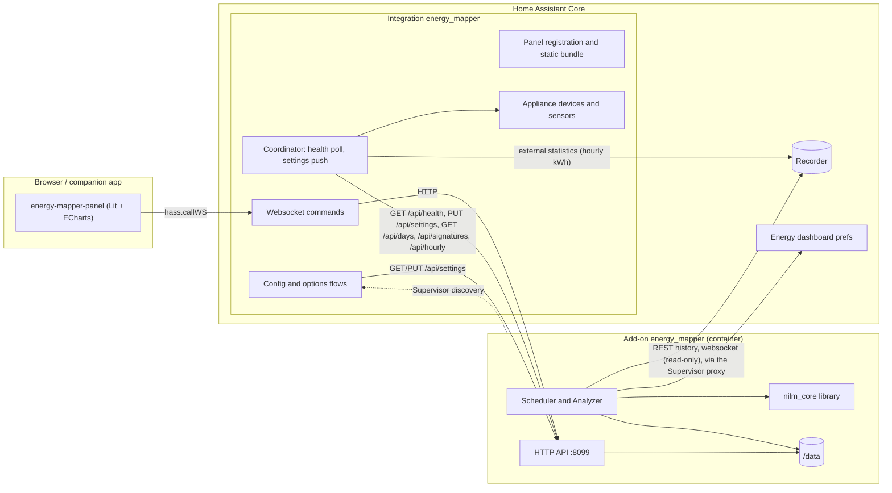
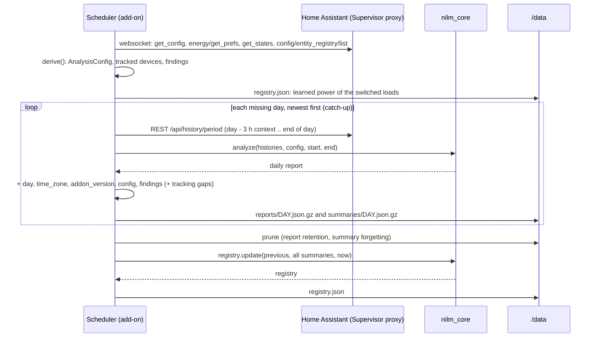
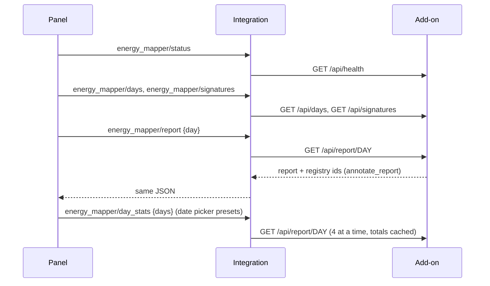
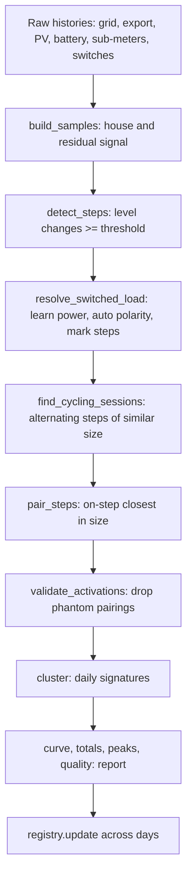
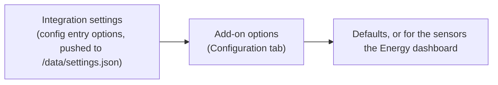

# Energy Mapper: design

This document describes how Energy Mapper works as of add-on 0.4.0 and integration 0.2.0:
the architecture, the analysis engine, how the Energy dashboard is used, storage, the APIs
and the reasons behind the main choices. User documentation: the [README](../README.md) and
the [add-on documentation](../energy_mapper/DOCS.md).

## Contents

1. [Goals and constraints](#1-goals-and-constraints)
2. [Architecture](#2-architecture)
3. [Data flow](#3-data-flow)
4. [The engine](#4-the-engine)
5. [Using the Energy dashboard](#5-using-the-energy-dashboard)
6. [Storage and retention](#6-storage-and-retention)
7. [Add-on HTTP API](#7-add-on-http-api)
8. [Integration: websocket API, appliances and statistics](#8-integration-websocket-api-appliances-and-statistics)
9. [Settings and precedence](#9-settings-and-precedence)
10. [Design choices](#10-design-choices)
11. [Known limits](#11-known-limits)
12. [Roadmap pointers](#12-roadmap-pointers)

## 1. Goals and constraints

Recognise the appliances of a home from the curve of its whole-house meter (and its solar
production), then, step by step, bring their consumption into the Home Assistant Energy
dashboard as the user names them (non-intrusive load monitoring, NILM).

- **Never put Home Assistant at risk**: no heavy computation in the Home Assistant process.
- **Read-only by default**: observe and propose. v0 never writes to Home Assistant; later
  versions change the configuration only after the user confirms, one appliance at a time.
- **Work for everyone**: no PV or PV, signed or import/export grid meters, W or kW, one or
  several phases, a battery, meters reporting every second or every minute, with or without
  an Energy dashboard. No hard-coded threshold that only fits one home.
- **Everything local**: consumption data reveals the habits of a household. No cloud, no
  telemetry.
- **Small hardware**: one day analysed in a few seconds at most on a Raspberry Pi 4.
- **No real consumption data in the repository**: tests and the panel's dev harness use
  synthetic households; real extracts stay outside (`tools/replay_csv.py`).

## 2. Architecture

The design follows the Frigate model: an add-on does all the computation, an integration
provides the Home Assistant side, and a panel shows the results inside the Home Assistant
frontend.

| Part | Where | Role |
|---|---|---|
| `nilm_core` | `energy_mapper/app/nilm_core/` | The engine: pure functions on lists of `(timestamp, value)`, standard library only, no Home Assistant import, no I/O, no clock. Testable and replayable offline. |
| Add-on service | `energy_mapper/app/` | Reads Home Assistant through the Supervisor (`homeassistant_api: true`, no token to create), derives the configuration from the Energy dashboard, runs the nightly analysis, maintains the signature registry and the storage, serves the internal HTTP API, announces itself through Supervisor discovery. |
| Integration | `custom_components/energy_mapper/` | Finds the add-on (discovery or manual address), keeps the user's settings in its config entry and pushes them to the add-on, relays the add-on API to the frontend as websocket commands, registers the sidebar panel, publishes the appliances as devices with sensors and imports their hourly energy into the long-term statistics (§ 8.1). No analysis. |
| Panel | `frontend/` → `custom_components/energy_mapper/frontend/energy-mapper-panel.js` | Sidebar panel running inside the Home Assistant frontend, built with the same libraries (Lit 3, ECharts 6) and styled only with Home Assistant theme variables. |

The integration and the panel never talk to Home Assistant's recorder for the analysis (the
integration only writes the appliances' statistics to it), and the add-on never talks to the
browser: the user only ever sees Home Assistant.

## 3. Data flow

### Nightly run

- **When**: on start, then every day at `analysis_time` (04:30 by default) in Home
  Assistant's time zone. Each pass catches up: yesterday and up to `backfill_days` days back
  that have no report yet, newest first. It stops at a *partial day* (the recorder history
  starts more than an hour after midnight: purged) or after three consecutive days without
  data. A failed day never stops the loop; Home Assistant outages are retried after 1, 5, 15
  and 60 minutes.
- **What a day is**: `[00:00, 24:00)` local time (23 or 25 hours on DST days). Histories are
  read from 3 hours before midnight so that loads already on at midnight are seen.
- **History request**: REST history with `minimal_response`, `no_attributes` and
  `significant_changes_only=0`, for the grid, solar, battery, sub-meter and switch entities
  and the energy sensors of the switched devices (for the tracking gaps).
- **After a pass that analysed something** (or once a day otherwise), the storage is pruned
  and the signature registry updated. `POST /api/analyze` does the same for one day.

### Viewing a report

## 4. The engine

`nilm_core.analyze()` turns raw histories into a daily report.

### 4.1 The signal (`signal.py`)

- **House load** = grid + PV + battery, where the grid is signed (+ import, − export, or
  `import − export` with two meters), PV is positive and the battery is + when discharging.
  **Residual** = house − sub-meters: what the analysis looks at.
- Several meters of the same kind (one per phase, several inverters) are summed on the union
  of their timestamps; the sum is unknown while one of them is.
- Unit factors per entity (kW → W) come from `unit_of_measurement`; `grid_invert` and
  `battery_invert` flip a sign.
- The grid meter drives the timeline: one sample per grid reading. Other series are
  piecewise constant (Home Assistant records a state when it changes).
- **Unavailable sources**: PV keeps its last value for 5 minutes, then counts 0 if it was
  already near zero (night, ≤ 50 W) and *unknown* otherwise (an inverter timeout in daylight
  must not create a multi-kW fake step); samples with unknown PV have no house value. Sub-meters
  and the battery keep their last value for 5 minutes, then count 0.

### 4.2 Steps (`steps.py`)

An appliance switching is a **step** in the residual load. For each reading that jumps by at
least 60 % of the threshold, the median of the readings in a window before and after is
compared; a difference of at least `step_threshold_w` (300 W) is a step. Windows are 20 s or
3.1 × the meter's median reporting interval, whichever is larger (at least three readings per
side), which makes the detector robust to single-sample spikes (motor inrush, meter noise)
and adapts it to meters reporting every 1 s to 60 s. Neighbouring candidates of the same sign
are merged, keeping the largest.

### 4.3 Switched loads (`known.py`)

An appliance driven by a Home Assistant entity without its own power sensor (a water heater
on a relay, a radiator on a pilot-wire relay). The entity tells *when* it may run; the steps
tell *whether* it drew power (a hot tank's thermostat may be open) and *how much*.

1. On-periods are the intervals in one of `on_states` (unavailable states do not end a period).
2. Near each transition (± 30 s), the largest free step of the right sign is a candidate; the
   **power** is the median candidate size (falling back to the power learned on previous days
   when there is no transition that day).
3. Candidates within 20 % (or half the threshold) of that power are kept and marked as
   explained; an on-period counts only if it started or ended with such a step.
4. **Automatic polarity**: the opposite states are tried too, and the polarity confirmed by more
   steps wins; the report then says `inverted: true`. A pilot-wire radiator heats while its
   relay is *off*.

Switched loads are resolved first, so their steps are never reused as anonymous activations.

### 4.4 Cycling sessions (`activations.py`)

Some loads switch on and off every few tens of seconds at the same power (an induction hob at
medium power, an oven thermostat). Pairing these steps one by one would produce dozens of tiny
"appliances", so they are grouped first: alternating up/down steps of at least 600 W, within
20 % of the running median size, at most 120 s apart, at least 6 steps. A session has a power,
a duty cycle, a cycle count, a median on-time and period. When another appliance switches at
the same instant as a cycle, the meter sees one combined step (e.g. +1.4 kW hob + 2.8 kW oven);
that step is split, the cycle's share joins the session and the remainder becomes a new step
that can be paired with the other appliance.

### 4.5 Pairing and validation (`activations.py`)

- Each off-step closes the open on-step **closest in size** (within 25 % or 60 W), not the most
  recent one: with several loads on, the off-step of a kettle must not close the water heater
  that started before it. Ties go to the most recent. Open on-steps older than 6 hours are
  dropped.
- **Validation** drops phantom pairings: steps from clouds (grid and PV are not sampled
  together) or from two unrelated appliances can be paired into a load lasting hours, during
  which the load falls back to the base. A low percentile (10 %) of the load during the
  activation must stay above `base + 0.6 × power`.

The result is a list of **activations** (one use of one appliance): start, end, power, and
for sessions duty, on-time and period.

### 4.6 Daily signatures (`signatures.py`)

Activations are grouped by kind (`steady` or `cycling`) and duration band (`short` < 10 min,
`medium` 10–60 min, `long` > 1 h, `session` for cycling), then clustered greedily on power
(12 % tolerance). The id names the group and the power rounded to 50 W under 1 kW, 100 W above:
`short-2000w`, `medium-2100w`, `long-900w`, `cyc-1500w`. Daily ids depend on that day only;
the long-lived identity is the registry id (below).

### 4.7 The report (`report.py`)

- **Base load**: the 5th percentile of the per-minute mean of the residual load (always-on
  consumption: fridges, network, standby).
- **Curve**: per minute, the house, grid, PV and sub-metered power, then the room left
  (house − sub-metered) split into base load, switched loads, signatures and *other*
  (unexplained). Measured parts are kept as measured; estimated parts are scaled down when they
  would explain more than what is left, switched loads first.
- **Totals** (`energy_kwh`) are integrated from the curve.
- **Peaks**: episodes where the house load is above 80 % of the day's maximum (samples less
  than 2 minutes apart merge into one episode), the top 5 by maximum. For each, what was running
  at the maximum (sub-meters, switched loads, activations) and the unexplained rest. A peak is
  **notable** when its maximum reaches the notable threshold (§ 4.8).
- **Quality**: number of samples, steps, seconds with unknown PV, longest gap, compute time.

### 4.8 The signature registry (`registry.py`)

An appliance used once a day is an isolated case in each daily report; it only becomes
recognisable across days. After each nightly pass the add-on rebuilds a **registry** from all
the stored day summaries.

- **Progressive forgetting, no fixed window**: every activation is weighted by its age,
  `0.5 ** (age_days / half_life_days)` (30 days by default). Recent habits dominate, a replaced
  appliance fades out within weeks, and a rare one (weekly, or a few times a year) stays known
  as "seen rarely" while its weight is meaningful. Below a weight of 1 % something is
  forgotten (about 200 days with a 30-day half-life).
- **Clustering from scratch every night** per (kind, band): seeds at the densest powers,
  nearest-centre assignment within 12 %, re-centring on the weighted median, merging of
  centres closer than 0.75 × the tolerance, until stable. The result depends only on the stored
  activations, so re-running a night gives the same clusters.
- **Stable identity**: each cluster takes the id of the previous signature it matches (same
  kind and band, power within 12 %, closest first, labelled signatures first). Unmatched
  clusters get a new id named like the daily ones. A previous signature without a cluster is
  carried forward with its weight decayed when nothing is left near its power (a rare
  appliance whose days were pruned), dropped when a neighbouring cluster took its activations,
  and dropped when its weight falls below 1 %, unless it has a user label (v1).
- **Per signature**: weighted and raw counts, days seen, uses per week, first and last seen,
  weighted hours histogram, weighted-median power and duration (and on-time, period and duty
  for sessions), raw and weighted energy, the three most recent examples.
- **Registry ids in daily reports**: `annotate_report()` adds `registry_id` to the activations
  (nearest signature, same rule), to the daily signatures (majority of their activations) and
  to the signature parts of the peaks. The API applies it when serving a report, so the ids are
  always the current ones.
- **Switched loads memory**: power (weighted median, weight × confirmed transitions) and
  polarity (weighted vote) from the days with confirmed transitions; a day without transitions
  keeps the last values, and the add-on uses the learned power as the fallback of such a day.
- **Notable peak threshold**: 80 % of the highest of the day's maximum and the highest daily
  maximum of the `peak_window_days` (30) days before, to follow the seasons; or the fixed
  `peak_threshold_w` when set. Daily reports still list the day's own top episodes, so a normal
  day is never empty; only the flag `notable` depends on this threshold. The days of the first
  backfill (analysed newest first) only know the days stored before them.

## 5. Using the Energy dashboard

`energy_config.derive()` turns `energy/get_prefs`, `get_states` and
`config/entity_registry/list` into the engine's `AnalysisConfig`. It is read live before each
analysis, so a change in the Energy dashboard applies to the next night.

**Energy → power sensor.** The dashboard lists energy sensors (kWh); the engine needs power
sensors (W). For each energy sensor, in order: a power sensor with the same `source_entity`
(estimation integrations such as powercalc); a power sensor of the same device with the most
shared name tokens (multi-channel meters have one power sensor per channel; power factor and
similar sensors are ignored); `sensor.<name>_power`.

**Sources.** Grid: the import sensors, several summed (one per phase), with the export sensor
when there is one grid meter; a grid source whose energy is 0 is ignored (and reported).
Solar: several inverters summed. Battery: the first battery source (with a "check the sign"
finding). Both the flat (`stat_energy_from`) and the older `flow_from`/`flow_to` formats are
read.

**Roles of the tracked devices** (`device_consumption`):

| Role | When | Use |
|---|---|---|
| `submeter` | Measured device with a power sensor | Subtracted before the analysis |
| `estimated` | Estimated device (has a `source_entity`) not driven by a switch, with a power sensor (lights…) | Subtracted like a sub-meter |
| `switched` | Estimated from a `switch` or `input_boolean` | A switched load: measured from the steps at its transitions |
| `nested` | `included_in_stat` points to another tracked device | Not subtracted (never twice) |
| `energy_only` | No power sensor found | Not used; finding `no_power_sensor` |
| `unavailable` | Energy sensor unavailable | Not used; finding `unavailable` |

**Findings** (shown as *Things to check*): `grid_ignored`, `no_power_sensor`, `unavailable`,
`battery_sign`, `no_grid`, and `tracking_gap`: after the analysis, `tracking_gaps()` compares,
for each switch-driven device, the energy declared by its sensor over the day with the energy
measured for its switched load; a ratio of 2 or more (with at least 0.5 kWh on one side) is
reported, typically an estimate configured at a few watts for a 2 kW water heater.

**Manual settings always win**: grid sensor (then no extra grid meters are summed), export,
PV, battery, signs, sub-meters (replace the derived list), switched loads (added, or
replacing the one with the same entity), thresholds. Without an Energy dashboard and without a
grid setting, the analysis fails with `no_grid`.

## 6. Storage and retention

Everything is under the add-on's `/data` (included in Home Assistant backups):

| Path | Content | Retention | Order of size |
|---|---|---|---|
| `reports/YYYY-MM-DD.json.gz` | Full daily report, with the per-minute curve | `report_retention_days` (90) | ~2 MB in all |
| `summaries/YYYY-MM-DD.json.gz` | The report without its curve | Until its activations' weight is below 1 % (~200 days with a 30-day half-life); never while the full report is kept | ~1–2 MB in all |
| `registry.json` | Signature registry | While a signature's weight is above 1 %; forever once labelled (v1) | tens of KB |
| `settings.json` | Settings pushed by the integration | Until replaced (`PUT {}` deletes it) | < 64 KB |
| `state.json` | `last_run`, `last_maintenance` | – | bytes |
| `options.json` | Add-on options (written by the Supervisor) | – | bytes |

Writes are atomic (temporary file + rename). Pruning runs after each analysis pass, then the
registry is updated; if it is missing or unreadable it is rebuilt from the summaries (a full
rebuild of 200 days × 80 activations takes about 0.2 s). Plain JSON reports of 0.1 are
compressed on start. When a full report has been pruned, `GET /api/report/DAY` serves the
summary with `curve: []` and `curve_pruned: true`.

### Report fields

| Field | Content |
|---|---|
| `version` | Report format (1) |
| `day`, `start`, `end`, `time_zone` | The analysed local day (unix times) |
| `generated_at`, `addon_version` | When and by which add-on version |
| `energy_kwh` | `house`, `grid_import`, `grid_export`, `pv`, `submetered`, `base`, `other`, `known` (`{name: kWh}`), `signatures` (`{daily id: kWh}`), and `base_w` (base load power, W) |
| `max_house_w`, `peak_threshold_w` | Highest house power of the day and the notable threshold |
| `curve` | Per-minute rows `{t, house, grid, pv, submetered, base, known: {name: W}, signatures: {daily id: W}, other}` |
| `peaks` | `{start, end, max_ts, house_w, grid_w, pv_w, parts: [{kind: submetered\|known\|signature, name, power_w, since?, registry_id?}], unexplained_w, notable}` |
| `known_loads` | Switched loads: `{name, entity_id, power_w, transitions, matched, on_states, inverted, on_s}` |
| `activations` | `{start, end, power_w, cycling, duty, on_s, period_s, signature, registry_id}` |
| `signatures` | Daily signatures: `{id, kind, band, power_w, count, duration_s, energy_kwh, hours, on_s, period_s, duty, examples, registry_id}` |
| `quality` | `{samples, steps, pv_unknown_s, max_gap_s, compute_s}` |
| `config` | Sensors used: `grid_entity`, `extra_grid_entities`, `grid_export_entity`, `pv_entity`, `extra_pv_entities`, `battery_entity`, `tracked` (`{name, energy_entity, power_entity, role, source_entity}`), `findings` |
| `findings` | `{kind, entity_id, detail}` (derive findings and tracking gaps) |

## 7. Add-on HTTP API

Port 8099 on the internal Supervisor network (not exposed on the host). No authentication:
only Home Assistant and other add-ons can reach it. Standard library `ThreadingHTTPServer`,
JSON in and out; request bodies are limited to 64 KB (413 above).

| Request | Answer |
|---|---|
| `GET /api/health` | `200 {"status": "ok", "version": "0.4.0", "last_run": <unix time \| null>, "days": <full reports>, "signatures": <registry size>, "storage_bytes": <int>}` |
| `GET /api/days` | `200 {"days": [...], "summary_days": [...], "generated": {day: <unix time>}}`: days with a full report, and older days with only a summary, ascending; `generated`: when each full report was made (`generated_at`) |
| `GET /api/report/YYYY-MM-DD` | `200` the report with registry ids; `400 {"error": "invalid_day"}`; `404 {"error": "not_found"}` |
| `GET /api/hourly/YYYY-MM-DD` | `200` the hourly breakdown of the day (`nilm_core/hourly.py`, § 8.1); `400 invalid_day`; `404 not_found` when the day has no per-minute curve |
| `GET /api/signatures` | `200` the registry: `{version, updated_at, half_life_days, power_tol, days, first_day, last_day, signatures: [...], switched_loads: [...], peak: {window_days, relative, reference_w, threshold_w, days} \| null}` |
| `POST /api/analyze?day=YYYY-MM-DD` | `200 {"day", "ok": true}`, else `{"day", "ok": false, "error", "message"}` with `invalid_day` 400 (not a date, or not over), `no_grid` / `no_data` / `partial_day` 422, `ha_error` 502, `internal` 500 |
| `GET /api/settings` | `200 {"settings", "options", "defaults", "automatic"}` (§ 9) |
| `PUT /api/settings` | Replaces the settings: `200 {"settings": <as stored>}`; `400 {"error": "invalid_settings" \| "invalid_json", "message"}` |

Other paths answer `404 {"error": "not_found"}`, other methods on known paths
`405 {"error": "method_not_allowed"}`. The registry signature fields are documented in the
[add-on documentation](../energy_mapper/DOCS.md#signature-registry).

**Discovery**: under the Supervisor the add-on posts
`{"service": "energy_mapper", "config": {"host": <container hostname>, "port": 8099}}` to
`http://supervisor/discovery` (retried after 10 s, 30 s, 1 min, 5 min); the integration's
`async_step_hassio` receives it.

## 8. Integration: websocket API, appliances and statistics

Registered once in `async_setup`. Every command needs an authenticated user; `analyze` needs an
administrator. Except `status` and `day_stats`, each command relays one add-on request and
returns its JSON unchanged.

| Command | Parameters | Result |
|---|---|---|
| `energy_mapper/status` | – | `{"configured": bool, "state": <config entry state> \| null, "url": str \| null, "available": bool, "health": <GET /api/health> \| null, "error": str \| null, "settings": <entry settings> \| null}`. Never an error; `health` is fetched live when the entry is loaded. |
| `energy_mapper/days` | – | `GET /api/days` |
| `energy_mapper/report` | `day`: `YYYY-MM-DD` | `GET /api/report/<day>` |
| `energy_mapper/analyze` | `day` | `POST /api/analyze?day=<day>` (timeout 600 s; admin only) |
| `energy_mapper/day_stats` | `days`: list of at most 62 days | `{"days": {"YYYY-MM-DD": {"house_kwh", "max_house_w", "notable_peaks", "last_notable"}}}`; days without a report are left out. The integration reads the reports (4 at a time) and caches the totals (up to 400 days; an analysis invalidates its day). |
| `energy_mapper/signatures` | – | `GET /api/signatures` |
| `energy_mapper/settings` | – | `GET /api/settings` (settings are changed in the options flow) |

Errors (`{"code", "message"}`): `invalid_format` (bad parameters), `unauthorized`,
`not_loaded` (no entry, or not set up), `addon_unavailable` (unreachable or timeout, 30 s by
default), or the add-on's own code and message (`invalid_day`, `not_found`, `no_grid`,
`no_data`, `partial_day`, `ha_error`, `internal`), else `http_<status>` / `invalid_response`.

Other parts of the integration:

- **Config flow**: `async_step_hassio` (discovery, then a confirmation) or `async_step_user`
  (manual URL, default `http://local-energy-mapper:8099`), both validated by
  `GET /api/health`. Single instance (unique id `energy_mapper`). On rediscovery an entry
  created by discovery follows the new URL; a manual URL is kept.
- **Coordinator**: polls `/api/health` every 5 minutes; setup raises `ConfigEntryNotReady`
  while the add-on does not answer.
- **Panel**: `panel_custom` registration (`/energy-mapper`, element `energy-mapper-panel`,
  icon `mdi:home-lightning-bolt-outline`, not admin-only), bundle served from
  `/energy_mapper_frontend/` with a content hash in the URL.
- **Diagnostics**: entry data and options, last health, availability, sync state, appliances
  and imported days.

### 8.1 Appliances, sensors and hourly statistics

The analysis is nightly, so a day's values are only known the next morning. A
`total_increasing` sensor updated once a day would put the whole day into the hour of the
analysis in the Energy dashboard. The hourly energy of each appliance is therefore imported
into the recorder's **long-term statistics** as **external statistics**, with the timestamp of
each hour, the way utility integrations publish delayed meter data; the sensors only show the
last analysed day.

**Appliances** (`appliances.py`): the registry's switched loads (those whose power has been
learned at least once, so a configured switch that never matched a step is not one yet) and
its signatures with a user `label` (set by the review flow, #10/#11). Identity:

| | Device identifier / unique id base | Statistic id |
|---|---|---|
| Switched load | `load:<entity_id>` | `energy_mapper:load_<slug of entity_id>_energy` |
| Labelled signature | `signature:<registry id>` | `energy_mapper:signature_<slug of registry id>_energy` |

Renaming (a new `name` in the settings or a new label) only changes the device name and the
statistic's name; the ids stay.

**Where the hourly series are computed: in the add-on** (`GET /api/hourly/DAY`,
`nilm_core/hourly.py`), because it owns the report format and the registry matcher, and the
answer is a few KB instead of the 200 KB per-minute curve (a 90-day backfill would otherwise
move about 20 MB to Home Assistant). For each curve row (one minute), switched-load watts are
keyed by entity id (the curve keys them by name, mapped with `known_loads`), and the watts of
each *daily* signature are shared among its activations running in that minute in proportion
of their energy, each share going to the **registry id** of its activation
(`registry.Matcher`, the rule of `annotate_report`); unmatched activations go to `?`. Rows are
summed per **UTC hour** (`floor(t / 3600)`), so a DST day has 23 or 25 hours and needs no
special case; in a time zone with a half-hour offset the first and last hours are shared with
the neighbouring days, and the integration adds both days' parts. The registry ids are those
of the registry at the time of the import: past days are not re-attributed when the registry
moves on.

**Synchronisation** (`coordinator.py`), in a background task after each successful health
poll (every 5 minutes) and after `energy_mapper/analyze`:

1. `GET /api/days` and `GET /api/signatures`. A day is *changed* when it was never imported or
   its `generated` time differs from the one imported (new day, or `POST /api/analyze`).
2. `GET /api/hourly/DAY` for the changed days (4 at a time), and the last day for the sensors.
3. The appliances are derived; the recorder metadata of source `energy_mapper` tells which
   already have statistics. An appliance without statistics is new: it is **backfilled** with
   every stored day that has a curve (up to `report_retention_days`), oldest first, in one
   import.
4. Each appliance imports the hours of its days (zeros included, so a re-import overwrites an
   hour that became empty).
5. Appliances gone from the registry lose their device (and so their entities) and their
   statistics (`async_clear_statistics`, only ids of source `energy_mapper`). A registry that
   was never written (`updated_at` null: a new or unreadable add-on store) removes nothing.
6. The imported days, the appliances, the last day's values and each appliance's last use are
   kept in `.storage/energy_mapper.<entry id>`, so the sensors have their values after a
   restart and nothing is imported twice.

**Monotonic sums** (`statistics.py`): importing hours `H` of a statistic reads the stored
rows from one week before `min(H)` (further back only if that week is empty) and takes the
sum of the last row before `min(H)`. The rows at or after `min(H)` keep their hourly value
(`state` holds the hour's kWh) unless they are in `H`, and the cumulative sums are recomputed
from there; only the hours of `H` and the later rows whose sum moved are written. So a
re-analysed day replaces its hours instead of adding to them, the days after it shift by the
difference, and the sums never decrease (hourly values are never negative).

Metadata: `has_sum`, `mean_type` none, `unit_class` `energy` (on the Home Assistant versions that have it; required from 2026.11),
kWh, `source` `energy_mapper`, `name` the appliance name.

**Devices and sensors** (`sensor.py`): a service device *Energy Mapper* (the entry) and one
device per appliance linked to it (`via_device`). All sensors use `has_entity_name` with
translated names (English, French), so their entity ids follow the appliance name; they are
unavailable while the add-on is unreachable and keep their values otherwise.

| Sensor | Device | Value |
|---|---|---|
| `sensor.<appliance>_energy_yesterday` | appliance | kWh of the last analysed day (attribute `day`) |
| `sensor.<appliance>_uses_yesterday` | appliance | Activations (signature) or on-periods (switched load) that day |
| `sensor.<appliance>_last_seen` | appliance | Timestamp: end of the last minute with energy, over the imported days |
| `sensor.<appliance>_typical_power` | appliance | Learned power, W (diagnostic) |
| `sensor.energy_mapper_unexplained_energy_yesterday` | service | The day's `other`, kWh |
| `sensor.energy_mapper_base_load` | service | The day's base load, W |
| `sensor.energy_mapper_last_analysis` | service | Timestamp of the add-on's last analysis |

The sensors have no `state_class`: they create no statistics of their own, the hourly
statistics are the energy history. The house total is already in Home Assistant (the grid
meter) and is not duplicated. Live power and on/off entities come with real-time detection
(#17).

## 9. Settings and precedence

The settings have three possible sources, resolved **key by key**:

1. **Integration settings** win. The options flow stores only the values that differ from
   what the add-on would use without them (the `automatic` and `defaults` answers of
   `GET /api/settings`), so untouched fields keep following the Energy dashboard. They are
   pushed with `PUT /api/settings` on save and on the first successful poll after Home
   Assistant starts (retried while the push fails). An entry that never saved settings adopts
   those the add-on holds (a reinstalled integration keeps the user's settings). If the add-on
   is down or refuses them, nothing is saved.
2. **Add-on options** (`/data/options.json`), the same keys plus `log_level`.
3. **Defaults** (`analysis_time` 04:30, `backfill_days` 30, `half_life_days` 30,
   `report_retention_days` 90, `peak_window_days` 30, `step_threshold_w` 300, signs not
   inverted, relative peak threshold) and, for the sensors, the Energy dashboard.

Accepted keys and ranges: `grid_entity`, `grid_export_entity`, `pv_entity`, `battery_entity`
(`sensor.*`), `grid_invert`, `battery_invert` (bool), `submeters` (`sensor.*` list),
`switched_loads` (`{entity_id, name?, on_states?}` list), `step_threshold_w` 50–10000,
`peak_threshold_w` 100–100000, `analysis_time` `HH:MM`, `backfill_days` 0–365,
`half_life_days` and `peak_window_days` 1–365, `report_retention_days` 7–3650. `null`, `""`
and `[]` mean absent; unknown keys refuse the whole request. A new `analysis_time` applies
after the next pass; everything else applies to the next analysis.

`GET /api/settings` answers `settings` (as stored), `options` (add-on options among these
keys), `defaults` (value of each scalar key without settings) and `automatic` (sensors and
switched loads the analysis uses without settings, read live; `null` when Home Assistant
cannot be read).

## 10. Design choices

- **Add-on + integration** rather than everything in the integration: the analysis reads a
  day of history at full resolution and runs CPU-bound code; in a separate container it can
  never slow down or crash Home Assistant, and it can later run as a standalone image for
  Container/Core users (#19). The integration stays thin and keeps the Home Assistant-specific
  parts (flows, translations, panel, later entities and repairs).
- **Configuration from the Energy dashboard**: most users already described their meters
  there. Deriving instead of asking means zero configuration for them, and the same model
  will let v1 write back to the Energy dashboard after confirmation.
- **Standard library only** (engine and add-on): small image, no native wheels to build for
  aarch64, nothing to audit or update, fast enough (a real day in about one second on amd64).
  The add-on includes a minimal RFC 6455 websocket client for the same reason.
- **No machine learning for now**: the events that matter in a home (resistive loads switching)
  are well described by steps, sizes, durations and hours; explicit rules are explainable in
  the panel ("2.6 kW for 51 min, evenings"), need no training data that the repository may not
  contain, and run on a Raspberry Pi. Learned models may come with labelled signatures and the
  public-dataset benchmark (#28) to measure whether they help.
- **No LLM**: nothing in the analysis needs one, and sending consumption data to a remote
  service would break the privacy constraint.
- **Progressive forgetting instead of a fixed window**: rare appliances stay known, replaced
  ones fade out, and storage stays bounded without a hard cut-off.
- **Stable signature ids**: clustering from scratch every night keeps the results
  reproducible; matching clusters to the previous ids keeps the identity that user labels will
  attach to (v1).
- **Home Assistant design system** for the panel: same libraries (Lit, ECharts), only theme
  variables, Home Assistant's own elements (date picker, buttons, alerts) when defined, with
  plain fallbacks; nothing of Home Assistant is bundled.
- **Read-only v0**: building trust in the results before anything is written to the user's
  configuration.

## 11. Known limits

- Estimation from one meter: during heavy simultaneous use (several kitchen appliances), some
  pairings remain wrong and peak breakdowns are approximate.
- Peaks are explained at the instant of their maximum; a load starting on that very sample is
  not counted yet.
- Loads below `step_threshold_w`, continuously variable loads and uses shorter than two meter
  readings are not recognised; multi-phase appliances produce one signature per phase.
- Activations longer than 6 hours are not paired.
- Three-phase installations are analysed on the sum of the phases.
- The analysis depends on the recorder history; the backfill is limited by `purge_keep_days`.
- The first backfill analyses newest first, so its days do not benefit from the peak window.
- Finding details are produced in English by the add-on.
- Appliance statistics are attributed with the registry of the night they are imported;
  a past day is re-attributed only when it is analysed again. A switched load removed from
  the settings stays an appliance until the registry forgets it (about 200 days with a 30-day
  half-life) or until it is removed explicitly (#11).
- The options flow cannot express "no sub-meters" or remove a switched load that comes from
  the Energy dashboard: an empty field falls back to the automatic value.

## 12. Roadmap pointers

| Milestone | Issues |
|---|---|
| [v1 – Validate & track](https://github.com/sylvaing/ha-energy-mapper/milestone/2) | Repairs to validate a signature (#10), one config subentry per appliance (#11), per-appliance entities (#12), take over tracking in the Energy dashboard (#13), learn from measured devices (#14), nightly self-test (#15), variable loads (#16), public-dataset benchmark with NILMTK metrics (#28) |
| [v2 – Live](https://github.com/sylvaing/ha-energy-mapper/milestone/3) | Real-time detection (#17), per-phase analysis (#18), multi-phase appliance cycles (#26) |
| [v3 – Publish](https://github.com/sylvaing/ha-energy-mapper/milestone/4) | Standalone Docker image for Container/Core (#19), release process and store listings (#20) |
