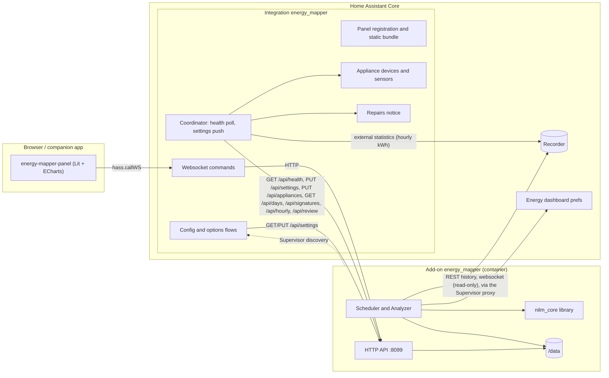
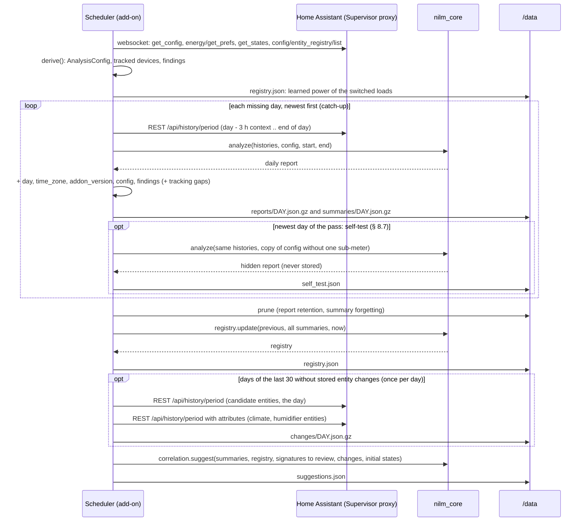
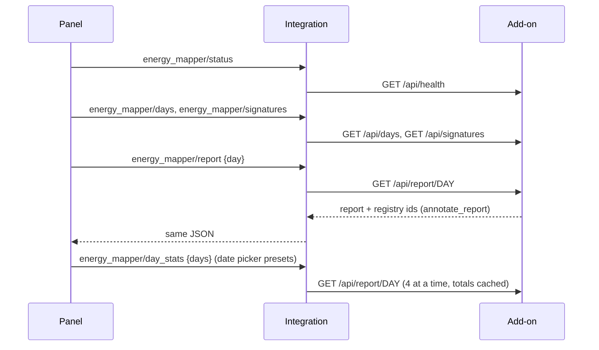
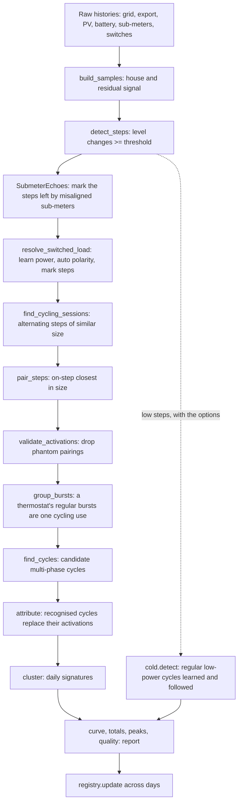
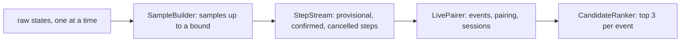
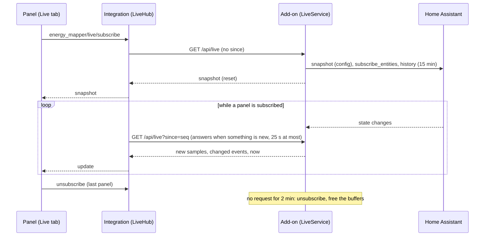
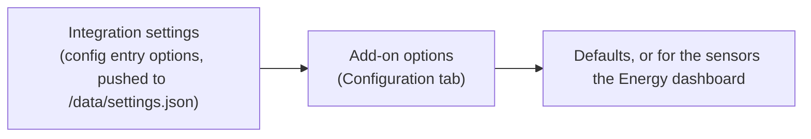

# Energy Mapper: design

This document describes how Energy Mapper works as of add-on 0.6.0 and integration 0.4.0:
the architecture, the analysis engine, how the Energy dashboard is used, storage, the APIs
and the reasons behind the main choices. User documentation: the [README](../README.md) and
the [add-on documentation](../energy_mapper/DOCS.md).

## Contents

1. [Goals and constraints](#1-goals-and-constraints)
2. [Architecture](#2-architecture)
3. [Data flow](#3-data-flow)
4. [The engine](#4-the-engine)
5. [Using the Energy dashboard](#5-using-the-energy-dashboard)
6. [Storage and retention](#6-storage-and-retention)
7. [Add-on HTTP API](#7-add-on-http-api)
8. [Integration: websocket API, appliances and statistics](#8-integration-websocket-api-appliances-and-statistics)
9. [Settings and precedence](#9-settings-and-precedence)
10. [Design choices](#10-design-choices)
11. [Known limits](#11-known-limits)
12. [Roadmap pointers](#12-roadmap-pointers)

## 1. Goals and constraints

Recognise the appliances of a home from the curve of its whole-house meter (and its solar
production), then, step by step, bring their consumption into the Home Assistant Energy
dashboard as the user names them (non-intrusive load monitoring, NILM).

- **Never put Home Assistant at risk**: no heavy computation in the Home Assistant process.
- **Read-only by default**: observe and propose. v0 never writes to Home Assistant; later
  versions change the configuration only after the user confirms, one appliance at a time.
- **Work for everyone**: no PV or PV, signed or import/export grid meters, W or kW, one or
  several phases, a battery, meters reporting every second or every minute, with or without
  an Energy dashboard. No hard-coded threshold that only fits one home.
- **Everything local**: consumption data reveals the habits of a household. No cloud, no
  telemetry.
- **Small hardware**: one day analysed in a few seconds at most on a Raspberry Pi 4.
- **No real consumption data in the repository**: tests and the panel's dev harness use
  synthetic households; real extracts stay outside (`tools/replay_csv.py`, and
  `tools/benchmark.py` to measure the engine on them, § 8.11).

## 2. Architecture

The design follows the Frigate model: an add-on does all the computation, an integration
provides the Home Assistant side, and a panel shows the results inside the Home Assistant
frontend.

| Part | Where | Role |
|---|---|---|
| `nilm_core` | `energy_mapper/app/nilm_core/` | The engine: pure functions on lists of `(timestamp, value)`, standard library only, no Home Assistant import, no I/O, no clock. Testable and replayable offline. |
| Add-on service | `energy_mapper/app/` | Reads Home Assistant through the Supervisor (`homeassistant_api: true`, no token to create), derives the configuration from the Energy dashboard, runs the nightly analysis, maintains the signature registry and the storage, serves the internal HTTP API, announces itself through Supervisor discovery. |
| Integration | `custom_components/energy_mapper/` | Finds the add-on (discovery or manual address), keeps the user's settings in its config entry and pushes them to the add-on, relays the add-on API to the frontend as websocket commands, registers the sidebar panel, publishes the appliances as devices with sensors and imports their hourly energy into the long-term statistics (§ 8.1). No analysis. |
| Panel | `frontend/` → `custom_components/energy_mapper/frontend/energy-mapper-panel.js` | Sidebar panel running inside the Home Assistant frontend, built with the same libraries (Lit 3, ECharts 6) and styled only with Home Assistant theme variables. |

The integration and the panel never talk to Home Assistant's recorder for the analysis (the
integration only writes the appliances' statistics to it), and the add-on never talks to the
browser: the user only ever sees Home Assistant.

## 3. Data flow

### Nightly run

- **When**: on start, then every day at `analysis_time` (04:30 by default) in Home
  Assistant's time zone. Each pass catches up: yesterday and up to `backfill_days` days back
  that have no report yet, newest first. It stops at a *partial day* (the recorder history
  starts more than an hour after midnight: purged) or after three consecutive days without
  data. A failed day never stops the loop; Home Assistant outages are retried after 1, 5, 15
  and 60 minutes.
- **What a day is**: `[00:00, 24:00)` local time (23 or 25 hours on DST days). Histories are
  read from 3 hours before midnight so that loads already on at midnight are seen.
- **History request**: REST history with `minimal_response`, `no_attributes` and
  `significant_changes_only=0`, for the grid, solar, battery, sub-meter and switch entities
  and the energy sensors of the switched devices (for the tracking gaps). The entity
  suggestions read their candidates the same way, plus one request *with* attributes (not
  minimal) for the few entities whose attributes are compared (§ 8.4).
- **Self-test** (§ 8.7): the newest day a pass analyses is analysed again in memory with one
  measured device (`self_test_devices`, 1 by default) not subtracted, from the histories
  already read.
- **After a pass that analysed something** (or once a day otherwise), the storage is pruned
  and the signature registry updated, then the entity suggestions are computed (§ 8.4).
  `POST /api/analyze` does the same for one day. A pass with nothing to analyse never calls
  Home Assistant: it recomputes the suggestions from the stored changes only.

### Viewing a report

**Names of the signatures in the panel** (`frontend/src/names.ts`, unit tested, #52). A
signature with a label shows it. One without gets a provisional name built from the
signature itself, in the user's language: the power rounded ("940 W", "2.6 kW"), the usual
duration rounded ("~50 min", "~1 h 30") or "in cycles" for a cycling one ("Cycle with
2.1 kW heating, ~1 h 30" for a multi-phase one, § 4.9), and when it runs,
from the registry's 24-hour histogram: the part of the day holding most of the uses
(morning 6–11 h, midday 11–14 h, afternoon 14–18 h, evening 18–22 h, night 22–6 h), two
parts ("at midday and in the evening"), or "all day" when they are spread. A missing field
leaves its part out (a daily signature not matched to the registry has no hours). The chart
legend, its tooltip, the peaks, the signature table and the review use it; the registry id
stays as secondary text or tooltip, for debugging. Two alike names in the legend get a
number ("(2)"), since the legend toggles series by name.

**Tabs** (`frontend/src/tabs.ts`, unit tested, #47). The panel header holds four tabs
in the style of Home Assistant's `ha-tab` (own buttons, `role="tablist"`, arrow keys, Home
and End move between them; on a `narrow` screen they share the width, each as wide as its label): **Today** (the day
picker, summary card, the day card (timeline or stacked chart), what used energy, peaks,
findings and the quality line),
**Appliances** (one card per appliance, then the signature registry and the switched
loads collapsed under "All signatures", #54), **To review** (administrators whose add-on has a review; a badge counts the proposed signatures)
and **Live** (every user, § 8.10; a pulsing dot while it streams).
The tab is kept in the URL, `?tab=today|appliances|review|live`, next to `?day=` (replaced, not
pushed, like the day); `?review=1`, the link of the Repairs notice, opens *To review* and is
replaced by `tab=review`. A non-administrator asking for `tab=review` gets *Today*. On
*Today*, administrators see a banner "N appliances waiting for a name → Start reviewing"
while signatures are proposed; it opens *To review*. An example of a signature in *To review*
switches back to *Today*, on its day, zoomed on it.

**Summary card** (`splitParts`, `categorySeries`, `maxPowerTime` in `frontend/src/data.ts`,
unit tested, #48). On *Today*, one card: the house consumption in large type, then one
secondary line with the highest power and its time (the curve maximum, else the highest
peak), the grid import, and the solar with its export (only when the installation has PV).
Below, a **split bar**, one segmented bar in the HA graph palette, and its legend with kWh
and share of each category: base load, measured by plugs and sensors, estimated, **named
appliances** (switched loads and signatures with a label or merged into an appliance),
**still to name** (the other signatures, the unclassified cluster included) and unexplained.
Empty categories are left out; reports without `estimated` (add-on < 0.8.1) count all the
sub-metered energy as measured. Base load, measured and estimated have the colours of their
chart series; named and still to name use graph colours 2 and 26. Selecting a legend item
(a button, `aria-pressed`) or a segment selects that category, again to clear it: the
selection is panel state (`selectedCategory`): the timeline highlights its rows and the
chart dims the other series. On a `narrow` screen the legend has two columns.

**The day, appliance by appliance** (`frontend/src/timeline.ts`, unit tested, #49). Under
the summary, a full-width card whose default view is a **timeline**, drawn with plain
markup and CSS (not ECharts): rows are real buttons (keyboard, focus ring, `aria-pressed`),
names stay text that wraps or ellipsises with the HA font, the theme variables apply
directly in light and dark, and the layout reflows on phones without recomputing a canvas.
On top, a thin **house strip** on the same axis: the highest house power of each slice of
the visible window (one slice per curve point, at most 144, `houseBuckets`), in SVG bars,
with the notable peaks shaded in the error colour; its maximum at the row end. Then one row
per appliance of the day (`timelineRows`): the rows of *What used energy*, same set, order,
colours and names, without the base load and the unexplained rest (they run all day). Each
row holds its running periods as blocks on the shared axis and its kWh at the end:
signatures run in their `activations` (a cycling session is one striped block; the report
has no individual cycles), or where the curve has their power when the report has no
activations for them; switched loads and the measured/estimated sub-meters run where the
per-minute curve has some of their power (`seriesPeriods`, the same periods the list counts;
the add-on is not changed). `visibleBlocks` clips the periods to the window, merges those
closer than about 2 px (1/600 of the window) and keeps a minimum width so a one-minute run
stays visible. Unnamed signatures have dashed blocks and their provisional name in italics.
A day whose curve is pruned still shows the signature rows (from the activations), without
the strip. The axis (`axisTicks`) uses a round step from the start of the day (5 min to 12
h) so that at most 9 labels fit (5 on `narrow`); the end of the day reads 24:00 in 24-hour
locales. Under the strip, the **notable peaks** are chips (power, time of the maximum, the
two largest parts): a chip, or a shaded peak on the strip, restricts the window to the peak
± 30 min (`peakZoom`, the chart's peak zoom); the chip of the shown peak is pressed and a
"Whole day" chip resets. Selecting a peak in *Peaks*, or an example in *To review*, zooms
whichever view is shown. A row label or its track selects the appliance (`selectedAppliance`,
as in the list); the selected appliance, or the rows of the selected category of the split
bar (`selectedCategory`), are highlighted and the others dimmed (selecting the base load or
the unexplained rest, which have no row, dims nothing). "Show all" in the card header clears
the selection. A "Timeline" / "Stacked curve" toggle (chips, `aria-pressed`) switches to the
stacked ECharts chart below, which keeps its own zoom; the timeline window resets with the
day. On a `narrow` screen the name and the kWh go above the track, which takes the width.

**What used energy** (`usageRows`, `usageDetail`, `seriesPeriods` in `frontend/src/data.ts`,
unit tested, #50). Under the day card, on the left, one row per chart series with some energy,
by decreasing energy, the unexplained rest last: colour dot (the colour of the series), name,
a short detail, a bar proportional to the largest row, and kWh. Base load ("221 W always
on"), measured by plugs and sensors and estimated are one row each ("measured · 05:57 –
21:51": the span where the curve has some of it; the report has no per-sub-meter energy, so
the plugs and sensors stay one row); switched loads give their on periods in the curve and
their time on ("2 runs · on for 2 h 25"); signatures their activations of the day and their
span ("1 run · 18:44 – 19:40", "in cycles · 06:31 – 07:26"; without `activations` the daily
counts and the curve). A signature without a name (no label, not merged) is "to name": its
provisional name in italics and a dashed dot. A row is a button (`aria-pressed`): it selects
that appliance, again to clear it; the selection is panel state (`selectedAppliance`, the
chart series id), the timeline highlights its row and the chart dims the other series, and
"Show all" clears it. Selecting an appliance clears the category of the split bar and the other way
round; a selected category highlights its rows. For administrators with a review, an
unnamed signature has a *Review* icon button: it opens *To review* on that signature (in the
filter that lists it) and focuses its title. On a `narrow` screen the bar goes under the name.

On the right (stacked below on narrow widths), **Peaks**, compact: per peak, the power, the
time window and "notable", then what ran with the names of the list and their power, and
the unexplained power; selecting a peak zooms the timeline (or the chart) on it. Below, the findings,
collapsed under "N things to check" (`
`), written in the user's language from their
`kind` and `params` (§ 5). The switched loads card is on
*Appliances* only.

**Appliances tab** (`frontend/src/appliances.ts`, unit tested, #54). The day picker
(without *Analyse*), then one card per appliance, the config subentries of the integration
(`energy_mapper/appliances`). A card shows the name; how it is tracked, from its sources:
*Recognised in the curve* (signature), *Switch* (switched load), *Power sensor* (sub-meter),
or *Merged: …* for several, and *estimated* or *measured*; the energy of the period; the runs
of the day; the last day the add-on saw it run (the latest `last_seen` of its signatures
and switched loads in the registry); and a mini histogram of its daily energy over the 7 days
ending on the selected day (30 for the 30-day period), the selected day in full colour. The
day's energy and runs come from the rows of *What used energy* of that day's report (the
series of its switched loads, matched by entity through `known_loads`, and of its
signatures, `sig:<registry id>`), so the card agrees with *Today*; a day without a report
falls back to the statistics. The daily energy comes from Home Assistant's long-term
statistics that the integration imports for each appliance (§ 8.1): one
`recorder/statistics_during_period` request (`period: "day"`, `types: ["change"]`) for the
30 days ending on the selected day, made while the tab is shown and again after a refresh or
an analysis; days are those of Home Assistant's time zone. Period chips *Day* / *7 days* /
*30 days* (`aria-pressed`) are shown when the statistics could be read: the 7- and 30-day
cards give the sum and "used N of 7 days" instead of runs. Without statistics (an older
Home Assistant, or none imported yet) the cards show the day of the report only, with a
hint. An appliance measured by a power sensor only has no series in the report and no
statistic of its own: its card says its energy is in its own sensor. Cards are sorted by
the energy of the period, then by name; a card is the dot colour of its chart series. A card
that ran that day is a button: it selects its series on *Today* (`selectedAppliance`, the
series with most energy for a merged appliance) and switches tab, where the timeline and the
list highlight it. Administrators get a *Settings* link on each card to the integration page
(`/config/integrations/integration/energy_mapper`, through Home Assistant's own navigation),
where the appliance's subentry is reconfigured (rename, link, merge); non-administrators see
the cards without it. Below the cards, the signature registry (table, or a list on `narrow`
screens) and the switched loads are collapsed under "All signatures (N)" (`
`),
open when the integration is older than 0.7.0 (no cards). The grid has as many columns as fit
240 px; on a phone the cards take the width. A card also shows the learning from a measured device and, for
administrators, its actions (§ 8.6).

**Narrow widths** (#53). The panel fits from 360 px up without horizontal page scroll:
toolbars and chips wrap, long names and entity ids break (`overflow-wrap: anywhere` on the
panel), the name column of the tables wraps and a table still too wide scrolls inside its
card (`.table-wrap`), the signatures become a list when Home Assistant reports `narrow`,
and the chart takes the width of its card. Manual test, in the dev harness
(`frontend/dev/index.html`) with the browser's device toolbar at 360, 390 and 768 px, light
and dark, `en` and `fr`, admin and `admin=0`, and the `empty`/`unavailable` scenarios:
expand the lists, click a peak (chip and list), select a timeline row, step through *To review* (scenario `many`: 30+ synthetic signatures), then check in the console that
`document.documentElement.scrollWidth <= innerWidth`. Names and entity ids much longer
than the sample's (edit `dev/sample/*.json` locally) must wrap, not widen the page.

## 4. The engine

`nilm_core.analyze()` turns raw histories into a daily report. Across days,
`nilm_core/registry.py` keeps the signature registry (§ 4.8) and
`nilm_core/correlation.py` scores entities against the signatures to review (§ 8.4).

### 4.1 The signal (`signal.py`)

- **House load** = grid + PV + battery, where the grid is signed (+ import, − export, or
  `import − export` with two meters), PV is positive and the battery is + when discharging.
  **Residual** = house − sub-meters: what the analysis looks at.
- Several meters of the same kind (one per phase, several inverters) are summed on the union
  of their timestamps; the sum is unknown while one of them is.
- Unit factors per entity (kW → W) come from `unit_of_measurement`; `grid_invert` and
  `battery_invert` flip a sign.
- The grid meter drives the timeline: one sample per grid reading. Other series are
  piecewise constant (Home Assistant records a state when it changes).
- **Unavailable sources**: PV keeps its last value for 5 minutes, then counts 0 if it was
  already near zero (night, ≤ 50 W) and *unknown* otherwise (an inverter timeout in daylight
  must not create a multi-kW fake step); samples with unknown PV have no house value. Sub-meters
  and the battery keep their last value for 5 minutes, then count 0.
- These rules are applied to one grid reading by `sample_at`, shared by the nightly
  `build_samples` and the live `SampleBuilder` (§ 4.11).
- The grid and the solar meters do not report together: a sample whose solar value is about
  to move is not trusted by the step detector (the *solar doubt*, § 4.2). The samples
  themselves, the curve and the energies are unchanged.
- A sample keeps what each sub-meter took out of the residual (`Sample.subs`): a sub-meter does
  not report with the grid meter, and § 4.12 finds the steps that leaves.

### 4.2 Steps (`steps.py`)

An appliance switching is a **step** in the residual load. For each reading that jumps by at
least 60 % of the threshold, the median of the readings in a window before and after is
compared; a difference of at least `step_threshold_w` (300 W) is a step. Windows are 20 s or
3.1 × the meter's median reporting interval, whichever is larger (at least three readings per
side), which makes the detector robust to single-sample spikes (motor inrush, meter noise)
and adapts it to meters reporting every 1 s to 60 s. Neighbouring candidates of the same sign
are merged, keeping the largest.
The live view (§ 4.11) runs the same detector on a stream (`StepStream`). The steps left by
sub-meters that do not report with the grid meter are then marked (§ 4.12).

**Night threshold** (#77, `night_step_threshold_w`, empty by default). On a solar
installation, a lower threshold also finds false steps in the daytime: the PV and grid meters
drift slightly apart while the sun is up, and most of those artefacts do not coincide with a
PV jump. So the lower threshold applies only where PV produces nothing:

- candidates are looked for with the lower of the two thresholds (jumps of 60 % of it);
- a step of at least `step_threshold_w` is always kept, as before;
- a smaller step, of at least `night_step_threshold_w`, is kept only when the PV production
  is known and its median stays below 20 W in `[t − 60 s, t)` and in `[t, t + 60 s)`
  (`steps.pv_quiet`, on the `Sample.pv` values of the day; `report.find_steps`).

Small candidates are judged before the merge, so where PV produces the steps are exactly
those without the option. The option has no effect without a PV meter
(`AnalysisConfig.low_step_threshold()` is None), nor when it is not below the step threshold:
the analysis is then byte-identical. The offline comparison that chose this rule (against a
lower threshold everywhere, and against dropping only the steps where PV jumped) is in issue
#77.

**Noise-adaptive threshold** (#88, `adaptive_threshold`, off by default). The fixed
thresholds were chosen for the worst hour of the curve, a cloudy midday, and apply at 3 a.m.
too. On the reference installation the noise of the residual load (the robust spread of the
detector's own statistic, § 4.7 `quality.meters`) is about 3 W from midnight to 5 a.m., 12 to
16 W in a calm morning or afternoon, 25 to 55 W under the midday sun, and above 100 W in the
hours where a thermostat cycles; a freezer's steps (+81 W on, −74 W off, medians at night) are
twenty times the night noise and were never found. With the option on:

- every reading is measured (`d`, the difference of the medians after and before it), not
  only those that jump, and a `NoiseTracker` keeps the **noise** around it:
  1.4826 × the median of `|d|` over the readings of the last 30 minutes (`NoiseConfig.window_s`).
  A median does not see an appliance that switches (a few readings in thirty minutes); it
  rises when the sky changes or when something cycles for half an hour. It is causal: it
  needs nothing after the reading's own window;
- the adaptive threshold is `max(40 W, 4 × noise)` (`floor_w`, `k`); it is not known before
  30 readings (`min_readings`);
- the steps of the fixed thresholds (the step threshold, and the night threshold where PV is
  quiet) are found **exactly as with the option off**: same candidates, merged among
  themselves only (`StepMerger`);
- a change the fixed thresholds do not keep is a **low** candidate when it is at least the
  adaptive threshold, under the fixed one that applies, and its reading jumps by 60 % of the
  adaptive threshold (`low_candidate`). Low candidates are merged per direction (the largest
  of those closer than the merge delay), and one within the merge delay of a candidate of the
  fixed thresholds of the same direction is a part of that step and is dropped. The result is
  a `Step` with `low = True`.

So the fixed thresholds are an upper bound: where the curve is noisy (four times the noise
above them) nothing is added, and the option never removes nor changes a step. The night
threshold no longer has to be lowered to see small appliances; it keeps one role, deciding
which steps are *not* low and so reach the review as before.

**Small uses** (`report.small_uses`). What the low steps make is kept apart from everything
else: `analyze` gives the steps of the fixed thresholds to the switched loads, the cycling
sessions, the pairing, the bursts, the cycles and the signatures, as without the option (the
report is then identical, field for field, apart from what follows). Afterwards:

1. the low steps a sub-meter's misaligned reports left are marked `explained_by` it, as the
   others were (§ 4.12), in a pass of their own on a second `SubmeterEchoes` fed with copies
   of the other steps, so that what explains those does not change (a 70 W appliance on a
   plug that reports late leaves ±70 W steps in the residual load);
2. the low steps a **switched load's transition** makes are marked `explained_by` that load
   (#99, `known.explain_low_steps`): a relay driving a 100 W pump leaves a low step each time
   it switches, which the installation already knows. The rule is the one of the other steps
   (§ 4.3): the largest free step of the right sign within 30 s of each transition, kept when
   its size agrees with the load's power within 20 % (or 20 W). That power is the one the
   steps of the fixed thresholds gave when they measured the load (one just above the step
   threshold, some of whose edges fall under it: same polarity too); for a load they never
   saw it is the median of the low steps at its transitions, in the polarity more of them
   agree with (`auto_polarity`). A step a sub-meter explained stays that sub-meter's, and an
   operation-state load (run mode, § 4.3) marks none, as it marks no other step;
3. the low steps left, and the steps of the fixed thresholds nothing used, are paired
   (`pair_steps`, sizes within 25 % or 20 W), a pair needing at least one low step;
4. the pairs are validated on the load like any use (§ 4.5).

The steps of a switched load are only **left out**: the load itself (`known_loads`: its
power, its matched transitions, its on-periods, its energy in the curve) is still what the
steps of the fixed thresholds make of it, so a load that only shows in the low steps keeps a
power of 0 and no energy. Measuring it from its low steps would move energy from *other* to
the switched loads with the option on, on the strength of steps that are kept or not with
the noise of the hour (an on-period counts when one of its edges is seen): left for when
the low steps are trusted for more than a list.

On the reference installation (§ 8.11) nothing moves: its two switched loads draw 0.9 and
1.8 kW, both measured by the fixed thresholds, and none of the 35 low steps found within
30 s of one of their transitions over the 8 days (50 to 200 W) has their size, so none is
explained and the benchmark is equal figure for figure (41.9 small uses a day before and
after). The rule is exercised by the synthetic days of `tests/test_switched_low_steps.py`
(a 100 W pump on a relay next to an 80 W fridge, in either polarity; the same pump as a
regular cycle, which the cold appliances would otherwise learn).

They are reported as `small_uses` (`{start, end, power_w, on_w, off_w}`: a compressor starts
higher than it stops) and never reach `activations`, the daily signatures, the registry, the
review, the curve's breakdown nor the statistics: on a real curve there are tens of them a day
(42 on the reference installation), most of them unnamed small loads, and naming them one by
one is not the point. Their steps are the input of the cold-appliance detector (§ 4.13,
#89), which proposes only the regular groups.

How the parameters were chosen (reference installation, 8 November days, the freezer hidden
and scored without the registry, § 8.11; 110 cycles of ~64 W):

| | Cycles found | Detections right | Small uses a day |
|---|---|---|---|
| `k` = 3 | 64 % | 70 % | 54 |
| **`k` = 4** | **52 %** | **82 %** | **42** |
| `k` = 5 | 43 % | 82 % | 36 |
| `k` = 6 | 34 % | 96 % | 31 |
| window 15 min (`k` = 5) | 46 % | 76 % | 34 |
| window 60 min (`k` = 5) | 36 % | 89 % | 36 |
| floor 30 W / 50 W (`k` = 5) | 43 % / 43 % | 83 % / 86 % | 37 / 34 |

`k` = 4 is the lowest value that does not cost precision. The floor does not matter on this
curve between 30 and 50 W (the night noise is 3 W, so the floor is what applies at night):
40 W is half the smallest step looked for and ten times the night noise. A second, shorter
window that would let the threshold rise within minutes was tried (5 to 15 minutes, the
higher of the two noises): it lost a quarter of the cycles found for the same precision, so
the single window is kept. Relaxing the 60 % jump rule for low candidates gave no steady gain
either. With `k` = 4, by night (no solar production) 56 % of the cycles are found and 92 %
of the detections are right; in the solar hours 45 % and 50 % (8 detections). The cycles
missed are those whose step meets a larger one, falls in an hour where the noise is high
(an evening of cooking, a thermostat cycling), or whose reading does not jump by 60 % of the
threshold; a detection often covers two cycles (an off-step missed, the on-step paired with
the next one). The cold-appliance detector (§ 4.13) finishes that job. On synthetic noise alone, a day whose solar hours
have 40 to 90 W of noise keeps one false low step every other day (against more than 100 at
a fixed 40 W) and none finds a partner to make a use (`tests/test_adaptive_threshold.py`).

The live view runs the same rule (§ 4.11). Limit: the noise is that of the last 30 minutes,
so the threshold follows a sudden change of the noise with a delay (about half the window).

**Solar doubt** (#86, `steps.SolarHold`, always on with a PV meter). The house load is
grid + solar, two meters that do not report together. When a cloud passes, the grid reading
moves at once and the solar reading comes later: a step appears, then cancels itself. On the
reference installation (8 November days, a grid meter every 15 s or faster, a solar meter
every 6 s that skips readings), half of the daytime steps of 300 to 600 W were such
artefacts. So before the detector sees them, the samples whose solar value is in doubt are
set aside:

- the **doubt** of a sample is how far the next different solar value of the samples is
  from its own, when that value comes within 60 s (`PV_LATE_S`): the production may already
  have been there, and the load with it. No doubt while the production is below 20 W
  (`PV_QUIET_W`), nor when it does not change within the minute;
- a sample whose doubt reaches half the step threshold (`SOLAR_DOUBT`) is not trusted: the
  detector gets the level before the doubt instead, the median of the last three trusted
  samples, for as long as the doubt lasts;
- so a cloud that the solar meter tells late gives no step, and an appliance that switched
  meanwhile gives one step with its real size, at the first trusted sample (a few seconds
  to a minute late).

Why this rule and not another: a solar value held for a long time is usually not stale,
since Home Assistant only records a value that changed (on the reference installation the
value changed by 10 W or less after 86 % of the silences of more than a minute), so an age
limit would discard good data; only the next value tells. Dropping the steps that the
doubt can explain (first prototype) left their partner steps orphan (the off-step of an
appliance dropped, its on-step then paired with another appliance), where holding the level
judges the step from both sides of the doubt. And a test on "the solar value moved by the
opposite amount within 3 minutes" is not sharp enough: with the solar series shifted in
time (a placebo), it fires on 28 % of the daytime steps of 300 to 600 W, against 32 % in
place. The mean lag between the two meters was measured too (3 to 6 s on the reference
installation): shifting the solar series by it changes the roughness of the load by 4 %, so
it is not done.

`report.find_steps` runs `hold_doubtful` on the residual and the `Sample.pv` of the day, then
the detector as before; without a PV meter nothing runs and the analysis is byte-identical.
The report's `quality` gets `solar_held` (the samples set aside) and `solar_interval_s`
(§ 5, finding `slow_solar_meter`). On synthetic cloudy days (`tests/synth.cloudy_day`: 78
cloud edges a day, a solar meter every 30 s) the ~105 false steps a day become none, and the
switches of appliances turned on within 20 s of a cloud edge are found in 99 % of the cases
(222 of 224 on 6 days; 65 % before, the cloud changing the size of the step; 95 % with a
solar meter every 60 s). Limits: a solar meter that needs
more than 60 s to tell a change (finding `slow_solar_meter`), or whose values are themselves
late by more than a few seconds (a meter every 30 s whose values are 15 s old leaves 3 false
steps a day of 160 on the same days), and the reverse case of a grid meter slower than the solar meter.

Other users of the threshold: switched loads (§ 4.3) keep `step_threshold_w` in their
tolerance (`max(20 %, threshold / 2)`), so their matching does not loosen; teaching
(§ 8.6), the self-test (§ 8.7) and the labelled examples (§ 8.9) do not track an appliance
(`recognisable` false, `too_small`) below the smallest fixed threshold that applies
(`smallest_step_w()`: the night one with a PV meter).

**Too low for the whole-house curve** (#88). Whether the curve can show an appliance at all
is no longer said from the configured threshold but from the measured noise: each report
carries `quality.meters.visible_w`, the smallest step its curve can show at its quietest
(`max(40 W, 4 × noise)` with the lowest of the noises measured apart from and during the solar
hours, `quality.meter_quality`), and the service takes the median of the last 14 reports
(`quality.visible_w`). `groundtruth.learn` sets `visible` on the learned signature: true at or
above the fixed threshold, and under it when the power reaches `visible_w`; before any report
has the figure, `visible` is `recognisable` (the former verdict). So a 70 W freezer on a quiet
curve is `recognisable: false, visible: true`: the panel says that the curve shows it but that
appliances this small are not tracked yet, and keeps "too low for the whole-house curve" for
those under the noise. `recognisable` still decides what is taught and self-tested, since the
small uses do not reach the registry.

### 4.3 Switched loads (`known.py`)

An appliance driven by a Home Assistant entity without its own power sensor (a water heater
on a relay, a radiator on a pilot-wire relay). The entity tells *when* it may run; the steps
tell *whether* it drew power (a hot tank's thermostat may be open) and *how much*.

1. On-periods are the intervals in one of `on_states` (unavailable states do not end a period).
2. Near each transition (± 30 s), the largest free step of the right sign is a candidate; the
   **power** is the median candidate size (falling back to the power learned on previous days
   when there is no transition that day).
3. Candidates within 20 % (or half the threshold) of that power are kept and marked as
   explained; an on-period counts only if it started or ended with such a step.
4. **Automatic polarity**: the opposite states are tried too, and the polarity confirmed by more
   steps wins; the report then says `inverted: true`. A pilot-wire radiator heats while its
   relay is *off*.

Switched loads are resolved first, so their steps are never reused as anonymous activations.

**Operation states: measured over the run** (#79, `known.resolve_state_load`). A connected
appliance's operation state (`run` / `stop`, a `sensor` entity, usually of the `enum` device
class) bounds its whole cycle, but the appliance may have no step at all: a heat-pump dryer
rises by ~400 W over three minutes, close to the threshold; a dishwasher starts with its pump
and heats 20 minutes later. A step at the transitions measures nothing, or the wrong power for
the whole cycle (2 kW × 3 h). So a switched load whose entity is a `sensor`
(`SwitchedLoadConfig.measure`, overridable with `mode`) is measured from the residual load
over each run, after the relays (their power taken out):

1. Runs: the on-periods, joined across pauses shorter than 10 min (`max_gap_s`), of 1 min to
   8 h (`max_run_s`: longer ones have too much else in them).
2. Baseline (`baseline_w`): the readings of the 20 minutes before the start and of the 20
   minutes after the end (after a 2-minute skip, a ramp down), without their highest 20 %
   (a kettle next to the run), averaged; when the two sides differ by more than 150 W, the
   lower side (something else ran on the other). A trimmed mean rather than a median: a fridge
   cycling at 40 % duty is part of the background during the run too, and a median of short
   windows lands on its on or off level (18 % low on the synthetic dryer).
3. Each run's profile is `max(residual − baseline, 0)`, piecewise constant; a run under 50 W on
   average (a delayed start) does not count. The load's `power_w` is the median of the runs'
   mean powers (the registry's memory and the typical power sensor); `matched` counts the
   transitions of the counted runs, so the registry learns it like a relay.
4. The curve uses the profile minute by minute (`KnownLoad.energy_ws`, `power_at`), first, as
   for every switched load. Such a load is **transparent** to the detection (`claims` false):
   it marks no step and `find_cycles` does not take its power out, so the appliance's own
   activations and cycle candidates still exist (its signature can be learned and validated;
   in the curve they get what the load left, normally nothing). No automatic polarity: an
   operation state's other states are not "on".

Relays (every other domain) are measured from their steps exactly as before: the analysis of
a day without operation-state loads is unchanged. A load running during the run (a kettle, an
oven) is counted in it, as a low load next to a multi-phase cycle is (§ 4.9); a relay that
switches during the run is not (its power is taken out first).

### 4.4 Cycling sessions (`activations.py`)

Some loads switch on and off every few tens of seconds at the same power (an induction hob at
medium power, an oven thermostat). Pairing these steps one by one would produce dozens of tiny
"appliances", so they are grouped first: alternating up/down steps of at least 600 W, within
20 % of the running median size, at most 120 s apart, at least 6 steps. A session has a power,
a duty cycle, a cycle count, a median on-time and period. When another appliance switches at
the same instant as a cycle, the meter sees one combined step (e.g. +1.4 kW hob + 2.8 kW oven);
that step is split, the cycle's share joins the session and the remainder becomes a new step
that can be paired with the other appliance.

### 4.5 Pairing and validation (`activations.py`)

- Each off-step closes the open on-step **closest in size** (within 25 % or 60 W), not the most
  recent one: with several loads on, the off-step of a kettle must not close the water heater
  that started before it. Ties go to the most recent. Open on-steps older than 6 hours are
  dropped.
- **Validation** drops phantom pairings: steps from clouds (grid and PV are not sampled
  together) or from two unrelated appliances can be paired into a load lasting hours, during
  which the load falls back to the base. A low percentile (10 %) of the load during the
  activation must stay above `base + 0.6 × power`.

The result is a list of **activations** (one use of one appliance): start, end, power, and
for sessions duty, on-time and period.

**Burst series** (`group_bursts`, #87). A heater regulating on its own thermostat switches on
for some tens of seconds every few minutes, for hours. Its steps are too far apart for a
session (§ 4.4), so each burst was one short activation: on the reference installation a
930 W radiator gave a "42 s appliance" used 151 times in 29 days, next to 88 short sessions of
the same radiator. Measured there, the bursts come at two levels: 40 s every 80 s while the
radiator's pilot-wire relay allows heating, and the relay itself opens for 1 to 9 minutes every
10 minutes, so that single bursts come back every 10 minutes at the end of a heating period.
After the validation, the regular bursts of the same power become one cycling use:

- a **burst** is a simple activation of at least 600 W (the sessions' minimum: a heating
  element) on for less than 5 minutes, or a cycling session. Longer, a use is one of its own,
  and may be a heating phase of a multi-phase cycle (§ 4.9, whose anchors last at least
  5 minutes: a tumble dryer's heater cycling for minutes at a time is left alone);
- bursts of the same power (20 % of the median of the series, the sessions' tolerance) less
  than 120 s apart (off to on) are one **block**: a train of bursts while the relay allows it;
- a block follows the previous one when it starts at most **15 minutes** after its start and,
  from the third block, within **25 %** of the median of the last five periods (a thermostat's
  period drifts slowly as the room warms). Start to start, so that the duty does not matter;
- a series has at least **4 blocks**. Once it has them, it may miss one block (a period of
  twice the usual one: a burst hidden by another appliance switching at the same time), and
  another short use of the same power in its middle does not end it;
- the pass is causal (each decision from the bursts before), so that the live view can follow
  the same rule (§ 4.11). A burst goes to the series it continues, the closest in power (the
  longest of those within 5 %).

Why these values, measured on the 1,165 activations of 29 stored days of the reference
installation. The rule finds 21 series: 20 of the radiator and a 2.9 kW load on for 70 s every
200 s (a thermostat by its look). The radiator's single bursts go from 151 to 72 and its short
sessions from 88 to 20; the activations shorter than 90 s from 398 to 311.

| Variant | Series | Not the radiator | Radiator's single bursts left |
|---|---|---|---|
| **The rule** (15 min, 25 %, 4 blocks, one missed) | 21 | 1 | 72 |
| No missed block | 21 | 1 | 81 |
| No regularity | 29 | 8, on 7 days (the short uses around a meal) | 58 |
| 3 blocks | 30 | 6 | 62 |
| 5 blocks | 12 | 1 | 96 |
| Period up to 10 min / 12 min / 20 min | 5 / 19 / 21 | 1 | 150 / 77 / 72 |
| Regularity 15 % / 35 % | 19 / 25 | 1 / 5 | 81 / 70 |
| From 300 W | 22 | 2 | 72 |

So 15 minutes leaves room for a 10-minute period that jitters (12 would do, 20 brings
nothing more) and two kettles twenty minutes apart are never one; without the regularity, or
with 3 blocks, chance series of unrelated short uses appear; under 600 W nothing regular is
found (and the motor bursts of a washing machine must stay phases of its cycle). The
grouping comes after the pairing rather than in `find_cycling_sessions`, because between two
bursts minutes apart other appliances switch (the alternation of the free steps is lost),
and because the radiator's short sessions are bursts of the same series.

A series is a cycling activation like a session: the median power of its bursts, their
median on-time and period (start to start, so 80 s for the radiator above), the number of
bursts, and its duty over the whole series (often under 20 %). `blocks` keeps when it was on
(`[start, end]` of each block). Its on-periods are those of its bursts, each taken on its own:
a session ending on an on-step whose off-step was not seen is not "on" until the next block.

**Exact energy of a cycling use.** `Activation.overlap_energy_wh` and `power_at` use the
on-periods of a cycling activation (each on-step followed by an off-step) instead of its mean
power: a heater on for 40 s every 4 minutes uses nothing in the three minutes between two
bursts, and the curve (§ 4.7) can only give a signature what the minute holds. The total is
unchanged (`power × duty × duration`); a hob session is only spread more exactly.

### 4.6 Daily signatures (`signatures.py`)

Activations are grouped by kind (`steady` or `cycling`) and duration band (`short` < 10 min,
`medium` 10–60 min, `long` > 1 h, `session` for cycling), then clustered greedily on power
(12 % tolerance). The id names the group and the power rounded to 50 W under 1 kW, 100 W above:
`short-2000w`, `medium-2100w`, `long-900w`, `cyc-1500w`. Daily ids depend on that day only;
the long-lived identity is the registry id (below). A burst series (§ 4.5) is `cycling` /
`session` like a hob session: it joins the `cyc-…` signature its short sessions already had.

### 4.7 The report (`report.py`)

- **Base load**: the 5th percentile of the per-minute mean of the residual load (always-on
  consumption: fridges, network, standby).
- **Curve**: per minute, the house, grid, PV and sub-metered power, then the room left
  (house − sub-metered) split into base load, switched loads, signatures and *other*
  (unexplained). Measured parts are kept as measured; estimated parts are scaled down when they
  would explain more than what is left, switched loads first.
- **Totals** (`energy_kwh`) are integrated from the curve.
- **Peaks**: episodes where the house load is above 80 % of the day's maximum (samples less
  than 2 minutes apart merge into one episode), the top 5 by maximum. For each, what was running
  at the maximum (sub-meters, switched loads, activations) and the unexplained rest. A peak is
  **notable** when its maximum reaches the notable threshold (§ 4.8).
- **Quality**: number of samples, steps, seconds with unknown PV, longest gap, compute time.

### 4.8 The signature registry (`registry.py`)

An appliance used once a day is an isolated case in each daily report; it only becomes
recognisable across days. After each nightly pass the add-on rebuilds a **registry** from all
the stored day summaries.

- **Progressive forgetting, no fixed window**: every activation is weighted by its age,
  `0.5 ** (age_days / half_life_days)` (30 days by default). Recent habits dominate, a replaced
  appliance fades out within weeks, and a rare one (weekly, or a few times a year) stays known
  as "seen rarely" while its weight is meaningful. Below a weight of 1 % something is
  forgotten (about 200 days with a 30-day half-life).
- **Clustering from scratch every night** per (kind, band): seeds at the densest powers,
  nearest-centre assignment within 12 %, re-centring on the weighted median, merging of
  centres closer than 0.75 × the tolerance, until stable. The result depends only on the stored
  activations, so re-running a night gives the same clusters.
- **Stable identity**: each cluster takes the id of the previous signature it matches (same
  kind and band, power within 12 %, closest first, labelled signatures first). Unmatched
  clusters get a new id named like the daily ones. A previous signature without a cluster is
  carried forward with its weight decayed when nothing is left near its power (a rare
  appliance whose days were pruned), dropped when a neighbouring cluster took its activations,
  and dropped when its weight falls below 1 %, unless it has a user label (v1).
- **Per signature**: weighted and raw counts, days seen, uses per week, first and last seen,
  weighted hours histogram, weighted-median power and duration (and on-time, period and duty
  for sessions), raw and weighted energy, the three most recent examples, and the
  `occurrences` of the last 60 days (`occurrence_days`), `[start, duration_s, power_w]` integers
  sorted by start, at most 600 (`max_occurrences`, the most recent): built from the cluster's
  activations; those of days no longer stored are kept from the previous registry, a carried
  signature keeps its own pruned to the window, and a signature merged into a neighbour gives
  its old ones to it. About 20 bytes each in the compact JSON of the API (12 KB at the cap, 1 to
  2 KB for a daily appliance). A registry without them (add-on before 0.9.0) triggers the
  maintenance at the next start, so they fill at once from the stored summaries.
- **Multi-phase signatures** (§ 4.9): the candidate cycles of the stored days are clustered on
  their phase sequences; a cluster of at least `min_cycles` (3) is a signature of kind
  `multiphase`, band `cycle`, id `cycle-<heating power>w`, with its template in `phases` and
  the weighted median energy of one cycle in `cycle_kwh` (plus the usual fields; `power_w` is
  the heating power, `duration_s` the cycle's). Identity: the previous `multiphase` signature
  whose template is within `cycle_distance` (0.6), labelled first; an expected one (no template
  yet) by its power. Recognised cycles (`multiphase` activations) are not clustered with the
  steady activations.
- **Cold appliances** (§ 4.13): signatures of kind `cold`, made from the `cold` lists of the
  stored days and not from activations; they carry their model (`on_w`, `off_w`,
  `on_modes_s`, `run_s`, `pause_s`) and `estimated_kwh`.
- **Registry ids in daily reports**: `annotate_report()` adds `registry_id` to the activations
  (nearest signature, same rule), to the daily signatures (majority of their activations; a
  cold one: the cold signature with the same steps), to the `cold` items and
  to the signature parts of the peaks. The API applies it when serving a report, so the ids are
  always the current ones.
- **Switched loads memory**: power (weighted median, weight × confirmed transitions) and
  polarity (weighted vote) from the days with confirmed transitions; a day without transitions
  keeps the last values, and the add-on uses the learned power as the fallback of such a day.
- **Notable peak threshold**: 80 % of the highest of the day's maximum and the highest daily
  maximum of the `peak_window_days` (30) days before, to follow the seasons; or the fixed
  `peak_threshold_w` when set. Daily reports still list the day's own top episodes, so a normal
  day is never empty; only the flag `notable` depends on this threshold. The days of the first
  backfill (analysed newest first) only know the days stored before them.

### 4.9 Multi-phase appliances (`cycles.py`, #26)

A dishwasher, a washing machine or a tumble dryer runs a sequence of phases of very different
powers: water heating (~2 kW, 10–30 min), wash or circulation (a motor or a pump, 50–500 W,
often in bursts), spin, drying (a heater cycling on its thermostat). The step engine sees each
heating phase as an unrelated steady activation and misses the low-power phases. A first,
light version (standard library, deterministic, a few ms per day) groups them:

1. **Candidate cycles** (`find_cycles`). Per minute, the residual load minus the base, the
   switched loads and the activations longer than 2.5 h (a water heater) is *active* from
   `low_w` (50 W): a local threshold far below the step threshold. Active minutes with pauses
   shorter than `max_gap_s` (10 min) form segments. A segment is a candidate when it contains a
   heating-like activation (steady, at least 1 kW, 5 min to 2 h), once bounded to 20 min before
   its first heating and 100 min after its last (a TV or a fridge next to it must not stretch it
   for hours), lasts 30 min to 4 h, has at least 10 min of activity outside its heating phases
   and at least one heating phase. Its *members* are the activations inside it that can be one
   of its phases (not a cycling session such as a hob, not a short burst of heating power such
   as a kettle). Its own power, minute by minute, is the load minus the base, the switched loads
   and every non-member activation. A burst series (§ 4.5) is a cycling activation, so never a
   member; its bursts (under 5 minutes) were not heating phases before either, and only its
   on-periods are taken out of the cycle's power.
2. **Phases** (`segment`). Each minute is classified (heat from 800 W, motor from 50 W, idle),
   smoothed with a median of three, split into runs; runs shorter than 5 min are merged into
   the neighbour of the closest mean power. Idle runs are not phases. A phase is
   `{kind, offset_s, duration_s, power_w}` (mean power).
3. **Distance** (`distance`). Dynamic time warping on the phase sequences, where each phase
   weighs its share of its cycle's energy, counted once (a warp step only pays for the phase it
   adds), so a short low-power phase (a fridge starting next to the cycle, a heating split in
   two) costs little; leading and trailing phases may be skipped at the highest cost times
   their weight. A pair costs `|log2 power ratio| + 0.5 |log2 duration ratio| + 2 x the
   difference of their positions in the cycle` (capped at 3): the second heating of a
   dishwasher is not the single one of a washing machine. Plus `0.5 |log2|` of the energy ratio
   and `0.25 |log2|` of the span ratio.
4. **Templates** (registry, § 4.8). Deterministic leader clustering with medoids (in start
   order, a candidate joins the nearest medoid within the distance or starts a cluster; medoids
   recomputed, three passes). The template is the medoid's phases, each one's power, duration
   and offset replaced by the weighted medians over the members' phases aligned to it.
5. **Attribution** (`attribute`, in `analyze()`). `AnalysisConfig.cycle_templates` holds the
   templates of the `multiphase` signatures the user **validated** (named by an appliance, or
   validated in the review; `registry.cycle_templates`), so that nothing moves before the user
   agreed. A candidate within `match_distance` (0.6) of a template, trimmed to the phases the
   template aligns, becomes one `CycleActivation` of that signature (its exact per-minute power;
   `power_w` its mean power) and replaces its member activations: the heating phases no longer
   count for their steady signatures, and the low-power phases leave *other*. The curve, the
   peaks, the hourly statistics (`Matcher` returns the template id of a `multiphase`
   activation) and the daily signatures (kind `multiphase`) use it like any activation.

**Evaluation** on synthetic cycles (`tests/test_cycles.py`, `--eval`: a dishwasher, a washing
machine and a tumble dryer on about half of the days each, random phase durations and powers,
the motor in bursts, noise, a fridge, kettles, an oven, a hob, a water heater and a TV; 60 days,
three seeds, every learned template used): precision 0.84–0.89, recall 0.62–0.64 of all the
cycles and 0.74–0.83 of the cycles that do not overlap another appliance's; median energy error
per recognised cycle 3–10 % (biased upwards by 2–12 %: low loads running during the cycle), and
1–3 % on the heating phases. The false positives are almost all a recurring "oven + fridge"
pattern, which the user would not validate. Cost: about 3 ms per day for the candidates, and
under 1 s for the registry's clustering of 200 days (345 candidates) on amd64.

**Left for later**: subsequence matching (a candidate that holds two appliances run back to
back, or a cycle followed by a TV), a local base (a fridge or a TV next to a cycle is counted in
it), merging the templates of one appliance's programmes, a phase timeline in the panel, an
evaluation on real ground truth (Home Connect appliances; smart plugs can now measure it, § 4.10
and § 8.6) with the CPU and memory cost on aarch64, and comparing with the other leads of #26 (hidden semi-Markov models,
deep-learning NILM).

### 4.10 Ground truth from a measured device (`groundtruth.py`, #14)

A power sensor that measures one appliance (a smart plug, an appliance's own meter) tells
exactly when it ran. `nilm_core/groundtruth.py` turns it into a ground truth, learns a
signature from it and evaluates the curve-based recognition against it. Pure (no clock, no
I/O): the add-on uses it to learn an appliance from a temporary plug (§ 8.6), and the nightly
self-test (§ 8.7) uses the same functions on a measured device it hides from the analysis.

1. **Runs** (`runs_of`). The readings are piecewise constant: a Home Assistant state holds
   until the next one (no hold limit, unlike the sub-meters of § 4.1: a plug at 0 W records
   nothing for hours), and `unavailable`/`unknown` mean no data. The appliance runs from
   `on_w` (20 W); pauses shorter than `max_gap_s` (10 min) stay inside one run (a
   dishwasher's pauses, a thermostat); runs shorter than a minute or never reaching
   `min_use_w` (50 W) are standby noise. The periods with data (`covered`) are returned too.
2. **Kind of a run**, in the engine's terms. `multiphase` when it has heating (from
   `CycleConfig.heat_w`, at least `heat_min_s`), at least `min_low_s` between `low_w` and
   `heat_w` (a pump, a motor) and the length of a cycle (`min_cycle_s` to `max_cycle_s`);
   its phases come from `cycles.segment` on its per-minute power, so they compare with the
   engine's candidates. `cycling` when its high level (half its 90th percentile) is crossed
   at least 6 times with a duty of at most 85 % (a thermostat): median on-time and period.
   `steady` otherwise; its power is the time-weighted median while at the high level.
   Raw readings, not per-minute means, decide: an oven's thermostat (2.4 kW / 0 W) has no
   time between 50 and 800 W, a dishwasher's circulation pump has a lot.
3. **Learned signature** (`learn`): the most frequent kind (ties: multi-phase, cycling,
   steady); steady: the most frequent duration band, the median power and duration of its
   runs; cycling: band `session`, the medians of power, on-time, period and duty;
   multi-phase: the runs' phase sequences are clustered like the registry's candidates
   (`cycles.cluster`, `match_distance`), the largest cluster is the programme and
   `cycles.template_of` its template; its power is the heating power. `recognisable` is
   false below the step threshold (a multi-phase one needs a heating phase).
4. **Evaluation** (`evaluate`, `merge_evaluations`, `detections`). A detection and a true
   run match when they overlap by at least `min_overlap` (half) of the shorter one;
   detections outside the covered periods are left out (nothing can say whether they are
   right). Several detections of one run all count as correct and the run as found once.
   `precision` = correct / detections, `recall` = found / runs, `f1`, and the energy ratio
   detected / true. `detections(summary, id, match, template)` lists what a stored day
   recognised as one signature: its activations whose registry id (`Matcher.match`) is it
   and, with a template, the candidate cycles within the match distance (what the analysis
   recognises once the template is validated).

**Connected appliances** (#79, `state_runs`). An operation state (`run` / `stop`) is a ground
truth of *when* without any power sensor; the curve says *how much*. A run is a period in one
of `on_states` (pauses in another state shorter than `max_gap_s` stay inside), of at least
`min_run_s`, clipped to the day. Its power is what the residual load (the report's curve: the
house without the sub-meters and the other switched loads, the appliance's own run-mode load
kept) draws above the baseline around it (§ 4.3, `known.measure_run`), and `_classify` then
gives its kind, level, cycling figures and phases as for a measured run (no step needed). The
optional entities add, per run:

- a **phase state** (`drying`, `cooling`…): `named_phases`, `{state, offset_s, duration_s,
  power_w}` (mean excess power), consecutive equal states joined;
- a **programme state** (a `select` or an `enum`): `program`, the state holding most of the run;
- an **energy counter**: `counter_kwh`, its delta from the start to 20 min after the end
  (`counter_lag_s`; capped at the next run), None without a reading before the start or after a
  reset. A 0.1 kWh counter reporting every 15 minutes is wrong by up to 0.1 kWh on one run, but
  the deltas of consecutive runs telescope: over many runs only the last remainder is lost.

`learn` adds for such runs (`source: "state"`): `named_phases` (per state, the median power and
duration, in cycle order), `programs` (per programme: uses, most frequent kind, median power,
duration and energy, the template of a multi-phase one), and for a multi-phase appliance with
programmes the template of the most used programme (`program`). The counter: once the runs with
a counted energy reach `min_counter_kwh` (1 kWh, so a 0.1 kWh resolution is within 10 %),
`counter_ratio` = counted / measured, and `energy_kwh` / `cycle_kwh` are the measured ones times
that ratio (`measured_kwh` keeps the curve's): the counter is the appliance's own meter, the
curve has the appliance's neighbours in it. The power is not scaled: the signature must match
what the curve shows.

Synthetic results (`tests/test_connected.py`): a heat-pump dryer ramping over 3 minutes to
~330 W for 1 h 40 next to a fridge: the step mode measures 0 kWh, the run mode 0.49 of 0.53 kWh
(−8 %); a dishwasher cycle (two 2 kW heatings, a 90 W pump) bounded by its state: energy within
2–5 % over 10 seeds, kind `multiphase` with its heating; 8 dryer days with a 0.1 kWh counter
every 15 minutes: 4.50 kWh counted for 4.49 kWh true, ratio 0.98, energy of a use 0.568 kWh for
0.562 true (0.581 from the curve alone); two programmes give two templates and the second one's
expected signature; relays with sharp steps unchanged.

Synthetic results (`tests/test_teaching.py`): an oven (2.35–2.45 kW, 35–50 min, three days
out of four) next to a fridge, kettles and a water heater, 8 days: learned `steady`/`medium`
within 60 W, recall and precision ≥ 0.9, energy ratio within 15 %; a dishwasher on 6 days:
learned `multiphase` with its five phases, recall ≥ 0.75 before and recall and precision
≥ 0.75 after its template is applied.

### 4.11 Live detection (`live.py`, #17)

The *Live* tab (#17 phase 1, add-on 0.12.0+ for the core) shows steps as they happen so that
the user can label them ("this is the toaster"). The engine runs on a stream of readings and
gives **the same steps as the night**: what the user labels is exactly what the nightly
analysis sees. Pure (no clock, no I/O), like the rest of the engine:

1. **Samples** (`signal.SampleBuilder`). The states are pushed as they come; the samples
   are built up to a time bound (a few seconds behind the clock live, so that PV and grid
   readings of the same moment are both in; the next reading's time when replaying). Same
   rules as § 4.1 (`sample_at`), same sum of several meters (unknown until each has
   reported). Readings older than the hold rules need are forgotten (the last valid one is
   kept).
2. **Steps** (`steps.StepStream`). A jump is judged once the window after it is complete,
   with the same medians as `detect_steps`; a candidate is confirmed once no later one can
   be merged into it, so `window + merge` after the step (~35 s on a 10 s meter). With the
   night threshold (§ 4.2), every jump is judged once `max(window, 60 s)` has passed, as the
   minute of PV after a small step must be known (`LiveDetector` keeps the PV of the samples
   and gives `pv_quiet`); the order, and so the merges, stay those of the night. With
   sub-meters that measure, a confirmed step is held until no sub-meter can explain it any
   more, 45 s and the merge delay after it, and a step a sub-meter explains is cancelled
   (§ 4.12). With the noise-adaptive threshold (§ 4.2, #88), every reading is measured
   once its window is complete, in time order, by the night's own `NoiseTracker`,
   `low_candidate` and `StepMerger`, so the stream gives the night's steps, the `low` ones
   among them, at the same delay as without the option (the noise needs nothing later than
   the reading's window). A low step never takes a provisional step and goes no further
   than the update that lists it (`LiveStep.low`): no event, no candidate, and the feed is
   the one of the option off. Before
   that, a **provisional** step comes after 3 readings (or 10 s), from the median of what is
   known after the jump; neighbouring jumps of the same sign share one; the confirmed step
   takes the id of the nearest provisional one of the same sign, and a provisional step no
   confirmed one can claim is **cancelled** (a spike). Provisional steps between 60 % and
   100 % of the threshold (the night threshold where PV is quiet) are flagged `small` (the
   guided mode says "too small") and never
   open an event. With a PV meter, the samples pass through the same `SolarHold` as the
   night (the solar doubt, § 4.2) before the stream: none waits while the panels produce
   nothing; in production a sample reaches the stream once the solar value of the samples
   has changed, or 60 s later, so the steps (provisional and confirmed) come that much later
   than the curve. The windows come from the meter interval: given (the night's: the median
   of the day), or estimated from the last 100 readings.
3. **Events** (`live.LivePairer`): one line of the feed. A switch-on (provisional, then
   confirmed or cancelled) opens one; a confirmed off-step closes the running event closest
   in size (`pair_steps`: `max(60 W, 25 %)`, ties to the most recent); an off-step with no
   running event is an event of its own (negative `delta_w`: switched on before the view
   started). A switch-on of at least 600 W within 120 s of the off-step of an event whose
   steps are all as close and of the same size (20 % of their median) continues it as a
   **session** (the cycling rule of § 4.4), `confirmed` from the 6 steps the night needs.
   The night's split of a step combining a cycle and another appliance is not done live.
   **Burst series** (§ 4.5, #87): each closed event gives its bursts as the night would see
   them (its session from 6 steps, else its short on/off pairs), kept for 75 minutes (five
   times the longest period), and `burst_series`, the night's own function, runs on them.
   When the event completes a series (its fourth block) or continues one, the series is one
   event (`series`, a session `confirmed` at once): the earliest event still held takes the
   steps of the others, which are **cancelled** (they leave the feed, as a spike does). So a
   thermostat is one line per burst for its first three blocks, exactly what the night would
   say if it stopped there, then one line; each later burst opens a line while it is on and
   joins the series when it closes. `prune` keeps a series for 15 more minutes (its next
   burst may come) and the bursts of the events it forgets, so a 10-minute thermostat makes
   its series in the service, which forgets events after 15 minutes. Not done live: the
   validation of the pairs; and once in a series the bursts of a fast train count one by one
   where the night counts their session once (only the median power can differ).
4. **Candidates** (`live.CandidateRanker`). For each event, the registry signatures (named
   or not, not those the user ignored) of the groups it can still be in, within twice the
   registry tolerance (`Matcher.near`, the registry's own rule): a session matches
   `cycling`; a closed event the band of its duration and multi-phase appliances (it may be
   their first phase), and `cycling` too when it is a burst (at least 600 W, under 5 min: it
   may be one burst of a thermostat, whose signature is a cycling one); a running event the
   bands its elapsed time allows (`short` is out after 10 min, a session after 2 min, or
   5 min from 600 W); an orphan off-step all of them. Score =
   `exp(-d²/2)` (`d` the distance in tolerances: 1 at the center, 0.61 at the edge of the
   night's tolerance) × 0.85–1 from habits (share of its uses at this hour, uses per week).
   A switch (a switched load, or one given by the caller) that changed the same way within
   30 s scores 0.95 (0.5 if its known power is far). A step across which the PV median moved
   by half the threshold is `pv_moved`: its scores are halved, so never above "maybe".
   Levels: ≥ 0.6 `likely`, 0.3–0.6 `maybe`, else `unknown`. Ranked again when the event
   changes, and `rerank(now)` for running events.
5. **Replay** (`live.replay`) streams a stored day (the raw histories of `analyze`) reading
   by reading through the whole pipeline, with the night's meter interval by default.

The service that runs this pipeline while a panel watches, and its API, are in § 8.8.

Tests (`tests/test_live.py`): the samples of the stream equal those of `build_samples`
(PV dropouts, import/export, kW, several meters, battery, sub-meters); replayed synthetic
days give exactly the steps of `detect_steps` (noise, overlapping loads, multi-phase
appliances, motor bursts, solar with dropouts, recorder gaps, irregular readings, 2 s
meters, the night threshold on a solar day with meter drift, cloudy days with a slow or late
solar meter in `tests/test_solar_doubt.py`, the noise-adaptive threshold alone and with the
night threshold, the solar doubt and late sub-meters in `tests/test_adaptive_threshold.py`); closed events equal `pair_steps`; a hob is one session with the night's cycle
count; on 60 uses of 6 steady appliances the right one is first in ≥ 80 % and in the top 3
in ≥ 95 %. A day of a 10 s meter replays in about 0.1 s. Burst series
(`tests/test_bursts.py`): a 1 kW heater on for 40 s every 4 minutes for 2 hours is one
cycling use at night (30 bursts, duty 0.17, 0.33 kWh, in the curve too) and one live session
with the same start, end, count, on-time, period and duty; kettles, a microwave used six
times, a hob session and eight synthetic days of multi-phase cycles are unchanged; a
dishwasher's candidate cycle is the same with a heater bursting next to it; a radiator
behind a relay (two levels) is one use; a slow thermostat makes its series with the
service's pruning.

### 4.12 Sub-meters off the grid meter's clock (`submeters.py`, #85)

The residual load subtracts each sub-meter reading by reading (§ 4.1). That is right for the
energy, but a sub-meter does not report at the instant the grid meter sees its appliance
switch. On the reference installation a Zigbee plug announces a change tens of seconds before
or after the grid meter, another one only reports every 43 s, and an appliance that modulates
every 5 s is read at different instants by its plug and by the grid meter. Between the two
reports the subtraction is wrong by the whole power of the appliance:

- a late (or early) report leaves a pulse or a hole of the appliance's power, as long as the
  lag: two steps, and a phantom activation;
- a start-up peak that lasts 3 s on the grid meter and 40 s on a plug that reports every 40 s
  digs a 40 s hole: two steps where the house load had none;
- a load that modulates faster than the meters report makes the residual jump by its power
  levels as long as it runs.

Measured on the reference installation, analysed day by day (4 days, an appliance of up to
2.4 kW that modulates on a plug, 87 changes of 300 W or more of the plug): 53 steps of 300 W
or more within a minute of them, against 42 when the plug is not subtracted at all. The
subtraction added steps instead of removing them.

**What is done.** The detection is left alone: the steps are those of `detect_steps` on the
plain residual, and the curve and the totals keep the plain subtraction. The steps the
sub-meters made are then **marked `explained_by` the sub-meter**, as a switched load marks its
own (§ 4.3), so that pairing, sessions and signatures ignore them
(`report.explained_steps`, `submeters.SubmeterEchoes`). Each sample keeps what each sub-meter
took out of the residual (`Sample.subs`), so everything is read on the grid meter's own
timeline, with the hold rules of § 4.1 already applied.

The evidence is always the same, reading by reading: where the sub-meter's subtracted value
changes, the residual load moves **against** it (the other way, by as much or more: the house
stayed, or went the other way) instead of staying still (**followed**: it moves by less than
40 % of the change, the house moved with the sub-meter).

1. **Echo**: the step is the sub-meter's report itself. Measured as the detector measured the
   step (medians of the windows before and after), the sub-meter's value steps the other way
   by the step's size; and between two readings at most `merge` apart, within `merge` of the
   step, the sub-meter makes that change while the residual makes the opposite one (within
   `max(60 W, 25 %)`, the tolerance of the pairing). The detector's medians halve a step when
   the lag is about half the window (an even number of readings), so an echo is a step of
   40 % to 100 % (plus the tolerance) of the sub-meter's change. A one-reading peak of the
   sub-meter is no change (its medians do not move).
2. **Partner**: the house's own step, which the sub-meter reported early or late. A step of
   the sub-meter's sign, within 45 s (`LAG_S`) plus `merge` of the echo (steps are dated by
   grid readings), which has the size of the sub-meter's change when measured on the load
   **with that sub-meter not subtracted** (so a halved step is recognised too). One partner
   per echo: the nearest free step before it, else the first one after it. An echo without a
   partner stays explained (the start-up peak: two echoes, no step of the house).
3. **Modulated**: within the detector's windows around the step, the sub-meter moves at least
   three times by 40 % of the step or more (two moves are one use), the house does not follow
   it (against at two of those moves at least), and the step is no larger than twice the
   largest move plus the tolerance (read late, a sub-meter that pulses by *A* is wrong by −*A*
   to +*A*).

Neither an echo nor a modulated step is accepted where, around the step, the house follows
the sub-meter more often than it goes against it: a step of the house that meets, at the same
reading, a move of a sub-meter that reports with the grid meter looks like a late report at
that reading alone.

**Unchanged where sub-meters are synchronous.** Nothing is explained without the residual
moving against a sub-meter at the very readings where it changes; a sub-meter that reports
with the grid meter is followed, so its installation gives the same steps and the same report
(tested: the report is identical but for `quality.submeters`). Without a sub-meter that
measures, the code does not run. **Estimated** sub-meters (an estimation integration's power)
are left out: they change with the state of their entity, not with a measurement. A device
**hidden** by the self-test (§ 8.7) or left in the curve by teaching (§ 8.6) is not a
sub-meter of that analysis: its steps stay.

**Why not re-time the subtraction** (apply each change of a sub-meter at the time of the
matching house step, then detect). It needs the house step of every change, found on another
signal, before the detection; on the reference installation most false steps come from a load
that modulates, where no change can be matched to one step, and a sample-level correction
tried offline removed 83 steps but created 44 new ones elsewhere. Marking steps can only
remove steps, never create or move one; the detector and its live twin stay as they are; and
a step waits for one bounded delay in the live view. Its limit: a real step of another
appliance that falls inside a lag or a modulation is measured on a disturbed load (wrong size,
or merged with an artefact), as before.

**Live** (§ 4.11). The explanation is fed the steps in time order and looks no further than
`LAG_S + merge` around one, so the live detector runs the same code on the same steps and
samples: a step the stream confirmed stays provisional until every step within that reach is
known (the stream has nothing pending before it, `StepStream.settled`), then comes out
confirmed, or cancelled with `explained_by` (its event is cancelled). With the night
threshold nothing changes in practice (a step already waits a minute); without it, a step is
confirmed about a minute after it instead of 35 s. Without a sub-meter that measures, nothing
waits.

**Measured lag** (`quality.submeters`, `SubmeterEchoes.lags`). For each sub-meter that
measures, the report gives the steps its reports explained and, for its isolated changes of
at least the smallest step threshold (no other change of half that within the lag and the
window), the lag between its report and the grid reading where the load without that
sub-meter jumps by the same size: 0 when the report falls between that reading and the one
before it (the subtraction is then right), positive when the sub-meter reports late, negative
when early. `changes`, `located`, the median `lag_s`, `lag_min_s`, `lag_max_s`. Teaching
(§ 8.6, #80) can read it to know how far a plug's instants are from the house's.

**With the solar doubt (§ 4.2) and the burst series (§ 4.5).** The sub-meters are read against
the points the detector read: the samples once the solar doubt is set aside, each with what
the sub-meters took out of it, in the night (`report.explained_steps`) and live (the points
that leave `SolarHold`). While a reading is set aside the load is held at its level, so a
change of a sub-meter there counts as followed, never as evidence. The doubt dates a step of
the house up to a minute late, which can put it out of an echo's reach: it then stays (a
limit, tested). Explained steps are not paired, so they never become bursts: a plug that
reports each burst of a thermostat 30 s late no longer makes a phantom series.

Real data (reference installation, 9 days analysed day by day with the rest of 0.16.0 at
work; the grid meter reports every 6 to 15 s, so the detector's window is 20 to 47 s depending
on the day). Around the 87 changes above: 53 steps of 300 W or more before, 10 after (42
without subtracting the plug), and of the 3 activations of 90 s or less that started there 1
is left. Over the 9 days 55 steps are explained: 46 by that plug (modulation, and reports
15 s late), 5 by a freezer's plug (its start-up peaks, 400 to 540 W held for one 43 s
reading), 3 by a pump's meter channel (an off reported 15 s late, with the house's own step
as partner, and the first reading after an outage) and 1 by another plug; the days go from
2752 to 2689 steps, 363 to 360 activations (a phantom activation of 3 hours, an on-step
closed by a plug's echo, is gone: its 0.9 kWh return to "unexplained") and 167 to 164 daily
signatures. The measured lags of the isolated changes are 0 to 0.6 s for the meter channel
and 2 to 6 s for the two plugs. On the 8 whole days of the benchmark (§ 8.11), against the
same engine without the explanation, the steps go from 297.6 to 296.6 per day, the registry
keeps its 45 signatures and the measured device its scores. The live replay gives the
night's steps and explanations on each of the 9 days. One false explanation was found and
fixed on the way (a pump's one-reading inrush right after another appliance switched off:
rule 1), and a sample-level correction was dropped (see above).

Tests (`tests/test_submeters.py`, synthetic): a 1.5 kW appliance on a plug that reports up to
45 s late on a 20 s interval, or up to 45 s early, 24 switchings: every step it leaves is
explained and the steps left are exactly those of the same house without the appliance, on
regular and irregular grid readings; the report has the activations of the house without it;
a freezer whose 3 s start-up peak lasts 40 s on its plug, 38 starts: the same; a hob that
pulses every 13 s on a plug read every 5 s: at most a quarter of its steps left, and none
explained when the plug reports with the grid meter, whatever switches during the session; a
synchronous plug with another appliance of the same power switching within 45 s: no step
explained, report unchanged; estimated sub-meter: nothing explained; self-test: the hidden
device keeps its steps and is found 12 times out of 12; live equals night on all of them,
with the night threshold and with the estimated interval too; a day of clouds seen late by
the solar meter with the plug late or early: live equals night, and the steps left are those
of the same day without the appliance (but for the limit above); a heater that bursts every
5 minutes on a plug 30 s late: a phantom series without the explanation, none with it.

### 4.13 Cold appliances (`cold.py`, #89)

A fridge or a freezer is the most favourable appliance under the thresholds: a compressor
that runs a few minutes, pauses and starts again, day and night, all year. Lowering the
threshold is not enough to name it (§ 4.2: the noise-adaptive threshold finds half of a
freezer's cycles, a detection often covers two, and tens of other small uses a day come with
them). On the reference installation the reason is plain once the low steps are listed: at
night **every edge is there**, and the pairing is what fails. Two such appliances run, one
of +82 W / −73 W for 9 min every 43, one of +117 W / −91 W for 4.6 min every 22 with a
14-minute run every fourth one; a compressor starts higher than it stops, so the off-step of
the larger one is the size of the on-step of the smaller one, and "the on-step closest in
size" (§ 4.5) mixes them. So these appliances have their own model, behind the option
`cold_appliances` (off by default; it needs `adaptive_threshold`, and does nothing without
it).

**Input.** The `low` steps of the adaptive threshold that no sub-meter and no switched load
explains (§ 4.2; the unpaired ones too), the curve the detector read, and the cold models the registry already holds
(`AnalysisConfig.cold_models`). The small uses are not read: their pairing is the problem.

**Learning** (`learn`), in the quiet stretches only: no solar production at the two edges of
a run (`PvQuiet`, with a solar meter) and no step of the fixed thresholds within 5 minutes
of it (`Quiet`).

1. Every on-step is tried with every off-step that follows it within an hour (off-step from
   0.55 to 1.2 times the on-step), unless another edge of the same size lies in between: a
   periodic appliance would else pair each start with a later stop too.
2. The pairs of one appliance are **dense** in (on-step, off-step, run length): within 12 %
   or 8 W on each step and 20 % or 45 s on the length. The pairs of two different appliances
   are not: their length is anything. The densest group (at least 5 runs) is taken, each edge
   in one run only, its edges are removed, and the search goes on.
3. **Regularity.** The usual pause of a group is its shortest common one (the longer ones
   are holes). A group is a rhythm when at least 4 of its pauses are that one within 15 %,
   and at least 60 % of them are it, or it with up to 3 runs missing in between (longer
   pauses are not judged: the chain was not followed there). A load of constant power and
   length switched at any time (a fan on a timer) fails here. A period above 2 hours is not a
   compressor.
4. Two groups with the same steps are one appliance, since the curve cannot tell their edges
   apart: their union when it is a chain at least as regular as each (the long run of the
   example above), else the larger one alone. The runs of the same steps that fill a hole of
   the chain are adopted whatever their length.

**The model** (`Model`) is a two-state machine with explicit durations: `on_w`, `off_w`,
`power_w` (the mean power of a run, measured on the curve above the level before and after
it, on the runs during which no other low step occurs), the usual run lengths (`on_modes_s`,
the most frequent first; `on_s` is the first), the mean run `run_s`, the usual pause
`pause_s`; `period_s` = `run_s` + `pause_s`, `duty` = `run_s` / `period_s`.

**Following** (`follow`) is the best path of that machine through the low steps of the whole
day, quiet or not (sizes within 1.5 times the learning tolerance: the noisy hours measure
worse). The candidate runs:

| Run | What it is | Score |
|---|---|---|
| `detected` | An on-step and an off-step of the model's sizes, a usual length apart | 2 |
| `detected` | The same with another length under one period, no other edge of the appliance in between (a door left open) | 1.5 |
| `completed` | One step; the other edge **found in the curve** where a usual length says it is due | 1.2 |
| `placed` | One step; the other edge not found, placed by the mean run | 0.6 |

An edge is looked for in the curve (`find_edge`) with the detector's statistic on 60 s
medians, at every reading of the window where it is due (the usual length ± its tolerance):
it is one when the largest move in the right direction is 0.5 to 1.5 times the model's step
and 3 times the noise of the window. This is the edge "under the adaptive threshold": where
the model says one is due, a lower bar than the detector's is enough.

A dynamic programme keeps the chain of non-overlapping runs with the highest total score
minus the cost of its transitions. From one run to the next, the pause is the usual one
(a quadratic cost, 1 at twice the 30 % tolerance), or the usual one with one or two
runs missing (0.5 each: they are **filled**, evenly, and moved to their edges when the
curve shows both), or anything else (1.5: the chain is broken there); no pause under 40 %
of the usual one. So a detection that spans two runs (an off-step and the next on-step
missed) is two completed runs, a run without any step between two others is filled, and a
stray step of the right size does not pay for the break it causes. The appliances are
followed one after the other, the one with the most runs learned first, and a step belongs
to one of them only.

**The estimate.** Where more than two runs are missing, the appliance is not followed, and
no run is reported: its energy there is the duty learned in the quiet hours times the mean
power (`estimated`: `[{start, end, power_w}]`), also before the first run and after the last
one of the day. It is an estimate, not a detection, and every place that shows it says so:
`estimated_kwh` next to `energy_kwh` in the report, the registry and the benchmark, "22 %
estimated" on the appliance's row of the day and "Of which estimated" in the review card.
The duty of the quiet hours is used as it is: a fridge opened all day runs more than at
night, and the estimate is then low.

**Report.** `cold`: per appliance `{id, on_w, off_w, power_w, on_s, on_modes_s, run_s,
pause_s, period_s, duty, learned_cycles, cycles: [{start, end, how}], counts, estimated,
energy_kwh, estimated_kwh, model?}` (`learned_cycles`: the quiet runs the day's model comes
from, 0 when the stored one was followed; `model`: the registry id it was given). Each one is
also a daily signature of kind `cold` (band `cold`, id `cold-<power to 10 W>w`, one use per
run), and takes its energy in the curve as the signatures do (`curve[].signatures`,
`energy_kwh.signatures`): what it explains leaves the unexplained share, the base load being
the level under it. `small_uses`, `activations` and the ordinary signatures are untouched.

**Persistence.** `registry.update` makes one signature of kind `cold` of the days'
appliances with the same steps (`cold.alike`): its model is the weighted median (age × quiet
runs learned) of the days that learned it, its count the runs, its energy the days' (with
`estimated_kwh`), its occurrences the runs. It keeps its id, label and review like the others
(matched by its steps; by its power for one declared before it was seen), is proposed after
5 runs on 3 days as any signature, and fades when no day has it. `registry.cold_models` gives
the models back to the next analyses (`service._run_day`):

- a model the quiet hours teach again takes the stored id and the day's values, unless its
  period is not the stored one within 25 % (a night that showed only the long runs): the
  stored model then stays;
- one they do not teach (a heater regulating all night) is followed with its stored values,
  and reported only when 15 % of the runs its period expects in the day are `detected`: an
  appliance that is gone still finds a few steps of its size from other loads, and would
  otherwise be estimated for ever (measured on the reference installation, where one of the
  two got a plug in the middle of the period: a few phantom runs and 0.4 kWh a day without
  the rule);
- one the user ignored is followed (its steps stay its own) and not reported: its energy is
  unexplained again.

**Decisions on the ticket's open questions.**

- *Two appliances that look alike: one group or two?* Two when either step differs by more
  than the tolerance (12 % or 8 W), whatever their periods: this is the case of the reference
  installation. One group at most when both steps are the same, because no edge can then be
  given to one or the other: their union is a signature only if it is itself regular (it
  usually is not, and nothing is proposed). Splitting them by period was not built: it would
  need each chain to stay in phase over hours, which two compressors do not.
- *Defrost and hard-start peaks.* Not modelled. A one-reading inrush is ignored by the
  detector's medians. A defrost heater (400–500 W for some minutes) is above the fixed
  thresholds: it is an ordinary use with its own signature, and the cold appliance simply
  has a hole there (filled or estimated).
- *How the day estimate is shown.* As energy only, never as runs, with its share next to the
  total wherever the total is shown.

**Not live.** The live view lists the low steps and opens no event for them, with or without
the option (`tests/test_cold.py` compares the feeds): naming a compressor's step as it
happens is left for later.

**Measured** (`tools/benchmark.py --adaptive --cold`, § 8.11, reference installation, 8 days,
150 W night threshold, the ~64 W cold appliance hidden, its plug covering 3 whole days and
one afternoon, 110 runs):

| | #88 (small uses) | Cold appliances |
|---|---|---|
| Runs found, registry-free score | 52 % | 76 % |
| Detections right, registry-free score | 82 % | 82 % |
| Runs found by the cold signature alone | – | 63 % (69 of 110) |
| Its runs that are right | – | 85 % (70 of 82) |
| … without solar production | – | 67 % found, 94 % right |
| … with solar production | – | 55 % found, 70 % right |
| Daily energy against the plug | 0 % | 107 % (worst day 109 %), 22 % of it estimated |
| House energy unexplained | 16 % | 12 % (cold: 3 %) |
| Ordinary signatures | 45 | 45 |

The appliance is learned without its plug, on the second night of the period (the first
one taught the other appliance only), and proposed: the same id on every day after, 170 runs
on 7 days. The 7 % above the plug are in the power: the curve shows 73 W during a run where
the plug reads 64 W, the same gap as on the steps (+82 / −73 W). The second cold appliance
(96 W during a run, no plug) is found on the 8 days. The other devices, the steps, the small
uses and the ordinary signatures are unchanged, and with either option off the result is the
one of before (compared key by key). The runs still missed are those of the busy hours
(cooking, a thermostat cycling), where neither edge is a low step: they are estimated. The
parameters are not sharp: the fill limit (1 to 4), the tolerances and the costs move the
runs found between 54 and 69 % and the energy between 106 and 113 %.

Tests (`tests/test_cold.py`, synthetic, `synth.Compressor` and `synth.cold_day`): a fridge
and a freezer with other steps and periods on a curve noisy under the sun and busy in the
evening are two signatures, each energy within 20 %, all their night runs found; the long run
of the freezer is the same compressor; a detection spanning two runs is split into two
completed runs at the real edges; a missed run is filled where it was; more than two missing
runs are an estimate of the right energy; irregular small loads, a load of constant length at
any time, pure noise (4 to 40 W, and a changing sky), four runs only, a large cycling heater
and two appliances with the same steps make no cold signature (never two for the last); with
either option off the report is the one of before, with both on it is that one plus the cold
appliances; the live feed is unchanged; the registry keeps one signature per appliance with a
stable id, proposes it after three days, keeps its label and review, gives the model back; a
night that teaches nothing is followed from the stored model; an appliance that is gone is
not reported; an ignored one is not either; the hourly energy goes to the registry id; the
settings; the benchmark's score.

## 5. Using the Energy dashboard

`energy_config.derive()` turns `energy/get_prefs`, `get_states` and
`config/entity_registry/list` into the engine's `AnalysisConfig`. It is read live before each
analysis, so a change in the Energy dashboard applies to the next night.

**Energy → power sensor.** The dashboard lists energy sensors (kWh); the engine needs power
sensors (W). For each energy sensor, in order: a power sensor with the same `source_entity`
(estimation integrations such as powercalc); a power sensor of the same device with the most
shared name tokens (multi-channel meters have one power sensor per channel; power factor and
similar sensors are ignored); `sensor.<name>_power`.

**Sources.** Grid: the import sensors, several summed (one per phase), with the export sensor
when there is one grid meter; a grid source whose energy is 0 is ignored (and reported).
Solar: several inverters summed. Battery: the first battery source (with a "check the sign"
finding). Both the flat (`stat_energy_from`) and the older `flow_from`/`flow_to` formats are
read.

**Roles of the tracked devices** (`device_consumption`):

| Role | When | Use |
|---|---|---|
| `submeter` | Measured device with a power sensor | Subtracted before the analysis |
| `estimated` | Estimated device (has a `source_entity`) not driven by a switch, with a power sensor (lights…) | Subtracted like a sub-meter |
| `switched` | Estimated from a `switch` or `input_boolean` | A switched load: measured from the steps at its transitions |
| `estimated` (excluded) | Estimated from a switch listed in `excluded_switched_loads` | Subtracted like any estimate (§ 8.2) |
| `excluded` | Sub-meter or estimate whose power sensor is listed in `excluded_submeters` | Not subtracted: its power stays in the residual (§ 9) |
| `nested` | `included_in_stat` points to another tracked device | Not subtracted (never twice) |
| `teacher` | Its power sensor teaches an appliance (§ 8.6) | Not subtracted, read for the ground truth |
| `energy_only` | No power sensor found; or (#79) its power sensor stayed flat all day while its energy counter increased | Not used; finding `no_power_sensor`, or `flat_power_sensor` for that day |
| `unavailable` | Energy sensor unavailable | Not used; finding `unavailable` |
| `energy_mapper` | One of Energy Mapper's own statistics (`energy_mapper:…`, § 8.1), e.g. an estimate replaced by the appliance's statistic | Never subtracted, never `unavailable`. A switched load's statistic keeps its relay measured as a switched load, with its learned polarity; a labelled signature's needs nothing. An id the add-on cannot map: finding `unknown_statistic`, not used |

**Energy Mapper's own statistics** (`statistic_ids.py`): once an appliance is published, users
may replace its estimate in the Energy dashboard by its statistic; the relay then disappears
from the dashboard (no more `source_entity`). The add-on maps the statistic back with
`statistic_ids.json`: `statistic id → {kind, source_id, name, on_states}`, rebuilt before
each analysis from the registry with the integration's rule (every learned switched load,
every labelled signature) and never forgetting an entry, so a relay idle for months keeps its
learned polarity. A load id missing from it is matched against the current entities
(`statistic_id(load, entity_id)`; default polarity, which the engine's automatic polarity
corrects). Both sides build ids with the same function (`energy_mapper:<load|signature>_<slug>_energy`,
Home Assistant's `slugify`), checked by the integration tests. A device whose
`included_in_stat` is such a statistic is `nested`; a statistic nested in another device too.
The appliances declared by the integration (§ 8.2) are applied last and win: their statistic
keeps its id across renames, re-links and merges, so its entry names the appliance and its
current relay or signature, and is never `unknown_statistic`. A relay listed in
`excluded_switched_loads` is not measured, even from its statistic.
When the same relay is behind both an estimate and a statistic, it is measured once, with the
learned polarity.

**Findings** (shown as *Things to check*): `grid_ignored`, `no_power_sensor`, `unavailable`,
`battery_sign`, `no_grid`, `unknown_statistic`, `flat_power_sensor` (below), `slow_solar_meter` (below) and `tracking_gap`: after the analysis, `tracking_gaps()` compares,
for each switch-driven device, the energy declared by its sensor over the day with the energy
measured for its switched load; a ratio of 2 or more (with at least 0.5 kWh on one side) is
reported, typically an estimate configured at a few watts for a 2 kW water heater.

**Flat power sensors** (#79, `constant_power`, `flat_power_sensors`, `without_flat`). Some
connected appliances expose a power sensor that stays at 0 W while they run, next to an energy
counter that does count. `derive()` pairs them like any device, so the device would be a
sub-meter that subtracts nothing, a truth for the self-test that never runs, and a plug that
could be picked to teach. The derivation only sees the current states, so the check runs on
each day's histories (`Analyzer._without_flat`): the measured devices (`submeter`,
`estimated`, `teacher`) whose power did not move all day (within 1 W, the value at midnight
included) are the candidates; only their energy counters are then read (one request, rarely).
A counter that counted at least `max(0.05 kWh, 2 × constant power × day)` (a constant standby
that explains the counter is not flat) makes the device `energy_only` for that day, in a copy
of the configuration (`config.submeters` without it, so the self-test skips it), with the
finding `flat_power_sensor`. The panel marks such a sensor in the plug picker (it cannot
teach) and in the connected-appliance form, and the finding points to learning the appliance
from its state.

**Slow solar meter** (#86, `slow_solar_meter`, `report.solar_interval`). The solar doubt
(§ 4.2) waits 60 s for a late solar reading. `quality.solar_interval_s` says how long the
meter takes to tell that the production moved: the time since its previous reading, for the
readings of the day that moved by half the step threshold or more while producing, their
lower quartile (Home Assistant records a value when it changes, so the plain interval
between readings measures the sky as much as the meter: 40 s for a 10 s meter with a 10 W
resolution under a clear sky; the lower quartile leaves out the changes that follow a
stable production). None under 20 such readings (a clear or a dull day). Above 60 s, a
passing cloud cannot be told from an appliance in the daytime: finding `slow_solar_meter`
on the PV power sensor, each day it is measured.

Each finding has a stable `kind`, the `entity_id` it is about, an English `detail` and, since
add-on 0.11.0 (#34), the `params` the panel builds its own sentence from (EN/FR,
`frontend/src/findings.ts`, unit tested):

| Kind | Entity | `params` |
|---|---|---|
| `grid_ignored` | Grid energy meter | `{}` |
| `no_power_sensor` | Energy sensor | `{source: grid\|solar}`, or `{source: device, name}` |
| `battery_sign` | Battery power sensor | `{}` |
| `unavailable` | Energy sensor | `{name}` |
| `unknown_statistic` | Statistic id | `{name}` |
| `no_grid` | – | `{}` |
| `tracking_gap` | Energy sensor | `{name, declared_kwh, measured_kwh}` |
| `flat_power_sensor` | Energy sensor | `{name, power_entity, power_w, energy_kwh}` (#79) |
| `slow_solar_meter` | PV power sensor | `{interval_s, limit_s}` (#86, add-on 0.16.0+) |

The panel names the device with `params.name` (the Energy dashboard's name), else the entity's
friendly name in Home Assistant, else the entity id, formats energies with the profile's
number format, and adds the entity id in parentheses. A kind it does not know (a newer add-on)
or a finding without the parameters it needs (an older add-on) shows `detail`.

**Manual settings always win**: grid sensor (then no extra grid meters are summed), export,
PV, battery, signs, sub-meters (replace the derived list), switched loads (added, or
replacing the one with the same entity), thresholds. Then the **user's appliances** (§ 8.2)
apply: their switched-load sources are switched loads named after the appliance, their
sub-meter sources are added to the sub-meters. Without an Energy dashboard and without a
grid setting, the analysis fails with `no_grid`.

## 6. Storage and retention

Everything is under the add-on's `/data` (included in Home Assistant backups):

| Path | Content | Retention | Order of size |
|---|---|---|---|
| `reports/YYYY-MM-DD.json.gz` | Full daily report, with the per-minute curve | `report_retention_days` (90) | ~2 MB in all |
| `summaries/YYYY-MM-DD.json.gz` | The report without its curve | Until its activations' weight is below 1 % (~200 days with a 30-day half-life); never while the full report is kept | ~1–2 MB in all |
| `registry.json` | Signature registry, with the review decisions (§ 8.3) | While a signature's weight is above 1 %; forever once labelled; the 100 most recently ignored after they fade out | tens of KB |
| `settings.json` | Settings pushed by the integration | Until replaced (`PUT {}` deletes it) | < 64 KB |
| `statistic_ids.json` | Energy Mapper statistic id → appliance (§ 5) | Forever (one line per appliance ever published) | KB |
| `appliances.json` | The user's appliances pushed by the integration (§ 8.2) | Until replaced | KB |
| `changes/YYYY-MM-DD.json.gz` | State changes of the candidate entities and attributes on one day, with their state at midnight (version 2, § 8.4) | 31 days, and never without the day's summary | ~10–100 KB per day |
| `suggestions.json` | Entity suggestions of the signatures to review (§ 8.4), and the candidate list | Replaced each night | a few KB to tens of KB |
| `self_test.json` | Nightly self-test: one entry per device tested per night, with its runs and evaluation (§ 8.7) | 60 days | a few KB |
| `state.json` | `last_run`, `last_maintenance` | – | bytes |
| `options.json` | Add-on options (written by the Supervisor) | – | bytes |

Writes are atomic (temporary file + rename). Pruning runs after each analysis pass, then the
registry is updated; if it is missing or unreadable it is rebuilt from the summaries (a full
rebuild of 200 days × 80 activations takes about 0.2 s). Plain JSON reports of 0.1 are
compressed on start. When a full report has been pruned, `GET /api/report/DAY` serves the
summary with `curve: []` and `curve_pruned: true`.

### Report fields

| Field | Content |
|---|---|
| `version` | Report format (1) |
| `day`, `start`, `end`, `time_zone` | The analysed local day (unix times) |
| `generated_at`, `addon_version` | When and by which add-on version |
| `energy_kwh` | `house`, `grid_import`, `grid_export`, `pv`, `submetered`, `estimated` (the part of `submetered` from estimated devices, add-on 0.8.1+), `base`, `other`, `known` (`{name: kWh}`), `signatures` (`{daily id: kWh}`), and `base_w` (base load power, W) |
| `max_house_w`, `peak_threshold_w` | Highest house power of the day and the notable threshold |
| `curve` | Per-minute rows `{t, house, grid, pv, submetered, estimated, base, known: {name: W}, signatures: {daily id: W}, other}` |
| `peaks` | `{start, end, max_ts, house_w, grid_w, pv_w, parts: [{kind: submetered\|estimated\|known\|signature, name, power_w, since?, registry_id?}], unexplained_w, notable}` |
| `known_loads` | Switched loads: `{name, entity_id, power_w, transitions, matched, on_states, inverted, on_s}`; an operation-state load (add-on 0.14.0+) adds `mode: "run"` and `runs` |
| `activations` | `{start, end, power_w, cycling, duty, on_s, period_s, signature, registry_id}`; a burst series (add-on 0.16.0+, § 4.5) is `cycling` and adds `blocks` (`[[start, end]]`: when it was on, bursts less than 2 minutes apart as one); a recognised multi-phase cycle (add-on 0.10.0+) adds `multiphase: true` and `phases`, its `power_w` is its mean power and its `signature` the registry id of its template |
| `small_uses` | Only with the noise-adaptive threshold (add-on 0.17.0+, § 4.2): the uses under the fixed thresholds, `{start, end, power_w, on_w, off_w}` (`on_w` / `off_w`: the size of its two steps). Kept apart: never in `activations`, `signatures`, the curve's breakdown nor the registry |
| `cold` | Only with the cold appliances (add-on 0.18.0+, § 4.13): per appliance `{id, on_w, off_w, power_w, on_s, on_modes_s, run_s, pause_s, period_s, duty, learned_cycles, cycles: [{start, end, how: detected\|completed\|placed\|filled}], counts, estimated: [{start, end, power_w}], energy_kwh, estimated_kwh, model?, registry_id}`; `estimated_kwh` is the part of `energy_kwh` estimated from the duty where the appliance was not followed |
| `cycles` | Candidate multi-phase cycles (add-on 0.10.0+): `{start, end, power_w (heating), energy_kwh, phases: [{kind: heat\|motor, offset_s, duration_s, power_w}], members, template, distance}` |
| `signatures` | Daily signatures: `{id, kind, band, power_w, count, duration_s, energy_kwh, hours, on_s, period_s, duty, examples, registry_id}`, and `phases` for kind `multiphase`; a cold appliance (add-on 0.18.0+) is one of kind `cold` with `estimated_kwh` |
| `quality` | `{samples, steps, submeters, pv_unknown_s, max_gap_s, compute_s}`; `steps` leaves out those the sub-meters' reports made, and `submeters` (add-on 0.16.0+, § 4.12) lists, per sub-meter that measures and has something to say, `{entity_id, name, explained_steps, changes, located, lag_s, lag_min_s, lag_max_s}`; with a PV meter (add-on 0.16.0+, § 4.2) `solar_held` (samples set aside by the solar doubt) and `solar_interval_s` (how long the solar meter takes to tell a change, `null` when not measured); `meters` (add-on 0.17.0+, § 4.2 and 8.11): `{grid: {median_s, p90_s}, solar: {median_s, p90_s} \| null, window_s, noise_w: {no_solar, solar}, visible_w}`, the meters' reporting intervals, the detector's window, the noise of the residual load apart from and during the solar hours, and the smallest step the curve can show; with the noise-adaptive threshold, `low_steps` (the steps kept under the fixed thresholds) |
| `ground_truth` | Only while an appliance learns from a sensor (add-on 0.11.0+, § 8.6): `[{key, entity_id, runs: [{start, end, energy_kwh, power_w, max_w, kind, duty, on_s?, period_s?, phases?}], covered: [[start, end]], covered_s, energy_kwh}]`; from a connected appliance (0.14.0+) also `mode: "state"`, `program_recorded?`, and per run `source: "state"`, `baseline_w`, `program?`, `counter_kwh?`, `named_phases?` |
| `config` | Sensors used: `grid_entity`, `extra_grid_entities`, `grid_export_entity`, `pv_entity`, `extra_pv_entities`, `battery_entity`, `tracked` (`{name, energy_entity, power_entity, role, source_entity}`), `findings` |
| `findings` | `{kind, entity_id, detail, params}` (derive findings and tracking gaps); `params` (add-on 0.11.0+) per kind in § 5 *Findings*, `detail` the English fallback |

## 7. Add-on HTTP API

Port 8099 on the internal Supervisor network (not exposed on the host). No authentication:
only Home Assistant and other add-ons can reach it. Standard library `ThreadingHTTPServer`,
JSON in and out; request bodies are limited to 64 KB (413 above).

| Request | Answer |
|---|---|
| `GET /api/health` | `200 {"status": "ok", "version": "0.12.0", "last_run": <unix time \| null>, "days": <full reports>, "signatures": <registry size>, "storage_bytes": <int>}` |
| `GET /api/days` | `200 {"days": [...], "summary_days": [...], "generated": {day: <unix time>}}`: days with a full report, and older days with only a summary, ascending; `generated`: when each full report was made (`generated_at`) |
| `GET /api/report/YYYY-MM-DD` | `200` the report with registry ids; `400 {"error": "invalid_day"}`; `404 {"error": "not_found"}` |
| `GET /api/hourly/YYYY-MM-DD` | `200` the hourly breakdown of the day (`nilm_core/hourly.py`, § 8.1); `400 invalid_day`; `404 not_found` when the day has no per-minute curve |
| `GET /api/signatures` | `200` the registry: `{version, updated_at, half_life_days, power_tol, days, first_day, last_day, signatures: [...], switched_loads: [...], peak: {window_days, relative, reference_w, threshold_w, days} \| null}` |
| `POST /api/analyze?day=YYYY-MM-DD` | `200 {"day", "ok": true}`, else `{"day", "ok": false, "error", "message"}` with `invalid_day` 400 (not a date, or not over), `no_grid` / `no_data` / `partial_day` 422, `ha_error` 502, `internal` 500 |
| `GET /api/settings` | `200 {"settings", "options", "defaults", "automatic"}` (§ 9) |
| `PUT /api/settings` | Replaces the settings: `200 {"settings": <as stored>}`; `400 {"error": "invalid_settings" \| "invalid_json", "message"}` |
| `GET /api/appliances` | `200 {"appliances": [...]}`: the user's appliances (§ 8.2) |
| `PUT /api/appliances` | Replaces them: `200 {"appliances": <as stored>}`; `400 {"error": "invalid_appliances" \| "invalid_json", "message"}` |
| `GET /api/review` | `200 {"criteria": {min_uses, min_days, wait_days, wait_factor}, "now", "counts": {proposed, waiting, ignored, validated}, "signatures": [...], "suggest": {computed_at, days, candidates, attribute_candidates, min_score, unrecorded_domains, unrecorded_entities}}`: the registry signatures `proposed` (most weighted energy first), `waiting` and `ignored`, each with its `review_state` (§ 8.3) and, when some entity matches, its `suggestions` (§ 8.4) |
| `POST /api/review` | `{"id", "action": "validate" \| "wait" \| "ignore" \| "restore", "appliance"?}`: `200 {"signature"}` with its `review_state`; `404 not_found`; `400 invalid_review` (`validate` needs `appliance`) |
| `POST /api/signatures` | `{"kind", "band", "power_w", "label"}`: the signature of an appliance not seen yet: `200 {"signature", "created"}` (an existing unnamed signature at that power is returned, `created: false`); `409 {"error": "conflict", "message", "id"}` when that signature belongs to another appliance; `400 invalid_signature` |
| `GET /api/teaching` | `200 {"teachers": [...]}`: per appliance with a teacher, `{key, name, entity_id, since, days, first_day, last_day, uses, energy_kwh, learned, signature: {id, kind, band, power_w, label, in_registry, linked}, conflict: {id, appliance} \| null, evaluation, per_day}` (§ 8.6) |
| `POST /api/teaching` | `{"appliance": <key>}`: `200 {"signature", "created", "learned", "programs"}` (`programs`, 0.14.0+: the other programmes' signatures of a connected appliance, `[{signature, created}]`); `404 not_found` (no appliance with a teacher), `422 not_learned` / `not_recognisable`, `409 conflict` (`id`), `400 invalid_teaching` |
| `GET /api/self_test` | `200 {"enabled", "devices_per_night", "window_days", "min_uses", "last_day", "devices": [...]}`: per tested device `{entity_id, name, appliance, state, tests, nights, first_day, last_day, uses, found, detections, correct, recall, precision, truth_kwh, detected_kwh, energy_ratio, rate, trend, learned, signature, history}` (§ 8.7) |
| `GET /api/live?since=<seq>&wait=<s>` | The live view's long-poll (§ 8.8): `200 {"seq", "session", "available": true, "reset", "history_s", "threshold_w", "night_threshold_w", "time_zone", "curve", "events", "now"}`, or `200 {"seq", "available": false, "reason", "error"?, "retry_at"?}`; `400 invalid_query` |
| `GET /api/live/stats` | `200` the live view's state, counters and timings (§ 8.8); does not start it |
| `GET /api/live/event?id=<id>&session=<session>` | `200 {"session", "event"}`: one event of the running live session, to label it (§ 8.9); `404 not_found` (cancelled, or pruned 15 min after it ended), `409 session_ended` (another session, or none running), `400 invalid_query`. Does not start the view |
| `GET /api/examples` | `200 {"last_day", "appliances": [...]}`: per appliance with labelled examples, what the analysed days found of them: `{key, name, measured, total, found, other, pending, signature, link, replace, conflict, disagreement, examples}` (§ 8.9) |

Other paths answer `404 {"error": "not_found"}`, other methods on known paths
`405 {"error": "method_not_allowed"}`. The registry signature fields are documented in the
[add-on documentation](../energy_mapper/DOCS.md#signature-registry).

**Discovery**: under the Supervisor the add-on posts
`{"service": "energy_mapper", "config": {"host": <container hostname>, "port": 8099}}` to
`http://supervisor/discovery` (retried after 10 s, 30 s, 1 min, 5 min); the integration's
`async_step_hassio` receives it.

## 8. Integration: websocket API, appliances and statistics

Registered once in `async_setup`. Every command needs an authenticated user; `analyze` needs an
administrator. Except `status`, `day_stats`, `appliances`, `tracking`, `take_over`, `undo_take_over`, `teaching`, `teach`,
`stop_teaching`, `connected_devices`, `self_test`, `live/subscribe` and `live/label`, each command relays one add-on request and returns its JSON unchanged.

| Command | Parameters | Result |
|---|---|---|
| `energy_mapper/status` | – | `{"configured": bool, "state": <config entry state> \| null, "url": str \| null, "available": bool, "health": <GET /api/health> \| null, "error": str \| null, "settings": <entry settings> \| null}`. Never an error; `health` is fetched live when the entry is loaded. |
| `energy_mapper/days` | – | `GET /api/days` |
| `energy_mapper/report` | `day`: `YYYY-MM-DD` | `GET /api/report/<day>` |
| `energy_mapper/analyze` | `day` | `POST /api/analyze?day=<day>` (timeout 600 s; admin only) |
| `energy_mapper/day_stats` | `days`: list of at most 62 days | `{"days": {"YYYY-MM-DD": {"house_kwh", "max_house_w", "notable_peaks", "last_notable"}}}`; days without a report are left out. The integration reads the reports (4 at a time) and caches the totals (up to 400 days; an analysis invalidates its day). |
| `energy_mapper/signatures` | – | `GET /api/signatures` |
| `energy_mapper/appliances` | – | `{"entry_id", "appliances": [{"key", "name", "subentry_id", "statistic_id", "power_w", "sources", "teacher", "examples", "examples_status"}]}`: the appliance subentries, sorted by name, for every user (the panel's *Appliances* tab, #54). Answered by the integration alone; `statistic_id` is null for an appliance without a statistic of its own (power sensor only). `examples`: its labelled examples; `examples_status`: the last `GET /api/examples` item of the appliance, or null (§ 8.9, integration 0.10.0+). Integration 0.7.0+. |
| `energy_mapper/settings` | – | `GET /api/settings` (settings are changed in the options flow) |
| `energy_mapper/review` | – | `GET /api/review`, `"repair"` (the notice is on) and `"appliances"` (`[{key, name}]` of the subentries, sorted by name: what a signature can be merged into); admin only |
| `energy_mapper/validate` | `signature_id`, `name`, `entity_id`?, `on_states`? (at most 20) | Creates the appliance (§ 8.3, § 8.4): `{"appliance": {"key", "name", "sources"}}`; admin only |
| `energy_mapper/merge_signature` | `signature_id`, `appliance` (its key) | Adds the signature as a source of that appliance (§ 8.4): `{"appliance": {"key", "name", "sources"}}`; admin only |
| `energy_mapper/wait`, `energy_mapper/ignore`, `energy_mapper/restore` | `signature_id` | `POST /api/review`: `{"signature"}`; admin only |
| `energy_mapper/tracking` | – | `{"devices": [{"stat_consumption", "name", "included_in_stat"}], "appliances": [{"key", "statistic_id", "in_dashboard", "taken_over": {"stat_consumption", "name"} \| null, "suggested": [{"stat_consumption", "reason"}]}]}` (§ 8.5); answered by the integration alone; admin only. Integration 0.8.0+ |
| `energy_mapper/take_over` | `appliance` (key), `stat_consumption` | Replaces that individual device of the Energy dashboard by the appliance's statistic (§ 8.5): `{"key", "statistic_id", "replaced"}`; admin only |
| `energy_mapper/undo_take_over` | `appliance` (key) | Puts the replaced device back: `{"key", "restored"}`; admin only |
| `energy_mapper/teaching` | – | `GET /api/teaching` and `"supported"` (false for an add-on before 0.11.0: `{"supported": false, "teachers": []}`), for every user (§ 8.6). Integration 0.9.0+ |
| `energy_mapper/teach` | `appliance` (key) or `name` (a new appliance, #79), `entity_id`, `mode` (`power` default: a power sensor; `state`: a connected appliance's operation state, #79), and for `state`: `on_states`, `phase_entity`?, `energy_entity`?, `program_entity`?, `track` (a new appliance also tracked by its state) | Starts learning: `{"key", "name", "sources", "teacher"}`; admin only |
| `energy_mapper/stop_teaching` | `appliance` (key), `use` (bool, default false) | Ends the learning; with `use`, links the learned signature: `{"key", "sources", "signature", "created", "programs"}`; admin only |
| `energy_mapper/connected_devices` | – | The devices that can teach from their state (#79): `{"supported", "devices": [{"device_id", "name", "appliance", "entities": [{"entity_id", "name", "role", "options", "unit", "recorded", "appliance"}], "proposal": {"entity_id", "on_states", "phase_entity", "energy_entity", "program_entity", "power_entity"}}]}`; answered by the integration alone; admin only. Integration 0.12.0+ |
| `energy_mapper/self_test` | – | `GET /api/self_test` and `"supported"` (false for an add-on before 0.11.0: `{"supported": false, "enabled": false, "devices": []}`), for every user (§ 8.7). Integration 0.9.0+ |
| `energy_mapper/live/subscribe` | – | A **subscription** (§ 8.8), for every user, read-only: the result, then `snapshot`, `update` and `status` event messages until `unsubscribe_events`. Integration 0.10.0+ |
| `energy_mapper/live/label` | `target`, the use (`event_id` + `session`, and/or `t_on`, `t_off`, `power_w`), `source`, and per target `signature_id`, `appliance`, `name`, `track`, `entity_id`, `on_states` | Labels a live event (§ 8.9): `{"effect", "appliance", "signature", "example", "open", "confirmed", "other_appliance"}`; admin only. Integration 0.10.0+ |

The review commands take `signature_id` (`id` is the websocket message's own id).
Errors (`{"code", "message"}`): `invalid_format` (bad parameters), `unauthorized`,
`not_loaded` (no entry, or not set up), `addon_unavailable` (unreachable or timeout, 30 s by
default), or the add-on's own code and message (`invalid_day`, `not_found`, `no_grid`,
`no_data`, `partial_day`, `ha_error`, `internal`), else `http_<status>` / `invalid_response`;
`validate` and `merge_signature` also answer `already_linked` (the signature or the entity is
already a source of an appliance) and `not_found` (no such signature or appliance);
`teach` answers `invalid_format` (not a power sensor), `not_found`, `already_linked` (the sensor is a
source or the teacher of another appliance) and `not_supported` (add-on before 0.11.0);
`stop_teaching` answers `not_found` (not learning) or the add-on's `not_learned`,
`not_recognisable` and `conflict`;
`take_over` and `undo_take_over` answer `not_found` (no such appliance, device or record),
`already_tracked` (the appliance's statistic is already in the Energy dashboard),
`no_statistic` (an appliance without a statistic of its own, or not imported yet) and
`invalid_format` (the device is an Energy Mapper statistic).

Other parts of the integration:

- **Config flow**: `async_step_hassio` (discovery, then a confirmation) or `async_step_user`
  (manual URL), both validated by
  `GET /api/health`. Single instance (unique id `energy_mapper`). On rediscovery an entry
  created by discovery follows the new URL; a manual URL is kept. The manual step proposes the
  address of the installed add-on when the Supervisor is there (`addons.list()`, slug
  `energy_mapper` or `<repository>_energy_mapper`, host name the slug with dashes, port 8099),
  else an empty field whose hint gives the standalone form `http://<host>:8099` (#32).
- **Coordinator**: polls `/api/health` every 5 minutes; setup raises `ConfigEntryNotReady`
  while the add-on does not answer.
- **Panel**: `panel_custom` registration (`/energy-mapper`, element `energy-mapper-panel`,
  icon `mdi:home-lightning-bolt-outline`, not admin-only), bundle served from
  `/energy_mapper_frontend/` with a content hash in the URL.
- **Diagnostics**: entry data and options, last health, availability, sync state, appliances
  and imported days, signatures to review.

### 8.1 Appliances, sensors and hourly statistics

The analysis is nightly, so a day's values are only known the next morning. A
`total_increasing` sensor updated once a day would put the whole day into the hour of the
analysis in the Energy dashboard. The hourly energy of each appliance is therefore imported
into the recorder's **long-term statistics** as **external statistics**, with the timestamp of
each hour, the way utility integrations publish delayed meter data; the sensors only show the
last analysed day.

**Appliances** are the config subentries of the entry (§ 8.2). Each has one or more
sources; its hourly energy is the sum of its switched-load and signature sources (a sub-meter
source is measured by its own sensor and gets nothing here). Identity, given at creation from
the first source and never changed afterwards (renames, link changes and merges keep it):

| Created from | Key: device identifier, subentry unique id, unique id base | Statistic id |
|---|---|---|
| Switched load | `load:<entity_id>` | `energy_mapper:load_<slug of entity_id>_energy` |
| Signature | `signature:<registry id>` | `energy_mapper:signature_<slug of registry id>_energy` |

A key already taken (an appliance re-linked away from that source) gets a suffix (`-2`). The
statistic id is stored in the subentry: after a link change it no longer follows the rule.

**Where the hourly series are computed: in the add-on** (`GET /api/hourly/DAY`,
`nilm_core/hourly.py`), because it owns the report format and the registry matcher, and the
answer is a few KB instead of the 200 KB per-minute curve (a 90-day backfill would otherwise
move about 20 MB to Home Assistant). For each curve row (one minute), switched-load watts are
keyed by entity id (the curve keys them by name, mapped with `known_loads`), and the watts of
each *daily* signature are shared among its activations running in that minute in proportion
of their energy, each share going to the **registry id** of its activation
(`registry.Matcher`, the rule of `annotate_report`); unmatched activations go to `?`. Rows are
summed per **UTC hour** (`floor(t / 3600)`), so a DST day has 23 or 25 hours and needs no
special case; in a time zone with a half-hour offset the first and last hours are shared with
the neighbouring days, and the integration adds both days' parts. The registry ids are those
of the registry at the time of the import: past days are not re-attributed when the registry
moves on.

**Synchronisation** (`coordinator.py`), in a background task after each successful health
poll (every 5 minutes) and after `energy_mapper/analyze`:

1. `GET /api/days` and `GET /api/signatures`. A day is *changed* when it was never imported or
   its `generated` time differs from the one imported (new day, or `POST /api/analyze`).
2. `GET /api/hourly/DAY` for the changed days (4 at a time), and the last day for the sensors.
3. The appliances are updated (§ 8.2: adoption, discovery); the recorder metadata of source
   `energy_mapper` tells which already have statistics. An appliance without statistics is
   new: it is **backfilled** with every stored day that has a curve (up to
   `report_retention_days`), oldest first, in one import.
4. Each appliance imports the hours of its days (zeros included, so a re-import overwrites an
   hour that became empty).
5. Statistics of source `energy_mapper` that no appliance owns are cleared
   (`async_clear_statistics`), and devices of no appliance removed. The registry never removes
   an appliance: only the user does (§ 8.2).
6. The appliances are pushed to the add-on when they changed (`PUT /api/appliances`).
7. The imported days, the learned powers, the last day's values and each appliance's last use
   are kept in `.storage/energy_mapper.<entry id>`, so the sensors have their values after a
   restart and nothing is imported twice.

**Monotonic sums** (`statistics.py`): importing hours `H` of a statistic reads the stored
rows from one week before `min(H)` (further back only if that week is empty) and takes the
sum of the last row before `min(H)`. The rows at or after `min(H)` keep their hourly value
(`state` holds the hour's kWh) unless they are in `H`, and the cumulative sums are recomputed
from there; only the hours of `H` and the later rows whose sum moved are written. So a
re-analysed day replaces its hours instead of adding to them, the days after it shift by the
difference, and the sums never decrease (hourly values are never negative).

Metadata: `has_sum`, `mean_type` none, `unit_class` `energy` (on the Home Assistant versions that have it; required from 2026.11),
kWh, `source` `energy_mapper`, `name` the appliance name.

**Devices and sensors** (`sensor.py`): a service device *Energy Mapper* (the entry) and one
device per appliance linked to it (`via_device`), in the appliance's subentry; an appliance
measured only by a sub-meter keeps its device without sensors. All sensors use `has_entity_name` with
translated names (English, French), so their entity ids follow the appliance name; they are
unavailable while the add-on is unreachable and keep their values otherwise.

| Sensor | Device | Value |
|---|---|---|
| `sensor.<appliance>_energy_yesterday` | appliance | kWh of the last analysed day (attribute `day`) |
| `sensor.<appliance>_uses_yesterday` | appliance | Activations (signature) or on-periods (switched load) that day |
| `sensor.<appliance>_last_seen` | appliance | Timestamp: end of the last minute with energy, over the imported days |
| `sensor.<appliance>_typical_power` | appliance | Learned power, W (diagnostic) |
| `sensor.energy_mapper_unexplained_energy_yesterday` | service | The day's `other`, kWh |
| `sensor.energy_mapper_base_load` | service | The day's base load, W |
| `sensor.energy_mapper_last_analysis` | service | Timestamp of the add-on's last analysis |

The sensors have no `state_class`: they create no statistics of their own, the hourly
statistics are the energy history. The house total is already in Home Assistant (the grid
meter) and is not duplicated. Live power and on/off entities come with real-time detection
(#17).

### 8.2 Appliances: one config subentry each

**Source of truth: Home Assistant.** Each appliance is a config subentry (type `appliance`)
of the Energy Mapper entry: `title` = name, `unique_id` = key, `data` =
`{key, statistic_id, sources, teacher?, examples?}` (`examples`: the labelled examples, § 8.9). Its device and entities belong to the subentry
(`config_subentry_id`), so the integration page lists the appliances, and Home Assistant
removes the device and entities with the subentry. The add-on owns what is *learned*
(signatures, powers, polarities); the user's *decisions* (names, links, merges, deletions,
exclusions) live in Home Assistant, in its backups, and are pushed to the add-on, which only
applies them. Sources:

| Source | Data | Hourly energy | In the add-on |
|---|---|---|---|
| `switched_load` | `entity_id`, `on_states` only when forced | `known[entity_id]` | A switched load named after the appliance |
| `signature` | registry `id`, its `kind`, `band`, `power_w` | `signatures[id]` | `label` = name, `appliance` = key; recreated from group and power if missing |
| `submeter` | `entity_id` (a power sensor) | none: the sensor has it | Added to the sub-meters |

**Sync, add-on → Home Assistant** (`coordinator.py`, each synchronisation):

1. *Adoption*, once per entry (until the first successful push): the appliances the add-on
   holds (`GET /api/appliances`) that no subentry covers become subentries, so a reinstalled
   integration keeps the user's appliances.
2. *Discovery*: every learned switched load not excluded and every labelled signature without
   `appliance` (a label set before #11 or by another client) that no subentry covers gets a
   subentry, named after the switched load or the label. A label with `appliance` belongs to
   one of our appliances: when none has that key, it was deleted and the next push clears it.
   The review in the panel (§ 8.3) creates its appliances through the same helper
   (`EnergyMapperCoordinator.async_add_appliance`).

**Sync, Home Assistant → add-on**: the list of appliances, sorted, is pushed with
`PUT /api/appliances` after each synchronisation when it differs from the last push (so after
every change of a subentry, which schedules one). The add-on stores it in
`appliances.json`, applies the labels to the registry at once and after each nightly update
(the update matches labelled signatures first), and uses the switched loads and sub-meters
from the next analysis. An add-on older than 0.5.0 answers 404/405: nothing is pushed, the
appliances still work in Home Assistant.

**Changes**, from the integration page (subentry flows, `config_flow.py`) and handled by the
entry's update listener (`async_subentries_changed`):

| Action | Flow | Effect |
|---|---|---|
| Add | *Add appliance*: a switch (`add_relay`), or not seen yet (`add_expected`: name, power, typical use) | New subentry. Not seen yet: `POST /api/signatures` creates an *expected* signature (weight 0, named, never forgotten) that the first cluster of its group within 12 % takes; an unnamed signature already at that power is used instead; one of another appliance is refused. A source already used by another appliance is refused (merge instead) |
| Rename | *Reconfigure → Rename* | Title; device name, statistic metadata name (empty import), add-on label or switched-load name follow. Entity ids (registry), unique ids, key and statistic id do not change |
| Change the link | *Reconfigure → Link to a switch / a power sensor* | Sources replaced. Same statistic: the past hours stay, new hours come from the new source (a re-analysed past day uses the new source). A relay no appliance uses any more is excluded; a signature loses its label at the push. A sub-meter-only appliance keeps its device and statistic history; its sensors are removed and no hours are imported |
| Merge | *Reconfigure → Merge another appliance into this one* | Under the synchronisation lock: every hour of the other appliance's statistic is added to this one's (read from the recorder, so the whole history, not only the retained days; sums recomputed), its sources join this one's, then its subentry is removed (device, entities, statistic). Merging is a union of sources, not a merge of registry clusters: two clusters at different powers would split again at the next nightly re-clustering |
| Delete | Home Assistant's own *Delete* on the subentry | Home Assistant removes the device and entities; the listener clears the statistic, excludes the relays no appliance uses any more (`excluded_switched_loads`, removed from the manual `switched_loads`), the push clears the labels. No comeback: discovery skips excluded relays and labels with `appliance` |

**Exclusions** (`excluded_switched_loads`, a setting, #33): the add-on does not
measure an Energy dashboard estimate driven by an excluded switch as a switched load (it is
subtracted like any estimate); a manual or appliance switched load is still measured. The
options flow shows the list; removing a switch from it lets it be found again. Removing an
automatic switched load from the options' list of switched loads excludes it. Adding an
appliance on an excluded switch removes the exclusion.

**Migration** (entry 1.1 → 1.2, `async_migrate_entry`): each device of the entry with an
appliance key (and each appliance of the 0.2 store without a device) becomes a subentry with
that key, name and the statistic id of the rule; the device moves into it
(`new_config_subentry_id`), its entities too (`config_subentry_id`). Entity ids, unique ids and
statistic ids do not change, nothing is re-imported. The add-on gets the appliances at the
first push; until then it keeps working from its settings.

### 8.3 Review of the signatures in the panel

The user decides which recurring signatures become appliances in the panel, where the curve
is visible, not in Repairs: a Repair per signature would be a red badge for every new
signature, and a Repair only offers "fix" or "ignore", with no "wait" and no curve.

**Who decides what.** The add-on owns the review state of each signature, computed when it is
asked (`review.py`), from the registry and the keys of the appliances the integration pushed:

| `review_state` | Rule |
|---|---|
| `validated` | The signature has a `label`/`appliance` (signature source of an appliance), or its decision is `validated` for an appliance key the add-on currently holds |
| `ignored` | Decision `ignored`, or `validated` for an appliance that no longer exists (deleting an appliance means "not interested"; restoring brings it back) |
| `waiting` | Decision `waiting` and neither `count ≥ until_count` (`ceil(count × wait_factor)`, at least one more) nor `now ≥ until` (`wait_days` later) |
| `proposed` | Mature: `count ≥ min_uses` and `days_seen ≥ min_days` (raw counts over the stored summaries) |
| `immature` | Otherwise |

The thresholds are settings (`review_min_uses` 5, `review_min_days` 3, `review_wait_days` 14,
`review_wait_factor` 2, § 9); a wait stores its own `until_count` and `until`, so changing the
settings does not move the waits already decided.

**Storage: in the registry signature** (`review`: `{"state", "at", …}`), because the
decision is about a registry identity and must follow it: `registry.update` copies it to the
cluster that takes the id each night, like the label. Ignored signatures are exempt from the
1 % forgetting (a carried one is kept when nothing absorbed its activations), so that the same
appliance seen again months later takes the ignored id and stays ignored; at most
`MAX_FADED_IGNORED` (100) faded ignored signatures are kept, the most recently ignored first,
which bounds the registry. Waiting decisions go with their signature. Decisions are written
under the registry lock; the nightly update, which reads the registry before re-clustering
(about 0.2 s), copies the decisions stored meanwhile before saving, so none is lost. The
registry is in `/data`, so decisions survive restarts and are in the backups; a registry
rebuilt from scratch (corrupt file) loses them (the appliances themselves are in Home
Assistant).

**Validation** (`energy_mapper/validate`, `EnergyMapperCoordinator.async_validate`): the
integration reads the registry signature, builds the source and creates the subentry with the
same helper as discovery, so the device, sensors, statistics and backfill follow at the next
synchronisation exactly as for any appliance:

| Choice in the panel | Source of the new appliance | Key |
|---|---|---|
| New appliance (a name) | `signature` (id, group, power) | `signature:<id>` |
| Linked to a switch or an entity whose state tells when it runs (`switch`, `input_boolean`, `light`, `fan`, `binary_sensor`, `climate`, `humidifier`, `water_heater`, `media_player`, or a `sensor` of the `enum` device class) | `switched_load`: the entity is the ground truth, the engine measures its power; the signature fades out as its steps are explained. `on_states`: those learned by the suggestion (§ 8.4) when the entity was suggested and they are not just `on`, else none (the add-on's automatic polarity) | `load:<entity_id>` |
| Linked to a power sensor (any other `sensor`) | `submeter`: subtracted before the analysis, its steps disappear | `submeter:<entity_id>` |
| A part of an existing appliance (`energy_mapper/merge_signature`, #43) | `signature` added to that appliance's sources (§ 8.4, *Merge*) | the appliance's, unchanged |

A signature or an entity already used by an appliance is refused (`already_linked`; merging is
done from the appliance's own flow). The integration then pushes the appliances at once
(`PUT /api/appliances`) and records `validate` with the new key (`POST /api/review`), so the
add-on knows the appliance before the decision names it.

**Repairs: one notice only.** After each synchronisation (every 5 minutes) and after each
decision, the integration reads `GET /api/review` and keeps a single non-fixable issue
`signatures_to_review` (warning, "to review: N") whose description and *Learn more* link open
the panel at `/energy-mapper?review=1`; the panel opens its *To review* tab. It is
deleted when nothing is proposed, when the option *Notify in Repairs* is off, or when the entry
is removed. An add-on before 0.6.0 answers 404: no notice, no section.

**Panel** (`frontend/src/review.ts`, unit tested, #51): administrators only, one signature
at a time.

- **Progress card**: named (`counts.validated`) / to review / waiting / ignored, and a bar:
  the share of the signatures' energy already explained (`reviewProgress`: `energy_kwh` of the
  registry signatures with a label or an appliance, over that plus the energy of the
  signatures still in the review; the immature ones are left out), or, without the registry,
  the share of the signatures handled (named or ignored). Filter chips: *Most energy first*
  (the default: the proposals), *With a suggestion*, *Waiting*, *Ignored*, with their counts.
- **Queue** (left, 340 px): per signature its provisional name, a short detail (uses per week,
  "suggestion" or "known appliance?", when a waiting one comes back) and its energy; sorted by
  `energy_kwh` (the value shown), then `weighted_energy_kwh`, then id (`reviewQueue`). The first
  12 rows, then *Show the N others* (the current one is always shown). A checkbox per row
  selects it for a **bulk action** in the queue header: *Wait* / *Ignore* for the proposals,
  *Restore* / *Ignore* for the waiting, *Restore* for the ignored (one websocket call per
  signature, then one reload).
- **Detail** (right): "Signature 3 of 29", the provisional name as title (`h2`, focusable),
  previous / next (no wrap); facts (power, cycle for a cycling signature, usual duration, energy
  per cycle for a multi-phase one, runs per week, energy observed, first seen, and for a
  multi-phase one its phases on a full-width line: "motor 92 W 8 min → heating 2.1 kW 20 min →
  …", `phasesSummary` in `names.ts`); the **day raster** (#65, `raster.ts`): one row per
  local day from the day before today (or a later occurrence) back to `first_seen`, at most 60,
  empty days included, the most recent on top; each occurrence of the registry (`occurrences`,
  add-on 0.9.0+) is a block in `--primary-color`, as wide as its duration (at least 3 px) with
  an opacity from 0.45 to 1 by its power between the signature's lowest and highest, split at
  midnight (`rasterRows`; a 23- or 25-hour day is scaled to the row); weekend rows tinted; about
  ten rows visible, the older ones by scrolling inside the card; a thin 24-cell strip of the
  usual hours (`hours`) and an axis every 3 h (6 h under 760 px, where the rows are 10 px high
  instead of 14) above. Each block is a button (title and label: day, times, duration, power):
  a click or Enter opens *Today* on its day zoomed on it, like the examples (disabled when the
  day has no report); one block is in the tab order (roving tabindex), the arrows move between
  blocks (`moveBlock`: left/right in time, up/down to the nearest block of the next non-empty
  row, Home/End) without stepping through the queue. Without `occurrences` (add-on before
  0.9.0) the former 24-hour histogram of the usual hours is shown instead. Then up to three
  examples **drawn on the
  house curve** (`exampleDrawing`: the curve of the example's day around it, at least 20 min
  or its duration on each side, the use shaded): the curves come from `energy_mapper/report`
  (the day already loaded is reused), loaded 300 ms after a signature is shown so that stepping
  through the queue loads nothing, and only the `t`/`house` points of at most 12 days are kept;
  a click opens *Today* on that day, zoomed on the use; a day kept as a summary only says "no
  curve". Then the best **entity suggestion** (#41, #43) with *Use* (`formForUse`: linked as a
  switch when its state drives the load, else a new appliance named after it) and, when it
  belongs to an appliance, *Merge* (`formForMerge`).
- **Validate form, inline**: the appliance name (or the appliance, to merge), *How to track
  it* as a segmented control (*Curve only* / *With a switch* / *With a power sensor* /
  *Merge into an appliance*, the last one when appliances exist) with its explanation, the
  entity picker (`ha-entity-picker` when loaded, a native input with a list of the matching
  entities otherwise), the other suggested entities as chips; *Validate and next*, *Wait*,
  *Ignore* (*Restore* for a waiting or ignored signature). After an action the next signature
  of the queue is shown (`nextAfter`: the next one still listed, else the previous one).
- **Keyboard shortcuts** (`shortcutFor`, shown under the buttons): **V** validate, **W** wait
  (shown as **A**, *attendre*, in French; both letters work in every language), **I** ignore,
  **←** / **→** previous / next, when the focus is inside the review but not in a text field,
  a select, a picker or the tab list (`typingTarget`); Ctrl, Alt and Meta combinations are left
  alone. A handled key stops there, so Home Assistant's own one-letter shortcuts (such as
  *a* for Assist) do not fire. W rather than A in English: "wait", and no clash with Assist.
- **Phones**: under 760 px of width (a container query) the queue, the previous / next of the
  title and the shortcut legend are hidden; a "1 of 34" stepper with previous / next stands
  above the detail and the segmented control stacks.

Not in this version: "probable sub-meter" (a power sensor whose steps coincide with the
whole-house steps). "Take over tracking" (#13) is on the appliance cards (§ 8.5).

### 8.4 Entity suggestions (#41, #43)

The review asks the user what a signature is; often Home Assistant already knows: a fan, a
heater on a smart relay, a washing machine reporting its programme state turn on and off
exactly when the signature starts and stops. The add-on compares them every night and the
panel shows the best match: "Probably: Attic fan (92 %)". When that entity already belongs to
an appliance, the signature is probably a part of it: "Probably part of Radiator: Living room
(heating)", with a *Merge into Radiator* button.

**Candidates** (`suggest.py`): entities of the domains `light`, `switch`, `input_boolean`,
`fan`, `climate`, `humidifier`, `water_heater`, `media_player`, `binary_sensor`, and `sensor`
with the `enum` device class (an operation state); not the diagnostic or configuration entities
(`entity_category`), not Energy Mapper's own entities, not the meters and sub-meters the
analysis uses, nor the excluded switched loads (`excluded_switched_loads`). Since 0.8.0 the
switched loads and the entities linked to an appliance **are** candidates: a signature matching
one of them is a part of that appliance (a radiator cycling on its own thermostat while its
pilot-wire relay allows heating), which the panel proposes to merge. At most 500, sorted.
Nothing is specific to a vendor or a name.

**Attribute candidates** (#43): a `climate` entity's state is its HVAC *mode* (`heat` all
winter); whether it is actually heating is the attribute `hvac_action`. A small fixed list of
"what is it doing" attributes is read as if they were states, for the entities of their domain
only (`ATTRIBUTE_CANDIDATES`, at most 50 entities):

| Domain | Attribute | Why |
|---|---|---|
| `climate` | `hvac_action` (`heating`, `cooling`, `idle`, `off`…) | The mode stays the same for months; the action follows the regulation |
| `humidifier` | `action` (`humidifying`, `drying`, `idle`, `off`) | Same, for a humidifier or dehumidifier |

Left out: a fan's `percentage` (a speed setting; the fan's on/off state already tells when it
runs) and the water heater's `operation_mode` (it is the state already; no standard attribute
says when a water heater heats). The series key is `<entity_id>::<attribute>`; a suggestion
gives `entity_id` and `attribute`, and the panel shows it as "<friendly name> (heating)", the
on states of the match in parentheses. Attributes need the full history rows (with
attributes, not minimal: an attribute change keeps `last_changed`, `last_updated` is its
time), so they are read in a separate request limited to those entities.

**Changes** (one history request per day, split so that the entity list of a request stays
under 3,000 characters, plus one with attributes): for each candidate, the changes of state
within the day (the first known state is not a change; `unavailable`/`unknown` are skipped),
and the state at midnight (`initial`, needed by containment). An entity changing more than 100
times that day (300 for an attribute: a thermostat's `hvac_action` may follow a short
regulation cycle) is only counted (`chatty`: that day is not compared for it); an entity
without any recorded state is `missing`. The changes of a day are read right after the day is
analysed, and kept in `changes/DAY.json.gz` (`version` 2) for 31 days; days of the window
without that file, or with a file written before 0.8.0 (no version: no attributes, no initial
states), are read (again) once at the next nightly run. If the recorder purged such a day
meanwhile, the old file is kept; it is still compared, the time before each entity's first
change being unknown. A day whose history is empty for every candidate (purged by the
recorder) is kept but not compared.

**Edge scoring** (`nilm_core/correlation.py`, pure): the signatures in the `proposed` and
`waiting` states (at most 50) and their activations of the stored summaries of the last 30
days (registry ids by the clustering's rule). Each activation gives an *on* step (its start)
and an *off* step (its end); steps closer to midnight than the window are left out. The
**window** is twice the day's mean sampling interval (`(end − start) / quality.samples`),
between 60 and 300 s. For one entity and one signature:

1. For each step, the nearest change of the entity within ± window, and the state it entered.
2. **On states**: the states entered at more on steps than off steps (`on` for a light,
   `off` for a pilot-wire relay, `running` for an operation state…). None: no candidate.
3. A step is **matched** when the state entered is an on state for an on step, or any other
   state for an off step.
4. `score` = matched / steps compared (days without stored changes, or chatty, are not
   compared); `on_share` and `off_share` the same per kind of step; `explained` (reverse
   share) = the entity's changes within the window of some step / all its changes on the
   compared days, steps or not.

An entity is suggested on edges when `score ≥ review_suggest_score` (80 % by default), at
least 5 steps are matched on at least 3 different days, and `explained ≥ 0.3`: an entity that
changes all the time matches every step by chance but explains few of its own changes. A
random entity changing *r* times a day hits a step with a probability of about *r × 2 ×
window / 1 day* (7 % for 50 changes a day and a 60 s window), far from 80 %.

**Containment scoring** (#43). Edge coincidence is the wrong test for an entity that stays in
a state for long periods while the load cycles inside them: a thermostat stays `heating` for an
hour while its radiator switches on and off on its own; most of the radiator's steps are far
from any change of the thermostat, and most of the thermostat's changes are far from a step.
What matters is that the signature **only runs while** the entity is in that state. From the
entity's known periods of each compared day (`segments`: from midnight with the initial state,
or from its first change) and the signature's activations (`signature_uses`; for a burst
series, § 4.5, each of its `blocks`: a radiator bursting for two hours is off most of that
time, and a relay that opens every 10 minutes is off between two blocks; the edge test takes
the on and off steps of the blocks in the same way, so both tests see what they saw when each
block was an activation):

1. **On states**: the states holding a larger share of the signature's on-time than of the
   entity's time (a lift above 1). None, or covering all the time: no candidate.
2. `contained` (shown as the score): the share of the signature's on-time spent in an on state.
3. `time_share`: the share of the entity's time in an on state.
4. **Sessions**: the activations of a day grouped when less than 30 minutes apart (uses close
   together are not independent evidence); a session is *inside* when at least half of its
   on-time is in an on state. `matches` = sessions inside, `sessions` = all of them.
5. `lift` = `contained / time_share` (#82): how much more often the signature runs in those
   states than the entity is in them.
6. `chance` = P(X ≥ matches) for X ~ Binomial(sessions, time_share): the probability that so
   many sessions fall inside by chance if they ignored the entity.
7. `shifted_chance` (#82): the same if the sessions **followed the clock** but ignored the
   entity. Each session is moved to the same clock times of every other compared day (by the
   difference of the days' starts, so a DST change keeps the local hours); `p_i` = the share
   of those days on which it would be inside, smoothed as `(hits + 1) / (days + 2)` (never
   inside on 27 other days is rare, not impossible). `shifted_chance` = P(X ≥ matches) for X
   the sum of independent Bernoulli(`p_i`) (Poisson-binomial, exact by dynamic programming);
   `baseline` = the mean `p_i`.
8. `used`: the share of the entity's on periods (consecutive on segments) during which the
   signature runs at least once (the entity's on-time actually used).

An entity is suggested on containment when `contained ≥ review_suggest_score` (the same
setting), at least 5 sessions are inside on at least 3 different days, `lift ≥ 2`,
`used ≥ 0.1`, `chance ≤ 10⁻⁴` and `shifted_chance ≤ 10⁻⁴`. The threshold allows for the
multiple comparisons (up to 550 series per signature): a random entity reaches it about once
in 10,000 comparisons.

**Why inclusion is not enough** (#82). Up to 0.14.0 the test was `contained`, `used ≥ 0.3`
and `chance` only. In winter, on the reference installation, it suggested mostly
coincidences: thermostats of water radiators (`heat`, or `hvac_action` `heating` + `idle`) for
a cycling ~900 W signature, a heating "comfort" sensor, a pool pump's filtration and a cover
for 300–900 W signatures. Two causes:

- `chance` gets small with enough sessions even for an entity on most of the day: 27 / 29
  sessions inside an entity on 60 % of the time is 7 × 10⁻⁵. `lift ≥ 2` requires the load to
  be much more often inside than the entity's own share; an entity on half of the day or more
  can never reach it.
- Most loads, heating schedules, pool filtration and covers follow the clock: they run in the
  daytime. A daytime signature falls inside any daytime entity more often than its 24-hour
  share says, so the binomial, which assumes the uses ignore the clock, is far too optimistic.
  `shifted_chance` compares with the same hours of the other days instead: an entity whose
  periods come back at the same hours contains the moved sessions as well (`baseline` near 1),
  one whose periods follow the regulation (a thermostat's `hvac_action`, a relay) does not.

Offline check on the reference installation's 28 days (300 W threshold), all signatures
against all 255 candidate series:

| Signature → entity | `contained` | `time_share` | `lift` | inside / sessions | `chance` | `baseline` | `shifted_chance` | 0.14.0 | 0.15.0 |
|---|---|---|---|---|---|---|---|---|---|
| cycling ~900 W → a water-radiator thermostat (×7) | 0.955 | 0.60 | 1.6 | 27 / 29 | 7 × 10⁻⁵ | 0.59 | 5 × 10⁻⁵ | suggested | rejected (`lift`) |
| long ~350 W → the boiler thermostat | 0.973 | 0.24 | 4.0 | 9 / 9 | 3 × 10⁻⁶ | 0.96 | 0.72 | suggested | rejected (`shifted_chance`) |
| medium ~300 W → the pool pump | 0.949 | 0.21 | 4.6 | 10 / 10 | 10⁻⁷ | 0.96 | 0.70 | suggested | rejected |
| medium ~350 W → a heating comfort sensor | 1.0 | 0.20 | 5.1 | 6 / 6 | 5 × 10⁻⁵ | 0.27 | 4 × 10⁻⁴ | suggested | rejected |
| short ~800 W → a cover | 0.809 | 0.47 | 1.7 | 40 / 51 | 4 × 10⁻⁶ | 0.69 | 0.07 | suggested | rejected |
| cycling ~900 W → the electric radiator's pilot-wire relay (`off`) | 0.834 | 0.06 | 14 | 23 / 29 | 2 × 10⁻²³ | 0.32 | 2 × 10⁻⁹ | rejected (`used` 0.18) | **suggested, first** |
| cycling ~900 W → that radiator's thermostat `hvac_action` | 0.873 | 0.09 | 9.5 | 23 / 27 | 2 × 10⁻²⁰ | 0.54 | 1.5 × 10⁻⁵ | rejected (`used` 0.18) | **suggested** |

The radiator's `used` is low because its relay is a switched load: the engine explains most of
its cycles, and the signature holds the rest. Its relay belongs to the radiator's appliance,
so the panel proposes the right merge.

**Known limit.** An entity whose on periods come back at the same hours every day cannot be
told from a coincidence by containment, even when it really drives the load (a load that only
runs inside a fixed filtration schedule): `shifted_chance` stays high. The edge test still
finds an entity that switches with the load.

Synthetic results (`tests/test_containment.py`, 20 days):

| Case | `contained` | `time_share` | `lift` | `shifted_chance` | Result |
|---|---|---|---|---|---|
| A ~900 W load cycling inside four of five "heating" periods a day (at times set by the regulation) | 1.0 | 0.29 | 3.4 | ≪ 10⁻⁶ | suggested (containment) |
| Same, 40 % of the uses moved outside heating | 0.61 | 0.29 | – | – | rejected (`contained` < 0.8) |
| 30 random entities, 4 changes a day | at most `time_share` + 0.1 | 0.1–0.9 | – | – | rejected (`chance`) |
| An entity on except two short breaks a day | 0.95 | 0.95 | 1.0 | 0.008 | rejected (`lift`, `chance`) |
| Daytime house: the radiator's thermostat and pilot-wire relay | 1.0 | 0.22 / 0.28 | 4.5 / 3.6 | 10⁻²¹ / 10⁻¹⁴ | suggested, thermostat first |
| Daytime house: three water-radiator thermostats on 06:00–21:00 (state, `hvac_action`) | 0.9–1.0 | 0.58–0.64 | 1.6 | 0.02 | rejected (`lift`) |
| Daytime house: an afternoon load inside a 10:00–19:00 pool filtration | 1.0 | 0.38 | 2.7 | 0.38 | rejected (`shifted_chance`) |
| The same heating periods at fixed hours every day | 1.0 | 0.29 | – | > 10⁻⁴ | rejected (known limit) |

An entity accepted on both tests is an edge match. The best 3 are kept: edge matches first,
by score, then containment matches by `lift` (the entity whose periods fit the load most
tightly first), then matches. Cost:
entities × signatures × days of lookups, binary searches and overlaps; containment is computed
only when the edge test fails and stops at `contained` when it is too low: a few seconds at
the bounds (550 series, 50 signatures, 30 days), once a night.

**Storage and API.** `suggestions.json` (`version` 2): `{version, day, computed_at, days,
candidates, attribute_candidates, min_score, unrecorded: {entities, domains}, entities: [the
candidates and attribute keys], devices: {entity_id: device_id}, signatures: {id: [candidate]}}`
where an edge candidate is `{entity_id, attribute?, match: "edge", score, on_share, off_share,
explained, matches, steps, days, days_compared, on_states, inverted}` and a containment
candidate `{entity_id, attribute?, match: "containment", score, contained, time_share, lift,
baseline, used, matches, sessions, days, days_compared, chance, shifted_chance, on_states,
inverted}`. It is replaced each
night; separate from the registry so that the nightly re-clustering never has to carry it.
`GET /api/review` adds `suggestions` to each listed signature that has some and `suggest` to
the listing. A suggested entity that belongs to an appliance gets `appliance: {key, name,
via}`: `via: "entity"` when it is a source of the appliance (switched load, sub-meter), `via:
"device"` when it shares a Home Assistant device with one (`devices`, from the entity registry
of the nightly run: a thermostat and its relay in one device). `unrecorded.domains`: the
candidate domains none of whose entities has any recorded state on the days that have some
history (recorder exclusions); the panel names them under the section's hint, without
blocking anything. The integration relays the listing, and adds `appliances`.

**Linking.** What a suggestion can become depends on how it matched:

| Suggestion | The form after *Use* / *Merge* (#51) | Why |
|---|---|---|
| Belongs to an appliance (`appliance`) | *Merge*: *Merge into an appliance*, that appliance selected (*Use* as for the other kinds) | The signature is probably a part of it |
| Edge match of an entity state | *With a switch*, the entity picked and named after it | Its changes are the appliance's steps: a ground truth |
| Containment match, or an attribute | *Curve only*, named after the entity | A hint for the name only (below) |

The form starts blank; the other suggested entities are chips in it, and another entity or mode can still be chosen.
`energy_mapper/validate` accepts `on_states`, sent when the entity is one of the edge state
suggestions and its on states are not just `on`. Any linked entity becomes a **switched load**
(§ 4.3): the engine handles any state values once the on states are known (and still tries the
opposite polarity), so every candidate domain is usable as a ground truth, an operation-state
sensor included. The derivation from the Energy dashboard (§ 5) keeps `switch` and
`input_boolean` only, for estimates driven by a switch: a light with an estimate stays an
estimate (subtracted), since a light below the step threshold could never be measured as a
switched load.

**Attributes and containment are not ground truths** (decision #43): a switched load measures
the power step at the entity's transitions (§ 4.3). A containment match says the opposite: the
load switches *inside* the entity's periods, not at its transitions, so a switched load keyed on
it would measure nothing useful. An attribute edge match (a humidifier's `action`) could be
one, but it would need a new kind of source (entity + attribute) in the subentries, the
settings, the analysis's history read and the hourly keys, for little gain: such entities
usually have an on/off state that is already a candidate. So an attribute or containment
suggestion only names the new appliance (a `signature` source) or points to the appliance to
merge into.

**Merge** (`energy_mapper/merge_signature`, `EnergyMapperCoordinator.async_merge_signature`):
under the synchronisation lock, the signature (with its group and power) is added to the
sources of the appliance with that key, like a merge of #38 (§ 8.2): the appliance keeps its
name, key and statistic; its energy is the sum of its sources from now on. The appliance is
marked for a **re-import**: at the next synchronisation (scheduled by the subentry change)
every stored day is imported again into its hourly statistic, so the stored days include the
signature's energy too (hours older than the report retention keep their values). The mark is
kept in the integration's storage until that synchronisation succeeds. The integration then
pushes the appliances and records `validate` with the appliance's key (`POST /api/review`), so
the signature is `validated` and labelled with the appliance's name. A signature already used
by an appliance is refused (`already_linked`).

### 8.5 Take over tracking in the Energy dashboard (#13)

Many users already track a device in the Energy dashboard with an estimate (a powercalc sensor
driven by its relay, a fixed-power template). Once Energy Mapper measures the appliance, its
hourly statistic (§ 8.1) can replace that entry. Two sources for one device would count it
twice, so the replacement is a single update of `device_consumption`.

**Pure rules** (`custom_components/energy_mapper/takeover.py`, unit tested on plain prefs):

- *Candidates*: every individual device that is not an Energy Mapper statistic. *Suggested*
  for an appliance (`suggestion`): its energy sensor's `source_entity` is one of the
  appliance's relays (`estimate`), or the sensor, or its `source_entity`, belongs to the Home
  Assistant device of one of its relays (`device`, a smart plug's own energy sensor). A
  signature-only appliance gets no suggestion; the user picks. Only appliances with a
  statistic of their own (a relay or a signature source) are listed; one measured by a power
  sensor only is not.
- *Take over* (`take_over`): the entry is replaced **in place** by
  `{"stat_consumption": <statistic>}`, keeping its `included_in_stat`; no `name` (the
  statistic's metadata name is the appliance's and follows renames), no `stat_rate` (it was
  the estimate's power). Devices nested in the old entry (`included_in_stat`) are nested in
  the statistic. Refused when the statistic is already in the dashboard (`already_tracked`),
  the device is gone (`not_found`, the prefs changed since the panel loaded) or is one of
  ours. The record `{statistic_id, replaced, children}` is returned.
- *Undo* (`restore`): the old entry takes the statistic's place (with the statistic's current
  `included_in_stat`); if the old entry is already back (re-added by hand) the statistic just
  leaves; if the statistic is gone too, the old entry is appended. Devices nested in the
  statistic are nested in the old entry again. The statistic always leaves.

**Integration** (`coordinator.py`): the prefs are read and written through Home Assistant's
energy manager (`energy.data.async_get_manager`, `async_update({"device_consumption": …})`),
so the other entries and the sources are untouched, under a lock. A take-over also needs the
statistic to be imported already (`no_statistic` otherwise: the dashboard would show
nothing). The records live in the integration's store (`takeovers`: appliance key →
`{statistic_id, replaced, children, name, at}`), in Home Assistant's backups. A new take-over
overwrites a stale record of the same appliance.

**Deleted appliance**: deleting (or merging away) an appliance clears its statistic. When it
had taken over a device, a fixable Repairs issue `takeover_removed_<key>` (warning; recreated
at start-up, issues not being persistent) explains it; its fix flow (`repairs.py`) confirms,
then runs the undo. Ignoring it leaves the dashboard as it is.

**Panel** (Appliances tab, administrators; `frontend/src/takeover.ts`, unit tested): under
each card with a statistic, a line *Energy dashboard*: "replaces *Boiler*" with *Undo*; "In
the Energy dashboard" (added by hand: nothing to do); "*Boiler* is probably this appliance"
or "Not in the Energy dashboard" with *Take over tracking*. The action opens a confirmation
inside the card: a picker of the devices (suggestions first, preselected, then the others by
name), a text naming both sides and saying that past days change too, *Replace* / *Cancel*.
*Undo* has its own confirmation (*Put back*). Nothing changes before the confirmation.

**Add-on side**: nothing new. The prefs are read live before each analysis (§ 5), so the
replaced sensor is no longer an input: a subtracted estimate stops being subtracted (no
feedback with the appliance's own estimate, and the signature it hid is in the curve again),
a relay's estimate gives way to the statistic, which keeps the relay measured with its
learned polarity, and the nested devices stay `nested`. Covered by `tests/test_energy_config.py`.

### 8.6 Learning an appliance from a measured device (#14)

A smart plug moved from appliance to appliance can teach each one its signature for good: while
it measures an appliance its power series is the ground truth of that appliance; once it is
gone, the appliance keeps being tracked from the whole-house curve with the learned signature.

**Who owns what.** The decision (which sensor teaches which appliance, since when) is the
user's, in the appliance's config subentry: `teacher: {entity_id, since}`, pushed with the
appliances (§ 8.2); a sensor teaches one appliance only. What is learned is the add-on's,
computed when asked from the stored days (`teaching.py`), so nothing new has to be kept in
sync: the ground truth of a day lives in its report (`ground_truth`) and follows the
retention of the summaries.

**Analysis** (`service.py`, `energy_config.derive`). A teaching sensor is **never
subtracted** while it teaches, whatever declares it (a sub-meter source of the appliance, a
device of the Energy dashboard, which gets the role `teacher`, or the settings): the
appliance stays in the residual exactly as it will be once the plug is gone, so what is
measured is what the user will get. The sensor is read with the other histories (its unit
scaled to W); after the analysis, each taught appliance's runs of the day (§ 4.10) are stored
in the report. A day analysed again (`POST /api/analyze`) while the sensor teaches gets a
ground truth too, from whatever history the recorder still holds.

**Status** (`GET /api/teaching`, `teaching.status`). The days whose ground truth has that
appliance and that sensor (and some covered time) are the learning days. From their runs,
`groundtruth.learn` gives the signature; `teaching.resolve` finds the registry signature it is
(steady or cycling: `nearest_signature`, the clustering's rule; multi-phase: the nearest
template within `cycle_distance`, an expected one without a template by its power). When the
registry has none yet, it is evaluated as the expected signature it would be, added to a copy
of the registry. A signature that belongs to another appliance (`appliance` set to another
key, or a label without appliance) is reported as `conflict`. The evaluation runs
`groundtruth.detections` and `evaluate` on each learning day, then merges them.

**Finishing** (`POST /api/teaching`, `teaching.apply`; `energy_mapper/stop_teaching` with
`use`). The add-on returns the registry signature, or creates an **expected signature** from
the learned one (§ 8.2): labelled with the appliance and its key, the learned duration, on-time,
period and duty, and for a multi-phase one the learned template and cycle energy, plus
`taught: {entity_id, at}`. A multi-phase one is then in `cycle_templates` at once (labelled),
so the next analyses recognise its cycles without waiting for three candidates; the nightly
update replaces the template by the cluster's when one forms. Refused when nothing was learned
(`not_learned`), below the step threshold (`not_recognisable`) or owned by another appliance
(`conflict`). The integration then, under the synchronisation lock, adds the signature source
(refused if another appliance has it), removes the teaching sensor's sub-meter source (the
plug goes away), clears the teacher and marks the appliance for a re-import, so the stored
days (analysed with the plug not subtracted) give its hourly statistic the signature's energy;
it pushes the appliances and records `validate` with the appliance's key. *Stop learning*
(without `use`) only clears the teacher: the sensor is subtracted again if it is still a
source.

**Panel** (Appliances tab, `frontend/src/teaching.ts`, unit tested). Administrators get *Learn
from a plug* next to *Settings* on a card that is not learning (an add-on before 0.11.0: not
offered): a picker of the power sensors (`device_class: power` or a W/kW unit) not used by
another appliance, the appliance's own sub-meter sensors first and preselected, and a text
saying that the sensor stops being subtracted, *Start learning* / *Cancel*. A learning card
shows to every user "Learning from *sensor* · since *day*", the days and uses seen, the
learned signature (its provisional name, § 3, and the phases of a multi-phase one), what keeps
it from being finished (too low for the curve, owned by another appliance) and "Found from the
curve: 4 of 5 uses (recall 80 %), precision 100 %". Administrators get *Stop learning* and
*Finish* (disabled until a recognisable signature without conflict is learned), each with its
confirmation inside the card. Nothing changes before the confirmation.

**Connected appliances** (#79). A connected appliance teaches from its operation state:
`teacher: {entity_id, since, mode: "state", on_states, phase_entity?, energy_entity?,
program_entity?}` (`appliances._teacher` checks it: the on-states are required, the counter is a
`sensor`). Nothing is hidden from the analysis (the appliance is already in the curve), so it
is not in the `teachers` option; `teacher_entities` adds its entities to the day's history
read, and `Context.energy_scales` the counter's unit (kWh, Wh, MWh). After the analysis,
`teaching.day_state_truth` keeps the runs of § 4.10 measured on the day's curve
(`residual_curve`: the other switched loads taken out, its own kept) in `ground_truth`, with
`mode: "state"` and, with a programme entity, `program_recorded` (whether the recorder held
any state of it that day: a `select` is often excluded). The status adds `mode`, the entities
and `program_recorded` (any learning day). Evaluation and resolution are those of a plug: the
appliance's state-driven switched load, if any, is transparent (§ 4.3), so its activations and
cycle candidates are still there to be found. `teaching.program_signatures` gives, on
*Finish*, the signatures of the other programmes of a multi-phase appliance (used at least
twice, with heating, template farther than the cycle distance from the learned one; resolved
in the registry, or expected signatures labelled with the appliance); the integration adds
them as sources too and validates them. A connected appliance's *Finish* keeps its sources
(its state stays its switched load; only a plug's sub-meter source is removed).

**Integration** (`connected.py`, pure, unit tested). `energy_mapper/connected_devices` lists
the devices having a `sensor` of the `enum` device class, from the entity registry (not
disabled, not diagnostic, not Energy Mapper's) and the states: per device the `enum` sensors
(*state* role; one whose options are all door words, `open` / `closed` / `locked`, is never
listed), its `select` entities (*program*), its energy counters and power sensors. The
proposal: the operation state is the `enum` already used by an appliance (with its on-states),
else the one whose options include a running word (`run`, `running`, `on`, `active`,
`working`, `in_progress`, `busy`), generic words of the entity id breaking ties; the phase
state another `enum` (most options; not one named like a programme); the programme a
`select` (or an `enum` named like one), the active or current one before the one selected for
the next start; an alert or event `enum` (all its options among `off`, `on`, `present`,
`confirmed`, `none`, `true`, `false`) is never proposed as the phase nor the programme, only
listed; the counter a `total_increasing` energy sensor.
`recorded` comes from the recorder's entity filter (`get_instance(hass).entity_filter`; None
without a recorder). `energy_mapper/teach` with `mode: "state"` checks the entities exist,
the on-states and the counter's domain, refuses an add-on older than 0.14.0 (`not_supported`,
from the last health answer) and an entity used by another appliance (`already_linked`), and
with `name` instead of `appliance` creates the appliance (with `track`, its operation state as
a switched-load source with the on-states).

**Panel** (`frontend/src/connected.ts`, unit tested). *Learn from a connected appliance* at the
top of the *Appliances* card (administrators, add-on with teaching), and *Learn from its state*
on the card of an appliance tracked by a `sensor` switched load: a form inside the card with
the device (the appliance's own first), the name (a new appliance), the operation state and
its running states as check boxes (from the `enum` options), the phase state, energy counter
and programme (all optional, preselected from the proposal), *Also track it by its state*
(a new appliance), notes for the chosen entities the recorder does not keep ("one signature
for all programmes" for the programme) and for a flat power sensor of the device (from the
day's `flat_power_sensor` findings), a sentence saying what starts, *Start learning* /
*Cancel*. A learning card adds the energy of a use (by its counter, with the ratio, once it
counted enough), the phases with their power, the programmes seen, and the unrecorded
programme note; *Finish* and *Stop learning* have their own confirmation texts.

**For the nightly self-test (#15).** A connected appliance is not hidden by the self-test:
nothing subtracts it, so its learning status is already that evaluation (same functions,
every night over its learning days). It can reuse, unchanged: `groundtruth.runs_of` (the
truth of a hidden measured device), `detections` (what a day's analysis recognised as a
signature), `evaluate` / `merge_evaluations` (per day and over the window), `learn` (the
signature to look for), and from the add-on `teaching.day_truth` (the stored form, with the
key of the appliance), `truth_days`, `resolve` and `evaluate_days` (the evaluation of one
signature over stored days). It does (§ 8.7).

### 8.7 Nightly self-test (#15)

How well does the curve find an appliance it cannot see? A sub-meter answers it every night:
its device is measured exactly, and the analysis subtracts it. Hiding it in a copy of the
analysis puts its power back in the curve, as if it had no meter, while its readings still
tell when it really ran.

**When and what** (`service.py`, `selftest.py`, pure). After a pass, the newest day it analysed
(`catch_up`: the first day it stores, normally yesterday) is analysed again, in memory, for up
to `self_test_devices` devices (setting and add-on option, 0–10, default 1; 0 disables it).
`POST /api/analyze` does not run it. The candidates are the subtracted sub-meters that measure
(`SubmeterConfig.estimated` false: an estimate is not a truth), whatever declares them (Energy
dashboard, settings, an appliance's sub-meter source); a teaching sensor (§ 8.6) is not
subtracted, so it is already measured by its learning status. **Rotation**: the device whose
last test is the oldest first, never tested first, ties by entity id; a device already tested
on that day is not tested again. Deterministic, so one device per night visits every sub-meter
in turn.

**One test** (`selftest.hide_and_find`), reusing § 4.10 and § 8.6 unchanged:

1. The device's readings (scaled to W), from the histories already read for the day (no extra
   Home Assistant request), give its runs (`groundtruth.runs_of`) and the covered periods.
2. The signature to look for is `groundtruth.learn` on its runs of the day plus those of its
   previous tests (at most 200), so a device that did not run that day can still be looked
   for (its detections then count as false), and one day's odd use does not decide.
3. Nothing to look for: no run yet (`no_use`), or below the step threshold
   (`not_recognisable`). No hidden analysis is run then: the slot costs nothing.
4. Otherwise `analyze` runs on the same histories with `selftest.hidden_config` (a deep copy of
   the day's `AnalysisConfig` without that sub-meter; the peak reference and the cycle
   templates are those of the real analysis). The signature is `teaching.resolve` in the stored
   registry; when there is none (a subtracted device never reaches the registry), it is the
   expected signature `teaching.new_signature` would create, added to a **copy** of the
   registry. `teaching.evaluate_days` gives that day's precision, recall and energy ratio.

**Never changes the real analysis.** The real report is stored before the self-test starts,
the hidden report is never stored, the registry is only read (copied when a signature is
added), and the statistics come from the stored reports only. Any failure is logged and costs
the test only (`_self_test_safely`). Cost: one more `analyze` of the day per tested device (as long
as the day's own analysis), nothing for a device that cannot be seen.

**Storage** (`self_test.json`, `{version: 1, tests: [...]}`): per test `{day, entity_id, name,
appliance (the key of an appliance with this sub-meter source), at, status (tested | no_use |
not_recognisable), runs, covered_s, learned, signature: {id, kind, band, power_w, label,
in_registry}, evaluation}`. A test of the same device and day replaces the old one; tests
older than 60 days are dropped when the next one is stored, and `GET /api/self_test` only
reads the window.

**Summary** (`selftest.summary`, `GET /api/self_test`): per device, the merged evaluation of
its `tested` nights. `rate` is its recall, "found again X % of the time", once it has at least
5 true uses (`min_uses`); before that the `state` is `not_enough_data` and `rate` is null,
never a misleading 0 %. `trend`: the recall of the newer half of the tests against the older
half, `up` / `down` from 10 points, else `stable`; null while either half has fewer than 3
uses. Devices are sorted by name.

**Integration**: `energy_mapper/self_test` relays it for every user, with `supported: false`
for an add-on before 0.11.0. The options flow has the setting in *Analysis and storage*
(*Self-test: measured devices per night*; stored only when it differs from the add-on's
default, so an older add-on that does not know it never receives it unless the user sets it).

**Panel** (Appliances tab, every user; `frontend/src/selftest.ts`, unit tested): a *Self-test*
card between the appliance cards and *All signatures*, shown once a device was tested. A hint
says what the test does and over how many days (and that it is switched off, when it is). One
line per device, by friendly name: the rate on the right (green from 80 %, orange from 50 %,
red below), "Found again 83 % of the time" with the trend (↗ Improving, → Stable, ↘ Getting
worse), then "6 tests · 10 of 12 uses · precision 90 % · energy 97 %". A device without enough
uses shows "Not enough data yet (2 of 5 uses)" and no rate; one below the step threshold "Too
low for the whole-house curve (90 W)"; one that never ran "No use seen yet".

**Left for later**: a self-test for the switched loads (hide the relay, look for its steps),
several nights' hidden reports to measure the signatures the registry would learn for the
device (today the signature comes from its own runs), and a test of the teaching sensors with
the same card.

### 8.8 Live view service (#17)

The engine side is § 4.11. This is what runs it, only while someone watches (phase 1 of #17,
the proposal's option A: in the add-on, not in the panel, so that what the user labels is what
the night sees).

**Add-on** (`live_service.py`). `LiveService.poll` is `GET /api/live`; every call is also the
"someone watches" signal. The first one starts the `live` thread (`_Session`):

1. `Analyzer.live_config()`: one Home Assistant snapshot (Energy dashboard, states, entity
   registry), `derive()` with the effective options, the learned power of the switched loads:
   the `AnalysisConfig` of the night, without the candidate lists. A `LiveDetector` with the
   stored registry and the local hour of Home Assistant's time zone.
2. `HAClient.subscribe_states(det.entities)`: `subscribe_entities` filtered on the meters,
   sub-meters and switched loads, on its own websocket connection (`ws_client.WebSocket`,
   whose `recv_text(timeout)` returns None without losing a frame received in part). Only
   state changes count (`"s"` with `"lc"`, `ha_client.entity_changes`), as in the recorder
   history the night reads.
3. The recorder history of the last 15 minutes (`history`, the night's request), pushed in
   time order. A reading is pushed once: one not newer than the last pushed for its entity is
   dropped (the subscription's first message and the history overlap).
4. Then a loop: the next message (with a timeout up to the next round), pushed; about once a
   second a round `advance(now − 5 s)` (PV and grid are not reported together), published;
   every 10 s `rerank(now)` and a check of the configuration; a ping every 30 s.

**Publishing.** Each round that has new samples, changed events or a changed "now" summary
takes a new **sequence number**. `seq` starts at the add-on's start time in milliseconds and
only increases, so a `since` from another process or session is older than the running
session (`session`: the seq it started at) and gets a snapshot (`reset: true`), as does a
`since` above the current seq. The service keeps the curve of the last 15 minutes (each
sample with its seq: `[ts, house W, residual W]`), the events the detector still holds (each
`LiveEvent.to_dict()` plus its last `seq` and `steps`; event ids continue across sessions,
`LiveDetector(first_event_id)`), and the "now" summary (last sample, sub-meters with their
appliance key, switched loads and their state, running event ids, unexplained power). A
snapshot gives all of it but the cancelled events; an answer to `since` the samples and the
events with a larger seq. A long-poll answers at once when the seq is past `since`, else
waits on a condition until the next publication or `wait` (25 s at most): the same seq and
empty lists. Events leave the detector (and the service) 15 minutes after they ended
(`pairer.prune`); the panel keeps its own feed.

**Lifecycle.**

| Situation | Behaviour |
|---|---|
| No request for 2 min (`IDLE_S`) | Unsubscribes, frees curve, events and readings: `state: idle`. The next request starts a new session (snapshot) |
| Home Assistant connection lost, or silent for 75 s despite the pings | Reconnects (1, 2, 5, 10, 30 s), then reads the history from the last reading (at most 15 min) and pushes what is newer |
| Registry written (nightly update, review decision, expected signature, teaching) | `ReportStore.registry_version` changed: `set_registry`, then every running event ranked again |
| Settings or appliances' sources changed (`Analyzer.live_options()`) | A new session (the meters may have changed): snapshot with `reset` |
| Processing lags > 30 s | `overloaded`: logged, the thread stops, no restart for 5 min (`retry_at`). The lag is the delay of the freshest reading of a round (state time to handling, minus the smallest delay seen: the clock offset with Home Assistant), or the round's own duration |
| Start fails (Home Assistant down, no grid meter) | `error` (`ha_error`, `no_grid`, `internal`), retried by the next request after 30 s |
| `live_view: false` | `disabled`: nothing starts |

The thread never takes the analysis lock: the nightly analysis is never affected. Cost: zero
without a viewer; one snapshot and a 15-minute history request per session; then a fraction of a
millisecond per round (a 2 s meter on a desktop: median 0.2 ms, 99th percentile 0.6 ms) (`GET /api/live/stats`:
`process_ms` median and 99th percentile, `readings_per_s`, `lag_s`, buffer sizes).

**Integration** (`live.py`). One `LiveHub` per entry (`runtime_data.live`). The websocket
command `energy_mapper/live/subscribe` (every user, read-only) adds a subscriber; the hub
long-polls the add-on (timeout 40 s) only while it has one, keeps a merged copy (curve trimmed
to `history_s`, events by id without the cancelled ones and those ended before the curve, the
last "now") and sends:

| Message | When |
|---|---|
| `{"type": "snapshot", "available": true, "seq", "session", "history_s", "threshold_w", "night_threshold_w", "time_zone", "curve", "events", "now"}` | To a new subscriber at once (the merged copy), and to all when the add-on answers `reset` |
| `{"type": "update", "seq", "curve", "events", "now"}` | New samples, events that appeared or changed (whole), the "now" summary; not sent when nothing changed |
| `{"type": "status", "available": false, "reason", ...}` | `disabled`, `starting`, `overloaded` (`retry_at`), `error` (`error`, `retry_at`), `addon_unavailable` (`message`), `addon_too_old` (`min_version`: 0.12.0, `addon_version`: from the add-on's 404 on `/api/live`), `not_loaded` (the entry unloads); sent once per change |

After a status the hub polls again without `since` (`starting` at once, `addon_unavailable`
after 2, 5, 10, 30 s, `error` 30 s, `overloaded` and `disabled` 60 s, `addon_too_old` 5 min).
When the last subscriber leaves, the poll is cancelled; the add-on stops 2 minutes later.

**Tests.** Add-on (`tests/test_live_service.py`, a fake subscription feeding states with a
fake clock): the first request starts and replays 15 minutes (an appliance already on is an
event); long-poll seq semantics (waits, answers once, an updated event comes back whole with
a new seq, an old `since` gets a diff, a future one a snapshot); idle stop frees everything
and a new session gives a snapshot; an add-on restart replays the history; reconnection
fills the gap without duplicates; the kill switch; self-protection and its pause; a failed
start; a new registry ranks again; a configuration change starts a new session; the frame
kept across a `recv_text` timeout. Integration (`tests_integration/test_live.py`, a fake
long-polling add-on): snapshot then updates, a non-admin subscriber joining gets the merged
snapshot, a cancelled event leaves it, a reset, unsubscribing stops the poll, every status
reason, an add-on too old, not loaded, unload.

### 8.9 Labelled examples (#17)

Phase 1 of #17, part 3: what a label in the live view (§ 8.8) does. A **labelled example** is
one use of an appliance the user pointed at: `{"t_on", "t_off" (null until the stop is known),
"power_w", "source": "live" | "guided", "created", "signature_id"? (the signature named at the
time), "live"? ({"id", "session"} of the live event while it is open)}`. It is a tiny ground
truth, like the runs of a teaching plug (§ 8.6), and it is used with the same tools.

**Storage.** In the appliance's subentry (`data.examples`), so in every Home Assistant backup,
deleted with the appliance; at most 20 per appliance (`appliances.add_example`: the same use
labelled again, within a second, replaces it; over 20 the oldest `live` one goes first, the
`guided` ones last); a merge keeps the examples of both appliances. Pushed with the appliance
(`PUT /api/appliances`; the add-on validates them, `appliances._example`). They are not part of
the analysis options (`derive_options`), so a label never restarts the live session.

**Websocket `energy_mapper/live/label`** (admin only, `labels.py`). The use comes from the live
event (`event_id` and `session`: `GET /api/live/event`, the add-on's `LiveService.event`
accessor, under its lock) and/or explicit `t_on`, `t_off` (null: open), `power_w` (the guided
mode); explicit fields win, and are enough when the event is gone (`not_found`,
`session_ended`). An event's stop counts once it stopped (`running` false); its power is
`power_w` (a session's median step); a session (`event.session`) makes a cycling signature. An
event whose switch-on was not seen (`delta_w` < 0) or a cancelled one is refused
(`invalid_event`). The target reuses the paths of the review and of the appliances:

| `target` | Parameters | Effect | `effect` |
|---|---|---|---|
| `signature` | `signature_id`, `name`, `entity_id`?, `on_states`? | An unnamed registry signature is named: the review's *validate*, creating the appliance with the example (`async_validate`) | `signature_named` (`signature.past_uses`: its `count`) |
| | | The signature already belongs to an appliance: the example is added to that one | `example_added`, `confirmed: true` |
| `appliance` | `appliance` (key), `signature_id`? | Adds the example. With an unnamed signature: it joins the appliance's sources (`async_merge_signature`, #43, the review's *validate*; its stored days are imported again). One of the appliance's own: a confirmation. One of another appliance ("No, it is..."): only the example; `other_appliance` | `signature_merged` / `example_added` |
| `new` | `name`, `track`: `curve` (default) | Whole use (start and stop) of at least 50 W: `POST /api/signatures` (`signature_group`: steady in the use's duration band, or cycling for a session) gives an unnamed signature at that power or a new expected one, then *validate* with the example. Open use: an appliance without source (key `appliance:<slug of the name>`) and the open example; its signature follows when the stop arrives or at night. A signature of another appliance at that power: `conflict` | `appliance_created` (`signature.created: true`, or no signature yet) / `signature_named` (an existing one) |
| | `track`: `switch` / `sensor`, `entity_id`, `on_states`? | An appliance with that entity source (`entity_source`: a switch, an `enum` sensor, or a power sensor as a sub-meter) and the example; `already_linked` when another appliance has it | `appliance_created` |
| | `track`: `teacher`, `entity_id` | An appliance taught by that power sensor (§ 8.6), without source yet | `appliance_created` |
| `ignore` | `signature_id` | "Never propose this again": the review's *ignore* decision, no example | `signature_ignored` |

The answer: `{"effect", "appliance": {"key", "name", "sources", "teacher", "examples": <count>}
| null, "signature": {"id", "kind", "band", "power_w", "past_uses", "created"} | null,
"example": <as stored> | null, "open": <stop not known yet>, "confirmed", "other_appliance":
{"key", "name"} | null}`. Errors: `invalid_format`, `invalid_event`, `not_found` (signature,
appliance or event), `session_ended`, `already_linked`, `conflict`, `addon_unavailable`.

**Completion when the stop arrives.** `LiveHub` tells the coordinator the events of each answer
(`on_events` → `async_live_events`). An open example whose `live` reference is an event that
stopped is completed (`t_off`, `power_w`; `live` removed); a cancelled one is dropped. An
appliance created without a source (`awaits_signature`) then gets the signature of the whole use
(`async_track_in_curve`: `POST /api/signatures`, then `async_merge_signature`). Without a panel
open (no live poll), the night completes it.

**At night** (`examples.py` in the add-on, `GET /api/examples`, computed from the stored day
summaries, so after each nightly analysis):

1. *Find*: the activation of the example's day that overlaps it by at least half of the shorter
   (`groundtruth.matches`, the evaluation rule of § 4.10), the largest overlap first; an open
   example: the activation that starts within 30 s of `t_on`. Its registry signature:
   `Matcher.match`.
2. *Link*: an appliance with no signature the analysis has seen (none, or only expected ones,
   `count` 0) and not measured by a switch or a sensor gets `link`: the signature most examples
   were found as (ties: the most recent), with `replace` = its expected signature sources; one
   that belongs to another appliance is a `conflict` instead (`teaching.owner_of`).
3. *Refine*: the integration, after each synchronisation (`_async_apply_examples`, outside the
   synchronisation lock), applies `link` through `async_merge_signature` (dropping `replace`,
   completing the open examples with the activation's end and power), so the review records
   *validate* and the push gives the signature the appliance's label (`apply_to_registry`): the
   registry matches it first from then on.
4. *Measure*: each example is `found` (one of the appliance's signatures, the linked one
   included), `other` (another signature: `owner`, and `disagreement` lists them: contradicting
   examples) or `pending` with a `reason` (`day_not_analysed`, `day_missing`, `no_activation`,
   `too_small`, `not_in_registry`, `measured`). `found` of `total` is the recognition shown on
   the appliance's card (`examples_status` in `energy_mapper/appliances`).

**Tests.** Add-on (`tests/test_examples.py`): validation; find by overlap and by start;
found, linked, an expected signature replaced, a conflict, contradicting examples, the majority,
every pending reason, a measured appliance; end to end on synthetic days (examples a few seconds
off, one open: all found, the toaster's signature linked with all its past uses, labelled after
`apply_to_registry`, kept by the next night); the endpoints; the live event accessor
(`tests/test_live_service.py`). Integration (`tests_integration/test_live_label.py`): every
target and effect, the guided mode's explicit times, an open new appliance completed by its stop
through `async_live_events` (and through `LiveHub`), a cancelled event, entity tracks and their
refusals, errors and the admin check, the night's link applied from `GET /api/examples`, merges
keeping the examples, the bound of 20.

### 8.10 The Live tab (#17)

Phase 1 of #17, part 4: the panel side of the live view (§ 8.8) and of the labels (§ 8.9).
The tab is its own element (`frontend/src/live-view.ts`, `energy-mapper-live`), rendered by
the panel only while the tab is shown: it subscribes to `energy_mapper/live/subscribe`
(`hass.connection.subscribeMessage`) when it is connected and the page is visible, and
unsubscribes when it is removed (another tab, the panel closed) or the page is hidden
(`visibilitychange`). The tab label carries a pulsing dot while the stream is up
(`live-state` event; no animation with `prefers-reduced-motion`). Every user sees the tab;
labelling and the guided mode are for administrators (`live/label` is admin only).

**The stream in the panel** (`frontend/src/live.ts`, unit tested). `applyMessage` folds the
messages into a store: a `snapshot` replaces the curve and the "now" summary and adds its
events, each tagged with the live session it came from (`stream`, sent back when labelling);
events that ran or were provisional and are missing from a new snapshot are dropped. An
`update` appends its samples (the curve is trimmed to `history_s`) and replaces each event it
carries unless the panel holds a newer `seq`; a `cancelled` event disappears. A `status` keeps
the feed (it can still be labelled by its times) but forgets the curve and what runs. Ended
events stay in the feed for an hour (`FEED_KEEP_S`), longer than the integration keeps them
(15 min). The panel's clock follows the stream's (`clockOffset`: the newest sample is "now"),
so relative times and the guided mode do not depend on the browser's clock.

**Screens** (as the validated mock-ups, top to bottom; on a phone the cards stack, *Now* and
the guided mode above the feed, *Good to know* last):

| Card | Content |
|---|---|
| Curve | The house power of the last 15 minutes (ECharts, `live-chart.ts`: the house as a step line with its area, the unidentified power, `residual_w`, as a grey area) and a marker on each switch-on: "?" to label (warning colour), "✓" known or labelled (success colour). A click on a marker opens the labelling of its event (or focuses its line). Legend under the chart |
| Now | `now.house_w` in large type; the running events (newest first) with their best candidate, "Looks like…" or "Unknown, +850 W" (dashed dot until named), the sub-meters drawing power, the switches that are on, and "Background and not identified" (`unidentified_w`); a split bar of those powers |
| What just happened | One line per event, newest first: the step, a title (the best candidate's name, "Looks like “2 kW appliance, ~15 min”" for an unnamed signature, "Unknown"; "X: stopped" for an off-step whose switch-on was not seen), a tag (*new*, *seen before*, *known*, *labelled by you*), when ("20 s ago", the clock time after an hour), then *running for* / *ran for* / *switches on and off (8 times in 6 min)*, the recognition score, *provisional* (greyed) and *the solar output moved*. Chips *All* / *To label (n)*. Administrators get **It's…**, **Ignore** (hides the line in this panel only) and, when the best candidate is an unnamed signature, a "⋯" menu **Never propose this again** (`target: "ignore"`) |
| I'm switching an appliance on | The guided mode (below), administrators |
| Good to know | The limits: cycles seen by their first phase, two appliances in the same second, below the threshold, only while the panel is open |

Steps below `threshold_w` are not in the stream (the add-on's pairer opens no event for a
`small` provisional step), so the feed has no greyed "below the threshold" lines; the footer
and *Good to know* say it instead.

**Lines and words** (`frontend/src/live-feed.ts`, unit tested). The best candidate is the first
one of confidence *maybe* or better. A candidate is *named* when it has an appliance or a label
(from the event or from the registry); its name is the appliance's, the label, the switch's
friendly name, or the provisional name of the registry signature (§ 3, `names.ts`). Its
structured `reason` is put in words: *Appliance already named* / *Seen 23 times, without a
name* (the registry's `count`), *not recognised at night yet* (`expected`), *same power
(2.1 kW)* (`distance` ≤ 0.5) or *usually 1.1 kW*, *usually at this time* (`usual_hour`), *3.5
times a week* (`per_week`), *the solar output moved at the same time*; a switch: *Water heater
relay changed 4 s before/after*.

**Inline labelling** (under the line, one at a time): a mini zoom of the house curve around the
event (a step path, the event's span shaded), what is known about it, the candidates as toggle
buttons with their reason and a score bar, a name field (with the existing appliances as
suggestions) and quick picks of frequent names for that power (`appliance-names.ts`: a small
static English and French list per power band, without the names already taken), *How to track
it* (curve, switch, power sensor, with Home Assistant's entity picker when needed), a sentence
saying what saving will do, then **Save** and the errors. The plan (`labelPlan`): a picked
candidate that belongs to an appliance → `target: "appliance"` (with its `signature_id`); a
picked unnamed signature → `target: "signature"` with the name typed (an existing appliance's
name instead: merged into it); a switch without appliance → `new` tracked by it; nothing picked
→ the typed name is an existing appliance (`appliance`) or a `new` one with its track. The
message carries `event_id`, `session` and the event's `t_on`, `power_w` (and `t_off` once it
stopped), so a label still works after the live session ended. After saving, the line becomes
*labelled by you* and shows the sentence built from the answer's `effect` (`resultEffect`), and
the panel reloads the appliances, the registry and the review.

**Guided mode** (`frontend/src/guided.ts`, a pure state machine, unit tested): *Which
appliance?* (a name; an existing appliance's name adds to it) → **I'm switching it on** (the
stream's time is noted) → *Switch it on now*, waiting up to 2 minutes for a switch-on dated
after the click (3 s of slack) → *Detected: +850 W at 14:32:05, is it?* **Yes** / **Not it,
keep waiting** (that event is not proposed again, a minute more at least) → *Switch it off
whenever you like*, until the event stops or **Finish without the stop** (after 30 minutes the
switch-on alone is kept) → saved: `live/label` with `source: "guided"`, `target: "new"`
(tracked in the curve) or `"appliance"`, the event and its explicit times → the sentence of the
`effect`, **Learn another appliance**. Two switch-ons within 10 s are both offered (*Two steps at
once*: pick one, or *Neither*); a proposed step that is cancelled goes back to waiting. With no
step, a rise of the house curve between 30 % and 100 % of the threshold that applies now (the
night threshold when `night_threshold_w` is set and `now.pv_quiet`; median of the samples
after the click against the 15 s before) shows **Too weak** after 30 s, with the advice of a
measuring plug (#14); otherwise **Nothing detected** after 2 minutes; both offer *Try again*.
If the panel closes while the appliance runs, its switch-on is saved (open example).

Every status reason of the stream has its message (`statusView`): *connecting*, *disabled*
(the `live_view` option), *starting*, *overloaded* (with `retry_at`), *error*,
*addon_unavailable*, *addon_too_old* (with `min_version` and the installed version) and
*not_loaded*; with nothing to show, the tab holds only that message and *Good to know*.

**Dev harness.** `frontend/dev/index.html` simulates the stream with invented data: a snapshot
of 15 minutes (an unnamed appliance running, a named one that ran, a hob in cycles, a fresh
+850 W switch-on), then an update every 2 seconds with appliances starting at random (a
spike that is cancelled among them); the dev bar picks the status (`live=`), turns the random
appliances off (`random=0`) and adds a +850 W switch-on, its stop, a +180 W rise (too weak) or
two switch-ons at once, to try the guided mode. `live/label` answers in memory.

### 8.11 Benchmark on real history (`tools/benchmark.py`, #84)

The figures of § 4 come from synthetic households. On a real installation, the sub-meters are
a ground truth: `tools/benchmark.py` (standard library, outside the add-on image) replays an
export of raw history through `nilm_core` and runs the self-test of § 8.7 for **every**
measured device on **every** day, so that a change of the engine can be measured before and
after.

- **Input**: the CSV export of `tools/replay_csv.py`, or a folder of `.json` / `.json.gz`
  files `{entity_id: [[timestamp, state], ...]}`; the meters, sub-meters, estimates, switched
  loads, unit factors and thresholds are options. Such exports stay **outside the
  repository**. Days are the whole local days of the export (`--tz`).
- **Real analysis**: each day is analysed with every sub-meter subtracted (on the day's own
  slice of the history, with its 3 hours of context), and a registry is built from those days.
- **Hide and find**: for each measured device (`selftest.candidates`: not the estimates), its
  runs of each day (`groundtruth.runs_of`), then `selftest.hide_and_find` with the runs of the
  **other** days as the previous ones: the signature looked for is the one a perfect teacher
  would give. Per device, the merged evaluation of its days (`merge_evaluations`): uses,
  found, detections, precision, recall, energy ratio. A device with no use on a day still
  counts that day's detections as false.
- **Below the threshold**: a device the analysis does not track (`learned.recognisable`
  false) is `below_threshold`: its uses and energy are counted, none found, so that a lower
  threshold (`--threshold`, `--night-threshold`) or a later detector shows its gain.
- **Without the registry** (`free`, #88). The score above goes through the signature
  registry: it compares with the power read on the device's own meter and depends on the
  one-use signatures that happen to be near it (on the reference installation a pump went
  from 88 % to 50 % when another appliance of about its power got a signature of its own,
  while 7 of its 8 runs were still detected). So each device also gets a score that needs
  no signature (`free_score`): a use is **found** when the uses of the hidden analysis of
  similar power (within 30 % of the use's own) cover at least half of it, whatever their
  signature, the small uses of the adaptive threshold (`--adaptive`) among them. The
  **detections** are the hidden analysis' uses of the device's power that the real analysis
  (the device subtracted) does not have, those being other appliances; one is right when
  the device's runs cover half of it. Recall and precision are given overall and apart for
  the uses that start without and with solar production (above 20 W in the report's curve).
  It is given for every device that ran, `below_threshold` or not.
- **Meters** (`nilm_core.quality.meter_quality`, read from each day's report,
  `quality.meters`): the reporting interval of the grid meter and of the solar
  meter while it produces (median, 90th percentile), and the **noise of the residual load**:
  the detector's own statistic (the difference between the medians of the readings before and
  after an instant, same windows) taken every minute, summarised by its robust spread
  (1.4826 x the median absolute value, so that the appliances that switch do not count),
  apart from the solar hours and during them. It is what a step must exceed to be seen.
- **Product figures**: the share of the house energy in each category (sub-metered, switched,
  signatures, base, unexplained), the number of signatures of the registry, the steps and
  the small uses per day.
- **Cold appliances** (`--cold`, with `--adaptive`; #89, § 4.13). The days are then analysed
  **in order**, each one with the cold models the days before it taught
  (`registry.update` after each day, as the add-on does), the real analysis and each hidden
  one apart: a hidden device is learned from the curve only. The result gains the cold
  signatures of the real analysis (`cold`), their share of the house energy (apart from the
  ordinary signatures, whose count leaves them out), and per hidden device the score of the
  cold appliance its absence adds (`devices[].cold`, `cold_score`): among the cold appliances
  of the hidden analysis that the real one does not have (other steps, or runs that do not
  cover the device's), the one whose runs cover the device's the most. Its runs against the
  device's (found, right, apart from and during the solar hours, counted where the device's
  meter reported), its daily energy against the meter over the days the meter covers
  (`energy_ratio`, `worst_day_ratio`, `estimated_share`), and the signature the registry of
  the hidden analyses holds for it. The runs of the cold appliances also count as uses in
  the registry-free score.
- **Output**: a table (the registry-free score below it), and `--json` a result that
  `--compare` sets against a later run (recall, precision, energy ratio, registry-free recall
  and precision of each device, signatures, shares, the cold score). With the options off the
  result is the one of before #88, plus the new figures.

Tests (`tests/test_benchmark.py`, synthetic): a water heater is found again on each day, a
100 W fridge is `below_threshold` with its 96 uses and found again with a 60 W threshold, a
plug with nothing on it is `no_use`; the meters' figures; the command line.

## 9. Settings and precedence

The settings have three possible sources, resolved **key by key**:

1. **Integration settings** win. The options flow stores only the values that differ from
   what the add-on would use without them (the `automatic` and `defaults` answers of
   `GET /api/settings`), so untouched fields keep following the Energy dashboard. They are
   pushed with `PUT /api/settings` on save and on the first successful poll after Home
   Assistant starts (retried while the push fails). An entry that never saved settings adopts
   those the add-on holds (a reinstalled integration keeps the user's settings). If the add-on
   is down or refuses them, nothing is saved.
2. **Add-on options** (`/data/options.json`), the same keys plus `log_level`.
3. **Defaults** (`analysis_time` 04:30, `backfill_days` 30, `half_life_days` 30,
   `report_retention_days` 90, `peak_window_days` 30, `step_threshold_w` 300,
   `self_test_devices` 1, signs not inverted, relative peak threshold) and, for the sensors, the Energy dashboard.

Accepted keys and ranges: `grid_entity`, `grid_export_entity`, `pv_entity`, `battery_entity`
(`sensor.*`), `grid_invert`, `battery_invert` (bool), `submeters_mode` (`automatic` or
`manual`), `submeters` (`sensor.*` list), `excluded_submeters` (`sensor.*` list),
`switched_loads` (`{entity_id, name?, on_states?}` list), `excluded_switched_loads` (entity id
list, § 8.2), `step_threshold_w` 50–10000, `night_step_threshold_w` 50 to the step threshold
(that of the settings, else of the add-on options, else 300; § 4.2), `adaptive_threshold`
(bool, off by default: the noise-adaptive threshold, § 4.2), `cold_appliances` (bool, off by
default: the cold appliances, § 4.13; acts only with `adaptive_threshold`),
`peak_threshold_w` 100–100000, `analysis_time` `HH:MM`, `backfill_days` 0–365,
`half_life_days` and `peak_window_days` 1–365, `report_retention_days` 7–3650,
`review_min_uses` 2–1000, `review_min_days` and `review_wait_days` 1–365, `review_wait_factor`
1.2–10, `review_suggest_score` 50–100 (%, § 8.4), `self_test_devices` 0–10 (§ 8.7). `null`, `""`
and `[]` mean absent; unknown keys refuse the whole request.

**Lists** (#33). Sub-meters: `submeters_mode: manual` makes `submeters` the exact list,
possibly empty ("no sub-meters", which also overrides the add-on option); a `submeters` list
alone means the same (older settings; stored with the mode). Otherwise they are automatic
(Energy dashboard, or the add-on option) minus `excluded_submeters`; the two are exclusive.
Switched loads: automatic minus `excluded_switched_loads`, plus or changed by
`switched_loads`. The options flow shows a mode (*Automatic* / *Only the sensors of the list* /
*None*) above the sub-meter list, which shows what is used: in automatic mode, an automatic
sub-meter removed from it is excluded (new ones of the Energy dashboard still come) and a
sensor the Energy dashboard does not list turns it into the user's own list. The list of
switched loads shows the automatic ones not excluded plus the user's; removing an automatic one
excludes it. The step description lists what is automatic (`automatic` of `GET /api/settings`)
and the user's changes (exclusions, own entries). When Home Assistant cannot be read
(`automatic: null`), the stored exclusions are kept. A new `analysis_time` applies
after the next pass; everything else applies to the next analysis.

`GET /api/settings` answers `settings` (as stored), `options` (add-on options among these
keys), `defaults` (value of each scalar key without settings) and `automatic` (sensors and
switched loads the analysis uses without settings, read live; `null` when Home Assistant
cannot be read).

## 10. Design choices

- **Add-on + integration** rather than everything in the integration: the analysis reads a
  day of history at full resolution and runs CPU-bound code; in a separate container it can
  never slow down or crash Home Assistant, and it can later run as a standalone image for
  Container/Core users (#19). The integration stays thin and keeps the Home Assistant-specific
  parts (flows, translations, panel, later entities and repairs).
- **Configuration from the Energy dashboard**: most users already described their meters
  there. Deriving instead of asking means zero configuration for them, and the same model
  will let v1 write back to the Energy dashboard after confirmation.
- **Standard library only** (engine and add-on): small image, no native wheels to build for
  aarch64, nothing to audit or update, fast enough (a real day in about one second on amd64).
  The add-on includes a minimal RFC 6455 websocket client for the same reason.
- **No machine learning for now**: the events that matter in a home (resistive loads switching)
  are well described by steps, sizes, durations and hours; explicit rules are explainable in
  the panel ("2.6 kW for 51 min, evenings"), need no training data that the repository may not
  contain, and run on a Raspberry Pi. Learned models may come with labelled signatures and the
  public-dataset benchmark (#28) to measure whether they help.
- **No LLM**: nothing in the analysis needs one, and sending consumption data to a remote
  service would break the privacy constraint.
- **Progressive forgetting instead of a fixed window**: rare appliances stay known, replaced
  ones fade out, and storage stays bounded without a hard cut-off.
- **Stable signature ids**: clustering from scratch every night keeps the results
  reproducible; matching clusters to the previous ids keeps the identity that user labels will
  attach to (v1).
- **Home Assistant design system** for the panel: same libraries (Lit, ECharts), only theme
  variables, Home Assistant's own elements (date picker, buttons, alerts) when defined, with
  plain fallbacks; nothing of Home Assistant is bundled.
- **Read-only v0**: building trust in the results before anything is written to the user's
  configuration.
- **Review in the panel, decisions in the registry** (§ 8.3): the curve is needed to judge a
  signature, and only the panel shows it; Repairs only notifies. Appliances are Home
  Assistant's (subentries), but "wait" and "ignore" are about a registry identity that changes
  every night, so they live next to it and follow it.

## 11. Known limits

- Estimation from one meter: during heavy simultaneous use (several kitchen appliances), some
  pairings remain wrong and peak breakdowns are approximate.
- Peaks are explained at the instant of their maximum; a load starting on that very sample is
  not counted yet.
- Loads below `step_threshold_w` (below `night_step_threshold_w` while PV produces nothing),
  continuously variable loads and uses shorter than two meter
  readings are not recognised. With the noise-adaptive threshold (§ 4.2) the smaller uses are
  found where the curve is quiet (about half of a freezer's cycles on the reference
  installation) and only listed in the report (`small_uses`): they are not named, tracked nor
  counted in the breakdown, except the regular ones the cold appliances (§ 4.13) make
  signatures of. Its
  noise is that of the last 30 minutes: when the curve gets noisy at once, the threshold
  takes a quarter of an hour to follow. Multi-phase appliances (§ 4.9): two appliances running at once
  or back to back make one candidate, a low load next to a cycle is counted in it, one
  appliance can give one signature per programme, and recognised cycles only absorb their
  activations once the user validated the signature.
- Cold appliances (§ 4.13): nightly only (nothing in the live view); two appliances with the
  same on-step and off-step (within 12 %) are one group at most, and usually none; a compressor
  above the fixed thresholds is an ordinary signature, one whose period exceeds 2 hours or with
  fewer than 5 runs in the quiet hours of its first day is not learned; a defrost is not
  attached to its appliance; where the appliance is not followed its energy is an estimate
  from the duty of the quiet hours, low on a day the door is opened a lot; the power is the
  one the whole-house curve shows, which a plug may read differently (64 W against 73 W on
  the reference installation); a model is learned from one house's 8 days, and the parameters
  were only checked there and on synthetic days.
- Activations longer than 6 hours are not paired.
- Burst series (§ 4.5): a thermostat seen for fewer than 4 blocks, or whose rhythm is broken
  twice in a row, stays short uses (on the reference installation half of the single bursts
  of a radiator and three quarters of its short sessions are grouped: the others come by
  twos and threes at the end of a heating period, or lost their off-step to the pairing,
  see the first limit); bursts under 600 W
  and periods above 15 minutes (a fridge) are not grouped; a train of bursts longer than
  15 minutes cannot be followed (the period is counted from its start), so a heating period
  that begins with a long train is a session, then a series; a series crossing midnight is
  two; a thermostat and a hob of the same power share a `cyc-…` signature. Days analysed
  before 0.16.0 keep their short activations until they leave the registry's memory, so the
  "short" signature of a thermostat fades instead of disappearing at once. In the Live tab,
  labelling one burst before its series exists names a short steady use, not the cycling
  signature; and the live series are those of the night only as far as the live pairs are
  (§ 4.11: no validation, switched loads not taken out, sessions made on the fly): on real
  days the same heating periods are found, often with other bounds.
- Solar (§ 4.2): clouds still make false steps in the daytime with a solar meter that takes
  more than 60 s to tell a change (finding `slow_solar_meter`), whose values are themselves
  late by more than a few seconds, or with a grid meter slower than the solar meter. In
  production, the steps of the live view wait for the next solar value (a minute at most).
- Sub-meters off the grid meter's clock (§ 4.12): the steps they leave are explained, not
  avoided, so a real step of another appliance inside a lag or a modulation is still measured
  on a disturbed load; a lone step of the house whose echo the medians hid (a change under
  twice the threshold, on an unlucky reading) stays; a sub-meter that modulates is explained
  only where its plug reports often enough for the house to be seen not following it; a step
  of the house dated late by the solar doubt (§ 4.2) can be out of its echo's reach; the
  measured lag only uses isolated changes of at least the step threshold.
- Three-phase installations are analysed on the sum of the phases.
- The analysis depends on the recorder history; the backfill is limited by `purge_keep_days`.
- The first backfill analyses newest first, so its days do not benefit from the peak window.
- Finding details are produced in English by the add-on.
- Appliance statistics are attributed with the registry of the night they are imported;
  a past day is re-attributed only when it is analysed again (with the appliance's current
  sources, after a link change).
- An appliance linked to a power sensor gets no statistics or sensors from Energy Mapper: its
  energy is the sensor's own.
- Review decisions live in the registry: a registry rebuilt from scratch (unreadable file)
  proposes the ignored and waiting signatures again (appliances are not affected).
- The review does not propose "probable sub-meter" yet.
- Take over tracking (#13) suggests devices from relays only (estimate source or Home
  Assistant device); a signature appliance's device is picked by hand. Merging away a
  taken-over appliance raises the same Repairs issue as a deletion; restoring then counts
  the former device next to the target appliance if the target's statistic is in the
  dashboard too (the target now includes the merged part): the user decides. The Energy
  dashboard shows the statistic for past days as well, so the days before the statistic's
  first hour (retention) show nothing for that device until *Undo*.
- Entity suggestions compare the state of the candidates and two attributes only
  (`climate.hvac_action`, `humidifier.action`), start after the first nightly run following
  the update, and cannot see entities the recorder excludes. Two entities that always change
  together (a relay and a binary sensor mirroring it) are both suggested; the user picks one.
- Containment finds what only runs while an entity is in some state, causal or not: an entity
  that follows the same daily schedule as a load (a daytime or tariff sensor and a pool pump)
  can be suggested; the user ignores it. An attribute or containment match is never used as a
  switched-load ground truth (§ 8.4).
- A merge suggestion needs the entity to be a source of the appliance or to share its Home
  Assistant device with one; otherwise the user picks *A part of an existing appliance* and the
  appliance by hand.
- The options flow cannot express "no sub-meters": an empty field falls back to the automatic
  value (#33). Excluding a switch is possible.

- Connected appliances (§ 4.3, § 4.10): a run is measured against the load around it, so an
  appliance running at the same time (a kettle, an oven) is counted in it, and a constant
  load that starts or stops exactly at the run's bounds shifts its baseline; runs longer than
  8 hours are not measured; a run crossing midnight is two runs, one per day. The proposal of
  the connected entities is a guess from device classes, option values and generic words: the
  user confirms it. A programme state the recorder excludes cannot give one signature per
  programme. Flat power sensors are found day by day: the day a flat sensor reports anything
  else, it is a sub-meter again.
- Learning from a measured device (§ 8.6) learns one signature per appliance: the most frequent
  kind, duration band or programme. An appliance whose uses split into several signatures (two
  programmes, short and long uses) keeps the others to review or merge. Days analysed before
  the learning started (with the plug subtracted) are not used until they are analysed again.
  A sensor that keeps measuring the appliance after *Finish* and is still a device of the
  Energy dashboard is subtracted again, and the signature then disappears from the curve.

## 12. Roadmap pointers

| Milestone | Issues |
|---|---|
| [v1 – Validate & track](https://github.com/sylvaing/ha-energy-mapper/milestone/2) | Review of the signatures in the panel (#10, done), entity suggestions (#41, #43, done), one config subentry per appliance (#11, done), per-appliance entities (#12, done), take over tracking in the Energy dashboard (#13, done), learn from measured devices (#14, done), nightly self-test (#15, done), variable loads (#16), public-dataset benchmark with NILMTK metrics (#28) |
| [v2 – Live](https://github.com/sylvaing/ha-energy-mapper/milestone/3) | Real-time detection (#17), per-phase analysis (#18), multi-phase appliance cycles (#26) |
| [v3 – Publish](https://github.com/sylvaing/ha-energy-mapper/milestone/4) | Standalone Docker image for Container/Core (#19), release process and store listings (#20) |
